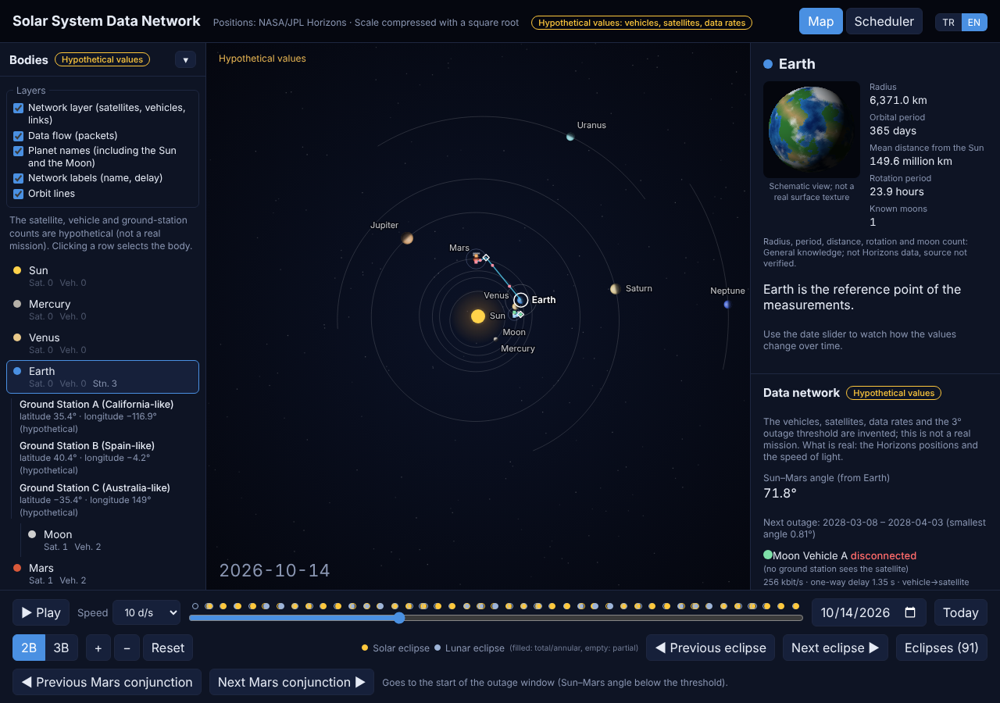

# solar-system-data-network

**English** | [Türkçe](README.md)

> This is the English version of [README.md](README.md) (Turkish, the primary file). Both files are kept in sync: every change to one is made to the other. Note: the site's user interface is bilingual (Turkish/English) except the Scheduler tab, which is still Turkish only; on-screen labels quoted here (buttons, panel names) are translated into English for readability. Command-line arguments, file names, identifiers and URL fragments (e.g. `#cizelgeleyici`, `?sentetik=1`) are kept literally.

An interactive solar-system map showing real planet positions. In later stages it adds a simulation of a communication network in which vehicles on the surface of the Moon and Mars send data to Earth through relay satellites.

> **Status: Stage 10 (value-aware queue, adaptive horizon robust to schedule error, real multi-satellite routing, orbit/power realism [lunar precession, Mars axial tilt, power model], telemetry trial, splitting the page start-up task; [details](#stage-10-value-aware-queue-schedule-error-robust-horizon-multi-satellite-routing-orbitpower-telemetry-page-start-up)); before that: Stage 9 (removing model optimism, value-weighted benefit and adaptive strategy, physical model that increases coverage [Moon orbit, second satellite, Mars shadow], generalization; [details](#stage-9-model-optimism-value-weighted-benefit-physical-model-that-increases-coverage-generalization)); before that: Stage 8 (rolling-horizon flow control, forecast error, error-model sensitivity, Web Worker pool; [details](#stage-8-rolling-horizon-flow-control-forecast-error-error-model-sensitivity)); before that: Stage 7 (coverage-aware strategy, clustered error model, Moon link scenario in the UI, narrow-screen layout); before that: Stage 6 (3D view and map UI: left "Bodies" panel, rotating globe card, label placer, layer toggles); before that Stage 5 (ground-station visibility, link errors and retransmission, Moon Vehicle A fix; before it Stage 4: Mars conjunction strategy, sensitivity analysis, validation with real data).** The vehicle/satellite/data-rate/packet/buffer/strategy values in the network are **hypothetical**; the scheduler results are **not the result of a real mission**. Only the Horizons positions, the light delays derived from them and the link geometry are real (the orbital elements, second satellite, shadow model and value weights added in Stage 9, and the queue thresholds, precession rates, Mars axis direction, power parameters and inter-satellite link added in Stage 10, are also **assumptions**). Stages 3 and 4 have now been tried in the browser with the **real Horizons data** (2020–2040) in the repository; the results and the differences from the synthetic data are in the [Stage 4](#stage-4-conjunction-strategy-sensitivity-analysis-validation-with-real-data) section.

**Live site:** once GitHub Pages is enabled, `https://mastartm.github.io/solar-system-data-network/` (Settings → Pages → Source: *GitHub Actions*).

The screenshots were taken with the **real Horizons data** (`?sentetik=1` was not used); the 2028 Mars conjunction:


Screenshots of the Scheduler tab are in the [Stage 4](#stage-4-conjunction-strategy-sensitivity-analysis-validation-with-real-data) and [Stage 7](#stage-7-coverage-aware-strategy-clustered-error-moon-link-narrow-screen) sections.

## Installation

Node.js 20 or later is required.

```bash
git clone https://github.com/mastartm/solar-system-data-network
cd solar-system-data-network
npm install
npm run dev      # on the first run it fetches the data from Horizons (internet required)
```

Other commands: `npm run build` (release build), `npm test` (unit tests), `npm run fetch-data -- --force` (re-fetch the data).

## How to use

- **Language (Turkish / English):** the **TR / EN** button at the top switches the interface language (the page reloads; the choice is remembered in the browser). On first open the browser language is used, and `?lang=tr` / `?lang=en` forces it. The **map interface** is bilingual; the **Scheduler tab is still Turkish only** (untranslated texts show in Turkish). Numbers and dates are formatted for the selected language.



- **Play/Pause** and **speed** selection: advance time.
- **Slider / date box / Today**: pick a date between 2020 and 2040.
- **Click a planet (or the Sun/Moon)**: its distance to Earth (km) and light delay (minutes) appear in the right panel.
- The wheel and the +/− buttons zoom in; the zoom stays fixed on the point under the cursor. In **2D** mode dragging pans; panning and zooming out are limited (the map cannot leave the scene) and when zoomed in the network detail (vehicle/satellite labels, links) appears (PR [#5](https://github.com/mastartm/solar-system-data-network/pull/5)).
- The **3D** button switches to a tilted view: drag to rotate (Shift+drag pans). In 3D the planets' deviation from the ecliptic plane is exaggerated 3 times (so that it is visible).
- **Left panel (Stage 6):** the "Bodies" list and "Layers"; for details see [Stage 6](#stage-6-3d-view-and-map-ui).
- **Narrow screen (≤ 700 px, Stage 7):** the bottom controls are a single row (play, date bar, date); the **⋯** button opens the speed, Today, 2D/3D, zoom, eclipse and Mars conjunction buttons. The info/network panel on the right collapses with the **"Info and network status ▸"** bar (closed at first); the left "Bodies" panel collapses as before. Details: [Stage 7](#4-narrow-screen-layout).
- **Scheduler tab (Stage 10):** a new **Stage 10 options** row in the settings: *Also run the Stage 10 policies* (value-aware queue, robust horizon; pick the decaying value from the "Science data value" selector), *projection: separate satellite buffers*, *telemetry throttling lower bound*; on the Moon *vehicle satellite selection*, *inter-satellite link*, *lunar orbit precession*; on Mars *Mars axis* and, in the shadow selector, *power model*. New **(m) Stage 10 experiments** (m1–m5, with a button): queue policy, robust horizon, multi-satellite routing, orbit/power, telemetry. Details: [Stage 10](#stage-10-value-aware-queue-schedule-error-robust-horizon-multi-satellite-routing-orbitpower-telemetry-page-start-up).
- **Scheduler tab (Stage 9):** in the settings the *Pool projection* (surface-link closure, ARQ copy RTT share), on the Moon the *Moon orbit / Second Moon satellite / polar vehicle*, on Mars the *Mars satellite shadow* selectors and the "Mars relay link (date range, no conjunction)" link; new sections (i) value-weighted benefit, (j) effect of the optimistic assumptions, (k) orbit / second satellite / shadow, (l) generalization ((j)–(l) run with a button). Details: [Stage 9](#stage-9-model-optimism-value-weighted-benefit-physical-model-that-increases-coverage-generalization).
- **Eclipses:** the dots above the slider show the eclipses (yellow: solar, blue: lunar; filled: total/annular, empty: partial/penumbral). Clicking a dot or the "Eclipses" list goes to that date; the ◀ ▶ buttons jump to the previous/next eclipse.

## Stage 2: data network (hypothetical)

- **Hypothetical values in a single file:** `src/config/hypothetical.ts` (vehicles, relay satellites, orbit altitudes, data rates, outage threshold, animation). On screen it says "Hypothetical values" in the header and the network panel, and on the map. It is not a real mission.
- **Assets:** 2 surface vehicles on the Moon, 2 on Mars; one relay satellite each for the Moon and Mars (circular, equatorial orbit).
- **Light delay:** the satellite→Earth distance is computed from the Horizons positions (body-centered vector − satellite position), the vehicle→satellite distance from the surface–orbit geometry; one-way delay = total distance / c. It is measured to the center of Earth (no ground station).
- **Mars conjunction:** when the Sun–Mars angle seen from Earth falls below the threshold (default 3°), the Mars links are cut; packets wait on the relay satellite. The "Mars conjunction" buttons at the bottom jump to the start of the outage window; the windows are found by scanning the data range.
- **Visibility conditions:** a vehicle cannot connect while the satellite is below the horizon; if the satellite is behind the body as seen from Earth ("occulted") the link is cut.
- **Animation:** vehicle → satellite → Earth packets; its speed is stylized (not to scale), the delay is given as a number in the panel. When there is no link they accumulate as white dots.
- **Simplifications:** body axes are assumed parallel to the ecliptic (no real pole directions); because the drawing distance of the Moon is exaggerated, the layout around the Moon is schematic; there is no ground station, bandwidth/battery model or solar-corona effect. At this stage I was in an environment that could not reach the Horizons data: the network model was verified with unit tests (synthetic geometry) and **not tried visually** with real data on screen.

## Stage 3: scheduler and comparison charts (hypothetical)

Open the **Scheduler** tab at the top (the map is hidden; when you go back it resumes where it left off). It opens directly with the `#cizelgeleyici` address. The tab computes on first opening (Chart.js is loaded at that moment, so it does not bloat the map bundle).

- **Model** (`src/network/scheduler.ts`, pure function, no randomness): vehicle → relay satellite → Earth. Vehicles produce part of their data rate (`dutyCycle`) in two classes: telemetry (priority 0, small packets) and science data (priority 1, large packets). Every vehicle and every satellite has a limited buffer. Link windows come from `computeNetwork`: the satellite being below the horizon, Earth visibility (being behind the body), the Mars conjunction outage. Delivery time = queue wait + light path; the light path is computed from the Horizons distances.
- **Two schedulers:** *FIFO* (arrival order; if the buffer is full the new arrival is dropped) and *priority* (the most important class goes first; if the buffer is full, room is made by discarding the newest packet of a lower class). If the satellite buffer is full the vehicle does not send and keeps its data in its own buffer (back-pressure).
- **Counters:** generated, delivered, **buffered** (waiting in a buffer for longer than one step), **delayed** (waiting in the queue longer than `delayedAfterSec`), **dropped** (buffer overflow), remaining in buffers at the end of the simulation. Always generated = delivered + dropped + remaining (verified by a test).
- **Charts:** (a) one-way light delay for the Moon and Mars, 2020–2040 (two separate charts; the scales are very different, no dual axis); (b) FIFO and priority: delivery time (95%), buffer fill (peak), loss; together with the counter table; (c) the filling and emptying of the Mars relay satellite buffer around the selected Mars conjunction. (a) is based on the real Horizons positions (Earth center – body center); (b) and (c) run on hypothetical values and the panel says so.
- **Reading warning:** the delivery time is computed only from delivered packets. The average of a scheduler that drops packets can look good (survivorship bias); read the time together with the loss and delivery counts. Also, telemetry produced during the conjunction has to wait for the end of the outage in both schedulers; the priority difference is seen mainly while the accumulated data drains and while the buffer overflows.
- **Tests:** `src/network/scheduler.test.ts` works with synthetic data (invented single-vehicle topology, invented rates, fixed-position tracks); it does not represent a real mission.
- **Not tried with real data:** there was no access to Horizons in this environment (HTTP 403). The UI was verified visually only with **synthetic circular orbits** opened with `?sentetik=1` (`src/data/synthetic.ts`, a red warning appears on the page). The real conjunction dates, delay curves and counter values were **not seen** with real data. The numbers produced with synthetic data represent nothing.
- **Decisions:** the simulation step is 300 s (around the conjunction window ~16 thousand steps, about half a second in the browser); packets are "bulk data chunks" (not real protocol packets) so that the numbers stay manageable; all numbers are in the `scheduler` section of `src/config/hypothetical.ts`.

## Stage 4: conjunction strategy, sensitivity analysis, validation with real data

> Everything is **hypothetical** (`src/config/hypothetical.ts`; the screen says "Hypothetical values"). The results are **not the result of a real mission.** What is real: the Horizons positions, the light delay, the link geometry.

### How to use

In the **Scheduler** tab (or at the `#cizelgeleyici` address):

- Pick a **conjunction window** (9 windows in 2020–2040). The rest of the screen runs this window, from 5 days before to 30 days after, for the **Mars relay link** (satellite + 2 vehicles) with three schedulers: FIFO, priority, **strategy**.
- **Sliders:** Mars satellite buffer, Mars satellite → Earth link rate, duty cycle. The initial values come from `hypothetical.ts`; their ranges are set by `HYPOTHETICAL.sensitivity`. The **Reset to default** button resets them all. About 0.5 s after you release a slider it recalculates; a computation in progress is cancelled if you move quickly one after another.
- **(d) Sensitivity scan:** each chart scans one parameter (the others at the slider value); the vertical dashed line is the slider's value. The loss and delivery-time metrics change with the drop-down.


### Strategy: "budgeted throttling"

`simulate(..., 'strategy', cfg)` = priority scheduler + **throttling of science-data production**. Telemetry (the most important class) is never throttled. The outage schedule (start and end) is **assumed to be known in advance** (the Sun–Mars geometry is predictable; I do not know how a real mission does this). From `lookaheadDays` before the outage and throughout it, for each vehicle:

```
budget = margin × (free space in the vehicle buffer + the share of the satellite buffer's free space in proportion to rate) − telemetry × remaining duration of the outage
factor = clamp(budget / (throttleable production × remaining time), minFactor, 1)
```

It is recalculated every step (feedback). Parameters: `HYPOTHETICAL.strategy` (`lookaheadDays: 1`, `margin: 0.9`, `minFactor: 0`). The first strategy I tried (throttling only according to the satellite buffer's fill threshold + a fixed factor before the conjunction) was dropped: in the 2028 window it reduced the delivered packets by ~13% compared with priority (127.7 thousand / 146.6 thousand), because it throttled without using the vehicle buffers, and throttling before the conjunction (when the buffer is empty and the link drains at full capacity) had no benefit. So I moved to budgeted throttling based on buffer free space.

### Loss or not produced? (fairness of the comparison)

- **Dropped (loss):** data that was produced but discarded because of buffer overflow.
- **Not produced:** data that was never produced because of the strategy. Because it never entered a buffer it is *not counted as dropped*; it is shown in a separate column. The FIFO and priority schedulers do not throttle production (not produced = 0).
- **Demand** = produced + not produced. The comparison is made on demand; the tables and charts show both **"dropped %"** (= dropped / demand) and **"dropped + not produced %"**, so the strategy is not counted as having escaped loss by throttling. **Delivered %** = delivered volume / demand.
- Equations (protected by tests): produced = delivered + dropped + remaining (for each class); demand = produced + not produced (the strategy's demand equals the priority scheduler's production to within ±1 packet). A "conservation check" row in the table checks this in every run.

### Validation with real data (Playwright/Chromium, no `?sentetik=1`)

`public/data/planets.json` and `moon.json` in the repository (2020-01-01 – 2039-12-31/2040-01-01) were used; **the data was not touched and Horizons was not accessed.** The built site was opened with `vite preview`.

- **Data health:** the count/length check passed for 9 bodies (new `validateTracks`; if there is a problem the map does not start and the panel says "Data corrupt or missing"). No NaN. No console errors/warnings.
- **Mars conjunction windows** (Sun–Mars < 3°, with a 0.25-day scan): 2021-09-29→10-17 (17.5 days), 2023-11-08→11-28 (19.5), 2025-12-29→2026-01-21 (22.8), 2028-03-08→04-03 (26.5), 2030-05-13→06-06 (23.3), 2032-07-01→07-20 (18.8), 2034-08-10→08-27 (16.8), 2036-09-15→10-02 (17.0), 2038-10-23→11-10 (18.8). The closest passes are 2021-10-08, 2023-11-18, **2026-01-09**, 2028-03-21, 2030-05-25, 2032-07-11, 2034-08-19, 2036-09-23, 2038-11-01; they agree with the Mars conjunction dates I know (2021-10-08, 2023-11-18, 2026-01-09); I did not compare the others with an independent source. The window duration depends on the 3° threshold and Mars's apparent speed; the difference between the shortest and longest is large (16.8–26.5 days).
- **Light delay:** Moon 1.19–1.36 s, Mars **3.2–22.2 min**: in the expected range. The Mars curve peaks at every conjunction (~21–22 min). On 2028-03-21 the panel: vehicle→satellite ~5 thousand km + satellite→Earth 357.2 million km → 19.9 min. (Moon: 1.34–1.38 s.)
- **Chart (c):** meaningful at a real conjunction: at the start of the outage (shaded area) FIFO/priority fill the buffer in ~5 days and wait at 100%, and drain in ~9 days once the outage ends; the strategy fills it linearly and slowly.
- **Counters make sense:** the conservation check is OK in all rows; the telemetry delivery time (95%) is close to the outage length (15–26 days); the buffered/delayed counts reflect this too. In all 9 windows (default settings, Mars link) FIFO drops 19–32% of the telemetry volume, while priority and strategy never drop telemetry.

**Differences between real and synthetic data** (same code, `?sentetik=1` / `src/data/synthetic.ts`): the Moon delay is a constant 1.28 s in the synthetic data (1.19–1.36 in reality); Mars 4.4–21.0 min (3.2–22.2 in reality); in the synthetic data all conjunction windows are exactly 21.3 days and regularly spaced (in reality 16.8–26.5 days, 25.6–26.4 months between consecutive closest passes). So numbers obtained with synthetic data do not replace the real data (the synthetic trials of Stage 3 were therefore only a UI check).

### Results (default settings, Mars link, percent = % of demand; **hypothetical**, not a real mission result)

Per conjunction window, scan step 1800 s: dropped % / dropped + not produced % / delivered %.

| Window (days) | FIFO | Priority | Strategy |
|---|---|---|---|
| 2021-09-29 (17.5) | 20.4 / 20.4 / 79.4 | 20.4 / 20.4 / 79.3 | 1.2 / 21.8 / 78.0 |
| 2023-11-08 (19.5) | 23.4 / 23.4 / 76.3 | 23.4 / 23.4 / 76.3 | 1.1 / 24.7 / 75.0 |
| 2025-12-29 (22.8) | 27.7 / 27.7 / 72.2 | 27.7 / 27.7 / 72.1 | 1.3 / 28.9 / 71.0 |
| 2028-03-08 (26.5) | 32.3 / 32.3 / 67.6 | 32.3 / 32.3 / 67.5 | 1.3 / 33.3 / 66.5 |
| 2030-05-13 (23.3) | 27.9 / 27.9 / 72.0 | 27.9 / 27.9 / 71.9 | 1.1 / 29.1 / 70.7 |
| 2032-07-01 (18.8) | 22.2 / 22.2 / 77.6 | 22.2 / 22.2 / 77.6 | 1.2 / 23.5 / 76.3 |
| 2034-08-10 (16.8) | 19.1 / 19.1 / 80.6 | 19.1 / 19.1 / 80.6 | 1.1 / 20.6 / 79.1 |
| 2036-09-15 (17.0) | 19.6 / 19.6 / 80.0 | 19.6 / 19.6 / 80.0 | 1.1 / 21.1 / 78.5 |
| 2038-10-23 (18.8) | 21.7 / 21.7 / 78.0 | 21.8 / 21.8 / 77.9 | 1.0 / 23.2 / 76.5 |

**Reading (in the hypothetical model):**

- In terms of total volume the three schedulers deliver **almost the same** volume (they are work-conserving; as long as the link is full it delivers whatever the link carries). The strategy does **not increase** the delivered volume, it reduces it by 1–1.5 percentage points (it deliberately leaves 10% of the buffer empty and computes the budget slightly conservatively).
- The differences are in *what* is lost: FIFO also drops telemetry (32% of the telemetry in the 2028 window), priority and strategy protect telemetry. The strategy turns dropped data (32% → 1.3%) into data that is never produced (32%): the same loss, but without being produced, carried and discarded (the strategy thins out science data throughout the outage; whether that is scientifically more valuable is not measured in this model, I do not know).
- Sensitivity (2028 window): as the buffer grows the loss decreases nearly linearly (8 Gbit ≈ 42% → 160 Gbit ≈ 19%); below a link rate of ~180 kbit/s the loss rises sharply, above it flattens out (the loss comes from the outage duration, not the buffer); as the duty cycle rises the loss rises and at a high cycle (≳10%) telemetry alone exceeds the buffer, so the strategy starts to drop too (telemetry is not throttled).
- The telemetry 95% delivery time is almost **independent** of the buffer/link rate/production (~the outage length): telemetry produced during the outage cannot go to Earth before the outage ends. Priority does not shorten this, it only protects telemetry from being dropped.

### Unexpected things and points to watch (real data / findings of the new stage)

1. **The "Next/Previous Mars conjunction" buttons got stuck in the same window** (a Stage 2 bug): the button jumped to 3 days before the window start, and on the second press found the same window again. Fixed in `src/main.ts` (compared against the target date); verified in the browser that all 9 windows can be visited in order.
2. **(Fixed in Stage 5: latitude −40°.) Moon Vehicle A (latitude −85°) could never see the equatorial-orbit Moon satellite** (geometry: the satellite never rises above the horizon; 0% visibility from the surface). Its data is never delivered, its buffer fills and telemetry/science is dropped. This is a consequence of the **hypothetical placement**, unrelated to the real data (the same in synthetic); the "whole network" total of Stage 3 was affected by it. I did not touch the configuration (a hypothetical value, not mine); instead the **Stage 4 section simulates only the Mars link**. If wanted, Moon Vehicle A's latitude/satellite inclination can be changed in `hypothetical.ts`.
3. **The Mars-side totals now differ from Stage 3:** Stage 3 simulated the whole network (including the Moon); the numbers (e.g. dropped packets) therefore cannot be compared with the old outputs.
4. **The "arrived" counter in the map's packet animation stays at 0 at high speeds** (1 day/s and above): the Mars satellite's period is ~6 hours, while the animation packet takes ~4 s in real time; since the link opens and closes during that time the packet is not completed. The counter is only animation style; the real calculation is in the Scheduler tab. Not fixed (not the job of this stage).
5. **The Moon delay chart (a) looks like a filled band:** with daily sampling the 27.3-day oscillation gets compressed over 20 years; the range is correct (1.19–1.36 s), it is only visual.
6. **The strategy knows the start/end of the outage in advance** and counts this as free in the model (an assumption). In reality there are forecast error, the cost of throttling (science loss) and operational decisions.
7. **Computation time:** the scenario takes ~0.5 s on first opening, the scans ~8 s (not a single chunk; each scheduler in its own `setTimeout` chunk, the longest task ~150 ms, ~280 ms on the first draw; the page does not freeze). When a slider changes only the scans of the other two parameters are recalculated (~5 s). Note: the timeline over 17 thousand steps takes ~0.1 s; the real cost is the number of packets, not the number of steps.
8. **Scan step 1800 s, main scenario 300 s:** small numerical differences (<0.5%) are normal.

### Tests

`npm test` (35 tests, **all synthetic**: invented single-vehicle topology, invented rates, fixed-position tracks; not from a real mission). New: strategy (identical to priority when there is no outage flag; throttles production during an outage, dropped decreases; telemetry is neither throttled nor dropped; conservation equations; determinism), scan helpers (`sweepValues`, `sweepPoint`, monotonicity of loss as the buffer grows), `withParams`/`restrictToRelay` (not mutating the input).

### Decisions

- The strategy and the scans are pure functions (`scheduler.ts`, `sweep.ts`; no DOM and no randomness). The UI splits the long computation into a separate `setTimeout` chunk for each scheduler and uses a cancellation token.
- No new external dependency, Web Worker or GitHub Actions workflow was added.
- The sliders change only the Mars side (the Moon link is fixed); all the new hypothetical values are in `hypothetical.ts` (`strategy`, `sensitivity`).
- If the data is corrupt/missing: `validateTracks` during loading, `try/catch` + "Computation stopped" message in the panel; the page does not crash.

## Stage 5: ground station, link errors and retransmission, Moon Vehicle A

> Everything is **hypothetical** (`src/config/hypothetical.ts`); the results are **not the result of a real mission.** What is real: the Horizons positions, light delays, geometry. The unit tests are **synthetic**; the numbers below were obtained with real data (the Horizons files in the repository, no `?sentetik=1`) in the browser and with a script.

### Moon Vehicle A fix
Stage 4 finding: the vehicle at latitude −85° could never see the equatorial-orbit Moon satellite (surface visibility 0%). In `hypothetical.ts` the latitude was changed to **−40°** (only this number; the satellite and the other vehicles are the same). Visibility is now 34% (Moon Lander B 38%, Mars vehicles 35–36%). Protected by a test (synthetic). Note: a real Moon mission covers the poles with inclined/elliptical orbits; here the orbit is equatorial, so the placement was fitted to the orbit, and the polar region was **not modeled**.

### Ground-station visibility
- **Model** (`src/network/stations.ts`, pure function): spherical Earth, rotation by GMST, transformation to the ecliptic frame; elevation = look angle from the station to the satellite (Earth-centered position − station position). The threshold is **10°** (`minElevationDeg`). The satellite's Earth link is now: not behind the body **and** (Mars) not in conjunction **and** at least one station sees the satellite above the threshold. New link state `nostation`. The handover is instantaneous, a single link is assumed (two stations do not download at the same time).
- **Stations (hypothetical):** 3 of them, whose positions were *chosen to resemble* deep-space stations (similar to California, Spain, Australia); it is not real facility data. The number is chosen from the UI, 0–3 (0 = ideal, the Stage 2–4 behavior).
- The **network panel** (map tab) shows, for each vehicle, the station that sees the satellite and its elevation.
- **Coverage with real data** (2028 window ± margin, 30 min step; the table in the Scheduler tab):

| Stations | Moon: sees the satellite | Moon: Earth link open | Mars: sees the satellite | Mars: Earth link open |
|---|---|---|---|---|
| None (ideal) | — | 88.1% | — | 48.3% |
| 1 | 42.9% | 37.7% | 44.3% | 21.4% |
| 2 | 73.3% | 64.7% | 75.6% | 36.8% |
| 3 | 98.6% | 87.0% | 100.0% | 48.3% |

  Three stations cover almost fully; this is why the **default (3) does not change the Stage 4 results**. With 1–2 stations the link-open time and delivery drop sharply.

### Link errors and retransmission (ARQ)
- **Model** (`scheduler.ts`, pure function): **no randomness**; the loss rate is applied with a deterministic accumulator (on each link, for each transmission attempt the rate accumulates; when it passes 1 that attempt is lost → periodic loss at certain intervals, "average p%" behavior). Surface-link loss 1%, Earth-link 5% (`HYPOTHETICAL.arq`).
- **Surface link** (vehicle → satellite): the RTT is assumed to be much shorter than a step; a lost attempt consumes bandwidth, the packet stays in the buffer and is retried.
- **Earth link** (satellite → Earth): the sender keeps the packet in its buffer for the **RTT (= 2 × light delay)** (~40 min at Mars, ~3 s at the Moon). If successful it releases the copy with an ACK; if lost, after a NAK it puts it at the head of the same class and resends. Copies count toward buffer fill (the priority scheduler cannot discard them).
- **Attempts** are at most `maxAttempts` (4); a packet exceeding that is counted as **"lost on the link"** (`abandoned`). `maxAttempts = 1` is the no-retransmission mode.
- **Link modes** (chosen in the UI): *Lossless link* (Stage 3–4) · *Lossy link, no retransmission* · *Lossy link + retransmission* (**default**).
- **New counters / equations (protected by tests):** lost on the link, lost attempts, retransmitted. **Produced = delivered + dropped + lost on the link + remaining in buffers; demand = produced + not produced.** "Dropped" is only buffer overflow; "lost on the link" is a separate column and enters the loss metrics together (dropped + lost on the link [+ not produced]). An Earth link loss slider and a scan chart (4th parameter) were added; "lost on the link" and "retransmitted" were added to the loss/time metric list.


### Results with real data (2028-03-08 window, Mars link, 300 s step, **hypothetical**)

| Configuration | FIFO delivered % | Priority delivered % | Strategy delivered % | Strategy dropped % |
|---|---|---|---|---|
| 3 stations, lossless link (= Stage 4) | 67.6 | 67.6 | 66.5 | 1.3 |
| 3 stations, lossy link, no retransmission | 63.7 | 63.7 | 62.8 | 1.2 |
| 3 stations, lossy link + retransmission (default) | 67.6 | 67.6 | 66.5 | 1.3 |
| 1 station, lossy link + retransmission | 41.0 | 41.1 | 41.1 | 13.4 |

Lost on the link (no-retransmission mode, priority): 4.0% of demand at Mars, 6.0% at the Moon (surface 1% + Earth 5% lost attempts; at Mars part of it is data that was going to overflow anyway). With retransmission ≈ 0% (all losses recovered; e.g. priority: 8.7 thousand retransmitted packets, 0 permanent loss).

**Moon link** (same window, 300 s, priority scheduler; no conjunction at the Moon, strategy = priority; obtained with a script, there is no Moon scenario in the UI):

| Stations | Link mode | Delivered % | Dropped % | Lost on the link % | Telemetry mean time |
|---|---|---|---|---|---|
| 3 | lossless | 99.8 | 0.0 | 0.0 | 1.9 h |
| 3 | lossy, no retransmission | 93.8 | 0.0 | 6.0 | 1.9 h |
| 3 | lossy + retransmission | 99.8 | 0.0 | 0.0 | 1.9 h |
| 1 | lossless | 78.1 | 19.4 | 0.0 | 6.4 h |
| 1 | lossy + retransmission | 73.8 | 23.6 | 0.0 | 6.4 h |

**Reading (in the hypothetical model):**
- **The number of ground stations is the most influential parameter in this model:** with 1 station the link-open time at both the Moon and Mars falls below the download need; the buffer does not drain even after the conjunction (Mars delivery 67.6% → 41%; Moon 99.8% → 78%).
- **Retransmission recovers the loss almost completely** (4–6% lost on the link → ≈ 0%), and the time cost is small because even at Mars the RTT (~40 min) is negligible next to the conjunction outage (~26 days); in this scenario the time depends on the outage, not on the retransmission.
- **The cost is in the buffer:** because the sender holds the copy for the RTT, when the buffer is tight (1-station Moon) retransmission **increases dropped** (19.4% → 23.6%): loss recovery turns into overflow loss.
- With 3 stations the effect of ARQ at Mars is negligible compared with the lossless mode (delivery difference < 0.1%).

### Unexpected things and points to watch
1. **The strategy does not know the ground-station coverage:** it computes the budget only from the empty buffer and does not account for the post-conjunction drain capacity (link-open ratio). With 1 station (link 21% open) it overflows again after the conjunction (strategy dropped 1.3% → 13.4%). Not fixed; a candidate for a later stage. **→ Addressed in Stage 7** (coverage-aware strategy; dropped 13.4% → 2.8%, but total loss/delivery did not improve).
2. **The deterministic loss is periodic:** every 20th attempt is lost (5%). Real errors are random and clustered (consecutive losses); therefore here `maxAttempts` overruns are seen much less than is realistic, and the loss-recovery success of retransmission is optimistic. **→ A clustered model was added in Stage 7; the prediction was confirmed** (with the same average loss, lost on the link 0–2 → 122–267 packets).
3. **The RTT on the surface link was ignored** (5–9 thousand km ≈ 20–30 ms ≪ 300 s step); on the satellite → Earth link there is the full RTT. ACK/NAK is lossless and instantaneous on its own link (an assumption).
4. **The coverage table has a 30 min step;** short (<30 min) visibility gaps can be missed.
5. **Earth is spherical,** with GMST under the UT1≈TDB assumption (~1 min ≈ 0.3° difference); sufficient for station visibility, with 0.3° uncertainty at the elevation threshold. There are no atmosphere, refraction, antenna constraints, weather, maintenance or scheduling conflicts; the three stations are assumed continuously available.
6. **Sweep time increased** (4 parameters; scan 5 points + default): ~10 s on first opening (in chunks, the page does not freeze).
7. The Stage 4 numbers (lossless link, ideal Earth) are **still valid**: they are reproduced in the UI by selecting "None (ideal)" + "Lossless link" or with 3 stations (almost full coverage).

## Stage 6: 3D view and map UI

> The network values are **hypothetical** (`src/config/hypothetical.ts`; the screen says "Hypothetical values"), the results are not the result of a real mission. The physical information on the planet card is **general knowledge, not Horizons data, and its source is not verified** (written from memory). The Earth-distance and light-delay rows are real Horizons data (labeled "Horizons" on screen). The screenshots were taken with the **real data** in the repository (`vite preview`, no `?sentetik=1`). The Scheduler tab and the simulation logic were not touched; the pan/zoom behavior in PR [#5](https://github.com/mastartm/solar-system-data-network/pull/5) and the Sun-relative reference in 3D did not change.


### 1. Left panel "Bodies"
- The Sun, planets and the Moon (indented under Earth). A row has a color dot, a name and the **Satellite / Vehicle / Station** counts (relay satellite, surface vehicle, ground station for Earth); the counts are derived from `hypothetical.ts` (`countsFor`), the panel says "Hypothetical values".
- Clicking a row selects the body (the same selection as clicking on the map: the map and the info panel update together) and the row expands: satellites (name, altitude, Earth link state, visible ground station and its elevation), vehicles (name, latitude/longitude, data rate, live link state), the stations on Earth. Clicking the selected row again opens/closes it.
- The status texts are updated without rebuilding the DOM (only `textContent`, every 250 ms), so clicks are not disturbed. The panel is collapsible (▾/▸ in the header); on a narrow screen (≤ 700 px) it is collapsed at first.

### 2. 3D planet card
- A rotating, lit sphere (a small canvas, our own code, no Three.js) for the body selected in the info panel. Beneath it "Schematic view; not a real surface texture".
- **The textures are procedural and deterministic** (`src/map/planetTextures.ts`): value noise with a fixed hash function + fractal/Worley noise, no `Math.random`. Earth (ocean, continent, polar ice, cloud), Mars, Moon, Mercury (cratered), Venus, Jupiter (bands + the Great Red Spot), Saturn (ring, Cassini division, sphere shadow), Uranus (tilted-sideways axis), Neptune, the Sun. Determinism is verified with unit tests.
- **Efficiency:** since the camera, light and axis are fixed, the per-pixel geometry is prepared once when a body is selected (`src/map/sphereRender.ts`); each frame only a longitude shift and texture read are done. The card runs at most ~30 frames/s, in its own `requestAnimationFrame`; it stops outside the map tab and while the page is hidden; with `prefers-reduced-motion` it draws a still frame.
- The **info panel skeleton** is built once when the selection changes; the 250 ms update only changes the numbers (the card canvas stays the same in the DOM, no flicker; verified in the browser).
- **Information next to the card:** radius, orbital period, mean distance from the Sun, rotation period, number of known moons (with "≥" for the giant planets). The screen says "General knowledge; not Horizons data, source not verified". The values are in `src/data/bodyFacts.ts`.
- **The spheres on the map:** the face toward the Sun is lit, the opposite face is clearly in shadow (a sharp terminator; instead of the previous soft gradient).


### 3. Label placer
`src/map/labels.ts` (pure, no DOM/Canvas). `MapView` and `NetworkLayer` do not draw the labels directly, they give them to `LabelSink` as **requests**; at the end of `MapView.render` `placeLabels` runs and draws (the only exception: the fixed "Hypothetical values" text at the top left, which is not tied to an object).
- **Priority:** selected (0) > Sun/planets (1) > Moon (2) > relay satellite (3) > vehicle (4) > delay (5); ties by request order (deterministic).
- **Candidate search:** first 8 directions at the nearest distance, then the next distance (4 distances: 3, 12, 28, 52 px, from the object's edge). The **preferred direction** is from the body center toward the object (outward); for planets the center is the Sun, for the Moon Earth, for satellites/vehicles the relevant body.
- The first candidate that does not overlap, is within bounds, and does not sit on object markers (body disks, vehicle/satellite markers) is chosen. At the 3rd and 4th distance (going far) a **leader line** is drawn. If there is no room the label is **skipped**; only the mandatory one (the selected body) is placed even if overlapping.
- Tests (`labels.test.ts`, synthetic): no overlap, priority, bounds, determinism, preferred direction, obstacle, leader line, mandatory label.
- On real data: zooming in around Earth–Moon and Mars, the labels (Moon, Moon Relay Satellite, Moon Vehicle A/B, delay, Venus etc.) **do not overlap** (the overlap count was measured as 0 on every frame in the browser).


### 4. Layers
5 switches in the left panel: **Network layer** (satellites, vehicles, links, conjunction warning), **Data flow** (packets), **Planet names** (including the Sun and the Moon; the selected body's name is always visible), **Network labels** (name, delay), **Orbit lines** (planet trails, Moon orbit, 3D reference rings). When off, the relevant thing is not drawn. The preferences are stored in `localStorage` (`ssdn.layers.v1`); if missing/blocked/corrupt it works with the default (all on) (try/catch, tested). Because data flow and network labels depend on the network layer, they look faded and disabled while the network is off (their preferences are kept).


### Validation with real data (Playwright/Chromium, `vite preview`, no `?sentetik=1`)
The left panel, the card (10 bodies), the labels (zooming in around Earth–Moon and the Mars region), the on/off of each layer (and the `localStorage` contents), 2D/3D (including dragging), date change (Mars conjunction button), going to the Scheduler tab and coming back, and the narrow screen were tried. **No console errors/warnings.**
- Main loop: 60 frames/s (the card live, 2D/3D, also when playing at 100 days/s); `MapView.render` average ~1.1 ms, p95 ~1.6 ms. Card frame (`putImageData`) ~0.05 ms; texture generation on first selection 30–100 ms.
- 3D: the camera/projection code was not touched (the Sun-relative reference is the same).

### Unexpected things and points to watch
1. **Label height bug (found, fixed):** when parsing the size from a font string like `600 12px`, the weight (600) was taken as the size; the selected body's label was measured 750 px tall, placed as "mandatory" and pushed off screen. Fixed with a regular expression.
2. **The texture is not a real surface:** the continents on Earth follow noise, not the real map; the position of Jupiter's Great Red Spot and Neptune's dark spot is fixed, unrelated to the real longitude. The rotation speed is stylized (scaled with the square root of the real rotation period; 20–80 s/turn). Retrograde rotators (Venus 177°, Uranus 98°) are reduced to an equivalent tilt and drawn with the rotation direction reversed; north/south can look reversed in the drawing.
3. **The moon counts (≥ 95 / 274 / 28 / 16) were written from memory** and increase over time; the source was not verified. The other values likewise (stated on screen). For the Moon the "distance from the Sun" is the same as Earth's (stated on screen).
4. **The shadow on the map** uses the Sun direction in the screen plane (the depth component is ignored in 3D); it is schematic.
5. **The narrow-screen** layout is cramped as in the earlier stages: the left panel collapses but because the bottom controls are tall the map stays small. Not improved. **→ Fixed in Stage 7** (the real cause was canvas `min-height:auto`; details Stage 7, section 4).
6. **The orbit-lines switch** also turns off the 3D reference rings (a separate switch was not made; a decision).
7. **The label placer's leader lines** are rarely visible in practice (near candidates are usually enough); verified by forcing in a test.
8. In the left panel the row scrolls into view when the selection changes; so the "Layers" box can move up.

### Decisions
- No new dependency, Web Worker or GitHub Actions workflow was added; no Three.js.
- No new hypothetical value was added (the counts are derived from the existing `hypothetical.ts`); the physical information is in `bodyFacts.ts`, not hypothetical but not verified.
- The unit tests are synthetic (stated in the test). `npm test`: 75 tests.

## Stage 7: coverage-aware strategy, clustered error, Moon link, narrow screen

> Everything is **hypothetical** (`src/config/hypothetical.ts`; the screen says "Hypothetical values"); the results are **not the result of a real mission.** What is real: the Horizons positions, light delays, geometry. The unit tests are **synthetic** (stated in the tests). The numbers below were obtained with the **real Horizons files** in the repository (`public/data/`, not touched; Horizons was not accessed; `?sentetik=1` was not used) in the browser and with the `scripts/asama7-sonuclar.ts` script (`npx vite-node scripts/asama7-sonuclar.ts [kapsama|tum-pencereler|ufuk|havuz|hata|hat-ayrimi|ay]`); the two give the same numbers. Pan/zoom (PR [#5](https://github.com/mastartm/solar-system-data-network/pull/5)), the Sun-relative reference in 3D, the Stage 6 left panel, globe card, label placer and layers, and the Stage 3–5 schedulers (FIFO, priority, strategy) and their numbers **did not change** (the 1 station/strategy numbers in the Stage 5 table — dropped 13.4%, delivered 41.1% — were reproduced exactly).

### How to use (Scheduler tab)
- **Link:** *Mars relay link (conjunction window)* or the new **Moon relay link (date range, no conjunction)**. For the Moon a start date (within the data range) and a duration (7/14/30/60 days) are chosen; the default is 2028-03-03, 60 days. The sliders change the selected link's satellite buffer and Earth link rate (separate ranges for the Moon, `HYPOTHETICAL.sensitivity.moon*`).
- **Link mode:** the fourth option **Clustered error + retransmission** (same average loss, two-state distribution).
- The comparison tables and charts now show **four** schedulers (two at the Moon: no conjunction, the strategies do not throttle): FIFO, priority, strategy (Stage 4, unchanged) and the **coverage-aware strategy** (purple).
- New sections: **(d) Comparison by number of ground stations** (1, 2, 3 stations; dropped and dropped+not-produced columns + a table) and **(e) Error model: periodic and clustered**. The sensitivity scan became **(f)** (formerly (d)).


### 1. Coverage-aware strategy (`'coverage'` policy)

**Assumption (first of all):** the link schedule is **known in advance**: the orbit, Earth's rotation, ground-station visibility and conjunction are predictable; the link's average loss is also known. I do not know how accurately a real mission knows this; forecast error was not modeled. The old strategy also knew the outage schedule; what is new is that the **coverage** (the stations that see the satellite, the link-open time) is known in advance.

**How it works** (`scheduler.ts`): from `lookaheadDays` (1) before the outage, throughout it and for `recoveryDays` (30) after it ends, for each vehicle the buffer "pool" (vehicle buffer + the share of the satellite buffer in proportion to rate) is **tracked forward**: while the Earth link is open it drains at the rate link rate × share × (1 − average loss), while it is closed (conjunction, no station sees it, behind the body) it does not drain; the largest science-data production factor such that the peak fill does not exceed the `margin` (0.9) fraction of the pool is found by binary search. Telemetry is not throttled; the throttled data is "not produced" (not loss). The old strategy (`'strategy'`) stays as it is; only the drain term and the recovery horizon are new. The factor is refreshed every 1800 s (only for computation cost; the results are the same output as refreshing every step).

Parameters `HYPOTHETICAL.coverageStrategy`: `lookaheadDays`, `recoveryDays`, `margin`, `minFactor`, `assetBufferShare` (the fraction of the vehicle buffer that joins the pool; 1 = the same pool as Stage 4, so the comparison measures only the drain-capacity term).

**Results** (2028-03-08 window, Mars link, lossy link + retransmission [periodic], 300 s step; cell: dropped % / dropped + not produced % / delivered %; **hypothetical**):

| Stations | Link open % | FIFO | Priority | Strategy (Stage 4) | Coverage-aware strategy |
|---|---|---|---|---|---|
| 1 | 21.6 | 47.0 / 47.0 / 41.0 | 47.1 / 47.1 / 41.1 | 13.4 / 47.1 / 41.1 | **2.8** / 48.9 / 41.1 |
| 2 | 36.9 | 32.4 / 32.4 / 67.2 | 32.6 / 32.6 / 67.0 | 1.6 / 33.7 / 65.9 | **0.8** / 34.6 / 65.0 |
| 3 | 48.2 | 32.2 / 32.2 / 67.6 | 32.2 / 32.2 / 67.6 | 1.3 / 33.3 / 66.5 | **0.7** / 34.3 / 65.5 |

Not produced %: strategy 33.7 / 32.0 / 32.0, coverage-aware 46.1 / 33.7 / 33.6 (1 / 2 / 3 stations).

The same comparison over the 9 conjunction windows, **1 station**, dropped % (priority → strategy → coverage-aware) and the coverage-aware strategy's dropped + not produced % (priority/strategy: the same value):

| Window | Priority dropped | Strategy dropped | Coverage-aware dropped | Coverage-aware dropped+not produced (others) | Delivered % |
|---|---|---|---|---|---|
| 2021-09-29 | 44.7 | 22.3 | 2.5 | 46.8 (44.7) | 41.8 |
| 2023-11-08 | 52.8 | 26.8 | 2.9 | 54.8 (52.8) | 34.2 |
| 2025-12-29 | 54.3 | 24.5 | 3.2 | 56.1 (54.3) | 33.7 |
| 2028-03-08 | 47.1 | 13.4 | 2.8 | 48.9 (47.1) | 41.1 |
| 2030-05-13 | 38.3 | 9.6 | 2.2 | 39.6 (38.3) | 50.3 |
| 2032-07-01 | 33.4 | 10.4 | 2.0 | 35.2 (33.4) | 53.3 |
| 2034-08-10 | 35.7 | 15.0 | 2.3 | 37.7 (35.7) | 50.3 |
| 2036-09-15 | 40.9 | 19.9 | 2.3 | 42.9 (40.9) | 45.3 |
| 2038-10-23 | 49.9 | 25.8 | 2.8 | 52.0 (49.9) | 36.7 |

**Sensitivity** (2028, dropped % / dropped + not produced % / delivered %):

| Parameter | 1 station | 3 stations |
|---|---|---|
| Recovery horizon 0 / 3 / 7 / 14 / 21 / **30** days | 11.9 / 47.1 · 10.6 / 47.4 · 9.1 / 47.6 · 6.5 / 47.6 · 4.6 / 47.9 · **2.8 / 48.9** (delivered 41.1 in all) | 0.7 / 34.2–34.3 in all (delivered 65.5) |
| Vehicle buffer share 0 / 0.5 / **1** | 0.0 / 50.3 · 0.3 / 49.6 · **2.8 / 48.9** (delivered 41.1) | 0.0 / 36.5 / 63.3 · 0.2 / 35.5 / 64.3 · **0.7 / 34.3 / 65.5** |

**Reading (in the hypothetical model):**
- Knowing the coverage **reduces dropped by 3–5 times** (13.4 → 2.8 with 1 station; ≈ halved with 2–3 stations) and turns almost all of the dropped into "not produced". **But it does not improve the total loss or the delivered volume:** with 1 station delivery is the same (41.1; link capacity is the limit), with 2–3 stations the total loss *increases* by ≈ 1 point (34.3 vs 33.3) and delivery *decreases* by ≈ 1 point (65.5 vs 66.5), because it prevents overflow more tightly and throttles more. The Stage 4 conclusion holds here too: the strategy changes which data is lost and at which stage, it does not increase the volume.
- Why the old strategy was not enough with **1 station:** after the conjunction the link is open 21.6% of the time; the average drain (~52 kbit/s) is below production (125 kbit/s), i.e. the buffer stays full after the conjunction too. Because the coverage-aware strategy sees this, it keeps throttling *after* the conjunction too (as the recovery horizon grows dropped decreases: 11.9 → 2.8); the horizon was not kept longer than 30 days (the end of the scenario).
- The **remaining dropped** (0.7–2.8%) comes from telemetry packets entering by **discarding** the lower class when the satellite buffer saturates (the priority rule; it was so in Stage 4 too). `assetBufferShare = 0` (only the satellite buffer is budgeted) reduces dropped to 0 but throttles ≈ 2 points more; the default 1 was chosen because it gives a fair comparison with the same pool as Stage 4. Which to prefer is a cost decision (I do not know).

### 2. Clustered error model (Gilbert–Elliott-like, deterministic)
- **Model:** for each link (each vehicle→satellite surface link, each satellite→Earth link) a two-state (good/bad) chain is generated step by step (`genLinkStates`). **No randomness:** the state transitions and loss draws come from the fixed-seed `mulberry32` generator that I wrote myself (`HYPOTHETICAL.arq.burst.seed`); the same input gives the same result (tested). The long-run fraction of the bad state is chosen such that the link's **average loss** (surface 1%, Earth slider 5%) is the mixture of the good/bad state losses; that is, **the average loss is the same as the periodic model, only its distribution differs**. The chain depends on **time** (not on the attempt): the retry of a lost packet, if the RTT is short, most likely stays in the same bad state — in the periodic model this never happened.
- **Parameters** (`HYPOTHETICAL.arq.burst`, invented): good-state loss 0.5%, bad-state loss 80%, mean duration of the bad state 30 min, seed 20281031. The initial state is good.
- It is chosen as a **link mode** ("Clustered error + retransmission"); `maxAttempts` 4 is the same. Section (e) gives the *no retransmission*, *periodic* and *clustered* modes side by side for the selected scenario and number of stations (priority scheduler).

**Results** (3 and 1 stations, priority, 300 s step; **hypothetical**). "Packets lost on the link" = those that could not be transmitted within `maxAttempts` (4) attempts:

| Scenario | St. | Mode | Transmission attempts | Lost attempts % (two links) | Longest consecutive loss | Retransmitted | **Packets lost on the link** | Delivered % |
|---|---|---|---|---|---|---|---|---|
| Mars 2028 | 3 | periodic | 288,296 | 3.03 | 1 | 8,732 | **0** | 67.6 |
| Mars 2028 | 3 | clustered | 289,372 | 3.56 | 30 | 10,042 | **267** (0.06%) | 67.5 |
| Mars 2028 | 1 | periodic | 275,591 | 2.99 | 1 | 8,245 | **2** | 41.1 |
| Mars 2028 | 1 | clustered | 274,130 | 2.67 | 30 | 7,060 | **266** (0.06%) | 41.0 |
| Moon 2028-03-03, 60 d | 3 | periodic | 45,749 | 3.04 | 1 | 1,390 | **0** | 99.9 |
| Moon 2028-03-03, 60 d | 3 | clustered | 46,380 | 4.73 | 28 | 2,046 | **146** (0.28%) | 99.6 |
| Moon 2028-03-03, 60 d | 1 | periodic | 43,859 | 3.02 | 1 | 1,324 | **0** | 73.2 |
| Moon 2028-03-03, 60 d | 1 | clustered | 44,133 | 3.88 | 28 | 1,592 | **122** (0.35%) | 73.3 |

**Reading:**
- **With the same average loss, `maxAttempts` overruns went from 0–2 packets → 122–267 packets:** in the periodic model, because every 20th attempt is lost, the same packet is never lost 4 times in a row (the longest consecutive loss is 1); in the clustered model 28–30 attempts are lost in a row. So the Stage 5 conclusion "retransmission recovers the loss almost completely" was **optimistic** (the prediction in Stage 5, "Unexpected" 2, was confirmed), but its size stays small (0.06–0.35%).
- **Which link the loss comes from depends on the RTT** (script section `hat-ayrimi`, 3 stations): at Mars **250 of the 267 packets are from the surface link** (RTT ≈ 0, the retry in the same step, in the same bad state) and only **17 from the Earth link** (RTT ~40 min ≳ the mean duration of the bad state 30 min, the retry mostly after the bad state); with 1 station 260 / 6. At the Moon **121 of the 146 packets are from the Earth link** (RTT ~3 s ≪ 30 min: the retry in the same bad state), 25 from the surface; with 1 station 31 / 91. In the UI the "…surface / Earth link" column in the (e) table shows this.
- The lost-attempt rate deviates from the nominal (2.7–4.7%, periodic 3.0%; the rates are the share of all attempts on the two links, the Earth link is 5% nominal): because packets lost in the bad state are retried, attempts are over-represented in the bad state, and over 60 days only ~100–170 bad-state periods are sampled (a deterministic deviation).
- The delivered volume hardly changes (Mars 67.6 → 67.5; Moon 99.9 → 99.6): under these assumptions the error model affects not the volume but *which packets are permanently lost*.


### 3. Moon link scenario (UI)
- In the Scheduler tab **Link → Moon relay link**. There is no conjunction at the Moon; the scenario is the Moon relay satellite + 2 vehicles over the selected **date range** (start + 7/14/30/60 days). The ground-station coverage table, the station comparison, the error model and the sensitivity scan also work for the Moon; in the buffer chart the shaded areas are the times when the Earth link is closed (no station sees it or it is behind the Moon). The strategies do not throttle at the Moon (identical to priority, tested) and are not shown.
- **With real data** (2028-03-03, 60 days, lossy link + retransmission, 300 s; **hypothetical**). Consistent with the Stage 5 README table (a small difference because the window went from 61 → 60 days):

| Stations | Sees the satellite % | Earth link open % | FIFO dropped / delivered % | Priority dropped / delivered % | Telemetry 95% time (FIFO / priority) |
|---|---|---|---|---|---|
| 1 | 42.6 | 37.4 | 24.2 / 72.8 | 23.9 / 73.2 | 4.9 days / 0.7 days |
| 2 | 73.2 | 64.6 | 0.0 / 99.9 | 0.0 / 99.9 | 0.5 / 0.4 days |
| 3 | 98.5 | 87.0 | 0.0 / 99.9 | 0.0 / 99.9 | 0.2 / 0.2 days |

- **Reading:** on the Moon link the decisive factor is **ground-station coverage**: with 1 station the link is 37% open, the buffer (2 Gbit) fills and overflows at every gap (dropped ≈ 24%), with 2 stations the loss disappears. The priority scheduler here, compared with FIFO, only reduces the telemetry time (4.9 → 0.7 days) and protects telemetry from being dropped. The ARQ effect is small but seen in section (e): on a clustered link, lost on the link 0.28–0.35%.
- **It is sensitive to the date range:** the same link 2030-06-01, 30 days, 1 station: delivered 74.6%, dropped 20.3% (73.2 / 23.9 in 2028). Do not generalize from a single range.


### 4. Narrow-screen layout
- **The real cause was different from what I wrote in Stage 6** ("bottom controls are tall"): at ≤ 700 px the `height` attribute of the `#map` canvas (set equal to its own size) **prevented the map from shrinking** because of flex `min-height:auto`. At 420×860, while `main` is 324 px the canvas stays 667 px, overflows behind the bottom bar (the Sun and inner planets were not visible) and the info/network panel (`#side`) was pushed off screen: **the info panel and the globe card were not reachable at all on a narrow screen.** Fixed with `#map { min-height:0 }`.
- **Layout (≤ 700 px):** the bottom controls are a **single row** (▶ Play · date bar · date · **⋯**); **⋯** opens/closes the speed, Today, 2D/3D, zoom, eclipse and Mars conjunction buttons (closed at first). The header got smaller (the Positions note is hidden on a narrow screen; the "Hypothetical values" badge stays). The info/network panel collapses with the **"Info and network status ▸"** bar (closed at first). The left "Bodies" panel is collapsed at first as before and opens with ▸/▾. The date label is hidden while the info panel is open (it overlaps). At 701 px and above the desktop layout **did not change**.
- **Measurements (420×860, real data):** visible map height ≈ 280 px → **681 px**; bottom bar 415 → **43 px**; header 121 → 60 px. With ⋯ open the map is 509 px, with info open 350 px. At 360×740 the map is 539 px; the 700/701 boundary was tried.
- On a narrow screen the Scheduler tab's header fits; the page does not overflow horizontally (`scrollWidth` = 420), wide tables scroll within themselves.


### Validation with real data (Playwright/Chromium, `vite preview`, no `?sentetik=1`)
Tried: the coverage-aware strategy (1/2/3 stations, the 2028 window), clustered error mode (Mars and the Moon), the Moon link scenario (including changing the start date/duration), the narrow screen (420, 360, 700/701), the Stage 6 features in the map tab (10 body rows, the card, 5 layer switches and `localStorage`, zoom, 2D/3D dragging, the Mars conjunction buttons go to consecutive windows, going to the Scheduler tab and coming back, 60 frames/s). **No console errors/warnings** (in all flows).
- **Computation time** (in the browser, in chunks: each scheduler/station/mode/scan point is a separate `setTimeout` chunk, the page responds to input meanwhile; measured with `PerformanceObserver` `longtask`):
  - **Mars, first open** (3 stations, lossy link + retransmission): total ≈ **14–15 s** (scenario 0.5–0.8 s [4 schedulers], coverage table 0.06 s, **station comparison 1.7–2.2 s**, **error model 0.4–0.5 s**, sensitivity scan 10.8–11.8 s). In Stage 5 the first open was ≈ 10 s; the increase is because of the fourth scheduler (in the scan 5 → 6 results/point) and two new sections. Cache: when the number-of-stations choice changes the station comparison is not recomputed (9 ms; it already covers 1/2/3), when the link mode changes the error-model table is not recomputed (1 ms; it already contains the three modes); when a slider changes both are recomputed.
  - **Longest single task: 229–396 ms** (mostly a single scheduler run at the 300 s step or the first draw; 396 ms on the first open, including the first load of Chart.js); in Stages 4–5 it was ≈ 150–280 ms. The page does not freeze but short stalls (~0.3–0.4 s) can occur. The coverage-aware strategy's forward projection is refreshed every 1800 s; if it were not refreshed a single run would be ≈ 0.7 s.
  - **Moon link:** total 1.3–2.6 s, longest task 51–114 ms.
- Map screenshots (desktop, 3D):  

### Tests
`npm test`: **89 tests** (before: 75). New (all **synthetic**: invented single-vehicle topology, invented rates and losses, stated in the tests): the coverage-aware strategy (identical to priority when there is no outage flag; with weak coverage the old strategy overflows while the new one drops much less and throttles more; with full coverage it does not over-throttle; telemetry is not throttled/dropped; **conservation and demand equations**; monotonicity of the recovery horizon; determinism, not mutating the input; conservation with ARQ; the `runPolicies` shortcut being the same as the real computation), the generator and state chain (determinism, the bad fraction and mean duration close to the target), clustering (in the periodic model the longest consecutive loss ≤ 1, much longer in the clustered; `maxAttempts` overruns; a long RTT rescuing the retry; the surface/Earth split of loss; the sequence changes when the seed changes), ARQ + small buffer + coverage strategy + clustered error together conserving. Existing tests were not touched; only the `SweepParams` field names changed (below).

### Unexpected things and points to watch
1. **The narrow-screen problem was elsewhere** (above): my diagnosis in Stage 6 ("bottom controls are tall") was incomplete; the canvas's `min-height:auto` behavior pushed the map behind the bottom bar and made the info panel unreachable.
2. **The coverage-aware strategy did not improve the total loss:** it reduces dropped and increases not produced; with 2–3 stations the total loss ≈ +1 point, delivery ≈ −1 point (above). Looking at "dropped" alone the strategy looks very successful; read it together with the **"dropped + not produced"** and delivered columns.
3. **The source of the remaining dropped** is telemetry discarding the low class when the satellite buffer saturates (the priority rule); `assetBufferShare = 0` reduces it to 0 but throttles more.
4. **In the clustered model the realized loss rate deviates from the nominal** (above): "the average loss is the same" is true at the parameter level, not the realized rate. Also the chain is discretized with the step time (300 s; 1800 s in the scan); as long as meanBadSec ≥ step the average is right, the numbers can deviate slightly between two steps.
5. **`maxAttempts` overrun is dominant on the surface link** (Mars): since the retry on the surface link is done in the same step (RTT ≈ 0 assumption, Stage 5) it stays in the bad state. On a real surface link the retry interval and short-term degradations can be different; I do not know.
6. **Computation time increased:** first open ≈ 10 → 14–15 s, longest single task ≈ 280 → 396 ms (four schedulers + station comparison + error model); because it is chunked the page does not freeze. The Moon link is much lighter (≈ 2 s). No Web Worker was added (by the rule, it is not added without asking); if needed it is proposed in the next step.
7. **No strategy in the Moon scenario:** `strategy` and `coverage` use only the conjunction outage (`earthBlackout`); at the Moon they do no flow control for station gaps (predictable closed link). This is a limitation; a candidate for a later stage.
8. **The `SweepParams` fields were renamed** (`marsRelayBufferMb` → `relayBufferMb`, `marsRelayDownlinkKbps` → `relayDownlinkKbps`; `defaultParams`/`withParams`/`runPolicy`/`sweepPoint` take which satellite to use via an optional `relayId`, default Mars): behavior is the same, the Mars numbers are the same; only the key names were updated in tests.
9. **The section letters changed:** the sensitivity scan (d) → (f); the "(d)" mentions in the older sections remain historically in the Stage 4–5 text.
10. **The coverage-aware strategy knows the average loss** (periodic or clustered; the same average) and ignores that ARQ copies occupy buffer space for the RTT (optimistic).
11. **No screenshot was put with synthetic data;** the unit tests are synthetic and stated in the tests.

### Decisions
- No new external dependency, Web Worker or GitHub Actions workflow was added; no dependency other than Chart.js. `scripts/asama7-sonuclar.ts` only reads the `public/data/` files (does not access Horizons) and runs with `vite-node` (which comes with vitest).
- All the new hypothetical values are in `hypothetical.ts`: `coverageStrategy`, `arq.burst`, `moonScenario`, `sensitivity.moon*`. The strategy (Stage 4) was preserved as it is; the new policy has a separate name (`'coverage'`).
- For the coverage-aware strategy the vehicle buffer is included in the pool (comparability with Stage 4); recovery horizon 30 days (the end of the scenario); share 0.9 (same as Stage 4).
- The clustered error is time-dependent, the average loss equals the periodic model, the seed is fixed.
- On a narrow screen the info panel is closed at first; it does not open automatically with a map selection (so the map does not suddenly shrink).

## Stage 8: rolling-horizon flow control, forecast error, error-model sensitivity

> Everything is **hypothetical** (`src/config/hypothetical.ts`; the screen says "Hypothetical values"); the results are **not the result of a real mission.** What is real: the Horizons positions, light delays, geometry. The unit tests are **synthetic** (stated in the tests). The numbers were obtained with the **real Horizons files** in the repository (`public/data/`, not touched; Horizons was not accessed; no `?sentetik=1`) with the `npx vite-node scripts/asama8-sonuclar.ts [ay|mars|ufuk|tum-pencereler|tahmin|capraz|hata]` script and in the browser (Playwright/Chromium, `vite preview`). **The schedulers and numbers of Stages 3–7 did not change** (the Mars 1/2/3 station numbers in the Stage 7 table were reproduced exactly with the script: 13.4 / 47.1 / 41.1 · 2.8 / 48.9 / 41.1 etc.); PR #5 pan/zoom, the 3D reference, the Stage 6 left panel/card/labels/layers, the Stage 7 narrow-screen layout were preserved (tried in the browser, below).

### What was added
- **The `'rolling'` policy** (Rolling-horizon strategy): the same pool projection as `'coverage'`, but **not tied to the conjunction flag**. Every 1800 s, for each vehicle, over the next `rollingDays` the pool (vehicle + satellite buffer share) is tracked forward through **every** closed-link period predicted from the link schedule (ground-station gap, behind the body, conjunction); the largest science-data factor such that the peak fill does not exceed `margin × capacity` is chosen by binary search. Telemetry is not throttled. So it **works at the Moon**. The `strategy` and `coverage` code is the same (a shared projection function, the arithmetic is the same; the numbers matched exactly). Parameters `HYPOTHETICAL.rollingStrategy` (`rollingDays` 3, options 0.5–45 days, `margin` 0.9, `assetBufferShare` 1, `refreshSec` 1800).
- **Forecast error** (`SchedConfig.forecast`): the schedule/loss that the strategies know deviates, **the real simulation does not change**. (1) the start/end of each open window ±N min (+ optimistic: thought to be longer; − pessimistic), (2) all windows shifted by ±N min, (3) the average loss estimate deviates by ±%. Deterministic, no randomness; rounded to the step (scan step 600 s); window ends touching the edge of the data range are not affected by the edge shift. If no error is given the result is identical (tested). `strategy`, `coverage`, `rolling` get the error; priority/FIFO do not.
- **Surface link retry interval:** `HYPOTHETICAL.arq.surfaceRetrySec` (default **0 = in the same step**, the Stage 5–7 behavior; the numbers are preserved). If > 0 a lost packet leaves the queue, waits holding space in the buffer, and returns to the head when the time is up (meanwhile the link continues with other packets).
- **UI** (Scheduler): a "Rolling horizon" selector; the rolling-horizon strategy in the 5-scheduler comparison at Mars and 3-scheduler at the Moon; the **(g) Forecast error** and **(h) Error-model sensitivity** sections (computed **with a button**; cleared when the scenario/selection changes). The Mars scans (f) stayed with the old four schedulers (computation time), the rolling-horizon was added to the Moon scans.


### 1. Rolling-horizon strategy results (300 s, lossy link + retransmission [periodic], horizon 3 days; cell: dropped+lost on the link % / total loss (dropped+lost on the link+not produced) % / delivered % [not produced %]; **hypothetical**)

| Link | St. | Link open % | Priority | Stage 4 strategy | Coverage-aware | Rolling-horizon |
|---|---|---|---|---|---|---|
| Moon 2028-03-03, 60 d | 1 | 37.5 | 23.9 / 23.9 / 73.2 | = priority | = priority | **7.4** / 24.1 / 73.2 [16.7] |
| Moon | 2 | 64.6 | 0.0 / 0.0 / 99.9 | = | = | 0.0 / 0.0 / 99.9 [0.0] |
| Moon | 3 | 86.8 | 0.0 / 0.0 / 99.9 | = | = | 0.0 / 0.0 / 99.9 [0.0] |
| Mars 2028 | 1 | 21.6 | 47.1 / 47.1 / 41.1 | 13.4 / 47.1 / 41.1 [33.7] | 2.8 / 48.9 / 41.1 [46.1] | 7.1 / 48.9 / 41.1 [41.8] |
| Mars | 2 | 36.9 | 32.6 / 32.6 / 67.0 | 1.6 / 33.7 / 65.9 | 0.8 / 34.6 / 65.0 | 4.7 / 33.6 / 66.1 [28.8] |
| Mars | 3 | 48.2 | 32.2 / 32.2 / 67.6 | 1.3 / 33.3 / 66.5 | 0.7 / 34.3 / 65.5 | 4.6 / 33.2 / 66.5 [28.6] |

**Clear result: no benefit in terms of total loss and delivery.** The rolling-horizon strategy reduces "dropped" a lot (Moon 1 station 23.9 → 7.4; Mars 1 station 47.1 → 7.1) but turns this into "not produced": at the Moon with 1 station the total loss 23.9 → 24.1 (+0.2 points), delivery 73.2 → 73.2 (the same; link capacity is the limit); at Mars the total loss +1–1.8 points, delivery −1.1 points with 3 stations. At the Moon with 2–3 stations there is already no loss, the strategy gains nothing. The Stage 7 conclusion holds here too: the strategy changes *what* and *when* is lost, it does not increase the volume. (At Mars with 3 stations in terms of "dropped" it is even **worse** than the Stage 4 strategy: 4.6 vs 1.3; because a 3-day horizon does not see the whole conjunction it starts throttling late.)

**Rolling-horizon sensitivity** (dropped+lost on the link / total / delivered [not produced]):

| Horizon (days) | Moon 1 st. | Mars 1 st. | Mars 3 st. |
|---|---|---|---|
| 0.5 | 7.5 / 24.1 / 73.2 [16.6] | 8.5 / 48.9 / 41.1 [40.5] | 5.1 / 33.2 / 66.5 [28.1] |
| 1 | 7.5 / 24.1 / 73.2 | 7.7 / 48.9 / 41.1 | 5.0 / 33.2 / 66.5 |
| **3 (default)** | 7.4 / 24.1 / 73.2 [16.7] | 7.1 / 48.9 / 41.1 [41.8] | 4.6 / 33.2 / 66.5 [28.6] |
| 10 | 4.8 / 24.1 / 73.2 [19.3] | 4.3 / 48.9 / 41.1 [44.7] | 2.0 / 34.2 / 65.6 [32.2] |
| 30 | 3.6 / 27.5 / 69.8 [23.9] | 2.5 / 51.7 / 38.3 [49.1] | 0.7 / 38.9 / 60.8 [38.2] |
| 45 | 3.6 / 27.5 / 69.9 | 2.5 / 51.7 / 38.3 | 0.7 / 39.0 / 60.8 |

A long horizon reduces "dropped" more but **worsens** the total loss and delivery (the conservative projection that assumes production will continue at the throttled rate throughout the horizon throttles too much). 3 days is the default because in terms of total loss a horizon ≤ 10 days is almost free; this is a choice.

9 Mars windows, 1 station, 1800 s step, horizon 30 days (dropped / total / delivered [not produced]): rolling-horizon dropped 1.9–2.9% (coverage-aware 2.0–3.3%), but the total loss is 2.2–4.4 points higher than coverage-aware in every window, delivery 1.9–4.4 points lower (e.g. 2028-03-08: priority 47.6 / 47.6 / 40.6; coverage-aware 2.8 / 49.4 / 40.6; rolling 2.5 / 52.1 / 37.9). (`tum-pencereler`)

### 2. Forecast error (scan step 600 s; rolling horizon 3 days; section (g) and the `tahmin`/`capraz` script)

Criterion: "the rolling-horizon strategy fell below the compared schedule" = worse by more than 0.1 point (dropped+lost on the link higher, total loss higher, delivery lower).

| Scenario | Dropped+lost on the link: vs priority / vs Stage 4 (difference with no error) | Total loss: vs priority | Delivery: vs priority |
|---|---|---|---|
| Moon 1 st. | −17.2 points (better); **never worsens at −480…+480 min** | already **+0.24** worse with no error | worsens at −120 min (72.3 vs 73.2); none in the scanned range in the + direction |
| Moon 2 st. | 0 (no loss already) | 0 with no error; worsens at **−60 min** (0.7), 4.5 at −120 | at −60 min (99.2 vs 99.9), 95.4 at −120 |
| Mars 1 st. | −40.0 / −6.3 points; never worsens | already **+1.9** with no error | does not worsen |
| Mars 3 st. | −27.7 points; vs Stage 4 with no error **+3.3 (already worse)** | **+1.0** with no error | **−1.0** with no error |

**Reading:**
- In terms of **dropped**, the rolling-horizon strategy **did not fall below the priority schedule at any scanned error level** (±480 min). It falls below the Stage 4 strategy only at Mars with 3 stations (even with no error) (the short horizon that does not see the conjunction).
- In terms of **total loss and delivery** it is already not better than priority with no error (section 1); that is, the "falling-below threshold" is zero with no error. The direction in which error *additionally* worsens this is **pessimistic** error (windows thought short → too much throttling): at the Moon with 2 stations, where nothing is lost, 0.7% at −60 min and 4.5% at −120 min is not produced (delivery 99.9 → 95.4); at the Moon with 1 station the total loss 24.2 → 26.5 (−120 min). At Mars the coverage-aware strategy is more sensitive to this error: with 1 station at −120 min the total loss 49.1 → 58.5, delivery 40.9 → 38.0; with 3 stations 34.3 → 45.7, delivery 65.5 → 54.1.
- **Optimistic** error (windows thought long) is cheap in this model: at the Moon with 1 station at +120 min dropped 6.7 → 6.8; Mars coverage-aware 2.8 → 4.4 (rolling-horizon 7.2 → 8.5). The buffer and the link gaps already being wide may explain this; I do not know.
- The effect of the **offset** is negligible (≤ 0.2 point at ±120 min). The **average loss deviation** has a small effect: because the loss is 5%, a ±100% deviation moves the capacity estimate by ≈ 5% (Mars 1 st. coverage-aware dropped 3.0 → 1.5, rolling-horizon 7.3 → 6.5; total loss ≤ 0.2 point).
- These results say that forecast error is small **under these assumptions**; real ground-station schedule/maintenance uncertainties are outside this model.


### 3. Error-model sensitivity (clustered model, 3 stations, priority, 600 s; section (h) and the `hata` script)
Packets lost on the link (surface / Earth link); periodic reference (same average loss): Mars 2 (0 / 2), Moon 0. Default: bad-state loss 80%, duration 30 min, retry interval 0.

| Parameter | Mars 2028 | Moon 2028-03-03, 60 d |
|---|---|---|
| Bad-state loss 20% / 40 / 60 / **80** / 100 | 4 (3/1) · 42 (41/1) · 147 (147/0) · **323 (322/1)** · 568 (568/0) | 4 (1/3) · 10 (3/7) · 41 (21/20) · **85 (53/32)** · 163 (91/72) |
| Bad-state duration 10 / 20 / **30** / 60 / 120 min | 181 (181/0) · 257 (257/0) · **323 (322/1)** · 494 (491/3) · 1,283 (760/523) | 74 (74/0) · 59 (54/5) · **85 (53/32)** · 245 (44/201) · 579 (83/496) |
| Surface retry interval **0** / 10 / 30 / 60 / 120 min | **323 (322/1)** · 20 (19/1) · **2 (0/2)** · 1 (0/1) · 1 (0/1) | **85 (53/32)** · 52 (22/30) · 35 (0/35) · 30 (0/30) · 29 (0/29) |

**Reading:** (i) The loss rises quickly with the bad-state loss and duration; delivery and dropped % hardly change (Mars delivery 67.6% → 67.4%; Moon 99.8% → 99.3%) — the effect is in *which packets are permanently lost*. (ii) **At Mars the dominant part of the loss is from the surface link** (RTT ≈ 0, the retry in the same bad state); when the surface retry interval goes up to 10 min 323 → 20, **at 30 min 2** (the periodic model's level), that is, the loss from the surface disappears with an interval equal to the mean duration of the bad state. The Earth-link loss at Mars is low because of the RTT (~40 min), and if the bad-state duration goes up to 120 min (exceeds the RTT) it jumps to 523. (iii) At the Moon the surface loss falls to 0 with retry (30 min) but **the Earth-link loss (RTT ~3 s) stays at 29–35**: the retry interval fixes the surface link, not the Earth link. (iv) A waiting copy holds buffer space; in this scenario (3 stations) no effect on dropped was seen, it would show if the buffer were tight (conservation was verified with a test).


### 4. Moving the computation to a Web Worker (added with approval)

The fourth item of Stage 8 was not in the first PR because it awaited approval; when approval came it was done in a separate PR. No new dependency or GitHub Actions workflow (Vite's built-in Worker support; `npm run build` produces the Worker as `dist/assets/compute.worker-*.js`, the Pages deployment did not change).

- **Architecture:** `src/network/compute.ts` (a pure handler, no DOM: link-timeline generation, scheduler runs, a scan point, ground-station coverage), `compute.worker.ts` (a thin Worker entry), `computeClient.ts` (**Worker pool**: at most 4, `hardwareConcurrency − 1` workers; each keeps its own copy of the tracks and its own link-timeline cache; if a Worker cannot be created the same handler runs on the main thread). The panel (`schedulerPanel.ts`) only submits jobs and draws the result; the coverage table, scenario, station comparison, error model, scan and the (g)/(h) scans are computed **together in the worker pool**, each section is drawn when it finishes. The computation results are **the same** as the main-thread computation (verified by tests; the same numbers in the browser too: e.g. Mars 1 station rolling-horizon dropped 6.7% / not produced 40.1%).
- **Cancellation token:** when the slider, scenario, station, link mode or rolling horizon changes, `bump()` cancels both the token and the pool: pending jobs **never start**, the result of the one in progress is discarded (the worker is freed when it finishes that job; a single job ≤ ~0.3 s). The promises of discarded jobs are neither settled nor rejected: so there is no "unhandled promise rejection" noise; since nobody holds on to them they are garbage-collected. Changing the scenario while a scan is running was also tried (no errors in the console).
- **Measurement** (real data, `vite preview`, in a 4-core container, 3 workers; with `longtask`; compared with the main-thread version in Stage 8's first PR):

| | Stage 7 / first Stage 8 PR (main thread, chunked `setTimeout`) | Web Worker pool |
|---|---|---|
| Mars first open, all sections | ≈ 14.5–16.5 s | **≈ 6.1–6.5 s** (slowest section: sensitivity scan) |
| Scenario (5 schedulers) first draw | ≈ 0.8–1.0 s | ≈ 0.75–0.85 s (first open), 0.4 s (later) |
| `longtask` count / total (opening) | ≈ 115–120 / ≈ 14–15 s | **3 / ≈ 0.25 s** |
| **Longest task (main thread)** | 279–324 ms | **124–138 ms** (Stage 7: 229–396 ms; below the target) |
| When Mars station/mode changes (cached link) | ≈ 10–12 s | ≈ 4–4.7 s |
| Mars (g) forecast error scan / (h) | ≈ 7 s / ≈ 2 s | ≈ 2.8 s / ≈ 0.9 s |
| Moon first open | ≈ 2.9 s | ≈ 1.4 s |

The remaining three main-thread tasks (≈ 80–140 ms) are Chart.js's first load and the first chart draws (not computation); to go below these the drawing would have to be split, which was not done. The page never stalled during computation (the computation is not on the main thread). The total time on first opening depends on the number of cores: on a single core the workers share, and the gain is only "the page does not stall" (not measured, I do not know).

- **Unexpected (item 4):** (1) **Rejecting the promise of a cancelled job** led on the first attempt both to unhandled promise errors and to a pending promise in the cache hanging forever (the link-timeline summary had been put in the cache as a *promise*; when reused after cancellation the computation never finished); fix: only completed summaries are cached. (2) In the (g) scan a bug where an `async` loop accessed an array not yet assigned (only in the browser, Mars (g)) was found and fixed. (3) Each worker builds its own link-timeline cache (the same timeline can be generated as many times as there are workers; ≈ 0.1–0.5 s).


- **Tests:** `npm test` **114 tests** (before: 108). `src/network/compute.test.ts` (**synthetic**: invented circular-orbit position tracks): the handler result identical to the direct call (`sim`, `tlInfo`, `policy`, `coverage`), error when not initialized, error on a corrupt range; the pool (1 and 3 workers) result the same; on cancellation pending jobs never start and results are discarded; the pool keeps working after an error.

### Validation with real data (Playwright/Chromium, `vite preview`, no `?sentetik=1`)
Tried: Moon 1/2/3 and Mars 1/2/3 stations (rolling-horizon strategy, the 30-day rolling-horizon choice), the (g) and (h) scans (Moon and Mars), narrow screen (420 px; the page does not overflow horizontally, `scrollWidth` 420), map tab: 10 body rows, the card canvas, layer switches + `localStorage`, zoom/drag, 2D/3D, eclipse and Mars conjunction buttons; on a narrow screen ⋯, the info panel, map 681 px / bottom bar 43 px (same as Stage 7). **No console errors/warnings** (in all flows).


   

**Computation time** (in the same container, with the same script, `main` and this branch measured back to back; with `longtask`): Mars first open total **14.5–16.5 s** (main: 15.1–16.1; this branch: 14.5–16.2; one-off 15.8 s / 537 ms outlier), longest single task **279–324 ms** (main 287–324, this branch 279–315). **It could not get below Stage 7:** the computation is still on the main thread, chunked with `setTimeout`; a single 300 s scheduler run ≈ 0.25–0.3 s and Chart.js's first draw set this floor. The fifth scheduler added ≈ 0.2–0.4 s to the scenario and the (d) section, the total stayed within noise (the Mars scans (f) do not cover the fifth policy). The new (g)/(h) scans are optional: Mars (g) ≈ 7 s, (h) ≈ 2 s; Moon (g) ≈ 0.9 s, (h) ≈ 0.6 s; longest task 61–231 ms. Moon first open ≈ 2.9 s (longest task 131 ms). **Moving the computation to a Web Worker (item 4) was not in this measurement because it awaited approval; it was done afterwards with approval, section 4.**

### Tests
`npm test`: **108 tests** (before: 89; 19 new, `src/network/rolling.test.ts`, all **synthetic**: invented single-vehicle topology and invented periodic link gaps): the rolling-horizon strategy (identical to priority when there is no closed period; throttles in gaps without a conjunction flag, the Stage 4/7 strategies do nothing in the same pattern; telemetry is not throttled/dropped; **conservation and demand equations**, the dropped/not-produced distinction; throttling does not increase the delivered volume; works at a conjunction too; deterministic, does not mutate the input; no throttling if there is no setting), forecast error (`forecastFlags`; no error = identical to perfect; priority is not affected; optimistic/pessimistic directions; loss deviation; offset), the surface retry interval (0 = the old behavior exactly; conservation, a waiting packet is "remaining"; a long interval reduces surface loss; deterministic; conservation with a small buffer). Existing tests were not touched.

### Unexpected things and points to watch
1. **Total loss/delivery did not improve** (above): the Stage 7 finding was confirmed for the third time; "dropped" alone is misleading.
2. **A long horizon worsens**: a 30–45 day horizon increases the total loss by 3–6 points (the conservative projection). A long horizon is needed to see the Mars conjunction but it has a cost; the default 3 days drops more than Stage 4 at Mars with 3 stations.
3. **The coverage-aware strategy is the policy most sensitive to pessimistic schedule error** (Mars 3 st. total loss 34.3 → 45.7 @ −120 min); optimistic error turned out cheap, the reason was not fully understood.
4. **The pool approach does not model the surface link:** the drain depends only on the Earth link being open; while the vehicle's surface link is closed the data in the vehicle buffer does not drain. Since surface visibility at the Moon is 34–38%, the projection may be optimistic (an assumption). **→ Added as an option in Stage 9; no effect** (section 1).
5. **ARQ copies holding buffer space for the RTT and the pending copies on the surface** are ignored in the projection (optimistic). **→ Added as an option in Stage 9; no effect** (section 1).
6. **The scan has a 600 s step**; a ±N min shift is rounded to the step, a deviation under 10 min cannot be distinguished. The clustered chain has a 600 s step (meanBadSec ≥ step was chosen); a 10 min bad duration is at the step boundary.
7. **If the bad-state loss is smaller than the average loss** (e.g. the Earth loss is 40% with the slider while the bad state is 20%) the average is clipped; in the scan the average does not stay constant.
8. **The results are a single scenario range** (Moon 2028-03-03/60 d, Mars 2028 window); no other range was tried at the Moon with 1 station (sensitivity to the range had been seen in Stage 7). **→ Closed in Stage 9** (Moon 5 ranges, Mars 9 windows; section 4).
9. **(g)/(h) optional** (with a button): so that the first-open time does not increase. With the Web Worker (section 4) it is now cheap (Mars ≈ 3 s / 1 s); running it automatically is a design decision, not done. **→ Measured and evaluated in Stage 9:** off by default, optional checkbox (section 4b).
10. **The computation-time target was not met in the first PR** (first open ≈ 15 s, longest task ≈ 0.3 s); resolved in section 4 with the Web Worker approval (≈ 6 s, longest task ≈ 0.13 s).

### Decisions
- No new external dependency or GitHub Actions workflow was added (Web Worker: not in the first PR because it awaited approval, added later with approval, section 4); the new policy has a separate name (`'rolling'`), `strategy`/`coverage` as they are.
- The new hypothetical values only in `hypothetical.ts`: `rollingStrategy`, `forecastScan`, `errorScan`, `arq.surfaceRetrySec` (default 0).
- `scripts/asama8-sonuclar.ts` only reads `public/data/` (does not access Horizons), runs with `vite-node`.
- Forecast error is applied only to the schedule the strategies know; the real links and losses do not change.

## Stage 9: model optimism, value-weighted benefit, physical model that increases coverage, generalization

> Everything is **hypothetical** (`src/config/hypothetical.ts`; the screen says "Hypothetical values"); the results are **not the result of a real mission.** What is real: the Horizons positions, light delays, geometry. **Assumptions:** the orbital elements (elliptical Moon orbit, second satellite), the second satellite's capacity, the polar vehicle, the Mars shadow model, value weights and half-lives. The unit tests are **synthetic** (stated in the tests). The numbers were obtained with the **real Horizons files** in the repository (`public/data/`, not touched; Horizons was not accessed; `?sentetik=1` was not used) with the `npx vite-node scripts/asama9-sonuclar.ts [projeksiyon|projeksiyon-zor|deger|deger-esik|adaptif|yorunge|golge|genelleme|tahmin-genelleme]` script (shared helpers `scripts/asama9-lib.ts`) and in the browser (Playwright/Chromium, `vite preview`); the two give the same numbers.
>
> **The Stage 3–8 numbers did not change:** the outputs of `scripts/asama8-sonuclar.ts` (`ay`, `mars`, `ufuk`, `tum-pencereler`, `tahmin`, `hata`) and `scripts/asama7-sonuclar.ts` (`kapsama`, `tum-pencereler`, `ufuk`, `havuz`, `hata`, `hat-ayrimi`, `ay`) are **byte for byte identical** on this branch and on `main` (on the same machine) (compared). Everything new is an **option** (off by default / default orbit); the existing schedulers (FIFO, priority, strategy, coverage-aware, rolling-horizon) and PR #5 pan/zoom, the Sun-relative reference in 3D, the Stage 6 left panel, globe card, label placer, layers, the Stage 7 narrow-screen layout, the Stage 8 Worker pool and cancellation token (the promises of cancelled jobs are not settled, a pending promise is not put in the cache) were preserved.

### What was added (summary)
1. **Two options that remove the optimistic projection assumptions** (`SchedConfig.projection`, `HYPOTHETICAL.projection`, both off by default): surface-link closure, the ARQ copies' buffer share over the RTT. **The effect was reported separately: no effect** (section 1).
2. **A value-weighted benefit metric** (delivered value / demanded value; a hypothetical unit value for telemetry and science data, an optional decaying value over time for science data) and the new **`'adaptive'` (adaptive horizon) policy** (section 2).
3. **Orbit choice for the Moon relay satellite** (equatorial circular [existing] / inclined-elliptical polar), a **second Moon relay satellite** (vehicles use the best visible one or the link order), an optional **polar vehicle**; **Mars relay-satellite shadow** (a simple outage, no power model) (section 3).
4. **Generalization** (Moon 5 date ranges, Mars 9 windows, including forecast error), running the (g)/(h) scans **optionally automatically**, splitting the main-thread tasks (section 4).

**UI (Scheduler tab):** the *Link* selector got "Mars relay link (date range; no-conjunction recommended)" (default 2029-06-01, 60 days: it does not intersect any conjunction; in a range that intersects a conjunction the Stage 4/7 strategies are shown too). In the settings the *Pool projection* (two checkboxes), on the Moon the *Moon orbit / Second Moon satellite / add polar vehicle*, on Mars the *Mars satellite shadow* selectors; when selected the main scenario, station comparison and scans are recomputed accordingly. New sections: **(i) Value-weighted benefit**, **(j) Effect of the optimistic assumptions**, **(k) Moon orbit and second satellite / Mars satellite shadow**, **(l) Generalization** ((j), (k), (l) run with a button; all in the Worker pool). A "Value %" column was added to the comparison table, the "Value" metric to the sensitivity scans, the adaptive strategy to section (g).


### 1. Removing the optimistic assumptions (the effect as a separate report)

Items 4–5 of Stage 8's "Unexpected": the pool projection of the coverage-aware / rolling-horizon strategy assumed (a) that the data in the vehicle buffer drains even while the surface link (vehicle → satellite) is closed, (b) that ARQ copies do not hold space in the satellite buffer. Both are now an **option** (used by `'coverage'`, `'rolling'` and the new `'adaptive'`; the Stage 4 `'strategy'` works with an empty-buffer budget and is not affected):

- **Surface-link closure** (`surfaceClosure`): the pool is tracked in two stages: vehicle buffer *a* → satellite share *r* → Earth. While the surface link (the schedule the strategy knows; forecast error is applied with the same rule) is open, *a* flows to *r* at `surface rate × (1 − surface loss)` (as much as production if the link is empty), *r* drains only while the Earth link is open; when *a* or *r* empties the flow regime changes (split into sub-intervals, analytic). The upper bound is on the sum *a + r* (the vehicle and satellite buffers are not bounded separately: an **assumption**).
- **ARQ copy RTT buffer share** (`arqHold`): in the simulation the copy is released `1 + ⌈RTT/step⌉` steps after sending (at the start of a step); in the continuous-time projection this corresponds to shifting the "link open" flag by `⌈RTT/step⌉` steps (since there is no sending before the start there is no draining in the first steps). ≈ 9 steps (45 min) at Mars; at the Moon, because the RTT of 3 s < step, 1 step (a consequence of step discretization).
- Two checkboxes in the UI and section (j); script: `projeksiyon`, `projeksiyon-zor`.

**Result (300 s, lossy + retransmission [periodic]; cell: dropped + lost on the link % / total loss % / delivered % [not produced %]; "surface" = surface-link closure, "ARQ" = RTT buffer share; priority is only a reference):**

| Link / policy | St. | Default (Stage 8) | Surface | ARQ | Both | Priority |
|---|---|---|---|---|---|---|
| Moon 2028-03-03, 60 d / rolling-horizon | 1 | 7.4 / 24.1 / 73.2 [16.7] | 7.4 / 24.1 / 73.2 [16.7] | 7.4 / 24.1 / 73.2 [16.7] | 7.4 / 24.1 / 73.2 [16.7] | 23.9 / 23.9 / 73.2 |
| | 2 | 0.0 / 0.0 / 99.9 | same | same | same | 0.0 / 0.0 / 99.9 |
| | 3 | 0.0 / 0.0 / 99.9 | same | same | same | 0.0 / 0.0 / 99.9 |
| Moon / adaptive | 1 | 7.5 / 24.1 / 73.2 [16.7] | 7.5 / 24.1 / 73.2 [16.7] | 7.5 / 24.1 / 73.2 [16.7] | 7.5 / 24.1 / 73.2 [16.7] | 23.9 / 23.9 / 73.2 |
| Mars 2028-03-08 / coverage-aware | 1 | 2.8 / 48.9 / 41.1 [46.1] | same | same | same | 47.1 / 47.1 / 41.1 |
| | 2 | 0.8 / 34.6 / 65.0 [33.7] | same | same | same | 32.6 / 32.6 / 67.0 |
| | 3 | 0.7 / 34.3 / 65.5 [33.6] | same | same | same | 32.2 / 32.2 / 67.6 |
| Mars / rolling-horizon | 1 | 7.1 / 48.9 / 41.1 [41.8] | 7.1 / 48.9 / 41.1 [41.8] | 7.2 / 48.9 / 41.1 [41.8] | 7.2 / 48.9 / 41.1 [41.8] | 47.1 / 47.1 / 41.1 |
| | 2 | 4.7 / 33.6 / 66.1 [28.8] | same | 4.7 / 33.5 / 66.1 [28.8] | 4.7 / 33.5 / 66.1 [28.8] | 32.6 / 32.6 / 67.0 |
| | 3 | 4.6 / 33.2 / 66.5 [28.6] | same | 4.6 / 33.3 / 66.5 [28.6] | 4.6 / 33.3 / 66.5 [28.6] | 32.2 / 32.2 / 67.6 |
| Mars / adaptive | 1 | 3.5 / 48.9 / 41.1 [45.5] | same | 3.4 / 48.9 / 41.1 [45.5] | 3.4 / 48.9 / 41.1 [45.5] | 47.1 / 47.1 / 41.1 |
| | 2 | 0.9 / 33.6 / 66.0 [32.7] | same | same | same | 32.6 / 32.6 / 67.0 |
| | 3 | 0.8 / 33.3 / 66.5 [32.5] | same | 0.7 / 33.3 / 66.5 [32.5] | 0.7 / 33.3 / 66.5 [32.5] | 32.2 / 32.2 / 67.6 |

The largest absolute difference from the default (all cells; dropped / total loss / delivered / not produced, points): surface **0.004 / 0.007 / 0.021 / 0.010**; ARQ **0.043 / 0.007 / 0.011 / 0.048**. **No effect** (below 0.1 point; the Stage 7–8 results are not affected by these two optimistic assumptions).

**In forced settings too** (`projeksiyon-zor`) the effect is ≤ 0.1 point: Moon surface link 100/50/30 kbit/s (~2–8 times production; Moon 1 station, rolling-horizon: not produced only at 30 kbit/s 19.1 → 19.2); Mars satellite buffer 8/16 Gbit and link rate 250–600 kbit/s (3 stations, coverage-aware and rolling-horizon: total loss at most 41.0 → 41.1).

**Why it has no effect:** (1) the decisive criterion of the projection is the *peak fill*, and this occurs at the **end** of the closed period (when data has accumulated); the difference created by surface-link closure and ARQ copies closes up by then. (2) The surface link (Moon 1000, Mars 600 kbit/s) is much faster than vehicle production (6–13 kbit/s at the Moon, 25–100 at Mars) and opens frequently over the orbital period (≈ 6–8 h): the vehicle buffer drains in a few seconds at each opening (in the Moon 1 station rolling-horizon run, of 5760 projections the peak fill differed between the two models in only 20; the results stayed the same). (3) At Mars an ARQ copy ≈ link rate × RTT ≈ 0.15–0.6 Gbit, < 1% of the 64 Gbit buffer, and the closed period (days) is much longer than the RTT (40 min). That the options **work** is verified by a synthetic test (when the surface is open 10 steps in every 100, the projection that accounts for closure raises not produced from 707 to 1307 packets and lowers dropped from 1490 to 929; `projection.test.ts`): in the real (hypothetical) network these conditions do not arise.


### 2. Value-weighted benefit and the adaptive strategy

**The metric.** `hypothetical.ts`: telemetry `valuePerMb: 4`, science data `1` (invented). **Value % = delivered value / demanded value**; demanded value = (produced + not produced Mb) × unit value (age 0). An optional **decaying value over time** (science data only): the value of a delivered packet is multiplied by `2^(−age / half-life)` (age = delivery time − production time; half-lives 3 / 7 / 14 / 30 / 90 days, chosen in the UI). The existing metrics (dropped %, dropped + not produced %, delivered %) stay **exactly** as they are. Each run carries the raw sums (`Metrics.valueParts`: per class demand Mb, delivered Mb, the decayed volume for each half-life); so weight and half-life sensitivity is scanned **without extra scheduler computation** (the section (i) grid; `valuePct`). The scans (f) do not compute the decayed total (only the fixed value; speed).

**(a) Does throttling pay off in value, under what condition?** Gain = the policy's value % − the priority schedule's value %, points (telemetry 4×; script `deger-esik`, half-life scanned 1–365 days):

| Scenario | Fixed value | Decaying value over time: half-life 3 / 7 / 14 / 30 / 90 days | Break-even half-life (the longest half-life at which gain ≥ 0) |
|---|---|---|---|
| Moon 2028, 1 st. — rolling-horizon | 0.00 | +1.00 / +0.66 / +0.39 / +0.20 / +0.07 | none (always ≥ 0, → 0 at long half-lives) |
| Moon 1 st. — adaptive | +0.01 | +0.80 / +0.53 / +0.31 / +0.16 / +0.06 | none |
| Mars 2028, 1 st. — coverage-aware | −0.00 | +0.49 / +1.13 / +1.20 / +0.88 / +0.39 | none (largest +1.22 @ 10 d) |
| Mars 1 st. — rolling-horizon | −0.00 | +0.45 / +0.97 / +0.98 / +0.69 / +0.30 | none (+1.02 @ 10 d) |
| Mars 1 st. — adaptive | −0.00 | +0.46 / +1.05 / +1.09 / +0.78 / +0.34 | none (+1.13 @ 10 d) |
| Mars 2 st. — coverage-aware | −1.36 | +0.99 / +0.74 / +0.33 / −0.27 / −0.91 | **21 days** (largest +1.10 @ 1 d) |
| Mars 2 st. — rolling-horizon | −0.65 | +1.53 / +1.05 / +0.56 / +0.07 / −0.37 | **34 days** (+1.67 @ 1 d) |
| Mars 2 st. — adaptive | −0.66 | +1.67 / +1.41 / +1.00 / +0.41 / −0.22 | **57 days** (+1.75 @ 2 d) |
| Mars 3 st. — coverage-aware | −1.43 | +0.17 / +0.20 / −0.03 / −0.50 / −1.04 | 13 days (+0.21 @ 1 d) |
| Mars 3 st. — rolling-horizon | −0.71 | +0.69 / +0.48 / +0.19 / −0.16 / −0.49 | 21 days (+0.80 @ 1 d) |
| Mars 3 st. — adaptive | −0.72 | +0.85 / +0.88 / +0.65 / +0.19 / −0.34 | **42 days** (+0.89 @ 5 d) |

**Answer:** *Yes, but under a narrow condition and small:*
- **With a fixed value (no decay over time) throttling pays off at no telemetry weight (1–32×):** with 1 station the link is saturated (link capacity is the limit), throttling does not increase the volume → gain 0.00; with 2–3 stations, because it throttles too much to prevent overflow more tightly, it *loses* −0.1 … −2.1 points (telemetry weight 32× … 1×) (the Stage 4/7/8 finding repeated with the value metric too).
- **If the value of science data decays over time** it pays off: throttling lowers the mean age of delivered data because it never produces the old data that accumulates during the closed period (when the link drains the priority schedule sends the old packets first) and puts the new data first. **If the link is saturated** (Moon and Mars 1 station) the gain is positive at every half-life (→ 0 at long half-lives), **if the link is not saturated** (Mars 2–3 stations) it pays off only if the half-life is **shorter than the break-even value** (13–57 days depending on the policy); at long half-lives (when the value hardly decays) the volume loss dominates.
- **The gain is small:** at telemetry 4× at most +1.1 (Moon), +1.2 (Mars 1 st.), +1.8 (Mars 2 st., half-life 1–2 days) points (at telemetry 1× +1.5 / +1.8 / +2.5); it decreases as the telemetry value rises (the science data's share shrinks): Mars 1 st. adaptive, half-life 14 days: +1.58 (telemetry 1×) → +1.09 (4×) → +0.49 (16×) → +0.28 (32×).
- **Conclusion: with a fixed value structure the strategy provides no benefit in total value.** The benefit exists only under the assumption "the value decays over time and the link is saturated / the half-life is short"; this is an **assumption** (the weights and half-lives are invented), a real mission does not know it.


**(b) `'adaptive'` (adaptive horizon).** The same pool projection as `'rolling'` (the same function), but the horizon is **not fixed**: every `refreshSec` (1800 s), from the schedule (the Earth-link schedule the strategy knows; forecast error with the same rule) the length *L* of the **first closed-link period** that is in progress now or starts within `leadDays` (1) is found (the start of the period backward, the end forward; for a multi-satellite vehicle any route being open counts as "open"); horizon = *the time remaining to the end of the period + `tailFactor` × L*, clipped to the range `[minDays, maxDays]` = [1, 45] days; if there is no nearby closed period, `minDays`. Telemetry is not throttled; the throttled data is "not produced". So a **short horizon for short station gaps** (≈ 1–1.5 days) and a **long horizon at conjunction** (conjunction + recovery) is used. Parameters `HYPOTHETICAL.adaptiveStrategy` (`minDays` 1, `maxDays` 45, `leadDays` 1, `tailFactor` 1, `margin` 0.9, `assetBufferShare` 1, `refreshSec` 1800). If the horizon is fixed (`minSec = maxSec`) it gives exactly the same result as the rolling-horizon strategy (tested). `strategy`, `coverage`, `rolling` stayed as they are.

**Results** (2028, 300 s, lossy + retransmission [periodic]; dropped + lost on the link % / total loss % / delivered % [not produced %]; script `adaptif`):

| Link | St. | Priority | Strategy (A4) | Coverage-aware | Rolling-horizon (3 days) | **Adaptive** |
|---|---|---|---|---|---|---|
| Moon | 1 | 23.9 / 23.9 / 73.2 | = priority | = priority | 7.4 / 24.1 / 73.2 [16.7] | **7.5 / 24.1 / 73.2 [16.7]** |
| Moon | 2, 3 | 0.0 / 0.0 / 99.9 | = | = | 0.0 / 0.0 / 99.9 | 0.0 / 0.0 / 99.9 |
| Mars | 1 | 47.1 / 47.1 / 41.1 | 13.4 / 47.1 / 41.1 [33.7] | 2.8 / 48.9 / 41.1 [46.1] | 7.1 / 48.9 / 41.1 [41.8] | **3.5 / 48.9 / 41.1 [45.5]** |
| Mars | 2 | 32.6 / 32.6 / 67.0 | 1.6 / 33.7 / 65.9 [32.0] | 0.8 / 34.6 / 65.0 [33.7] | 4.7 / 33.6 / 66.1 [28.8] | **0.9 / 33.6 / 66.0 [32.7]** |
| Mars | 3 | 32.2 / 32.2 / 67.6 | 1.3 / 33.3 / 66.5 [32.0] | 0.7 / 34.3 / 65.5 [33.6] | 4.6 / 33.2 / 66.5 [28.6] | **0.8 / 33.3 / 66.5 [32.5]** |

The adaptive strategy is close to the coverage-aware strategy in "dropped" (0.7–0.8) and to the rolling-horizon/Stage 4 strategy in total loss (33.2–33.3): **with 2–3 stations ≈ 1 point better than the coverage-aware strategy's total loss, 2–6 times better than the rolling-horizon (3 days) strategy's dropped**. But compared with priority it **still has +1.0…1.6 points of total loss, −1.0…−1.6 points of delivery** (2–3 stations) — there is no benefit in terms of volume. Sensitivity (Mars 1 and 3 st., Moon 1 and 3 st.): `tailFactor` 0 … 2 and `leadDays` 0.25 … 3 are almost ineffective (dropped moves ≤ 0.1 point); `minDays` 0.5 → 3: Mars 1 st. dropped 4.0 → 3.3.


### 3. A physical model that increases coverage (Moon) and the Mars shadow

**Model** (`network.ts`, `coverage.ts`, `timeline.ts`; all chosen with `NetOptions`, default = the Stage 2–8 network, identical by test):
- **Moon orbit:** `'equatorial'` (existing: 3000 km circular equatorial; the Stage 2–8 formula exactly) or `'elliptical'`: a Kepler orbit (body-centered, ecliptic-parallel frame; Kepler's equation by Newton), **invented elements** `HYPOTHETICAL.moonOrbits.elliptical`: a = 6500 km, e = 0.6, i = 90° (polar), ω = 90° (apolune over the south pole), periapsis altitude ≈ 863 km, apoapsis ≈ 8663 km, period ≈ 13 h. **The plane is inertially fixed** (no J2/third-body precession; an assumption).
- **Second Moon relay satellite** (`HYPOTHETICAL.moonRelay2`): its counterpart elliptical/polar orbit with the apolune in the north (half a period of phase difference); **it has its own link rate (40 kbit/s) and buffer (2 Gbit)** — that is, it also doubles the capacity (an assumption). Vehicles: **'best'** = uses, among the satellite(s) that see it, first the one whose Earth link is open, then the one at the highest elevation; **'order'** = link order (first the first, if it does not see, the second). The scheduler works multi-satellite with `LinkSample.assetRelay` (the satellite used per vehicle at each step); the strategy projection combines the routes for a vehicle (pool = vehicle buffer + the satellite shares on each route, drain = the total rate of the open routes; **assumption:** the satellite buffers are interchangeable).
- **Polar vehicle** (`moonPolarAsset`, latitude −85°, optional): off by default (the old numbers do not change). The equatorial orbit can never see it (tested); the elliptical orbit sees it.
- **Mars shadow** (`marsEclipse`): a cylindrical shadow (the Sun direction from Mars's position relative to the Sun); **no power model**; in the shadow only the link is closed: `'earth'` = only the satellite → Earth link, `'both'` = the surface link too. Because the Mars axis is assumed parallel to the ecliptic, the equatorial orbit passes through the shadow on every revolution (≈ 14%; in reality the axial tilt is ≈ 25°) — an **assumption**. New `LinkState` `'eclipse'`.
- **Coverage summary** (`CoverageRow`): % of ground stations that see the satellite, Earth link open % (per satellite and at least one satellite), surface visibility %, vehicle → Earth path open %.

**Moon results** (2028-03-03, 60 d, lossy + retransmission [periodic], 300 s; 2 vehicles; "surface visibility" = Moon Vehicle A / Lander B; cell: dropped + lost on the link % / total loss % / delivered % [not produced]; script `yorunge`):

| St. | Configuration | % of stations seeing the satellite (sat. 1 / 2) | Earth link open % (sat. 1 / 2 / any) | Surface visibility % (A / B) | Priority | Rolling-horizon | Adaptive |
|---|---|---|---|---|---|---|---|
| 1 | equatorial circular (existing) | 42.6 | 37.4 | 34.1 / 37.8 | 23.9 / 23.9 / 73.2 | 7.4 / 24.1 / 73.2 [16.7] | 7.5 / 24.1 / 73.2 [16.7] |
| 1 | inclined/elliptical | 41.9 | 41.4 | **71.2 / 19.2** | 17.0 / 17.0 / **80.9** | 6.1 / 17.2 / 81.0 [11.2] | 6.9 / 17.2 / 81.0 [10.3] |
| 1 | eq. + 2nd satellite (best) | 42.6 / 43.1 | 37.4 / 42.4 / 54.5 | 39.4 / 64.7 | 0.8 / 0.8 / 98.7 | same | same |
| 1 | eq. + 2nd satellite (link order) | 42.6 / 43.1 | 37.4 / 42.4 / 54.5 | 39.4 / 64.7 | 1.0 / 1.0 / 98.5 | same | same |
| 1 | elliptical + 2nd satellite (best) | 41.9 / 43.1 | 41.4 / 42.4 / 54.6 | 71.2 / 43.3 | 0.1 / 0.1 / 99.5 | same | same |
| 1 | elliptical + 2nd satellite (link order) | 41.9 / 43.1 | 41.4 / 42.4 / 54.6 | 71.2 / 43.3 | 0.7 / 0.7 / 98.9 | same | same |
| 1 | *(control) single equatorial satellite, link rate and buffer 2×* | — | — | — | **0.0 / 0.0 / 99.8** | same | same |
| 2 | equatorial (existing) | 73.2 | 64.6 | 34.1 / 37.8 | 0.0 / 0.0 / 99.9 | 0.0 / 0.0 / 99.9 | 0.0 / 0.0 / 99.9 |
| 2 | inclined/elliptical | 72.4 | 71.2 | 71.2 / 19.2 | **5.6 / 5.6 / 94.3** | 5.6 / 5.6 / 94.3 | 5.6 / 5.6 / 94.3 |
| 2 | with second satellite (4 options) | 72.4–73.2 / 73.8 | 64.6–71.2 / 72.6 / 83.1–83.2 | 39.4–71.2 / 43.3–64.7 | 0.0 / 0.0 / 99.9 | same | same |
| 3 | equatorial (existing) | 98.5 | 87.0 | 34.1 / 37.8 | 0.0 / 0.0 / 99.9 | same | same |
| 3 | inclined/elliptical | 98.3 | 96.7 | 71.2 / 19.2 | **5.6 / 5.6 / 94.3** | same | same |
| 3 | with second satellite (4 options) | 98.3–98.5 / 98.7 | 87.0–96.7 / 97.2 / 99.4–99.5 | 39.4–71.2 / 43.3–64.7 | 0.0 / 0.0 / 99.9 | same | same |

**If the polar vehicle is added** (3 vehicles; priority schedule: dropped + lost on the link / total loss / delivered; 1 and 3 stations):

| Configuration | Polar vehicle surface visibility % | 1 st. | 3 st. |
|---|---|---|---|
| equatorial circular | 0.0 | 42.2 / 42.2 / 54.9 | 24.2 / 24.2 / 74.9 |
| inclined/elliptical | 78.8 | 35.4 / 35.4 / 61.5 | 4.2 / 4.2 / 95.7 |
| equatorial + 2nd satellite (best) | 7.2 | 0.6 / 0.6 / 98.8 | 0.0 / 0.0 / 99.8 |
| elliptical + 2nd satellite (best) | 78.8 | 7.9 / 7.9 / 90.7 | 0.0 / 0.0 / 99.9 |
| elliptical + 2nd satellite (link order) | 78.8 | 14.4 / 14.4 / 83.8 | 0.0 / 0.0 / 99.9 |
| *(control) single equatorial, link rate and buffer 2×* | — | 24.2 / 24.2 / 74.9 | 24.2 / 24.2 / 75.0 |

**Reading (in the hypothetical model):**
- **The elliptical/polar orbit redistributes coverage, it does not increase it overall:** Moon Vehicle A's surface visibility goes 34% → 71%, the polar vehicle's 0% → 79%, and (with 1 station) the Earth-link-open time goes 37.4% → 41.4% as the satellite's time behind the Moon decreases (delivery 73.2 → 80.9); but **Moon Lander B's visibility near the equator drops 38% → 19%** and because the visibility gaps last for days (fixed plane + the Moon's rotation) B's 1 Gbit buffer overflows: with 2–3 stations, even when the Earth link is 71–97% open, **5.6% dropped** (0.0 in the equatorial orbit). That is, the value of the polar orbit depends on vehicle placement (if there is a polar vehicle, with 3 stations 24.2% → 4.2%).
- **The second satellite helps a lot, but the reason is capacity:** with 1 station dropped 23.9 → 0.8; **but when the single satellite's link rate and buffer are doubled the result is the same (even better: 0.0 / 99.8)**. The second satellite's coverage contribution is small: a ground station can never see the satellite more than it is visible from the Moon (1 station: sees the satellite 42–43%; "any satellite's link open" 37.4% → 54.5%, because the second satellite does not stay behind the Moon); the limiting factor is the station's time of seeing the Moon. With the polar vehicle present (elliptical + 2nd satellite, 3 vehicles) the capacity control leaves 24.2 loss with a single satellite: because only a polar orbit can see the polar vehicle, **coverage** (not capacity) is decisive there.
- **'best visible' vs 'link order':** a small difference (1 station: 0.8 vs 1.0; elliptical + 2nd satellite 0.1 vs 0.7; with the polar vehicle 7.9 vs 14.4): link order uses the second satellite only when the first is not visible, so it piles the load onto the first.
- The rolling-horizon / adaptive strategy is the same as priority on links with a second satellite (the loss is already ≤ 1%).


**Mars shadow** (2028-03-08 conjunction window, 300 s; cell: dropped + lost on the link / total / delivered [not produced]; script `golge`):

| St. | Configuration | Earth link open % | Surface visibility % (A / B) | Priority | Rolling-horizon | Adaptive |
|---|---|---|---|---|---|---|
| 1 | no shadow (existing) | 21.4 | 35.1 / 35.7 | 47.1 / 47.1 / 41.1 | 7.1 / 48.9 / 41.1 [41.8] | 3.5 / 48.9 / 41.1 [45.5] |
| 1 | only the Earth link closed in shadow | 21.1 | 35.1 / 35.7 | 47.7 / 47.7 / 40.4 | 7.2 / 49.6 / 40.4 [42.4] | 3.6 / 49.6 / 40.4 [46.0] |
| 1 | surface + Earth link closed in shadow | 21.1 | **30.2 / 30.7** | 48.4 / 48.4 / 40.4 | 7.1 / 49.5 / 40.4 [42.5] | 3.4 / 49.5 / 40.4 [46.2] |
| 3 | no shadow → 'earth' → 'both' | 48.3 → 47.7 → 47.7 | 35.1 → 35.1 → 30.2 | 32.2 → 32.3 → 32.2 (delivered 67.6 → 67.5 → 67.5) | 4.6 / 33.2 → 33.3 → 33.3 | 0.8 / 33.3 / 66.5 (unchanged) |

In the conjunction window the effect of the shadow is **small** (with 1 station delivery 41.1 → 40.4; with 2–3 stations ≤ 0.1): the satellite is in shadow 14.2% of the time but **99.2% of that already falls within the time when the Earth link is closed**, because near the conjunction Earth and the Sun are seen from Mars in almost the same direction and a satellite in Mars's shadow is also behind Mars as seen from Earth (body-behind closure). In a **range far from the conjunction** (2029-06-01, 60 days; in the UI "date range, no conjunction") the effect is **large**:

| St. | Configuration | Earth link open % | Surface visibility % | Priority | Rolling-horizon | Adaptive |
|---|---|---|---|---|---|---|
| 1 | no shadow | 35.6 | 35.0 / 35.8 | 21.0 / 21.0 / 67.1 | 3.3 / 22.8 / 67.1 [19.5] | 3.7 / 22.8 / 67.1 [19.1] |
| 1 | only the Earth link closed in shadow | 30.8 | 35.0 / 35.8 | **29.9 / 29.9 / 58.2** | 4.8 / 31.6 / 58.2 [26.8] | 5.2 / 31.6 / 58.2 [26.3] |
| 1 | surface + Earth link closed in shadow | 30.8 | 30.2 / 30.7 | 29.9 / 29.9 / 58.2 | 4.7 / 31.6 / 58.2 [26.9] | 5.2 / 31.5 / 58.2 [26.4] |
| 3 | no shadow → 'earth' | 85.9 → 74.6 | 35.0 / 35.8 | 0.0 / 0.0 / 99.7 (unchanged) | same | same |

(The link-open time −4.8 points with 1 station, −11.3 points with 3 stations; with 1 station delivery 67.1 → 58.2; with 3 stations the link is still sufficient.) If the surface link is also closed ('both') the surface visibility goes 35 → 30; it does not change the results further (the link is already the limit).


### 4. Generalization and cleanup

**(a) Generalization.** The "no generalization from a single scenario" limit of Stage 8 was **closed** with this section (section (l) and the scripts `genelleme`, `tahmin-genelleme`). **Moon, 1 station, five 60-day ranges** (chosen according to the Moon's nodal cycle: major standstill around 2025, minor around 2034; lossy + retransmission [periodic], 300 s; dropped + lost on the link / total / delivered [not produced]):

| Start | Link open % | FIFO | Priority | Rolling-horizon (3 d) | Adaptive |
|---|---|---|---|---|---|
| 2021-03-01 | 36.8 | 24.2 / 24.2 / 72.6 | 24.5 / 24.5 / 72.3 | 7.7 / 24.7 / 72.3 [17.0] | 8.1 / 24.7 / 72.3 [16.6] |
| 2025-09-01 | 35.3 | 27.0 / 27.0 / 69.1 | 27.4 / 27.4 / 69.1 | 8.2 / 27.8 / 69.1 [19.7] | 8.3 / 27.6 / 69.1 [19.3] |
| 2028-03-03 | 37.5 | 24.2 / 24.2 / 72.8 | 23.9 / 23.9 / 73.2 | 7.4 / 24.1 / 73.2 [16.7] | 7.5 / 24.1 / 73.2 [16.7] |
| 2034-05-01 | 36.2 | 26.1 / 26.1 / 70.6 | 26.0 / 26.0 / 70.7 | 8.2 / 26.2 / 70.7 [18.0] | 8.3 / 26.2 / 70.7 [17.8] |
| 2038-01-15 | 37.7 | 22.5 / 22.5 / 74.4 | 23.0 / 23.0 / 74.0 | 7.3 / 23.3 / 74.1 [16.1] | 7.3 / 23.3 / 74.0 [16.0] |

Difference from priority (min / median / max, points): dropped + lost on the link **−19.2 / −16.8 / −15.8** (rolling-horizon), −19.1 / −16.4 / −15.7 (adaptive); total loss **+0.20 / +0.24 / +0.44** and +0.20 / +0.21 / +0.26; delivery 0.00 / +0.02 / +0.02 and +0.01 / +0.01 / +0.02; value (fixed) ≈ 0; value (science data 14-day half-life) **+0.31 / +0.33 / +0.35** (adaptive). **With 2 stations** in all five ranges the loss is 0.0 and the difference 0.00 (throttling does nothing). That is, the Stage 8 Moon 2028 result is **of the same nature in all five ranges** (dropped decreases a lot, total loss and delivery do not change, deviation ≤ 0.4 point); what changes with the range is the loss level (dropped 22.5–27.4%, delivery 69.1–74.4%).

**Mars, all 9 conjunction windows** (1800 s scan step, rolling horizon 30 days [same as Stage 8], 1 and 3 stations; difference from priority, min / median / max, points):

| | Dropped + lost on the link | Total loss | Delivered | Value (14 d half-life) |
|---|---|---|---|---|
| **1 st.** coverage-aware | −50.9 / −42.4 / −31.2 | +1.25 / +1.90 / +2.14 | −0.00 / 0.00 / 0.00 | |
| rolling-horizon (30 d) | −51.4 / −42.6 / −31.2 | **+4.07 / +4.62 / +5.85** | **−4.36 / −2.74 / −2.25** | |
| adaptive | −49.3 / −40.7 / −30.3 | +1.23 / +1.83 / +2.14 | −0.00 / 0.00 / 0.00 | **+0.68 / +1.06 / +1.45** |
| **3 st.** coverage-aware | −31.6 / −21.7 / −18.7 | +2.00 / +2.36 / +2.57 | −2.57 / −2.36 / −2.00 | |
| rolling-horizon (30 d) | −31.6 / −21.7 / −18.7 | +6.65 / +7.05 / +7.29 | −7.29 / −7.05 / −6.64 | |
| adaptive | −31.6 / −21.7 / −18.7 | +1.00 / +1.34 / +1.58 | −1.59 / −1.35 / −1.00 | **+0.54 / +0.62 / +0.69** |

The same direction in each of the 9 windows: the strategy reduces "dropped" a lot, increases the total loss (adaptive the least: +1.0…2.1 points), does not increase the volume. **The adaptive strategy gives 2.3–5.8 points less total loss than the fixed long-horizon (30-day) rolling-horizon strategy in every window** (1 station 2.3–4.4; 3 stations 5.6–5.8) (it removes the conservatism of a long fixed horizon by choosing the horizon according to the closed-period length); under decaying value (14 days) a gain of +0.5…+1.5 points over priority is consistent.


**Forecast error, generalization** (window start/end shift −240 / −120 / +120 / +240 min, 600 s; + optimistic, − pessimistic; Moon: 5 ranges, 1 station, rolling horizon 3 d and adaptive; Mars: 9 windows, 1 station, coverage-aware / rolling horizon 30 d / adaptive; **total loss difference from priority**, min / median / max over scenarios, points; script `tahmin-genelleme`):

| Policy | Worst difference within \|error\| ≤ 120 min | −240 min | Scenarios where dropped + lost on the link got worse than priority (> 0.1 point) |
|---|---|---|---|
| Moon rolling-horizon | +1.44 / +2.25 / +2.57 | +9.79 / +11.28 / +12.45 | 0 / 5 |
| Moon adaptive | +0.60 / +1.45 / +2.36 | **+51.93 / +53.87 / +55.25** | 0 / 5 |
| Mars coverage-aware | +5.74 / +11.28 / +17.81 | +6.71 / +14.59 / +24.03 | 0 / 9 |
| Mars rolling-horizon (30 d) | +8.63 / +14.43 / +22.21 | +10.65 / +18.13 / +28.65 | 0 / 9 |
| Mars adaptive | **+2.37 / +2.65 / +3.06** | +11.63 / +19.17 / +29.79 | 0 / 9 |

**Reading:** (1) **Dropped + lost on the link did not fall below the priority schedule in any scenario and at any scanned error level (−240 … +240 min)** (Moon 0/5, Mars 0/9): the single-scenario finding of Stage 8 generalized. (2) **Optimistic error** (+120/+240 min) is cheap: the total loss is equal to or slightly better than with no error, "dropped" rises by a few points (e.g. Mars 2028 coverage-aware dropped 2.8 → 4.4–4.5; Moon 2028 rolling-horizon 6.7 → 6.8, 600 s). (3) **Pessimistic error** (windows thought short → throttled too much) increases the total loss; **the adaptive strategy is much more robust at Mars for |error| ≤ 120 min** (+2.4…+3.1 points; coverage-aware +5.7…+17.8, fixed 30-day horizon rolling-horizon +8.6…+22.2), because it limits the horizon to the end of the closed period + a short tail. (4) **At a large pessimistic error (−240 min) all collapse; the adaptive one most at the Moon with 1 station** (total loss ≈ 78%, delivery ≈ 19%; the rolling-horizon 3 days at the same error ≈ 36%): −240 min completely erases every station window (≲ 8 h), the schedule looks "never open", the closed period is thought to be 60 days and the horizon goes to 45 days. **Choosing the horizon according to the closed-period length is fragile when schedule error merges and lengthens closed periods** (a known weakness).

**(b) Running the (g)/(h) scans automatically at opening: not done (off by default; an optional checkbox was added).** Measurement (Mars, clicking the two buttons together right after the main sections finish, 3 trials): (g) + (h) together **3.5–4.6 s** of extra computation, with **no long task** during this time (the drawings were split into tasks). The duration of the main sections is not affected (the scans start afterwards), but the **"everything is ready" time ≈ 5.5 s → ≈ 9–10 s** and it re-runs on every slider/selection change (3 workers are busy 4 s more). It is not worth worsening the first opening and interaction for this; whoever wants it turns it on with the **checkbox** ("Compute the (g) and (h) scans automatically after the main sections finish", off by default). Meanwhile the (g) and (h) charts shared the same list and while one was being computed destroyed the other's charts (a Stage 8 bug); they were split into separate lists. The adaptive strategy was also added to section (g).

**(c) Main-thread tasks.** *Successful:* (1) The Scheduler panel (the large template and the Stage 3–9 sections) is now loaded/set up **on first open, as a separate chunk** (`import()`); the main bundle 167 → 58 KB (gzip 60 → 23 KB), the map opening is not lengthened by these. (2) Chart.js is loaded with only the components used (instead of `chart.js/auto`) and **each chart is drawn in a separate macrotask** (with `setTimeout(0)`, the remaining drawing is abandoned if a new computation starts); the simulation jobs are given to the Worker pool first, and the (a) delay charts are drawn meanwhile. Result: loading Chart.js and the first draws are no longer **long tasks (>50 ms)**; Mars first open `longtask` 3 → 1–2 (the remainder: below). *Unsuccessful / not possible:* the remaining longest task (≈ 120–175 ms, at ≈ 190 ms on page opening) is **page start-up** (parsing planets.json at 1.6 MB and setting up the tracks, the first setup of the map/left panel/globe card); this task is independent of the Scheduler tab, `JSON.parse` cannot be split, and since the map has to be set up on the main thread it cannot be moved; not split. Chart.js's module evaluation (≈ 205 KB) cannot be split but since it is not in the same task as the drawings it is now below 50 ms.

### Computation time and `longtask` (real data, `vite preview`, 4-core container, 3 workers; `main` and this branch back to back, 5 trials)

| | Stage 8 (`main`) | This branch |
|---|---|---|
| Mars first open, all main sections | 5.8–6.9 s | **5.2–6.4 s** |
| Scenario (Mars: 5 → 6 schedulers) first draw | 0.72–0.82 s | 0.82–0.91 s |
| Switch to the Moon link, total | 1.41–1.47 s | 1.73–1.96 s |
| `longtask` count (Mars open) | 3 | 1–2 |
| Longest main-thread task | 133–145 ms | **121–175 ms** (page start-up; not the scheduler's) |
| (j) effect / (k) shadow / (l) generalization [Mars 3 st.] | — | 3.5 / 2.6 / 8.9 s (none produces a long task) |
| (j) / (k) orbit / (l) generalization [Moon 3 st.] | — | 0.5 / 3.6 / 1.8 s |
| (g) forecast / (h) error model [Mars] | ≈ 2.8 / 0.9 s | 3.3 / 0.7 s |

The Mars first open **did not worsen, it improved by ≈ 0.5 s** despite the 6th scheduler (adaptive) and the value sums: the simulation core got faster (the delay array is sorted with `Float64Array.sort()`: one run ≈ 20–40% faster, the results are **byte for byte identical**; the decaying value sum is computed with a loop + `exp` instead of `reduce + Math.pow`, which in the first attempt cost +50–90 ms per run). The Moon link got ≈ 0.3–0.5 s slower (the adaptive strategy and the fourth policy in the comparison). `longtask` was measured with `PerformanceObserver` (`type: 'longtask'`).

### Validation with real data (Playwright/Chromium, `vite preview`, no `?sentetik=1`)
Tried: **Mars and the Moon, 1/2/3 stations**; the value-weighted metric (the telemetry weight and half-life selectors, grid policy, the table and the sensitivity "Value" metric); **elliptical orbit, second satellite (best / link order), polar vehicle** (separately and together); the Mars shadow (earth / both) and the no-conjunction range; **the two projection options**; sections (j), (k), (l) (Mars and the Moon); the (g)/(h) scans and the automatic checkbox; **narrow screen** (420 px: the page does not overflow horizontally, `#sched` `scrollWidth` 420; the Stage 9 options fit, long selector texts do not overflow; map 681 px, bottom bar 43 px — same as Stage 7); **Stage 6 and 7 features in the map tab:** 10 body rows, the globe card, 5 layer switches (+ `localStorage`), zoom and drag, 2D/3D, the Mars conjunction buttons go to consecutive windows (2028-03-05, 2030-05-10, 2032-06-28), on a narrow screen ⋯ and the collapsible info panel, going to the Scheduler tab and coming back. **No console errors/warnings** (in all flows).


    

### Tests
`npm test`: **157 tests** (before: 114). New (all **synthetic**: invented single-vehicle topologies, invented rates/gaps, synthetic circular position tracks, invented orbital elements; stated in the tests): `projection.test.ts` (default = Stage 8 exactly; surface closure reduces to a single pool on a frequent/fast surface and throttles more/drops less on a long closure; ARQ RTT share; no effect without ARQ; conservation with both options together, determinism, not mutating the input; conservation with the coverage strategy), `adaptive.test.ts` (same as priority when there is no closed period; exactly the same as rolling-horizon when the horizon is fixed; telemetry is not throttled/dropped; **conservation and demand equations**; the horizon is chosen according to the closed-period length; forecast error; multi-route `assetRelay` routing and multi-route projection conservation; value metric: `decayMb`, extreme half-lives, `valuePct` weight/half-life, existing metrics do not change, the relative improvement of throttling under decaying value), `orbit.test.ts` (Kepler: circular/elliptical/polar, vis-viva; default options = no options; second-satellite candidate and selection rules; polar vehicle; `restrictToRelays`; cylindrical shadow geometry, shadow fraction ≈ asin(R/a)/π, 'earth'/'both' behavior; coverage summary; **conservation on the new paths: second Moon satellite + polar vehicle + elliptical orbit + shadow, 6 policies, lossless/periodic/clustered link, with the two projection options on**), `compute.test.ts` (timeline with network options: the handler the same as the direct call; `tlInfo` per-satellite open fraction; `coverage` network options; `policy` also applies the second satellite's parameters). Existing tests were not touched.

### Unexpected things and points to watch
1. **The two optimistic projection assumptions turned out to have no effect** (≤ 0.05 point, ≤ 0.1 even in forced settings): the Stage 7–8 results did not arise from them; the strategy-loss distinction comes not from the model's optimism but from the link capacity being the limit.
2. **The value benefit of throttling exists only under the "value decays over time" assumption** and is ≤ ~2.5 points; none with a fixed value (section 2). This is a metric/assumption finding, not a strategy finding.
3. **The second satellite's benefit comes from capacity** (the control row); not from coverage. The ground station's time of seeing the Moon remains limiting.
4. **The elliptical polar orbit breaks vehicle B** (visibility 38% → 19%, gaps lasting days, buffer overflows): the polar orbit is sensitive to placement. The plane being inertially fixed (no precession) may be enlarging this; I do not know.
5. **The Mars shadow is largely masked at conjunction** (99.2% overlap): in my first attempt "time spent in shadow 0.3%" appeared, because states in shadow were first labeled "behind Mars"; it was separated by adding `RelayState.eclipsed`. To see the effect of the shadow the no-conjunction range scenario was added.
6. **The adaptive strategy collapses at a large pessimistic schedule error** (Moon 1 st., −240 min: total loss ≈ 78%); the rolling-horizon 3 days holds it at 36%. Tying the horizon to the closed-period length is fragile to schedule error.
7. **The meaning of `CoverageRow` changed:** `see`/`up` are now counted once per satellite (before it was summed over the number of vehicles and divided; the percentages are the same). `TlInfo` gained `openFracByRelay` and `openFracAny`; with a single satellite the same as `openFrac`.
8. **The (g)/(h) chart list sharing** was a bug left over from Stage 8 (when you ran the two in a row the first's charts disappeared); fixed.
9. **On a narrow screen the conjunction-window selector overflowed by 477 px** (left over from Stage 7; not the page but `#sched` scrolled horizontally); fixed (the labeled selectors stack on a narrow screen).
10. **Speed:** the value sum cost +50–90 ms per run in the first implementation (`reduce + Math.pow`) and had raised the Mars first open to ≈ 7.5–8.6 s; it was reversed with a loop + `exp`, never computing the sum in the scans, and sorting the delay array in a typed array (measurement table).
11. **Multi-satellite projection assumption:** the satellite buffers are treated as interchangeable (as if, once a vehicle's data has entered one satellite, the other's link could drain it too); in reality the data stays in the satellite it entered. It did not affect the results because the loss on links with a second satellite is ≤ 1%, but it is optimistic if the boundary capacity is tight.
12. **With the two projection options, with a single route on a single satellite, the Stage 8 arithmetic is exactly preserved** (`Metrics`/counters the same); the extra fields (`decayMb`, `valueParts`) were only added.
13. **The Moon ARQ hold delay** is a consequence of step discretization (RTT 3 s → 1 step = 300 s); the real effect at the Moon is negligible.
14. **The decaying value is only in the metric computation:** it does not change the scheduling decisions (which packet goes); that is, a value-aware queue policy like "send aging data first / discard old data" was **not tried** (the priority schedule sending the old packet first under decaying value is a separate policy topic).

### Decisions
- No new external dependency or GitHub Actions workflow (no dependency added other than Chart.js; Playwright only for validation, not added to the repository). The new policy has a separate name (`'adaptive'`); `strategy`/`coverage`/`rolling` as they are.
- All the new hypothetical values are in `hypothetical.ts`: `projection`, `value`, `scheduler.classes[].valuePerMb`, `adaptiveStrategy`, `moonOrbits`, `moonRelay2`, `moonPolarAsset`, `marsEclipse`, `marsFreeScenario`, `generalization`; the second satellite's link rate/buffer is in `scheduler.relay*`.
- Defaults give the old numbers: both `projection` options off, orbit equatorial, no second satellite/polar vehicle/shadow; `schedConfig()` only adds extra fields.
- The adaptive-horizon parameters (`tailFactor` 1, `leadDays` 1, `minDays` 1, `maxDays` 45) are almost ineffective in the sensitivity scan, so reasonable middle values were chosen (no tuning was done).
- The (g)/(h) automatic run is off by default (the measurement rationale above); the Scheduler panel and Chart.js are loaded on first use.
- The scan and error-model computations do not produce a decaying value sum (only the fixed-value metric); the value grid is fed from the scenario/comparison computations.

## Stage 10: value-aware queue, schedule-error-robust horizon, multi-satellite routing, orbit/power, telemetry, page start-up

> Everything is **hypothetical** (`src/config/hypothetical.ts`; the screen says "Hypothetical values"); the results are **not the result of a real mission.** What is real: the Horizons positions, light delays, geometry. **Assumptions:** the queue thresholds and rules, value weights and half-lives, the robust-horizon parameters, the inter-satellite link (range, rate), the Moon precession rates, **the direction of Mars's axis**, battery/power parameters, the telemetry-trial values (and, from Stage 9, the orbital elements, the second satellite's capacity, the shadow model). The unit tests are **synthetic** (stated in the tests). The numbers were produced with the **real Horizons files** in the repository (`public/data/`, not touched; Horizons was not accessed; `?sentetik=1` was not used) with the `npx vite-node scripts/asama10-sonuclar.ts [deger|deger-esik|deger-model|dayanikli|yonlendirme|presesyon|golge|guc|telemetri]` script (all if no section name is given; the output is deterministic: two separate runs gave **byte for byte identical** output) and the same numbers were seen in the browser (Playwright/Chromium, `vite preview`, Worker pool).
>
> **The Stage 3–9 numbers did not change:** the outputs of `scripts/asama7-sonuclar.ts`, `asama8-sonuclar.ts` and `asama9-sonuclar.ts` (all sections + `projeksiyon-zor`, `deger-esik`, `tum-pencereler`, `havuz`) were recorded **before** the change (`main`, 722aee1) and compared **after** the change: `asama9` and the extra sections **byte for byte identical**; because the `asama7` and `asama8` scripts write the wall-clock duration (`(ms: …)`) at the end of each line, they were compared by removing only these duration notes (every remaining byte the same). Everything new is an **option**: the new policies have separate names (`'valueAware'`, `'valueAdaptive'`, `'adaptiveRobust'`), and with no configuration they are **identical** to the corresponding old policy (`'priority'` / `'adaptive'`) (tested); `FIFO`, `priority`, `strategy`, `coverage-aware`, `rolling-horizon`, `adaptive` and PR [#5](https://github.com/mastartm/solar-system-data-network/pull/5) pan/zoom, the Sun-relative reference in 3D, the Stage 6 left panel, globe card, label placer, layers, the Stage 7 narrow-screen layout, the Stage 8 Worker pool and cancellation token (the promises of cancelled jobs are not settled, a pending promise is not put in the cache) and the page-wide `import()` chunked loading were preserved.

### What was added (summary)
1. **A value-aware queue policy** (`'valueAware'`; together with throttling `'valueAdaptive'`): it takes effect only **while a decaying value model is selected** (otherwise identical to `'priority'`); it sends science data **newest first**, discards a packet whose value falls below a threshold ("discarded", not dropped), and when the buffer is full discards the **oldest** science packet to make room for new data. It does **not throttle** production (section 1).
2. **Schedule-error-robust adaptive horizon** (`'adaptiveRobust'`; `'adaptive'` stays as it is): a **confidence interval** on the closed-period length, **retreat** (no throttling when the schedule looks "never open"), **horizon clipping** (section 2).
3. **Real multi-satellite routing** (`SchedConfig.routing`, `ProjectionOptions.separateRelays`, `NetOptions.moonIsl`): the data stays in the satellite it entered (the satellite buffers are separate); the vehicle's satellite selection by buffer/link state (`'leastFilled'`, `'openFirst'`); an optional **inter-satellite link**; **separate satellite buffers** in the projection (section 3).
4. **Orbit and power (simple):** Moon **precession** (`NetOptions.moonPrecession`), Mars **axial tilt** (`marsAxis: 'tilted'`), a very simple **power model** (`marsEclipse: 'power'`) (section 4).
5. **The telemetry side:** smaller/more frequent telemetry packets, a reserved link share for telemetry (`telemetryShare`), throttling telemetry too (`telemetryMinFactor`) (section 5).
6. **The page start-up task was split:** the previous longest main-thread task (≈ 110–195 ms) is no longer a long task (section 6).

**UI (Scheduler tab):** a new **"Stage 10 options"** row in the settings: *Also run the Stage 10 policies* (extra rows in the comparison table and charts; off by default so that it does not lengthen the Mars first open), *projection: separate satellite buffers*, *telemetry throttling lower bound*; on the Moon *vehicle satellite selection*, *inter-satellite link*, *lunar orbit precession*; on Mars *Mars axis* and a *power model* in the shadow selector. A new **(m) Stage 10 experiments** section (m1–m5, with a button, in the Worker pool) computes reduced versions of the tables in these sections with the selected link/number of stations/link mode. An **"Discarded"** column was added to the comparison packet table (conservation: produced = delivered + dropped + lost on the link + **discarded** + remaining).


### 1. Value-aware queue policy

**Why:** In Stage 9 the decaying value was only a *metric* (the value of a delivered packet `2^(−age/half-life)`); it did not affect scheduling decisions, and throttling paid off only if the value of science data decays over time, and then only a little (≤ ~2.5 points). The question: can this gain be obtained **without throttling production**, with a queue rule?

**The policy** (`scheduler.ts`; parameters `HYPOTHETICAL.valueAware`, all the rules are **invented**):
- **Newest first** (`newestFirst`): in the science-data class the next packet is the one *at the end* of the queue (the packet being sent is finished). Under exponential decay, when capacity is limited, this is the order that increases the total value the most (when `v₁>v₂`, sending `v₁` first gains `(v₁−v₂)(2^(−d₁/H)−2^(−d₂/H)) > 0`). Telemetry (the most important class) is not affected.
- **Discard below a threshold** (`expireBelow`, default 0.25 = two half-lives): a science packet whose value falls below this fraction of its initial value is discarded in the buffer (vehicle and satellite); it is counted as **"discarded"** (`expired`), it is neither dropped nor lost on the link; it is **included** in the total loss.
- **Discard the oldest** (`evictOldest`): when the buffer is full, for a newly produced packet at the vehicle the oldest packet of the same class is discarded (this counts as "dropped": overflow). At the satellite/relay hop only lower classes are discarded (otherwise the vehicle buffer would drain and swap places in the satellite buffer and the total capacity would shrink; it was so in the first attempt, fixed).
- **When off** (`SchedConfig.valueAware` absent ⇒ no decaying value model selected) `'valueAware'` is **identical** to `'priority'` and `'valueAdaptive'` to `'adaptive'`. In the UI the configuration is given only when the *Science data value* selector is other than "fixed value".
- **Conservation:** produced = delivered + dropped + lost on the link + **discarded** + remaining; demand = produced + not produced; it is exercised by tests on every new path (link modes × rule combinations × `valueAware`/`valueAdaptive`).

**Result** (Moon 2028-03-03 60 d and Mars 2028-03-08 window; 300 s, lossy link + retransmission [periodic]; telemetry weight 4×; cell: **value % gain, points** = policy − priority, in each column the real value's half-life is the same as the rule half-life; script `deger`):

| Scenario | Half-life | Throttling (Stage 9 adaptive) | **Queue rule (all)** | only newest first | throttling + queue |
|---|---|---|---|---|---|
| Moon 1 st. (priority: dropped 23.9, delivered 73.2) | 3 d | +0.80 | **+13.01** | +10.28 | +12.84 |
| | 7 d | +0.53 | **+6.65** | +4.63 | +6.38 |
| | 14 d | +0.31 | **+3.66** | +1.95 | +3.38 |
| | 30 d | +0.16 | **+1.79** | +0.52 | +1.63 |
| | 90 d | +0.06 | **+0.61** | −0.23 | +0.56 |
| Moon 2 st. / 3 st. | 3 d | 0.00 / 0.00 | +0.12 / +0.01 | +0.12 / +0.01 | +0.12 / +0.01 |
| | ≥ 7 d | 0.00 | ≤ +0.03 | ≤ +0.03 | ≤ +0.03 |
| Mars 1 st. (priority: dropped 47.1, delivered 41.1) | 3 d | +0.46 | **+13.97** | +12.15 | +13.97 |
| | 7 d | +1.05 | **+11.00** | +10.09 | +11.22 |
| | 14 d | +1.09 | **+7.68** | +7.18 | +7.84 |
| | 30 d | +0.78 | **+4.58** | +4.21 | +4.63 |
| | 90 d | +0.34 | **+1.79** | +1.56 | +1.81 |
| Mars 2 st. | 3 d | +1.67 | **+8.64** | +7.83 | +8.64 |
| | 7 d | +1.41 | **+4.41** | +3.77 | +4.51 |
| | 14 d | +1.00 | **+2.26** | +1.66 | +2.25 |
| | 30 d | +0.41 | **+1.06** | +0.53 | +0.90 |
| | 90 d | −0.22 | **+0.33** | +0.08 | −0.10 |
| Mars 3 st. | 3 d | +0.85 | **+2.89** | +2.52 | +2.89 |
| | 7 d | +0.88 | **+1.88** | +1.18 | +1.85 |
| | 14 d | +0.65 | **+0.88** | +0.51 | +1.08 |
| | 30 d | +0.19 | **+0.73** | +0.16 | +0.43 |
| | 90 d | −0.34 | **+0.28** | +0.02 | −0.26 |

**Telemetry weight** (half-life 14 d; cell: queue rule / throttling, points; script `deger-esik`): Moon 1 st. 1× +5.30 / +0.45 → 4× +3.66 / +0.31 → 32× +0.94 / +0.08; Mars 1 st. 1× +11.13 / +1.58 → 4× +7.68 / +1.09 → 32× +1.97 / +0.28; Mars 2 st. 1× +3.28 / +1.45 → 32× +0.58 / +0.26; Mars 3 st. 1× +1.27 / +0.95 → 32× +0.23 / +0.17. With 2–3 stations at the Moon both metrics are ≈ 0 (the link is not saturated: the queue order is immaterial).

**Answer: yes.** *Stage 9's small gain can be obtained without throttling production, and is even greatly exceeded, but only under the assumption "the value of science data decays over time":*
- **If the link is saturated** (Moon 1 st., Mars 1–2 st.) the queue rule gains many times more than throttling (telemetry 4×, half-life 3–14 d: Moon 1 st. +13.0 / +6.7 / +3.7 points = 12–16 times throttling; Mars 1 st. +14.0 / +11.0 / +7.7 = 7–30 times; Mars 2 st. 2–5 times); throttling + queue gives **nothing more** than the queue alone (±0.3; at Mars 2–3 st. at a 90 d half-life throttling takes ≈ 0.4–0.5 point away from the queue's gain). The queue rule **stays positive at long half-lives too** (90 d: +0.3…+1.8), while throttling loses −0.2…−0.3 at Mars 2–3 st. at 90 d.
- **The source of the gain is "newest first" + "discard the oldest"**, not discarding below a threshold: the threshold scan (half-life 14 d, 4×; script `deger-esik`) for threshold 0 / 0.5 / 0.25 / 0.1 / 0.03: Moon 1 st. +3.66 / +3.61 / +3.66 / +3.66 / +3.66; Mars 1 st. +7.73 / +7.81 / +7.68 / +7.65 / +7.73; Mars 3 st. +1.28 / +0.88 / +0.88 / +1.28 / +1.28 — the discard threshold does not move the gain (|Δ| ≤ 0.4), it only converts "dropped" into "discarded" (Mars 1 st. at threshold 0.5 dropped 47.1 → 32.7, discarded 20.4%). "Only newest first" gives 87–93% of the gain at Mars 1 st., 79% (3 d) at Moon 1 st. at a short half-life, less at a long half-life (30 d: 29%); the rest comes from "discard the oldest" (making room for new data when the buffer overflows). "Only discard the oldest" is ≤ +1.3 and negative at long half-lives at the Moon.
- **There is no rule with a fixed value** (the same as priority when off); but **if the rule half-life is really different** (script `deger-model`; Mars 2 st.): rule 3 d, real value fixed ⇒ −5.23 points (delivered −7.6) because of discarding data that is really valuable; rule 14 d ⇒ −2.00; rule 90 d ⇒ 0.00 (and still +8.0 against a real 3 d, +2.3 against 14 d). At Moon 1 st. and Mars 1 st. even a mis-specified rule is −0.03…0.00 with a fixed value (the queue order does not change the volume). So **changing the order is almost free, discarding is expensive if the half-life is not known correctly.**
- **Cost (hidden):** the science-data delay distribution changes: at Mars 1 st. science-data 95% delay (of delivered) 36.6 days → 0.8–1.5 days, because the old data goes late or is discarded; **the age of delivered data improves, the fate of old data gets worse** (stays in the queue / is discarded). Telemetry is not affected. The "total loss" (including discarded) rises most at Mars 1 st., +9.1 points (3 d half-life, threshold 0.25): the queue rule gains value, not volume.
- **Neither throttling nor the queue meaningfully increases the delivered volume** (the delivery difference at most +0.3; in most cells 0 … −7.6 points; at Mars 2 st. queue-all −7.6 at 3 d); the benefit is only under the "new data is valuable" assumption.


### 2. Adaptive horizon robust to schedule error

**The problem (Stage 9):** `'adaptive'` chooses the horizon according to the length of the nearby closed period in the schedule; when the window start/end is shifted by −240 min (pessimistic) every ground-station window (≲ 8 h) is erased, the schedule looks "never open", the closed period is thought to be 60 days, the horizon goes to 45 days and everything is throttled (Moon 1 st.: total loss ≈ 78%).

**The robust version** (`'adaptiveRobust'`; `AdaptiveRobustConfig`; it takes effect only if the settings are on, with all off it is **identical** to `'adaptive'`, tested):
1. **Confidence interval** (`histFactor`): the predicted closed-period length cannot exceed ×2 of the longest closed period in the last 7 days that the strategy **really observed** (no error in the past); if there was no closed period in the past, the schedule's length is not trusted.
2. **Retreat** (`trustMin` + `checkSec`): if in the last 2 days the schedule shows fewer than 30% of the steps that were **really open** as open (a pessimistic/erased schedule) the schedule is not trusted and **no throttling is done** (the priority rule); if no open step was observed in the last 2 days (conjunction) the last verdict is kept.
3. **Horizon clipping** (`capSec`): in closed periods that do not contain a conjunction the horizon cannot exceed this duration. In closed periods that contain a conjunction outage (astronomical, predictable) protections 1 and 3 are not applied.
- Default (`hypothetical.ts`): retreat (threshold 0.3) + confidence interval (×2); clipping off (because it did not remove the collapse alone, see below).

**Metric:** a reproduction of the Stage 9 `tahmin-genelleme` table (Moon 5 ranges, Mars 9 windows, 1 st., 600 s, −240…+240 min; script `dayanikli`; the Stage 9 rows give output **identical** to the numbers in the README: Moon adaptive −240 min +51.93 / +53.87 / +55.25; Mars adaptive |error| ≤ 120 min +2.37 / +2.65 / +3.06). Total loss difference (points, vs priority; min / median / max scenario):

| Link / policy | Worst at \|error\| ≤ 120 min | −240 min | −120 min | no error | dropped+lost on the link % (median): priority / no error / −120 / −240 |
|---|---|---|---|---|---|
| Moon rolling-horizon (3 d) | +1.44 / +2.25 / +2.57 | +9.79 / +11.28 / +12.45 | +1.44 / +2.25 / +2.57 | +0.21 / +0.23 / +0.49 | 24.8 / 7.2 / 0.1 / 0.0 |
| Moon adaptive (Stage 9) | +0.60 / +1.45 / +2.36 | **+51.93 / +53.87 / +55.25** | +0.60 / +1.45 / +2.36 | +0.19 / +0.21 / +0.27 | 24.8 / 7.5 / 3.0 / 0.0 |
| Moon robust: only retreat (0.3) | +0.22 / +0.40 / +0.55 | −0.01 / +0.23 / +0.53 | −0.00 / +0.26 / +0.55 | +0.19 / +0.21 / +0.27 | 24.8 / 7.5 / 13.2 / 24.7 |
| Moon robust: only confidence interval | +0.59 / +0.67 / +0.81 | +0.56 / +0.69 / +1.20 | +0.59 / +0.67 / +0.81 | +0.19 / +0.21 / +0.27 | 24.8 / 7.5 / 3.8 / 2.4 |
| Moon robust: only clipping 6 d | +0.50 / +1.29 / +1.90 | +35.61 / +37.49 / +38.89 | +0.50 / +1.29 / +1.90 | +0.19 / +0.21 / +0.27 | 24.8 / 7.5 / 3.0 / 0.0 |
| Moon robust: only clipping 1 d (the smallest horizon) | +0.42 / +0.49 / +0.72 | +0.45 / +0.54 / +1.01 | +0.42 / +0.49 / +0.72 | +0.19 / +0.21 / +0.27 | 24.8 / 7.5 / 6.1 / 4.7 |
| Moon robust: **default** (retreat + confidence interval) | **+0.22 / +0.40 / +0.55** | **+0.00 / +0.00 / +0.00** | −0.00 / +0.26 / +0.55 | +0.19 / +0.21 / +0.27 | 24.8 / 7.5 / 13.2 / 24.8 |
| Mars rolling-horizon (30 d) | +8.63 / +14.43 / +22.21 | +10.65 / +18.13 / +28.65 | +8.63 / +14.43 / +22.21 | +4.07 / +4.71 / +5.98 | 44.8 / 2.3 / 0.0 / 0.0 |
| Mars adaptive (Stage 9) | **+2.37 / +2.65 / +3.06** | **+11.63 / +19.17 / +29.79** | +2.37 / +2.65 / +3.06 | +1.45 / +1.92 / +2.15 | 44.8 / 3.6 / 0.0 / 0.0 |
| Mars robust: only retreat (0.3) | +1.77 / +2.15 / +2.50 | −0.01 / +0.15 / +0.59 | −0.00 / +0.00 / +0.00 | +1.45 / +1.92 / +2.15 | 44.8 / 3.6 / 44.8 / 44.8 |
| Mars robust: only confidence interval | +2.37 / +2.54 / +3.06 | +11.63 / +19.17 / +29.79 | +2.37 / +2.54 / +3.06 | +1.45 / +1.92 / +2.15 | 44.8 / 3.6 / 0.0 / 0.0 |
| Mars robust: only clipping 6 d / 1 d | +2.37 / +2.65 / +3.06 ; +2.20 / +2.40 / +2.73 | +11.63 / +19.17 / +29.79 (both) | same | +1.45 / +1.92 / +2.15 | 44.8 / 3.6 / 0.0 / 0.0 |
| Mars robust: retreat → fixed 3 d horizon | +2.70 / +3.50 / +4.55 | +3.02 / +4.25 / +5.28 | +2.70 / +3.50 / +4.55 | +1.45 / +1.92 / +2.15 | 44.8 / 3.6 / 3.8 / 3.7 |
| Mars robust: **default** | **+1.77 / +2.15 / +2.50** | **−0.01 / +0.15 / +0.59** | −0.00 / +0.00 / +0.00 | +1.45 / +1.92 / +2.15 | 44.8 / 3.6 / 44.8 / 44.8 |

**Result: the −240 min collapse was removed, the ±120 min robustness was not spoiled — but there is a cost.**
- **−240 min:** the Moon adaptive loss of +51.9…+55.3 points falls to **0.00**, and at Mars +11.6 / +19.2 / +29.8 falls to **−0.01 / +0.15 / +0.59** (no difference from priority). Mars's worst difference at |error| ≤ 120 min goes from +2.37…+3.06 → **+1.77…+2.50** (better), the Moon's from +0.60…+2.36 → **+0.22…+0.55** (better); the no-error and optimistic (+120/+240) results are the **same** as adaptive (retreat is not triggered).
- **Cost: retreat also gives up the gain of throttling.** On an untrusted schedule the strategy returns to priority; the "dropped"-reduction property disappears at those error levels (Moon −240 min: dropped+lost on the link median 24.8; Mars −120 and −240 min: 44.8 = priority). That is, the robust version is a guarantee of **"at worst as bad as priority when the schedule is badly known"**, it does not keep "the benefit of throttling even when the schedule is badly known". A threshold of 0.5 instead of 0.3 gives up throttling completely at Moon −120 min (dropped median 24.7), 0.2 gives it up later (10.3; 13.2 at 0.3); at Mars at −120 min retreat happens at all three thresholds 0.2 / 0.3 / 0.5 (dropped median 44.6 / 44.8 / 44.8). The number of scenarios where "dropped+lost on the link is worse than priority" is, in the robust default, Moon 0 / 5, Mars 1 / 9 (a temporary worsening of a few points at transition moments).
- **Which protection fixes what?** *Retreat* is the only protection that fixes −240 min on both links; the *confidence interval* fixes only the Moon (+0.56…+1.20) because Mars's closed periods include the conjunction and (by design) are exempt from the confidence interval; *clipping* fixes the Moon only **if the horizon is reduced to the time the buffer can absorb production** (1 d: the Moon's ≈ 3 Gbit vehicle + satellite buffer is larger than 1 day of production) (+0.45…+1.01, dropped median 4.7 at −240 min — better than retreat), at 6 d it **does not fix** (+35.6): on an erased schedule the "no drain" assumption leads to throttling at every horizon, at every horizon beyond the buffer; that is, clipping is **a setting that depends on the buffer size and production**, not a general solution. *Retreat → fixed horizon* lowers −240 min at Mars to +3.0…+5.3 (dropped median 3.7) but does not fix it at the Moon (+9.9…+12.4); and it is worse at ±120 min (+2.7…+4.6).
- **Not eliminated/not tried:** **correcting** the schedule error from observation (estimating the shift from the real windows in the past and shifting the future schedule back; at −120 min the windows get shorter but are not erased, correctable; at −240 min the windows are erased, not correctable) was not tried; it may be that such a version could keep the benefit of throttling at −120 min too (I do not know; Next stages). The error type is only a window start/end shift (the offset and loss deviation were not scanned in this stage).


### 3. Real multi-satellite routing

**The optimism in Stage 9:** in the simulation the data already stayed in the buffer of the satellite it entered (the satellite buffers are separate); only the strategy **projection** was optimistic (the satellite buffers were treated as interchangeable). In this stage:
- **Projection with separate buffers** (`projection.separateRelays`, option): the pool is divided into containers (vehicle buffer → the planned satellite's share; each satellite's share drains through **its own** link); the bound is separate on each container (the vehicle buffer share and each satellite's share). No effect with a single-route vehicle (tested: the same as Stage 9).
- **Dynamic satellite selection** (`routing.select`): `'timeline'` = the Stage 9 timeline selection (default, identical); `'leastFilled'` = among the satellites the vehicle can see (surface link open), the one with the **least-filled buffer**; `'openFirst'` = first those whose Earth link is open, and among them the least filled. The timeline gives the surface-link state per candidate satellite at each step (`LinkSample.cand`).
- **Inter-satellite link** (`routing.isl`, `NetOptions.moonIsl`): a line of sight between the two Moon satellites that the Moon does not block and ≤ 30,000 km (invented); data in the satellite whose **Earth link is closed** is transferred to the peer whose link is open at 100 kbit/s (invented) (in priority order, the whole packet). On the elliptical + elliptical pair the link is **100%** open (distance 7,800–14,300 km, the Moon does not cut the line of sight), on the equatorial + elliptical pair ≈ 94%: in practice always open.

**Result** (Moon 2028-03-03, 60 d, 300 s, lossy + retransmission; cell: dropped+lost on the link / total loss / delivered [not produced]; "pool" = the Stage 9 projection, "separate" = separate buffers; script `yonlendirme`):

| Configuration | Satellite selection | priority | rolling-horizon (pool) | rolling-horizon (separate) | adaptive (separate) |
|---|---|---|---|---|---|
| elliptical + 2nd satellite + polar vehicle, **1 st.** | timeline (Stage 9) | 7.9 / 7.9 / 90.7 | 7.9 / 7.9 / 90.6 | 0.0 / 20.3 / 79.1 [20.3] | 0.0 / 14.9 / 84.1 [14.9] |
| | least-filled buffer | **1.8 / 1.8 / 97.3** | 1.8 / 1.8 / 97.3 | 0.0 / 18.7 / 80.8 [18.7] | 0.0 / 9.4 / 90.1 [9.4] |
| | link-open first, then least filled | 1.8 / 1.8 / 97.3 | 1.8 / 1.8 / 97.3 | 0.0 / 18.8 / 80.7 | 0.0 / 9.4 / 90.1 |
| | timeline + inter-satellite link | 6.5 / 6.5 / 92.3 | 6.4 / 6.5 / 92.3 | 0.0 / 19.2 / 80.2 | 0.0 / 11.3 / 88.0 |
| | least-filled + inter-satellite link | **1.4 / 1.4 / 98.2** | 1.4 / 1.4 / 98.2 | 0.0 / 18.5 / 81.1 | 0.0 / 7.5 / 92.0 |
| equatorial + 2nd satellite, **1 st.** | timeline (Stage 9) | 0.8 / 0.8 / 98.7 | 0.8 / 0.8 / 98.7 | 0.0 / 4.9 / 94.6 | 0.0 / 4.5 / 94.9 |
| | least filled | 0.3 / 0.3 / 99.3 | 0.3 / 0.3 / 99.3 | 0.0 / 2.9 / 96.7 | 0.0 / 2.2 / 97.3 |
| | link-open first | 0.2 / 0.2 / 99.4 | 0.2 / 0.2 / 99.4 | 0.0 / 2.9 / 96.7 | 0.0 / 2.3 / 97.4 |
| | timeline + inter-satellite link | 0.0 / 0.0 / 99.7 | 0.0 / 0.0 / 99.7 | 0.0 / 1.1 / 98.5 | 0.0 / 0.1 / 99.6 |
| elliptical + 2nd satellite (no polar vehicle), **1 st.** | timeline (Stage 9) | 0.1 / 0.1 / 99.5 | 0.1 / 0.1 / 99.5 | 0.0 / 3.5 / 96.1 | 0.0 / 1.3 / 98.4 |
| | least filled / link open / ISL | 0.0 / 0.0 / 99.7 … 99.8 | same | 0.0 / 2.9…3.1 / 96.6…96.9 | 0.0 / 0.0…0.3 / 99.4…99.8 |
| 2 and 3 st. (all configurations) | all options | 0.0 / 0.0 / 99.9 | same | 0.0 / 0.0…0.1 / 99.9 | same |
| *(control) single equatorial satellite, link rate and buffer 2×* | — | 1–3 st.: 0.0 / 0.0 / 99.8–99.9 | same | — | — |
| *(control) single equatorial satellite + polar vehicle, 2×* | — | 1–3 st.: **24.2 / 24.2 / 74.9–75.0** | same | — | — |

**Reading:**
- **Dynamic satellite selection makes a real difference, but only at the bottleneck:** with the polar vehicle, with 1 st. the loss 7.9 → **1.8** (least-filled buffer) → **1.4** (+ inter-satellite link); with equatorial + 2nd satellite 0.8 → 0.3 → **0.0**. With 2–3 stations it is already ≤ 0.1%, so no difference. The difference between "link open first" and "least filled" is ≤ 0.1.
- The **inter-satellite link** also finishes off the remaining loss at the bottleneck (0.3 → 0.0; 1.8 → 1.4); because data stuck in one satellite due to a closed link can pass to the peer whose link is open. Since the link is almost always open and its rate (100 kbit/s) is higher than the satellite link rate (40 kbit/s), the limit is most likely not the link but the free capacity of the peer whose link is open (this interpretation was not measured).
- **Capacity control:** a single equatorial satellite with 2× capacity gives 0.0 / 99.8 without the polar vehicle (the second satellite's benefit is from capacity: the Stage 9 finding was confirmed again); **with the polar vehicle** a single satellite stays at 24.2 (only an elliptical/polar orbit can see the polar vehicle): there the benefit comes from **coverage** and dynamic selection/ISL reduce it to 1.4 — a second satellite + smart routing is **better** than the capacity control, because the control cannot see this data at all.
- **The Stage 9 projection really was optimistic and "separate buffers" reveals this but does not improve the strategy:** the pool projection at the bottleneck (polar vehicle, 1 st.) never throttles and leaves the same loss as priority (rolling-horizon pool 7.9 = priority 7.9); the separate-buffer projection pushes it to throttle enough to bring "dropped" to 0 but **the total loss rises 7.9 → 14.9…20.3** (not produced): the Stage 4–9 finding "throttling converts dropped into not produced, total loss and delivery do not improve" **holds exactly on a multi-satellite link too** (link/buffer capacity is the limit). The Stage 9 second-satellite results (loss ≤ 1%) were not affected by this optimism.


### 4. Orbit and power realism (simple)

**(a) Moon precession** (`NetOptions.moonPrecession`; meaningful only on an elliptical/inclined orbit: the plane of a circular equatorial orbit is the equatorial plane): the node (RAAN) of the elliptical orbit drifts at a constant rate (°/day) after `epoch` (2028-03-03) (`HYPOTHETICAL.moonPrecession.raanRateDegPerDay`, default −1; the rates are **invented**; real ELFO/NRHO precession is not found with this simple model). Moon Lander B's surface visibility and loss (elliptical single satellite, 60 d; script `presesyon`):

| RAAN rate (°/day) | Earth link open % | Surface visibility % (A / **B**) | 1 st.: dropped+lost on the link / delivered | **3 st.: dropped+lost on the link** / delivered |
|---|---|---|---|---|
| none (fixed plane; Stage 9) | 41.4 | 71.2 / **19.2** | 17.0 / 80.9 | **5.6** / 94.3 |
| −13.2 (opposite to the Moon's rotation) | 41.4 | 70.8 / 18.2 | 18.2 / 79.6 | 2.1 / 96.8 |
| −5 / −2 / −1 / −0.5 | 41.3–41.4 | 70.9–71.1 / 18.1–19.2 | 16.8–18.9 / 79.4–81.1 | 4.5–5.7 / 93.9–95.4 |
| +0.5 / +1 / +2 / +5 | 41.4–41.5 | 70.8–71.4 / 17.9–18.7 | 17.8–18.3 / 80.3–80.8 | 5.9–6.8 / 92.2–94.0 |
| +13.2 (the same rate as the Moon's rotation) | 42.1 | 70.6 / **26.8** | 15.3 / 82.2 | **0.0** / 99.9 |

(When the polar vehicle is added the 3 st. loss stays in the range 0.0–5.1%; with the second satellite 3 st. 0.0, 1 st. ≤ 0.3% [no polar vehicle] or 6.1–11.1% [with polar vehicle]; at another start of the Moon [2034-05-01, ≈ 6 years after the epoch, −1 °/day] B visibility 17.7% → 17.4%, 3 st. dropped 5.4% → 6.2%.) **Conclusion:** the sensitivity of vehicle B's loss to precession is **not systematic**: in the ±5 °/day range B visibility stays at 18–19%, the 3 st. loss moves only ±1 point (noise level); an effect is seen only at the extreme rate at which the plane stays almost fixed relative to the Moon's surface (+13.2 °/day: B 26.8%, loss 0) — this is an **invented coincidence**. Therefore the suspicion in Stage 9 that "vehicle B's loss (visibility 38% → 19%) may come from the absence of precession" was **not confirmed**: when precession is added B's visibility also stays at ≈ 18–19%; the problem is not from the rotation of the orbital plane but from the polar geometry concentrated with the apolune over the south pole.

**(b) Mars axial tilt** (`marsAxis: 'tilted'`; the axis direction is an **assumption**: ICRS RA 317.68°, Dec 52.89° ≈ **26.7°** tilted from the ecliptic pole): the Mars relay satellite's orbital plane and the surface vehicles' pole axis are computed in a **consistent frame** rotated about this axis (surface–satellite distances/visibility counts do not change; but the position relative to the Earth and Sun direction changes). In 20-day windows, 1 st. (script `golge`):

| Window start | Axis parallel: shadow % / behind the body % / link open % | Axis **tilted**: shadow % / behind the body % / link open % |
|---|---|---|
| 2029-06-01 | 14.0 / 14.2 / 32.3 | 10.4 / **0.0** / 38.8 |
| 2029-09-23 | 14.2 / 14.2 / 25.1 | 13.9 / 13.3 / 25.5 |
| 2030-01-15 | 14.2 / 14.3 / 30.2 | **2.4** / 4.6 / 34.8 |
| 2030-05-09 | 14.2 / 3.2 / 9.4 | 12.9 / 2.8 / 9.2 |
| 2030-12-23 | 14.6 / 14.1 / 30.4 | **2.9** / 8.0 / 35.9 |
| 2031-02-18 | 14.5 / 14.1 / 27.6 | 4.9 / 11.9 / 30.2 |

(All 13 windows are in the script output.) **The shadow decreases markedly in the chosen seasons** (it wanders in the range 2.4–14.0% over the year; with a parallel axis it is a constant ≈ 14%), **but a second, unexpected effect is larger: the behind-the-body closure also varies seasonally** (0–14%; the orbital plane is no longer always aligned with the Earth) and the Earth-link-open time goes 35.6% → 40.9% (2029-06-01 window, 1 st.) even without a shadow. In the no-conjunction range (2029-06-01, 60 d, 1 st., priority; dropped+lost on the link / total / delivered):

| Configuration | Earth link open % | Priority | Adaptive |
|---|---|---|---|
| no shadow, axis parallel (Stage 9) | 35.6 | 21.0 / 21.0 / 67.1 | 3.7 / 22.8 / 67.1 [19.1] |
| no shadow, axis **tilted** | 40.9 | **12.2 / 12.2 / 76.9** | 2.2 / 13.1 / 76.9 [10.9] |
| Earth link closed in shadow, axis parallel | 30.8 | 29.9 / 29.9 / 58.2 | 5.2 / 31.6 / 58.2 [26.3] |
| Earth link closed in shadow, axis **tilted** | 36.3 | 20.4 / 20.4 / 67.7 | 3.5 / 22.2 / 67.7 [18.7] |
| surface + Earth link closed in shadow, axis tilted | 36.3 | 21.0 / 21.0 / 67.7 | 3.4 / 22.3 / 67.7 |

With 3 stations the link stays sufficient, so no configuration changes the loss (0.0 / 99.7). **Reading:** the shadow's own effect is large on the tilted axis too (12.2 → 20.4 = +8.2 points; parallel: +8.9), but because axial tilt reduces the **behind-the-body closure**, **the overall effect stays around the no-shadow-parallel baseline (21.0) (20.4)**: the caveat from Stage 9 that "the assumption of the axis parallel to the ecliptic exaggerates the shadow" is right, but the main consequence of axial tilt is not the shadow but the seasonal improvement of link coverage. In the conjunction window (2028-03-08, 1 st.) axial tilt makes the priority loss 47.1 → 43.8 (delivered 41.1 → 45.2); the shadow adds +0.6 point (again overlapping with the conjunction).

**(c) Power model** (`marsEclipse: 'power'`; instead of "link closed in shadow"; off by default): a stateful simple battery (`MarsPower`): solar input 0 in shadow, `solarW` in sunlight, load = base load + (if the link is geometrically open) link load; when the charge falls **below 20%** the link (surface + Earth) closes, when it rises **above 50%** it opens (hysteresis); parameters `HYPOTHETICAL.marsPower` (700 Wh, 700 W solar, 300 W base, 350 W link load: **invented**, not a real satellite's power budget). Applied in sequence on the timeline (the battery full at the start of the timeline; step 300 s, 600–1800 s in the scans: the step sampling of the shadow is coarse). Battery-capacity scan (no-conjunction range 2029-06-01, 1 st.; script `guc`):

| Battery (Wh) | Axis | Earth link open % | Link closed because of power % | Priority (1 st.) |
|---|---|---|---|---|
| 450 | parallel | 31.0 | 4.6 | 29.4 / 29.4 / 58.6 |
| 550 | parallel | 32.2 | 3.4 | 28.2 / 28.2 / 59.9 |
| **700** | parallel | 33.4 | 2.2 | 21.0 / 21.0 / 67.1 |
| 900 | parallel | 35.1 | 0.5 | 21.0 / 21.0 / 67.1 |
| 1500 | parallel | 35.6 | 0.0 | 21.0 / 21.0 / 67.1 |
| *link closed in shadow (Stage 9)* | parallel | 30.8 | 11.3 | 29.9 / 29.9 / 58.2 |
| 450 | tilted | 37.6 | 3.3 | 19.8 / 19.8 / 68.9 |
| 700 | tilted | 38.6 | 2.3 | 15.0 / 15.0 / 74.2 |
| 900 | tilted | 39.6 | 1.3 | 12.2 / 12.2 / 76.9 |
| *link closed in shadow (Stage 9)* | tilted | 36.3 | 11.8 | 20.4 / 20.4 / 67.7 |

**Conclusion:** the "link closed in shadow" rule (link 11–12% closed) in the power model closes only if **the battery runs out** (0–4.6%); a large enough battery (≥ 900 Wh at this invented load) fully absorbs the shadow and the results return to the no-shadow baseline. The effect of the shadow in Stage 9 (+8 points of loss) is **a consequence of the power budget chosen in this stage**, not of the model: at a battery of 450 Wh +8.4 points, at 700 Wh ≈ 0, at ≥ 900 Wh 0. No difference with 3 stations and in the conjunction window.


### 5. The telemetry side

Stages 4–9 never throttled telemetry. Three trials (300 s, lossy + retransmission; script `telemetri`; cell: dropped+lost on the link / total / delivered [not produced]):
1. **Smaller/more frequent telemetry packets** (0.8 → 0.4 / 0.2 / 0.1 Mb): Moon 1 st. priority 23.9 → 23.4 / 23.8 / 23.8 (delivered 73.2 → 73.7 / 73.3 / 73.2); Mars 1 st. 47.1 → 47.1; Mars 3 st. 32.2 → 32.2. **No effect** (|Δ| ≤ 0.5 point, no direction; the noise of packet-size quantization). Telemetry dropped+lost on the link 0.00–0.03%.
2. **A reserved link share for telemetry** (`telemetryShare`: 0 / 0.1 / 0.25 / 0.5; the unused share passes to science data): **ineffective in the priority queue** (telemetry already goes first: telemetry p95 delay always 58,201 s at the Moon, always 2,099,997 s at Mars; the total result the same). **In FIFO** it reduces telemetry delay (Moon 1 st. p95 422,101 → 207,601 s [share 0.5]; Mars 1 st. 2,672,699 → 2,238,897 s) but telemetry **dropped** hardly changes (Moon 19.6% → 20.3–21.5%; Mars 46.6% → 46.3–46.5%) and FIFO's total result is still much worse than priority (Mars 1 st. value 41.1% → 44.1 vs priority 59.0). At conjunction the delay stays equal to the outage length (link closed).
3. **Telemetry is throttled too** (`telemetryMinFactor`: when the science throttling factor is `t` the telemetry factor is `m + (1−m)·t`; adaptive throttling): dropped+lost on the link decreases but **turns into the same amount of "not produced"**; total loss and delivery do not change, the **value metric falls** (telemetry 4×): Moon 1 st. for lower bound 1 / 0.75 / 0.5 / 0.25 / 0 dropped+lost on the link 7.5 / 6.9 / 6.3 / 6.0 / 5.4; total loss 24.1 / 23.6 / 24.1 / 23.8 / 23.9; delivered 73.2 / 73.8 / 73.2 / 73.6 / 73.4; value % (fixed) 81.5 / 80.4 / 78.5 / 77.5 / 75.9. Mars 1 st.: dropped+lost on the link 3.5 → 2.0; total 48.9 → 48.9; value 59.0 → 44.5. Mars 3 st.: 0.8 → 0.2; total 33.3 → 33.3; value 76.9 → 66.6. **It does not reduce the total loss; it lowers the value: no effect / negative.**

Conclusion: **none of these three trials on the telemetry side improves the total loss or the value**; since telemetry already goes first as the most important class the bottleneck is link capacity (the Stage 9 finding), and what can be done about telemetry (packet, share, throttling) does not change it.


### 6. Page start-up task

**Measurement** (`vite preview`, **real data**, no `?sentetik=1`; Playwright/Chromium, `PerformanceObserver` `longtask`; `main` and this branch back to back): the previous longest main-thread task was page start-up; a single **≈ 110–195 ms** long task (at ≈ 160–200 ms of page opening). A CPU profile (`Profiler`, including profiling overhead) showed what the task consists of — **the expected `planets.json` parsing is not dominant**:

| Component (profile, with overhead) | Duration |
|---|---|
| Earth globe-card texture (`generateTexture('earth')`, fbm noise, 256×128) — inside `select('earth')` | ≈ 60–65 ms |
| Eclipse bar and list (`fmtDate` → a new `Intl.DateTimeFormat` on every call, 91 eclipses × 2) — inside `createControls` | ≈ 25 ms |
| `findBlackoutWindows` (20 years, 0.25 d step) | ≈ 12 ms |
| `planets.json` + `moon.json` parsing (`res.json`) ≈ 8–11 ms, `Float64Array.from` conversion ≈ 12 ms (Node measurement; 1.62 MB) | ≈ 20 ms, **in two separate tasks** |
| Drawing the first frame (stars, bodies, labels) | ≈ 110 ms with profiling overhead (a separate task; around ≈ 50 ms without overhead) |

**What succeeded (implemented):** (1) The globe-card texture is produced in **16-row chunks** (each chunk ≈ 8 ms, `setTimeout(0)` between chunks), a flat-colored placeholder is drawn meanwhile and replaced when the texture is finished (`generateTextureRows`; **byte for byte identical** to producing it in one go, tested); (2) a single `Intl.DateTimeFormat` instance is used (the output is **the same** as `toLocaleString`: 0 difference over 500 dates); (3) a `setTimeout(0)` task boundary was placed between the start-up stages (`MapView + controls` → `left panel + info panel` → `network layer + conjunction windows` → first frame). **Result:** the number of page openings with a ≥ 50 ms task **20 / 20 → 3 / 20** (52–56 ms in the remainder; on `main` 115–221 ms, median 135 ms); the opening time ("ready": until the date label is visible) **did not change** (median 338 → 333 ms): the work did not decrease, it was only split into pieces.

**What failed / was not done (with reasons):**
- **Moving `planets.json` parsing to a Worker: not implemented** — on measurement grounds: parsing + conversion to typed arrays total ≈ 20 ms and are already in two separate tasks; not even part of the long task. Worker setup (module loading and transferring the buffers with `postMessage`) would take away almost all of this; the gain is ≤ 20 ms of main-thread time, and the opening delay increases. The earlier README's ("parsing cannot be split") prediction was **wrong**: the real costs were texture generation and the formatter.
- **Setting up the map only in the visible tab: not implemented** — the map is the default visible tab; even if the scheduler is opened directly with `#cizelgeleyici` the map needs a small setup (≈ 30 ms in chunks), the gain is negligible. The Scheduler panel is already loaded with `import()` on first use (Stage 9).
- **Drawing the first frame** (≈ 110 ms with profiling overhead, in reality around the `longtask` threshold) is a single drawing task; it was not split (a frame cannot be split). In 3 of 20 openings this task was seen as 52–56 ms.

### Computation time and `longtask` (real data, `vite preview`, 4-core container, 3 workers; `main` and this branch **back to back, alternating**, 12 trials)

| | Stage 9 (`main`) | This branch (Stage 10) |
|---|---|---|
| Page opening, "ready" (date label) | 295–488 ms (median 339) | 277–432 ms (median 333) |
| Openings with a ≥ 50 ms task at opening | **20 / 20** (longest 115–221 ms, median 135) | **3 / 20** (52–56 ms) |
| Mars first open, all main sections (Scheduler tab) | 5.13–6.99 s (median 5.78) | 5.66–6.63 s (median 6.17) |
| Scenario (6 schedulers) first draw | 0.85–1.05 s (median 0.90) | 0.85–1.05 s (median 0.94) |
| Switch to the Moon link, total | 1.91–2.24 s (median 1.93) | 1.80–2.27 s (median 2.08) |
| ≥ 50 ms tasks in the Scheduler tab flow (Mars open + switch to the Moon), per trial | 1.5 (longest median 130 ms, largest 217) | 0.75 (longest median 54 ms, largest 74) |
| Mars open with the Stage 10 policies on | — | 5.6–6.4 s (the extra 3 schedulers in the Worker pool; the difference is within measurement noise) |
| (m1) / (m2) / (m4) / (m5) [Mars, 3 st.] | — | 1.0 / 1.1 / 1.2 / 2.3 s |
| (m3) / (m4) / (m5) / (m1) / (m2) [Moon, 1 st.] | — | 1.8 / 0.7 / 0.6 / 0.3 / 0.9 s |

**Assessment:** **Gain for the main thread:** the ≈ 135 ms long task at page opening is gone (section 6) and the longest task in the Scheduler tab flow came down from 130 to 54 ms. **Cost in computation time:** the Mars first-open median is **≈ +0.4 s (≈ 7%)**, the switch to the Moon ≈ +0.15 s (≈ 8%) slower; this is within the measurement's own fluctuation (±0.5 s in the same version) but in the same direction in both alternating rounds. **The cause could not be proven:** the pure simulation core (`simulate`) gives the same time in Node and in Chromium (V8) for `priority` / `rolling` / `adaptive` (e.g. in Chromium Mars 2028, 3 st.: `main` 86–94 / 92–102 / 149–177 ms; branch 85–102 / 96–113 / 157–173 ms; link-timeline generation 103–158 vs 109–156 ms); the difference per section is also inconsistent (station comparison −4%, scenario +8%, scan +5%). Possible factors: the larger `simulate` and panel chunk (bundle 112 → 141 KB) and extra fields; these were **not measured**. No extra cost was observed with the Stage 10 policies (off by default) on. `main` should be re-measured in a new PR with the same scripts (not in the repository, only in `/tmp`); the number of measurements was limited for a quality A/B in this stage.

The queue rule (`valueAware`) in the same hot loop: when the rule is off the order selection is done with the old calls (`peek`/`shift`), the new function takes effect only when the rule is on; in the first implementation the separate-satellite-buffer projection (`peakSep`) adding a `closure` and an `ftOf` call to every `projectThrottle` call slowed `adaptive` by ≈ 10% in Chromium (3 repetitions); when it was moved into a separate function (`projectSeparate`) the difference fell to the noise level.

### Validation with real data (Playwright/Chromium, `vite preview`, no `?sentetik=1`)
Tried: **Mars and the Moon, 1/2/3 stations** (Mars 2 and 3 st. run separately); the Stage 10 policies (decaying value 14 d selected): the table, **the conservation row ("OK in all rows"), the "Discarded" column**, the value table and the sensitivity grid; (m1)…(m5) at Mars and the Moon (elliptical + 2nd satellite + polar vehicle + inter-satellite link + least-filled-buffer satellite selection); the Moon precession, separate satellite buffers and telemetry lower-bound options; the Mars no-conjunction range + tilted axis + power model; **re-trying the Stage 8–9 sections** ((g) forecast error, (h) error model, (j) optimistic assumptions, (k) orbit/shadow, (l) generalization [Mars 9 windows, Moon 5 ranges]; Mars and the Moon, 1 and 3 stations: all worked, no long task apart from a single 74 ms task); the generalization scans (Moon 5 ranges / Mars 9 windows, with forecast error) also in the Stage 10 script (`dayanikli`); **narrow screen** (420 px: the page does not overflow horizontally, `#sched` `scrollWidth` 420, the Stage 10 options row 388 px; map 372 px with the info panel closed, bottom bar 43 px); **Stage 6 and 7 features in the map tab:** 10 body rows, the globe card (placeholder → texture), 5 layer switches (+ `localStorage`), zoom and drag, 2D/3D, the Mars conjunction buttons go to consecutive windows (2028-03-05, 2030-05-10, 2032-06-28), on a narrow screen ⋯ and the collapsible info panel, going to the Scheduler tab and coming back. **No console errors/warnings** (in all flows; a "willReadFrequently" warning came only from the validation script's own `getImageData` calls, not from the application).

In flows with the Stage 10 policies on and many options, **individual ≥ 50 ms tasks were seen** (the largest ≈ 90–110 ms; while the scenario was recomputed and charts with 9 schedulers were being drawn, and at the validation script's page-size changes); in the default flow (Stage 10 options off) they were not seen; these are smaller than Stage 9's 120–175 ms task but were **not eliminated** (chart drawing is already split into tasks, 9 series are heavier than 6).


    

### Tests
`npm test`: **192 tests** (before: 157). New (all **synthetic**: invented single/double-satellite topologies, invented rates, periodic gaps, synthetic position tracks; stated in the tests): `stage10.test.ts` (**value-aware queue:** with no configuration `valueAware` = priority and `valueAdaptive` = adaptive **identically** (4 link modes × two link timelines); a configuration with the rules off is the same too; **conservation equations** (produced = delivered + dropped + lost on the link + discarded + remaining, 4 link modes × 5 rule combinations × 2 policies); on a saturated link newest-first increases the value, does not throttle production; discarding after a long closed period ("discarded" ≠ dropped; the age of a delivered packet does not exceed the threshold age); discard the oldest; determinism; **robust horizon:** priority with no configuration, the configuration without protections identical to adaptive; on erased windows adaptive collapses, retreat returns to priority; retreat is not triggered at mild and optimistic error; in a period containing a conjunction there is no clipping/confidence interval but retreat on an untrusted schedule (the verdict is kept during the outage); horizon clipping; confidence interval; **telemetry:** `telemetryMinFactor` 1/none ⇒ the same, < 1 ⇒ telemetry not produced; `telemetryShare` ineffective in the priority queue, reduces delay in FIFO; **multi-satellite:** `'timeline'` selection and no routing ⇒ same as Stage 9, dynamic selection ineffective on a single route; least-filled / link-open-first selection increases delivery, no satellite buffer exceeds capacity (the data stays in the satellite it entered); inter-satellite link (ineffective when off, conservation); `separateRelays` off ⇒ same as Stage 9, ineffective on a single route, throttles more on multiple routes; `restrictToRelays` re-indexing; **network options:** precession (off/same at the epoch, then the plane drifts, ineffective on a circular orbit), the Mars axis (rotation matrix: lengths preserved, 24–29° tilt, parallel = default), the seasonal shadow fraction varies more on a tilted axis, `MarsPower` (draining, threshold, hysteresis, does not close with a sufficient battery, deterministic), the `applyPower` timeline effect, inter-satellite link geometry); `compute.test.ts` (the new policies and network options **in the Worker handler** identical to the direct call, conservation; power/axis coverage summary; pool cancellation does not start Stage 10 jobs, promises are not settled); `planetTextures.test.ts` (texture generation in row chunks is byte for byte identical to a single pass). Existing tests were not touched.

### Unexpected things and points to watch
1. **The queue rule gains much more value than throttling** (Moon 1 st. 3 d: +13.0 vs +0.8), but the gain comes almost entirely from the **ordering** ("newest first" + "discard the oldest") and from the **"value decays over time"** assumption; the discard threshold (the rule actually asked for) did not contribute to the gain (|Δ| ≤ 0.4). None with a fixed value; discarding with a wrong half-life is expensive (−5.2 points, delivered −7.6). These are a **model finding**: it is not known that the real scientific value decays exponentially or that new data is more valuable than old.
2. **In the first implementation "discard the oldest" broke the two-stage buffer:** discarding the old packets of the same class at the satellite hop to make room also drained the vehicle buffer and deleted old data in the satellite buffer, which shrank the total capacity (in a synthetic test delivered 70.5% → 55.9%; the test was written because of this). Fixed so that it applies only to a newly produced packet at the vehicle.
3. **The robust horizon removes −240 min but also gives up the benefit of throttling** (section 2); horizon clipping works only as long as the buffer absorbs production (1 d) and this was clearly seen in a synthetic test. In the first attempt, retreat not working in periods that include a conjunction did not fix −240 min at Mars (because no open step was observed in the last 2 days during the conjunction, the verdict reverted to "trusted"); a memory that keeps the last verdict was added.
4. **The main effect of axial tilt is not the shadow but the behind-the-body closure** (14% → 0–14% seasonally; Earth link open 35.6% → 40.9%): the tilt that was asked for in Stage 9 only for the shadow changed the whole geometry because it required a consistent frame. The result stayed around the no-shadow-parallel baseline (21.0 → 20.4).
5. **The effect of precession on vehicle B's loss is not systematic** (±1 point noise; evident only at +13.2 °/day).
6. **In the power model the effect of the shadow depends on the power budget:** with a small battery only slightly lighter than Stage 9's "link closed in shadow", with a large one zero.
7. **All three trials on the telemetry side were ineffective/negative:** the bottleneck is link capacity.
8. **The Stage 9 projection really was optimistic on a multi-satellite link** (the pool projection never throttles at the bottleneck), when separate buffers fix this the strategy increases the total loss (7.9 → 14.9…20.3): the general finding of Stages 4–9 holds on a multi-satellite link too.
9. **The inter-satellite link is in practice always open** (elliptical + elliptical 100%; equatorial + elliptical ≈ 94%).
10. **The expected culprit in page start-up (JSON parsing) was not it:** texture generation (≈ 60 ms) and a new `Intl.DateTimeFormat` on every call (≈ 25 ms) lengthened the task; parsing ≈ 20 ms and in two tasks.
11. **A computation-time increase of ≈ +0.4 s (7%) in the Scheduler tab** (section "Computation time"; the cause could not be proven).
12. **`asama7/8-sonuclar.ts` duration notes:** because these scripts write `(ms: …)` on each line, the byte-for-byte comparison is done by removing these notes (the comparison in the earlier stages was like this too, it is stated explicitly here).
13. **Script durations:** `asama10-sonuclar.ts` in full ≈ 8–10 min (≈ 4–5 min in groups of 2 and 3 sections over 4 processes).

### Decisions
- No new external dependency or GitHub Actions workflow (Playwright was used only for validation, not added to the repository). The new policies have separate names (`'valueAware'`, `'valueAdaptive'`, `'adaptiveRobust'`); the existing six schedulers and their numbers stayed as they are (evidence: the byte comparison above).
- All the new hypothetical values are in `hypothetical.ts`: `valueAware`, `adaptiveRobust`, `routing`, `moonPrecession`, `marsAxis`, `marsPower`, `telemetry`.
- Defaults give the old numbers: if the new `SchedConfig` fields are absent or at default the arithmetic is identical (tested); `stage10Cfg` in the UI adds only the selected options.
- The queue rule takes effect only while a decaying value model is selected (the request); the rule half-life equals the real half-life (the sensitivity to mis-specification is in `deger-model`).
- "Discarded" is **included** in `lossPct` (discarding valuable data is a loss), but not in `dropPct`/`abandonedPct`; a separate `expiredPct`.
- In the robust horizon the default: retreat (0.3) + confidence interval (×2); clipping off. Retreat was chosen as "no throttling" (priority), because every projection made with an erased schedule leads to throttling.
- The projection with separate buffers and dynamic satellite selection are effective only on multi-satellite vehicles; ineffective on a single route.
- The power model, precession and axial tilt are **off** by default; the power model assumes the battery is full at the start of the timeline.
- The Stage 10 policies are **off** by default in the UI (so as not to lengthen the opening time); the (m) experiments run with a button.
- Parsing in page start-up was not moved to a Worker (measurement rationale, section 6); the globe-card texture is produced in row chunks.

## Stage 11 (started): scheduler speed loss

> Scope: only the **first item** in README "Next stages" (the cause of the ≈ 7% slowdown of the Scheduler tab measured in Stage 10). The other Stage 11 candidates were **not done**. The numbers were measured with real Horizons data, in Chromium, alternating with `main` (722aee1, Stage 9); the computations are hypothetical.

**Finding 1 — not the main thread, the Worker:** In the CPU profile the main-thread work was the same in the two versions (inclusive times ±3%); the difference was only in idle waiting time. The number of jobs was the same too (133 Worker jobs, of the same kind). When the total busy time in the Workers was measured (the duration of each job was summed with `performance.now()`) the difference appeared there.

**Finding 2 — the cause:** The Stage 10 code was enlarging the hot loop of `simulate` even on the default (off) path (the queue rule, the inter-satellite link, the projection with separate buffers). Node-by-node elimination (60-repetition `simulate` measurements in Chromium; the difference was not visible in Node, a V8 version difference): when the ISL and discard blocks were taken out of the loop the `priority` difference disappeared. What was done: (1) the discard scan and the inter-satellite transfer were moved into the `expireStep` / `islStep` functions; (2) the selection of the projection with separate buffers was moved from inside `projectThrottle` to the caller (`projectFor`), and `projectThrottle` returned to the Stage 9 form; (3) when the queue rule is off the order selection uses the old calls directly (`peek`/`shift`); (4) `computeNetwork` no longer allocates an empty array on every call by default.

**Result (in-page, Mars open, 10 alternating trials × 2 rounds; total busy time of the Workers / wall time):** before the fix the branch was **+5%…+14% / +3%…+6%** relative to `main`, after **+4%…+7% / +3%…+6%**; that is, the speed loss was **not completely removed**, the remaining ≈ 4–5% (in Chromium the `simulate` micro-measurement is equal for `priority`, `rolling` ≈ +5%, `adaptive` ≈ +4%; the measurement noise is at this level). The source of the remaining difference is **unknown** (possible: the growth of the `simulate` closure, the telemetry-factor branch inside `projectThrottle`). In addition, ≥ 50 ms tasks (chart redraw with the Stage 10 policies on) were **not split**.

**Validation:** `npm test` 192 tests passed; the `asama7/8/9` outputs and the `asama10-sonuclar.ts` outputs (deger, golge, telemetri, yonlendirme) are **byte for byte identical** to the earlier outputs after the change (asama7/8: except the duration notes).

## Stage 11 (continued): correcting schedule error from observation

> Scope: the **single item** in README "Next stages" (correcting schedule error from observation). The other candidates (value model, capacity cost-benefit, realistic orbit/power, the remaining ≈ 4–5% speed difference) were **not done**. All values are **hypothetical**; the results are not the result of a real mission (the positions and light delays are real Horizons data, the rest is invented). The new thing is an **option**; it is off by default.

**The problem (Stage 10):** when the schedule error exceeds a certain level `'adaptiveRobust'` stops throttling (retreat) and returns to the priority schedule (Mars −120 min: dropped+lost on the link 44.8 = priority; Moon −120 min: 13.2). The strategy can **observe how wrong the schedule turned out to be** in the past; if the error is a shift it can be compensated.

**Method** (`AdaptiveRobustConfig.correct`; `learnSec`, `minWindows`, `maxShiftSec`; defaults `HYPOTHETICAL.adaptiveRobust.correct`: 7 days, 3, 6 h; `correctConfig()`):
1. At each step, only the Earth-link window **starts** and **ends** that have **happened up to that moment** (observation: no error) are matched **separately** with the known (erroneous) forecast edges: mutual nearest neighbor, at most `maxShiftSec` apart. The edges of merged or erased windows are not matched (this mattered: matching window pairs found a wrong shift such as 30 instead of 6 steps when neighboring windows merged under optimistic error; that was the first version, fixed).
2. The difference *ds* for the starts and *de* for the ends (median, all satellites, rounded to a step); expansion *e* = (*de* − *ds*)/2, offset *o* = (*de* + *ds*)/2. If there are fewer than `minWindows` matches for the starts and ends, or |*e*|, |*o*| exceed `maxShiftSec`, **no correction is made**.
3. The future schedule (Earth link and surface link; the projection and closed-period computation, including the ARQ delay) is shifted back with `forecastFlags(forecast, −e, −o)`; the schedule structures are rebuilt for the changed edges (only when the estimate changes). **The conjunction (behind-the-body) schedule is not touched.** Retreat and the confidence interval work with the corrected schedule.
4. If `correct` is absent the code path is **the same** (identical to Stage 10; tested). The real simulation (links, losses) never changes; only the schedule the strategy knows.

UI: Scheduler → (m2) the "Correct schedule error from observation (Stage 11)" checkbox adds **a new column** to the table; it has a row in the "Hypothetical values" table.

**Results** (`npx vite-node scripts/asama11-sonuclar.ts`; real Horizons data; 600 s step, 1 station, lossy link + retransmission [periodic]; Moon 5 start dates, Mars 9 conjunction windows; cell: median total-loss difference [points, vs priority] / median dropped+lost on the link %; priority dropped+lost on the link: Moon 24.8, Mars 44.8; robust with no error: Moon +0.21 / 7.5, Mars +1.92 / 3.6):

| error (min) | Moon: robust (Stage 10) | Moon: + correction | Mars: robust (Stage 10) | Mars: + correction |
|---|---|---|---|---|
| edge −240 | +0.00 / 24.8 | +0.00 / 24.8 (**no effect**) | +0.15 / 44.8 | +0.15 / 44.8 (**no effect**) |
| edge −120 | +0.26 / 13.2 | +0.28 / 8.2 | +0.00 / 44.8 | +2.09 / 24.6 |
| edge −60 | +0.40 / 7.1 | +0.21 / 7.5 | +2.15 / 25.9 | +1.97 / 3.8 |
| edge +60 / +120 | +0.20 / 7.5 | +0.21 / 7.5 | +1.88 / 4.6 ; +1.42 / 5.2 | +1.90 / 3.9 ; +1.90 / 4.0 |
| offset −120 | +0.26 / 7.5 | +0.21 / 7.2 | +2.00 / 26.3 | +1.92 / 3.9 |
| offset −60 | +0.22 / 7.5 | +0.21 / 7.5 | +1.96 / 26.3 | +1.92 / 3.6 |
| offset +60 / +120 | +0.21 / 7.5 ; +0.23 / 7.5 | +0.21 / 7.5 ; +0.26 / 7.6 | +1.89 / 3.6 ; +1.90 / 3.5 | +1.92 / 3.5 ; +1.89 / 3.6 |

**Reading:**
- **−60 and −120 min (windows get shorter) and the offset at Mars:** the correction brings back the throttling that the erroneous schedule lost; the result approaches the "no error" row (Mars edge −60: dropped+lost on the link 25.9 → 3.8; Mars offset −60: 26.3 → 3.6 [no error 3.6]; Moon edge −120: 13.2 → 8.2 [no error 7.5]). **Only partially at Mars edge −120 min**: 44.8 (priority) → 24.6; it does **not reach** the "no error" 3.6, because at −120 min the shortest windows are erased completely (no window shorter than 4 hours remains) and an erased window cannot be corrected; retreat (0.3) is still partly triggered. (Correction alone, without retreat and the confidence interval: dropped+lost on the link 1.0, total loss +2.20; that is, it throttles **too much**, deviating from +1.92 / 3.6 with no error.)
- **−240 min: no effect.** Because the windows are erased completely there is no forecast edge to match, no correction is ever learned; the result is the same as Stage 10 (Moon 24.8, Mars 44.8 = priority). This is the limit that Stage 10 stated; it was not overcome.
- **Optimistic edge (+60/+120) and the offset at the Moon: practically no effect** (Moon ≤ 0.05 point). At Mars on an optimistic edge the correction brings the result closer to the no-error one: the total loss rises slightly (+1.42 → +1.90), dropped+lost on the link falls (5.2 → 4.0); that is, the "cheap" extra gain of the optimistic error is also lost with the correction (with no error +1.92).
- The number of scenarios **worse than priority** (dropped+lost on the link) is the same as the Stage 10 default (Mars −240: 1/9, Moon 0/5); the correction did not increase it.
- With real data in Chromium (Mars, 3 stations, step 600 s, (m2) checkbox on): no console errors; the new column works (−120 min: dropped+lost on the link 20.4 [retreat = priority] → 18.1; ±240 min: the same). The screenshots are with real data: `docs/asama11-takvim-duzeltme-genis.png`, `docs/asama11-takvim-duzeltme-dar.png` (600 px).

**Tests** (`npm test`; all **synthetic**: invented single-satellite topology and periodic link gaps, stated in the tests; `src/network/stage11.test.ts`): `correct` absent or no error ⇒ **identical** to Stage 10; an edge shortening of −100 s increases the total loss by > 5 points, the correction brings it within < 1 point of the error-free schedule; edge, offset and both together are corrected; with erased windows (−250 s) no correction ⇒ the same as without `correct`; the `maxShiftSec` and `minWindows` limits; under optimistic error where neighboring windows merge (gap < 2 × shift) a wrong shift is not learned; **conservation equations** (produced = delivered + dropped + lost on the link + discarded + remaining; demand = produced + not produced) on the corrected paths (lossless, ARQ, surface closure + ARQ hold + separate buffers × four schedule errors); determinism. The computation runs in the Worker pool (no separate code path was added; `correct` goes to the handler with the configuration).

**Validation:** the outputs of `asama7/8/9/10-sonuclar.ts` are **byte for byte identical** before and after the change (asama7/8: except the duration notes; the references were recorded first). `npm test`: **200 tests** (before: 192; 8 new, all in `stage11.test.ts`); `npm run build` passed.

**Limits (unknowns):**
- The corrector assumes the **same family** as the simulation's error model (a constant edge shift and/or a constant offset); in this measurement the error is also from this family, so the results may be **optimistic**. Time-varying, per-window different or partially erased errors, and real ground-station maintenance uncertainties were not tried.
- The **average loss deviation** error and the behind-the-body (conjunction) schedule error were not corrected; not scanned.
- The parameters (7 days, 3 matches, 6 h, the mutual-nearest-neighbor rule) are invented; not tuned. The error type is only a window shift.
- When the correction "learns enough" (after how many windows) was not scanned; during the learning period the strategy works with the erroneous schedule.

## Stage 11 (continued 2): questioning the value model

> Scope: the **single item** in README "Next stages" (questioning the value model). The other candidates (capacity cost-benefit, realistic orbit/power, the remaining ≈ 4–5% speed difference) were **not done**. All values are **hypothetical**; the alternative value models are invented and are not a real measure of scientific value. The new thing is an **option**; the default behavior did not change.

**The question:** In Stage 10 the gain of the value-aware queue rule ("newest first + discard below a threshold + discard the oldest") was measured only under the *exponentially decaying, new-data-is-valuable* assumption (Stage 10 changed only the half-life: rule half-life ≠ real half-life). If the real value decays **in another form** (deadline, floor, linear, telemetry deadline) does the rule still pay off?

**What was done (all options):**
1. `SchedConfig.valueModels` (`ValueModel`: `decay` + optional `top`; curves `ValueCurve`): alternative value curves for the **metric**: `exp`, `step` (1 until the deadline, then `after`), `floor` (floor + (1 − floor) × exponential: old data stays valuable too), `linear`. If `top` is given telemetry also decays (a delay-sensitive class). It is appended to the `decayMb` array **after** the `valueHalfLivesSec` entries; `valuePct(..., { halfLifeIdx, topDecays })`. It **does not affect** scheduling decisions; if not given the results are identical to Stage 9–10 (tested). The models are in `HYPOTHETICAL.value.models` (`valueModelsConfig()`).
2. `ValueAwareConfig.expireAfterSec`: discards a science packet whose age exceeds this time (discarding that fits the **deadline** model; if absent the `expireBelow` behavior). It gives the same result as `expireBelow` at the equivalent age (tested).
3. UI: Scheduler → (m6) "Compare with alternative value models" (a button, Web Worker pool); a "Hypothetical values" row.

**Measurement** (`npx vite-node scripts/asama11-sonuclar.ts deger`; real Horizons data; 300 s, lossy link + retransmission [periodic]; telemetry weight 4; cell: **value gain, points** = policy − priority, according to each row's **own** real model). Rules: **A** = Stage 10 "all" (the rule assumes exponential 14 d), **B** = only newest first, **C** = the rule that fits the deadline (discard at the real deadline + newest first + discard the oldest; only the step models), **D** = only discard at the deadline. Control: the "exponential 14 d" row reproduces the Stage 10 results (Moon 1 st.: A +3.66, throttling +0.31).

**Moon 2028-03-03 (60 d), 1 station — priority: dropped+lost on the link / total / delivered [not produced] = 23.9 / 23.9 / 73.2 [0.0]**

| real value model | throttling | A: all (assumes exponential 14 d) | B: only newest first | C: the rule that fits the deadline | D: only discard at the deadline |
|---|---|---|---|---|---|
| exponential, half-life 14 d (control: Stage 9-10) (priority value % 76.9) | +0.31 | +3.66 | +1.95 | — | — |
| deadline 3 d (then 0) (priority value % 70.5) | +2.12 | +10.96 | +8.58 | +10.96 | +10.36 |
| deadline 14 d (then 0) (priority value % 81.5) | +0.01 | +0.00 | −1.90 | +0.00 | +0.00 |
| deadline 30 d (then 0) (priority value % 81.5) | +0.01 | +0.00 | −1.11 | +0.00 | +0.00 |
| deadline 14 d (then half value) (priority value % 81.5) | +0.01 | +0.00 | −1.23 | +0.00 | +0.00 |
| exponential 14 d, floor 30% (valuable even when old) (priority value % 78.3) | +0.22 | +2.56 | +1.19 | — | — |
| exponential 14 d, floor 60% (priority value % 79.7) | +0.13 | +1.46 | +0.44 | — | — |
| linear, 0 at 30 days (priority value % 78.2) | +0.25 | +2.68 | +0.83 | — | — |
| exponential 14 d + telemetry deadline 1 d (priority value % 76.9) | +0.31 | +3.66 | +1.95 | — | — |
| exponential 14 d + telemetry deadline 3 d (priority value % 76.9) | +0.31 | +3.66 | +1.95 | — | — |

Discarded %: A 0.0; deadline 3 d: C 22.6 / D 8.5; deadline 14 d: C 2.2 / D 0.0; deadline 30 d: C 0.0 / D 0.0. Delivery difference (points, vs priority): A +0.0, B −0.8, C(3 d) +0.0, C(14 d) +0.0, C(30 d) +0.0.

**Mars 2028 conjunction window, 1 station — priority: dropped+lost on the link / total / delivered [not produced] = 47.1 / 47.1 / 41.1 [0.0]**

| real value model | throttling | A: all (assumes exponential 14 d) | B: only newest first | C: the rule that fits the deadline | D: only discard at the deadline |
|---|---|---|---|---|---|
| exponential, half-life 14 d (control: Stage 9-10) (priority value % 50.7) | +1.09 | +7.68 | +7.18 | — | — |
| deadline 3 d (then 0) (priority value % 43.3) | −0.00 | +15.29 | +14.58 | +15.65 | +14.12 |
| deadline 14 d (then 0) (priority value % 54.7) | +2.04 | +4.27 | +3.79 | +4.27 | +4.31 |
| deadline 30 d (then 0) (priority value % 55.4) | +1.50 | +3.59 | +3.43 | +3.59 | +3.48 |
| deadline 14 d (then half value) (priority value % 56.9) | +1.02 | +2.12 | +1.82 | +2.12 | +2.16 |
| exponential 14 d, floor 30% (valuable even when old) (priority value % 53.2) | +0.76 | +5.37 | +4.98 | — | — |
| exponential 14 d, floor 60% (priority value % 55.7) | +0.44 | +3.05 | +2.79 | — | — |
| linear, 0 at 30 days (priority value % 50.8) | +1.54 | +7.83 | +7.34 | — | — |
| exponential 14 d + telemetry deadline 1 d (priority value % 28.8) | +1.09 | +7.68 | +7.18 | — | — |
| exponential 14 d + telemetry deadline 3 d (priority value % 30.5) | +1.09 | +7.68 | +7.18 | — | — |

Discarded %: A 4.4; deadline 3 d: C 56.8 / D 54.3; deadline 14 d: C 20.4 / D 14.3; deadline 30 d: C 3.0 / D 3.5. Delivery difference (points, vs priority): A −0.0, B −0.2, C(3 d) −0.0, C(14 d) −0.0, C(30 d) −0.0.

**Mars 2028 conjunction window, 3 stations — priority: dropped+lost on the link / total / delivered [not produced] = 32.2 / 32.2 / 67.6 [0.0]**

| real value model | throttling | A: all (assumes exponential 14 d) | B: only newest first | C: the rule that fits the deadline | D: only discard at the deadline |
|---|---|---|---|---|---|
| exponential, half-life 14 d (control: Stage 9-10) (priority value % 73.5) | +0.65 | +0.88 | +0.51 | — | — |
| deadline 3 d (then 0) (priority value % 69.9) | +0.92 | +2.53 | +2.40 | +2.97 | +4.35 |
| deadline 14 d (then 0) (priority value % 73.9) | +1.15 | +1.62 | +0.00 | +1.62 | +2.62 |
| deadline 30 d (then 0) (priority value % 77.6) | −0.72 | −2.11 | −2.17 | −1.61 | +0.00 |
| deadline 14 d (then half value) (priority value % 75.8) | +0.21 | −0.24 | +0.00 | −0.24 | +0.77 |
| exponential 14 d, floor 30% (valuable even when old) (priority value % 74.7) | +0.24 | −0.02 | +0.36 | — | — |
| exponential 14 d, floor 60% (priority value % 76.0) | −0.17 | −0.91 | +0.20 | — | — |
| linear, 0 at 30 days (priority value % 73.3) | +1.15 | +1.40 | +0.36 | — | — |
| exponential 14 d + telemetry deadline 1 d (priority value % 54.3) | +0.65 | +0.88 | +0.51 | — | — |
| exponential 14 d + telemetry deadline 3 d (priority value % 55.8) | +0.65 | +0.88 | +0.51 | — | — |

Discarded %: A 3.0; deadline 3 d: C 38.8 / D 36.7; deadline 14 d: C 8.6 / D 10.1; deadline 30 d: C 2.3 / D 0.0. Delivery difference (points, vs priority): A −3.1, B +0.0, C(3 d) −6.9, C(14 d) −3.1, C(30 d) −2.3.

**Reading (in these three scenarios; each a single date range):**
- **The rule's gain depends on the shape of the model; its sign can change too.** At Mars with 1 station (capacity-limited) rule A gains in **all** models (+2.12 … +15.29); the most at a short deadline (3 d) (+15.29), less at a long deadline and in the "valuable even when old" models. At Mars with 3 stations the gain shrinks and **becomes negative in some models**: deadline 30 d (A −2.11), floor-exponential 60% (A −0.91), deadline 14 d + half value (A −0.24). The reason (measured): A discards ≈ 3% of the packets (delivery −3.1 points), losing value that is still valuable as old data.
- **Moon 1 station:** at deadlines of 14 d and longer A has **no effect** (+0.00); B (only newest first) **does harm** (−1.11 … −1.90): old data already arrives within its time, the newest-first order makes it miss the deadline. At a short deadline (3 d) A +10.96. At the Moon with 2+ stations the loss ≈ 0, so the rule is again ineffective (the same as Stage 10; not re-measured).
- **The rule that fits the deadline (C) does not provide an extra gain:** C ≈ A (Mars 1 st.: +4.27 / +4.27, +3.59 / +3.59; 3 d: +15.65 / +15.29), that is, fitting the rule to the real deadline brought at most ≈ +0.5 point. At Mars 3 st. at a long deadline C is negative too (−1.61).
- **D (only discard at the deadline) is not negative in any step model** (Mars 3 st.: +4.35, +2.62, +0.00, +0.77) and is close to A at Mars 1 st. (+14.12, +4.31, +3.48, +2.16): most of the gain comes from not spending the link on data that has no value left; the ordering rules (newest first, discard the oldest) carry a risk of harm at a long deadline. This does **not mean** that D is the safest option in all Moon/Mars scenarios (3 scenarios, 1 date range); only in this measurement.
- **Telemetry deadline (1 d, 3 d): no effect.** The gains are the same as the exponential 14 d row: because throttling and the rule do not change telemetry (already the highest priority, not throttled); only the priority value % drops (Mars 1 st.: 50.7 → 28.8 / 30.5), because telemetry is delayed during conjunction closure and this is the same in both policies.
- **Throttling (Stage 9 adaptive horizon)** stays small and its sign changes (Mars 3 st.: −0.72 … +1.15); not-produced data is already counted as 0 in the value metric.
- **The fate of old data:** a discarded packet gets 0 value in the metric (not delivered); the "Discarded %" line under the tables shows this. The half-value deadline and floor models represent the case where late delivery is partly valuable; in these models the cost of discarding is visible (the negative cells above).

**Tests** (`npm test`; all **synthetic**: invented single-satellite topology, saturated periodic link, stated in the tests; `src/network/stage11-deger.test.ts` + `compute.test.ts`): curve values (exponential 0.5 at the half-life, step 1/after at the boundary, floor `floor` at infinity, linear 0 at zero); with `valueModels` absent or empty the result is the same, the models only extend `decayMb` (the schedule result is the same); the exponential model = a `valueHalfLivesSec` entry with the same half-life, the deadline/floor/linear extreme cases give the expected value; the `top` curve decays telemetry, with `topDecays` off the metric is the same as Stage 9–10; with `expireAfterSec` absent there is no discarding, at the age equivalent to `expireBelow` the same result, telemetry is not discarded, a shorter deadline discards more; **conservation equations** (produced = delivered + dropped + lost on the link + discarded + remaining; demand = produced + not produced) on the new paths (lossless/ARQ × three rule combinations × `valueAware`/`valueAdaptive`); the **Worker handler** gives exactly the same result and metrics as the direct call.

**Validation:** the outputs of `asama7/8/9/10-sonuclar.ts` and `asama11-sonuclar.ts duzeltme` are **byte for byte identical** before and after the change (asama7/8: except the duration notes; the references were recorded first). `npm test`: **209 tests** (before: 200; 9 new); `npm run build` passed. With real data in Chromium (vite preview) the (m6) flow works, no console errors, no horizontal overflow at 600 px; the screenshots are with real data: `docs/asama11-deger-modeli-genis.png`, `docs/asama11-deger-modeli-dar.png`.

**Limits (unknowns):**
- The alternative models (deadlines, floor, linear, telemetry deadline) are invented; I do not know how the scientific value of a real mission decays over time. There is a single science class; different curves per class (multiple science classes) were not tried.
- The rule parameters (threshold 0.25, `scanSec`) were not tuned for this item; combinations other than the "all on" rule, the rule that fits the deadline and only discarding (e.g. deadline + newest-first order separately) were not scanned. 3 scenarios, a single date range; generalization (many Moon dates / all Mars windows as in Stage 9) was not done.
- The rule itself still assumes exponential (A) or knows the deadline (C, D); the rule **learning** the real model (from observation) was not tried.
- The value metric uses the delivery age; the time packets wait after being produced was not separated from that in the queue.

## Data source and decisions

- **Source:** the NASA/JPL Horizons API (`ssd.jpl.nasa.gov/api/horizons.api`), no key required. Sun-centered position and velocity vectors in the ecliptic plane (planets every 2 days, the Moon Earth-centered daily).
- **Decision: the data is fetched with a script and written as JSON under `public/data/`, the site reads from these files** (`scripts/fetch-horizons.mjs`). Why: no rate-limit or CORS risk, the site opens fast, no server is needed. Also, when writing this stage I was in an environment that could not reach Horizons, so I **could not test** whether a direct call from the browser (CORS) works.
- `npm run dev` and `npm run build` run the script automatically if the data is missing. GitHub Actions also fetches it before deployment. If you wish you can commit the JSON you fetched; then the script does not run again.
- **Intermediate days** are computed with Hermite interpolation (position + velocity are used), so the files are small.
- **Map scale:** the drawing radius is proportional to the square root of the real distance (so that Neptune and Mercury fit on the same screen). The angles are real. **The Moon's drawing distance is exaggerated** (its direction is real). The km and light minutes shown in the panel are real values.
- **Orbit trails** are drawn for one period from the start of 2020 (or until the end of the data); for Saturn and beyond it is not a full circle but the 2020–2040 arc.
- Time: Horizons JD (TDB) is used, UTC is shown on screen. The ~69-second difference between them is immaterial for this map.

- **Eclipses** (2020–2040, 91 of them) were computed with the [astronomy-engine](https://github.com/cosinekitty/astronomy) library and written to `public/data/eclipses.json` (`npm run build-eclipses`, no internet needed). This is not the NASA catalog itself but a computed list; there can be time differences. It was checked against known dates (e.g. 2024-04-08 total solar, 2025-03-14 total lunar).

## Folders

```
src/data/    data reading, types, general physical information (bodyFacts)
src/map/     interpolation (ephemeris), Canvas drawing, label placer (labels), planet textures and the globe card computation
src/ui/      controls, info panel + globe card, left panel (Bodies, layers), network panel; Scheduler tab: schedulerPanel.ts (main panel), schedulerExtras.ts (Stage 9 sections: value, effect, orbit/shadow, generalization), schedShared.ts (shared helpers, value model selection), stage10Panel.ts (Stage 10 experiments m1–m5)
src/network/ network model (delay, link state, conjunction; Stage 9: Kepler orbit, second Moon satellite, Mars shadow; Stage 10: precession, Mars axial tilt, power model `MarsPower`, inter-satellite link), scheduler + strategies (Stage 9: adaptive horizon, projection options, value metric; Stage 10: value-aware queue, robust horizon, routing, projection with separate buffers, telemetry options) + error model, scan, timeline, coverage summary (coverage.ts); compute.ts / compute.worker.ts / computeClient.ts (the handler and client that run the long computation in a Web Worker pool)
src/i18n/    interface language: the t() function, language resolution, en.json (Turkish text → English equivalent)
src/config/  hypothetical values (single file)
scripts/     the Horizons data-fetching script; asama7-sonuclar.ts, asama8-sonuclar.ts, asama9-sonuclar.ts (+ asama9-lib.ts shared helpers), asama10-sonuclar.ts, asama11-sonuclar.ts (scripts that produce the README numbers with real data, do not access Horizons); check-readme.mjs (consistency check between README.md and README.en.md, `npm run check-readme`), check-i18n.mjs (interface translation check, `npm run check-i18n`)
public/data/ Horizons JSON files (real data, in the repository)
docs/        screenshots taken with real data
.github/workflows/  GitHub Pages deployment
```

## Open questions (continued with an assumption)

0. **3D:** our own perspective projection on Canvas was used instead of Three.js (because of the ban on heavy frameworks).
1. **Scale:** square-root compression was assumed. A true-scale (linear) view can be added if wanted.
2. **Date range:** 2020–2040 was assumed. The range changes with `START`/`STOP` in `scripts/fetch-horizons.mjs`.
3. **CORS:** a direct browser call could not be tested (see above). Fetching with a script was chosen for this reason.
4. **Screenshot:** taken with real Horizons data, under `docs/` (closed in Stage 4). No synthetic image was put.
5. **Chart.js:** added in Stage 3 (the only new dependency, loaded dynamically when the tab is opened).
6. **Scheduler assumptions:** (ground station and retransmission were added in Stage 5) no coding; a single link rate; when the satellite buffer is full the vehicle holds (back-pressure); vehicles on a satellite access the source in turn (the first vehicle first). A real mission profile is needed for realistic buffer sizes and class shares, I do not know.
7. **Telemetry during conjunction:** priority cannot move forward the telemetry produced during the outage (the link is closed). The Stage 4 strategy throttles science data but cannot speed up telemetry; the telemetry delay stays equal to the outage length. A strategy that also throttles telemetry or splits it into more frequent/smaller packets was not tried.
8. **Validation with real data:** done in Stage 4 (see above).
9. **Strategy assumptions:** the start/end of the outage are known in advance (error-free); the budget is 90% of the buffer (`margin`), starting 1 day in advance. A real mission does not know these parameters; the results are conceptual.
10. **Not-produced data is not counted as "loss"** (a separate column); I chose this as a definition and in the comparison I show both "dropped" and "dropped + not produced". If "not produced" corresponds to a different cost for you (e.g. the part with scientific value) let us review this definition together.
11. **Moon Vehicle A visibility problem:** resolved in Stage 5 by changing the latitude to −40° (the polar region was not modeled, see above). In Stage 7 a Moon link scenario was added to the UI (a selectable date range).
12. **The Mars relay satellite's Mars shadow (eclipse) and power model:** in Stage 9 a simple shadow outage was added (cylindrical, no power model, option; section 3); there is still no power/battery model.
13. **3D view:** in Stage 6 the UI work was done (left panel, card, labels, layers); the projection did not change.
14. **Ground-station and ARQ assumptions:** the positions are chosen hypothetical values similar to deep-space stations; the loss model is deterministic (periodic or, since Stage 7, fixed-seed clustered); the Stage 4 strategy does not know the coverage, the new strategy in Stage 7 does (with the assumption that the coverage schedule is known in advance).
15. **Is the coverage schedule known in advance?** (Stage 7) The orbit and Earth's rotation are predictable, but I do not know how far in advance a real mission knows the station schedule, maintenance and conflicts; forecast error was not modeled. The assumption that the average link loss is known in advance carries the same limitation.
16. **The clustered-error parameters** (80% loss in the bad state, mean 30 min, 0.5% in the good state) are invented; not based on a real link measurement. The results (especially the `maxAttempts` overrun) are very sensitive to these parameters and the RTT.
17. **Pool definition (coverage-aware strategy):** the vehicle buffer is assumed to be in the pool (`assetBufferShare` = 1); if set to 0 dropped falls to zero but it throttles more. Which is the right cost is a design decision, to be reviewed with you.

18. **The orbital elements (Stage 9) are invented:** the elliptical Moon orbit (a 6500 km, e 0.6, i 90°, ω 90°), the second satellite (ω 270°, half a period of phase difference), the polar vehicle (−85°, 30°). The plane is inertially fixed by default: real polar/NRHO-like orbits behave differently under the gravity of the Moon and Earth. **A simple precession option was added in Stage 10** and it was seen that vehicle B's loss is **not** systematically sensitive to it (section 4a); but the precession rates are invented too and real ELFO/NRHO precession is not found with this simple model.
19. **The second satellite's capacity** (40 kbit/s link, 2 Gbit buffer; the same as the first) is an assumption and is the source of the benefit (capacity, not coverage; section 3). In the multi-satellite projection the satellite buffers were assumed to be interchangeable.
20. **The value weights and half-lives** (telemetry 4, science data 1 unit/Mb; 3–90 day half-life) are invented; real scientific value may not be of this form (constant per Mb, exponentially decaying). The result is "no benefit with a fixed value, ≤ ~2.5 points with decaying value"; we should review the weights themselves with you.
21. **Mars shadow:** cylindrical, no penumbra and no Sun diameter, the Mars axis parallel to the ecliptic by default (**a tilted-axis option was added in Stage 10:** the shadow falls seasonally to 2.4–14%, but the main effect is the change in behind-the-body closure; the axis direction is an assumption); the link is counted closed in shadow (**Stage 10: a simple power-model option**). Because the effect is masked in the conjunction window we see the importance of the shadow only in a no-conjunction range.
22. **The adaptive horizon is fragile to schedule error** (it collapses at −240 min at the Moon with 1 station; section 4a): the closed-period length must be known correctly. **Tried in Stage 10** (section 2): retreat + confidence interval remove the collapse but also give up the benefit of throttling; horizon clipping works only as long as the buffer absorbs production.
23. **The decaying value is only in the metric:** it does not change scheduling decisions (which packet goes first, which is discarded). **A value-aware queue policy was tried in Stage 10** (section 1): the small gain of throttling is obtained without throttling production, and by far more than it — but only under the assumption "value decays over time and new data is more valuable than old".
24. **The page start-up task** was split in Stage 10 (section 6): the real cost was not the `planets.json` parsing but the globe-card texture and the date formatter.
25. **The queue rule and discard threshold** (newest first, threshold 25%, discard the oldest) are invented; the rule's gain depends on the assumption that "the value of science data decays exponentially over time". I do not know which data of a real mission loses value as it ages (or whether old data is just as valuable); the fate of old data (going late or being discarded) as a cost does not appear in the value metric, only in the "discarded" and delay columns.
26. **The robust-horizon parameters** (confidence threshold 0.3, ×2 interval, 7 days of history, 2 days of checking) are invented; the error type is only a window start/end shift (the offset and loss deviation were not scanned in this stage). Retreat returns to priority; **correcting** the schedule error from observation was not tried.
27. **The inter-satellite link** (range 30,000 km, 100 kbit/s) is invented; in reality the link budget, routing and delay can be much more complicated. Data transfer is done only with the "link closed → open" rule.
28. **The direction of Mars's axis** (RA 317.68°, Dec 52.89°) is an assumption (chosen close to the real value, not verified); the orbital plane and the surface vehicles were rotated about the same axis, that is, axial tilt changes not only the shadow but also the behind-the-body closure and visibility.
29. **The power model** (battery 700 Wh, solar 700 W, base load 300 W, link load 350 W, thresholds 20%/50%) is invented and does not represent a real satellite's power budget; the battery is assumed full at the start of the timeline; the step sampling (300–1800 s) is coarse compared with the shadow duration; no solar-panel orientation, battery aging or heat.
30. **Precession** only drifts the node (RAAN) at a constant rate; the argument of periapsis and the inclination are fixed; the rates are invented. A realistic orbit evolution with third-body effects was not tried.
31. **The telemetry trial:** the packet size, reserved share and throttling values are invented; it turned out ineffective because telemetry is the most important class. Telemetry's own link/priority structure (e.g. a separate low-rate telemetry link, telemetry without ARQ) was not tried.
32. **Performance:** the Stage 10 Scheduler-tab flow had been measured ≈ 7% slower than `main`; in Stage 11 the cause (the simulation core in the Worker) was found and partly fixed, the remaining ≈ 4–5% could not be explained (section "Stage 11").
33. **The schedule correction knows the error family:** the corrector assumes a constant edge shift + a constant offset; the error in the measurement is also from this family (the results may be optimistic). Real schedule uncertainties (maintenance, varying shift) may behave differently.
34. **Erased windows cannot be corrected** (edge −240 min, the shortest windows at Mars −120 min): since there is no forecast edge to match, the correction is not learned or stays incomplete; retreat is still needed. The correction parameters (7 d, 3 matches, 6 h) are invented, not tuned.
35. **The alternative value models are invented** (deadlines, floor, linear, telemetry deadline): how the real value decays over time is not known; since the sign of the rule's gain depends on the model, the positive result of Stage 10 depends on this assumption.
36. **Queue-rule safety:** with a long deadline or data that is valuable when old, "newest first" / "discard the oldest" can lose value (Mars 3 st.); "only discard at the deadline" did not come out negative in this measurement but it is 3 scenarios and a single date range.

## External sources used

- [NASA/JPL Horizons System](https://ssd.jpl.nasa.gov/horizons/) — planet and Moon positions (public data).
- [astronomy-engine](https://github.com/cosinekitty/astronomy) (MIT) — eclipse computation (only at development time).
- [Chart.js](https://www.chartjs.org) (MIT) — comparison charts.
- Tools: [Vite](https://vite.dev), [TypeScript](https://www.typescriptlang.org), [Vitest](https://vitest.dev).

## Next stages

Stage 11 candidates (the values stay **hypothetical**; the results are not the result of a real mission):
- **Correcting schedule error from observation:** **Done in Stage 11** (section "Stage 11 (continued)"): edge shift and offset are corrected (only partially at Mars edge −120 min; no effect at −240 min). Remaining: **average loss deviation** and conjunction-schedule errors, time-varying/per-window different errors, parameter tuning.
- **Questioning the value model:** **Done in Stage 11 (continued 2)**: the rule's gain depends on the shape of the model, negative in some models (Mars 3 st.); only discarding at the deadline looked safest (3 scenarios). Remaining: multiple science classes, the rule learning the model from observation, broad generalization, rule parameter tuning.
- **Principles that increase capacity:** the total loss remains tied to link/buffer capacity despite all the effort (throttling, queue rule, telemetry, routing neither increase nor decrease the total loss); the second satellite and the number of stations are the leverage. A cost-benefit analysis of the choices that make capacity more expensive (e.g. two satellites + inter-satellite link).
- **More realistic orbit and power:** Moon orbits with third-body effects (NRHO/ELFO), verification of the Mars axis direction and penumbra, solar-panel orientation and a thermal/aging model of the battery; load sharing in the power model (accumulating data instead of the link).
- **Scheduler-tab speed:** finding the cause of the ≈ 7% time increase in Stage 10 (V8 profile, Worker module cost), splitting the chart drawing into smaller tasks when the Stage 10 policies are on.

Work discussed with the project owner, not yet done (not code, a planning note; the order and scope will be clarified when doing it):
- **Turkish + English site (partly done):** the map interface is bilingual, the Scheduler tab is still Turkish. A small translation layer (no new dependency): a `tr`/`en` dictionary, a language button on the page, remembering the choice in the browser, defaulting by browser language on first open. Difficulty: most UI texts (especially the Scheduler panel) are Turkish templates embedded in code; moving them into a dictionary is large but mechanical. The scope decision is open: only the site UI, or the README too (`README.en.md`)? Script outputs and internal comments can stay Turkish. The "Hypothetical values" and the real/assumption distinction must be preserved in both languages.
- **Live demo link:** static hosting (e.g. GitHub Pages); because it would require a new GitHub Actions workflow it **will be asked of the project owner first**.
- **Announcement:** presenting the project as "a solar-system map with real Horizons data + a hypothetical communication simulation", for educational/portfolio purposes (a screenshot and a "hypothetical" warning at the top of the README; a 30–60 s screen recording; a "what I simulated, what I invented" blog post; Show HN, r/space, r/dataisbeautiful, Turkish communities). Sending it directly to NASA/SpaceX was **not recommended**: the results rest on invented values and are not a finding about a real mission; the delay-tolerant networking (DTN) open-source community is more suitable for feedback.
