# solar-system-data-network

Gerçek gezegen konumlarını gösteren etkileşimli bir güneş sistemi haritası. İlerleyen aşamalarda Ay ve Mars yüzeyindeki araçların aktarma uyduları üzerinden Dünya'ya veri gönderdiği bir haberleşme ağı simülasyonu eklenecek.

> **Durum: Aşama 10 (değere duyarlı kuyruk, takvim hatasına dayanıklı uyarlamalı ufuk, gerçek çok uydulu yönlendirme, yörünge/güç gerçekçiliği [Ay presesyonu, Mars ekseni eğikliği, güç modeli], telemetri denemesi, sayfa başlatma görevinin bölünmesi; [ayrıntı](#aşama-10-değere-duyarlı-kuyruk-takvim-hatasına-dayanıklı-ufuk-çok-uydulu-yönlendirme-yörüngegüç-telemetri-sayfa-başlatma)); önceki: Aşama 9 (model iyimserliklerini giderme, değer ağırlıklı fayda ve uyarlamalı strateji, kapsamayı artıran fiziksel model [Ay yörüngesi, ikinci uydu, Mars gölgesi], genelleme; [ayrıntı](#aşama-9-model-iyimserlikleri-değer-ağırlıklı-fayda-kapsamayı-artıran-fiziksel-model-genelleme)); önceki: Aşama 8 (kayan ufuklu akış kontrolü, tahmin hatası, hata modeli duyarlılığı, Web Worker havuzu; [ayrıntı](#aşama-8-kayan-ufuklu-akış-kontrolü-tahmin-hatası-hata-modeli-duyarlılığı)); önceki: Aşama 7 (kapsama bilen strateji, kümelenmiş hata modeli, Ay hattı senaryosu arayüzde, dar ekran düzeni); önceki: Aşama 6 (3B görünüm ve harita arayüzü: sol "Cisimler" paneli, dönen küre kartı, etiket yerleştirici, katman aç/kapa); ondan önce Aşama 5 (yer istasyonu görüşü, hat hatası ve yeniden iletim, Ay Aracı A düzeltmesi; kendinden önce Aşama 4: Mars kavuşumu stratejisi, duyarlılık analizi, gerçek veriyle doğrulama).** Ağdaki araç/uydu/veri hızı/paket/tampon/strateji değerleri **varsayımsaldır**; çizelgeleyici sonuçları **gerçek bir görev sonucu değildir**. Gerçek olan yalnızca Horizons konumları, bunlardan çıkan ışık gecikmeleri ve bağlantı geometrisidir (Aşama 9'da eklenen yörünge elemanları, ikinci uydu, gölge modeli ve değer ağırlıkları; Aşama 10'da eklenen kuyruk eşikleri, presesyon hızları, Mars eksen yönü, güç parametreleri ve uydular arası bağlantı da **varsayımdır**). Aşama 3 ve 4 artık depodaki **gerçek Horizons verisiyle** (2020–2040) tarayıcıda denendi; sonuçlar ve sentetik veriyle farklar [Aşama 4](#aşama-4-kavuşum-stratejisi-duyarlılık-analizi-gerçek-veri-doğrulaması) bölümünde.

**Canlı site:** GitHub Pages açıldıktan sonra `https://mastartm.github.io/solar-system-data-network/` (Settings → Pages → Source: *GitHub Actions*).

Ekran görüntüleri **gerçek Horizons verisiyle** alınmıştır (`?sentetik=1` kullanılmadı); 2028 Mars kavuşumu:

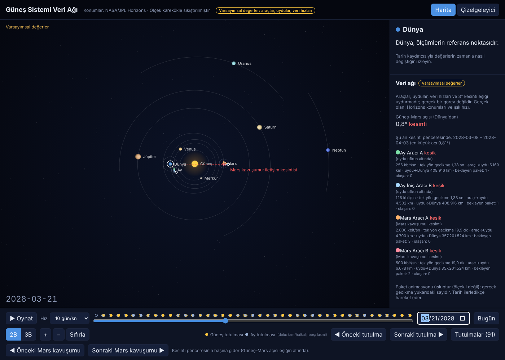

Çizelgeleyici sekmesinin görüntüleri [Aşama 4](#aşama-4-kavuşum-stratejisi-duyarlılık-analizi-gerçek-veri-doğrulaması) ve [Aşama 7](#aşama-7-kapsama-bilen-strateji-kümelenmiş-hata-ay-hattı-dar-ekran) bölümlerinde.

## Kurulum

Node.js 20 veya üstü gerekir.

```bash
git clone https://github.com/mastartm/solar-system-data-network
cd solar-system-data-network
npm install
npm run dev      # ilk çalıştırmada Horizons'tan veriyi çeker (internet gerekir)
```

Diğer komutlar: `npm run build` (yayın derlemesi), `npm test` (birim testler), `npm run fetch-data -- --force` (veriyi yeniden çek).

## Nasıl kullanılır

- **Oynat/Durdur** ve **hız** seçimi: zamanı ilerletir.
- **Kaydırıcı / tarih kutusu / Bugün**: 2020–2040 arasında tarih seçin.
- **Gezegene (veya Güneş/Ay'a) tıklayın**: Dünya'ya uzaklığı (km) ve ışık gecikmesi (dakika) sağ panelde görünür.
- Tekerlek ve +/− düğmeleri yakınlaştırır; zoom imlecin altındaki noktaya sabit kalır. **2B** modda sürükleme kaydırır; kaydırma ve uzaklaşma sınırlıdır (harita sahneden çıkmaz) ve yakınlaşınca ağ ayrıntısı (araç/uydu etiketleri, bağlantılar) görünür (PR [#5](https://github.com/mastartm/solar-system-data-network/pull/5)).
- **3B** düğmesi eğik görünüme geçer: sürükleyerek döndürün (Shift+sürükleme kaydırır). 3B'de gezegenlerin ekliptik düzlemden sapması 3 kat abartılır (görünsün diye).
- **Sol panel (Aşama 6):** "Cisimler" listesi ve "Katmanlar"; ayrıntı için [Aşama 6](#aşama-6-3b-görünüm-ve-harita-arayüzü).
- **Dar ekran (≤ 700 px, Aşama 7):** alt kontroller tek satırdır (oynat, tarih çubuğu, tarih); **⋯** düğmesi hız, Bugün, 2B/3B, zoom, tutulma ve Mars kavuşumu düğmelerini açar. Sağdaki bilgi/ağ paneli **"Bilgi ve ağ durumu ▸"** çubuğuyla katlanır (başlangıçta kapalı); sol "Cisimler" paneli eskisi gibi katlanır. Ayrıntı: [Aşama 7](#4-dar-ekran-düzeni).
- **Çizelgeleyici sekmesi (Aşama 10):** Ayarlarda yeni **Aşama 10 seçenekleri** satırı: *Aşama 10 politikalarını da çalıştır* (değere duyarlı kuyruk, dayanıklı ufuk; azalan değeri "Bilim verisi değeri" seçicisinden seçin), *projeksiyon: ayrı uydu tamponları*, *telemetri kısma alt sınırı*; Ay'da *araç uydu seçimi*, *uydular arası bağlantı*, *Ay yörünge presesyonu*; Mars'ta *Mars ekseni* ve gölge seçicisinde *güç modeli*. Yeni **(m) Aşama 10 deneyleri** (m1–m5, düğmeyle): kuyruk politikası, dayanıklı ufuk, çok uydulu yönlendirme, yörünge/güç, telemetri. Ayrıntı: [Aşama 10](#aşama-10-değere-duyarlı-kuyruk-takvim-hatasına-dayanıklı-ufuk-çok-uydulu-yönlendirme-yörüngegüç-telemetri-sayfa-başlatma).
- **Çizelgeleyici sekmesi (Aşama 9):** Ayarlarda *Havuz projeksiyonu* (yüzey hattı kapalılığı, ARQ kopyası RTT payı), Ay'da *Ay yörüngesi / İkinci Ay uydusu / kutup aracı*, Mars'ta *Mars uydusu gölgesi* seçicileri ve "Mars aktarma hattı (tarih aralığı, kavuşumsuz)" hattı; yeni bölümler (i) değer ağırlıklı fayda, (j) iyimser varsayımların etkisi, (k) yörünge / ikinci uydu / gölge, (l) genelleme ((j)–(l) düğmeyle çalışır). Ayrıntı: [Aşama 9](#aşama-9-model-iyimserlikleri-değer-ağırlıklı-fayda-kapsamayı-artıran-fiziksel-model-genelleme).
- **Tutulmalar:** kaydırıcının üstündeki noktalar tutulmaları gösterir (sarı: güneş, mavi: Ay; dolu: tam/halkalı, boş: kısmi/yarıgölge). Noktaya veya "Tutulmalar" listesine tıklayınca o tarihe gider; ◀ ▶ düğmeleri önceki/sonraki tutulmaya atlar.

## Aşama 2: veri ağı (varsayımsal)

- **Varsayımsal değerler tek dosyada:** `src/config/hypothetical.ts` (araçlar, aktarma uyduları, yörünge yükseklikleri, veri hızları, kesinti eşiği, animasyon). Ekranda başlıkta ve ağ panelinde, haritada ise "Varsayımsal değerler" yazar. Gerçek bir görev değildir.
- **Varlıklar:** Ay'da 2, Mars'ta 2 yüzey aracı; Ay ve Mars için birer aktarma uydusu (dairesel, ekvatoral yörünge).
- **Işık gecikmesi:** uydu→Dünya mesafesi Horizons konumlarından (cisim merkezli vektör − uydu konumu), araç→uydu mesafesi yüzey-yörünge geometrisinden hesaplanır; tek yönlü gecikme = toplam mesafe / c. Dünya'nın merkezine ölçülür (yer istasyonu yok).
- **Mars kavuşumu:** Dünya'dan bakınca Güneş–Mars açısı eşiğin (varsayılan 3°) altına inince Mars bağlantıları kesilir; paketler aktarma uydusunda bekler. Alttaki "Mars kavuşumu" düğmeleri kesinti penceresinin başına atlar; pencereler veri aralığı taranarak bulunur.
- **Görüş koşulları:** araç, uydu ufkun altındayken bağlanamaz; uydu Dünya'dan cismin arkasında kalırsa ("occulted") bağlantı kesilir.
- **Animasyon:** araç → uydu → Dünya paketleri; hızı üsluptur (ölçekli değil), gecikme panelde sayı olarak verilir. Bağlantı yoksa beyaz noktalar olarak birikir.
- **Basitleştirmeler:** cisim eksenleri ekliptiğe paralel varsayıldı (gerçek kutup yönleri yok); Ay'ın çizim mesafesi abartılı olduğu için Ay çevresindeki yerleşim şematiktir; yer istasyonu, bant genişliği/batarya modeli ve Güneş koronası etkisi yok. Bu aşamada Horizons verisine erişemeyen bir ortamdaydım: ağ modeli birim testlerle (sentetik geometri) doğrulandı, ekranda gerçek veriyle **görsel olarak denenmedi**.

## Aşama 3: çizelgeleyici ve karşılaştırma grafikleri (varsayımsal)

Üstteki **Çizelgeleyici** sekmesini açın (harita gizlenir, geri dönünce kaldığı yerden devam eder). `#cizelgeleyici` adresiyle doğrudan açılır. Sekme ilk açılışta hesaplar (Chart.js o anda yüklenir, harita paketini şişirmez).

- **Model** (`src/network/scheduler.ts`, saf fonksiyon, rastgelelik yok): araç → aktarma uydusu → Dünya. Araçlar veri hızlarının bir kısmını (`dutyCycle`) iki sınıfta üretir: telemetri (öncelik 0, küçük paket) ve bilim verisi (öncelik 1, büyük paket). Her araçta ve her uyduda sınırlı tampon vardır. Bağlantı pencereleri `computeNetwork`'ten gelir: uydunun ufkun altında olması, Dünya görüşü (cisim arkasında kalma), Mars kavuşumu kesintisi. Teslim süresi = kuyruk bekleme + ışık yolu; ışık yolu Horizons mesafelerinden hesaplanır.
- **İki çizelgeleyici:** *FIFO* (geliş sırası; tampon doluysa yeni gelen düşer) ve *öncelikli* (en önemli sınıf önce gider; tampon doluysa daha düşük sınıfın en yeni paketi atılarak yer açılır). Uydu tamponu doluysa araç göndermez, verisini kendi tamponunda tutar (geri basınç).
- **Sayaçlar:** üretilen, teslim, **tamponlanan** (bir adımdan uzun tamponda bekleyen), **gecikmeli** (kuyrukta `delayedAfterSec`'ten uzun bekleyen), **düşen** (tampon taşması), simülasyon sonunda tamponda kalan. Her zaman üretilen = teslim + düşen + kalan (testle doğrulanır).
- **Grafikler:** (a) Ay ve Mars için tek yön ışık gecikmesi, 2020–2040 (iki ayrı grafik; ölçekler çok farklı, çift eksen yok); (b) FIFO ve öncelikli: teslim süresi (%95), tampon doluluğu (tepe), kayıp; sayaç tablosuyla birlikte; (c) seçilen Mars kavuşumu çevresinde Mars aktarma uydusu tamponunun dolup boşalması. (a) gerçek Horizons konumlarına dayanır (Dünya merkezi – cisim merkezi); (b) ve (c) varsayımsal değerlerle çalışır ve panelde öyle yazar.
- **Okuma uyarısı:** teslim süresi yalnızca teslim edilenlerden hesaplanır. Paketi düşüren çizelgeleyicinin ortalaması iyi görünebilir (hayatta kalma yanlılığı); süreyi kayıp ve teslim sayısıyla birlikte okuyun. Ayrıca kavuşum sırasında üretilen telemetri her iki çizelgeleyicide de kesintinin bitmesini beklemek zorundadır; öncelik farkı asıl birikmiş veri boşalırken ve tampon taşarken görülür.
- **Testler:** `src/network/scheduler.test.ts` sentetik veriyle çalışır (uydurma tek araçlı topoloji, uydurma hızlar, sabit konumlu izler); gerçek bir görevi temsil etmez.
- **Gerçek veriyle denenmedi:** bu ortamda Horizons'a erişim yoktu (HTTP 403). Arayüz yalnızca `?sentetik=1` ile açılan **sentetik dairesel yörüngelerle** (`src/data/synthetic.ts`, sayfada kırmızı uyarı çıkar) görsel olarak doğrulandı. Gerçek kavuşum tarihleri, gecikme eğrileri ve sayaç değerleri gerçek veriyle **görülmedi**. Sentetik veriyle çıkan sayılar hiçbir şeyi temsil etmez.
- **Kararlar:** simülasyon adımı 300 sn (kavuşum penceresi çevresi ~16 bin adım, tarayıcıda yaklaşık yarım saniye); paketler "toplu veri parçası"dır (gerçek protokol paketi değil) ki sayılar yönetilebilir kalsın; tüm sayılar `src/config/hypothetical.ts` içindeki `scheduler` bölümündedir.

## Aşama 4: kavuşum stratejisi, duyarlılık analizi, gerçek veri doğrulaması

> Her şey **varsayımsaldır** (`src/config/hypothetical.ts`; ekranda "Varsayımsal değerler" yazar). Sonuçlar **gerçek bir görev sonucu değildir.** Gerçek olan: Horizons konumları, ışık gecikmesi, bağlantı geometrisi.

### Nasıl kullanılır

**Çizelgeleyici** sekmesinde (veya `#cizelgeleyici` adresinde):

- **Kavuşum penceresi** seçin (2020–2040'ta 9 pencere). Ekranın geri kalanı bu pencereyi, 5 gün öncesinden 30 gün sonrasına, **Mars aktarma hattı** (uydu + 2 araç) için üç çizelgeleyiciyle çalıştırır: FIFO, öncelikli, **strateji**.
- **Kaydırıcılar:** Mars uydu tamponu, Mars uydu → Dünya hat hızı, görev döngüsü. Başlangıç değerleri `hypothetical.ts`'ten gelir; aralıkları `HYPOTHETICAL.sensitivity` belirler. **Varsayılana dön** düğmesi hepsini sıfırlar. Kaydırıcıyı bıraktıktan ~0,5 sn sonra yeniden hesaplanır; hızlı art arda hareket eden hesabı iptal eder.
- **(d) Duyarlılık taraması:** her grafikte bir parametre taranır (diğerleri kaydırıcı değerinde); düşey kesikli çizgi kaydırıcının değeridir. Kayıp ve teslim süresi ölçütleri açılır kutuyla değişir.

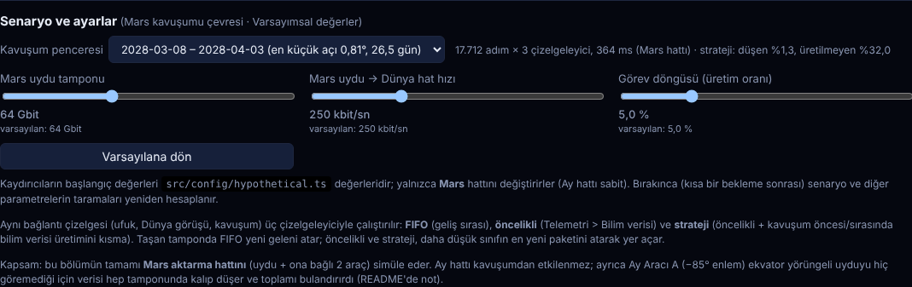
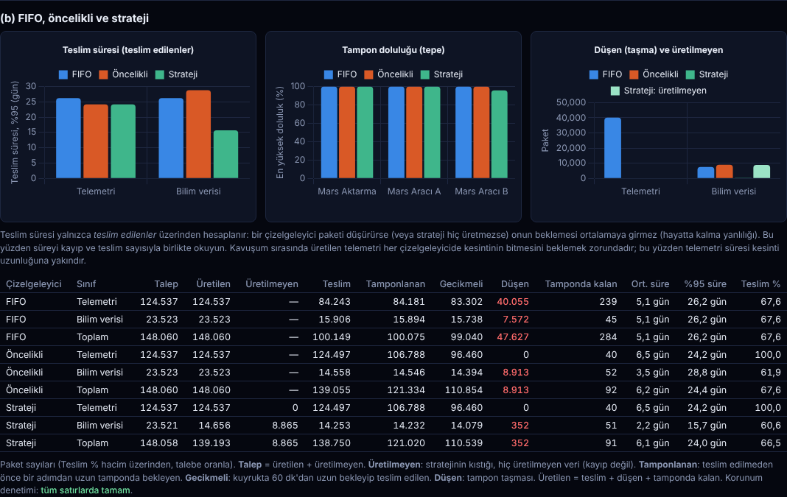
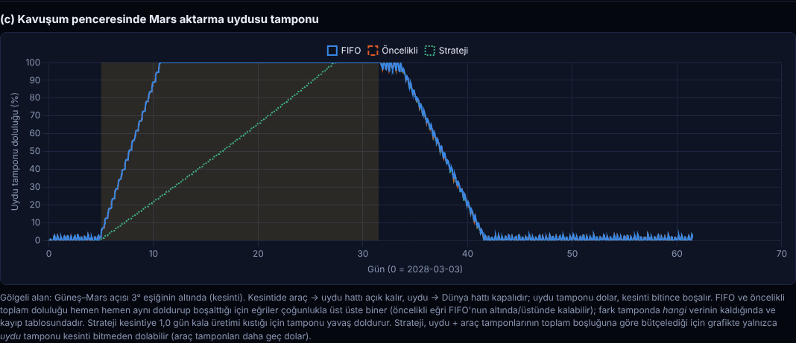
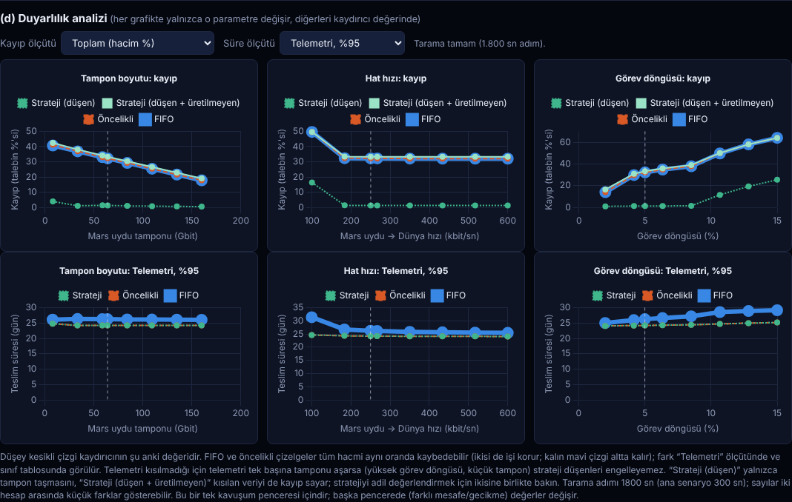
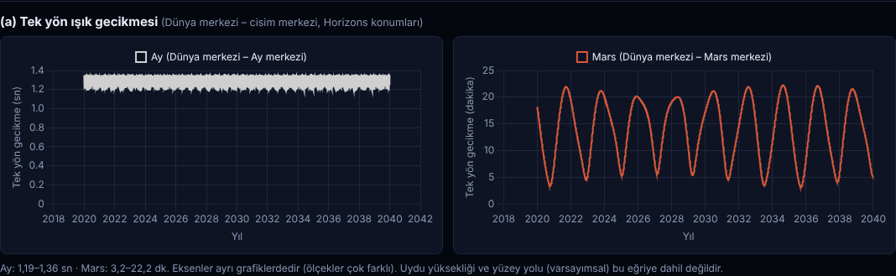

### Strateji: "bütçeli kısma"

`simulate(..., 'strategy', cfg)` = öncelikli çizelgeleyici + **bilim verisi üretimini kısma**. Telemetri (en önemli sınıf) hiç kısılmaz. Kesinti takvimi (başlangıç ve bitiş) **önceden bilinir varsayılır** (Güneş–Mars geometrisi öngörülebilirdir; gerçek bir görevin bunu nasıl yaptığını bilmiyorum). Kesintiye `lookaheadDays` kala ve kesinti boyunca, her araç için:

```
bütçe  = margin × (aracın tamponu boşluğu + uydu tamponu boşluğunun hız oranındaki payı) − telemetri × kesintinin kalan süresi
çarpan = clamp(bütçe / (kısılabilir üretim × kalan süre), minFactor, 1)
```

Her adımda yeniden hesaplanır (geri besleme). Parametreler: `HYPOTHETICAL.strategy` (`lookaheadDays: 1`, `margin: 0.9`, `minFactor: 0`). İlk denediğim strateji (yalnızca uydu tamponunun doluluk eşiğine göre kısma + kavuşum öncesi sabit çarpan) bırakıldı: 2028 penceresinde teslim edilen paketi öncelikliye göre ~%13 azalttı (127,7 bin / 146,6 bin), çünkü araç tamponlarını kullanmadan kısıyordu ve kavuşumdan önce (tampon boşken, hat tam kapasiteyle boşaltırken) kısmanın bir faydası yoktu. Bu yüzden tampon boşluğuna dayalı bütçeli kısmaya geçtim.

### Kayıp mı, üretilmeyen mi? (karşılaştırmanın adaleti)

- **Düşen (kayıp):** üretilmiş ama tampon taşması yüzünden atılan veri.
- **Üretilmeyen:** strateji yüzünden hiç üretilmeyen veri. Tampona girmediği için *düşen sayılmaz*; ayrı sütunda gösterilir. FIFO ve öncelikli çizelgeler üretimi kısmaz (üretilmeyen = 0).
- **Talep** = üretilen + üretilmeyen. Karşılaştırma talep üzerinden yapılır; tablo ve grafikler hem **"düşen %"** (= düşen / talep) hem **"düşen + üretilmeyen %"** gösterir, böylece strateji kısarak kayıptan kurtulmuş sayılmaz. **Teslim %** = teslim edilen hacim / talep.
- Denklemler (testle korunur): üretilen = teslim + düşen + kalan (her sınıf için); talep = üretilen + üretilmeyen (stratejinin talebi öncelikli çizelgenin üretimine ±1 paket eşittir). Tabloda "korunum denetimi" satırı bunu her çalıştırmada kontrol eder.

### Gerçek veri doğrulaması (Playwright/Chromium, `?sentetik=1` yok)

Depodaki `public/data/planets.json` ve `moon.json` (2020-01-01 – 2039-12-31/2040-01-01) kullanıldı; **veriye dokunulmadı, Horizons'a erişilmedi.** `vite preview` ile derlenmiş site açıldı.

- **Veri sağlığı:** 9 gövde için sayı/uzunluk kontrolü geçti (yeni `validateTracks`; sorun olursa harita başlamaz, panel "Veri bozuk ya da eksik" yazar). NaN yok. Konsol hatası/uyarısı yok.
- **Mars kavuşum pencereleri** (Güneş–Mars < 3°, 0,25 gün taramayla): 2021-09-29→10-17 (17,5 gün), 2023-11-08→11-28 (19,5), 2025-12-29→2026-01-21 (22,8), 2028-03-08→04-03 (26,5), 2030-05-13→06-06 (23,3), 2032-07-01→07-20 (18,8), 2034-08-10→08-27 (16,8), 2036-09-15→10-02 (17,0), 2038-10-23→11-10 (18,8). En yakın geçişler 2021-10-08, 2023-11-18, **2026-01-09**, 2028-03-21, 2030-05-25, 2032-07-11, 2034-08-19, 2036-09-23, 2038-11-01; bildiğim Mars kavuşum tarihleriyle (2021-10-08, 2023-11-18, 2026-01-09) uyuşuyor; diğerlerini bağımsız bir kaynakla karşılaştırmadım. Pencere süresi 3° eşiğine ve Mars'ın görünür hızına bağlıdır, en kısa/uzun fark büyük (16,8–26,5 gün).
- **Işık gecikmesi:** Ay 1,19–1,36 sn, Mars **3,2–22,2 dk**: beklenen aralıkta. Mars eğrisi her kavuşumda tepe yapıyor (~21–22 dk). 2028-03-21'de panel: araç→uydu ~5 bin km + uydu→Dünya 357,2 milyon km → 19,9 dk. (Ay: 1,34–1,38 sn.)
- **(c) grafiği:** gerçek kavuşumda anlamlı: kesinti başında (gölgeli alan) FIFO/öncelikli tamponu ~5 günde doldurup %100'de bekliyor, kesinti bitince ~9 günde boşalıyor; strateji doğrusal ve yavaş dolduruyor.
- **Sayaçlar mantıklı:** korunum denetimi tüm satırlarda tamam; telemetri teslim süresi (%95) kesinti uzunluğuna yakın (15–26 gün); tamponlanan/gecikmeli sayıları da bunu yansıtıyor. 9 pencerenin hepsinde (varsayılan ayarlar, Mars hattı) FIFO telemetri hacminin %19–32'sini düşürüyor, öncelikli ve strateji telemetriyi hiç düşürmüyor.

**Gerçek ve sentetik veri arasındaki farklar** (aynı kod, `?sentetik=1` / `src/data/synthetic.ts`): Ay gecikmesi sentetikte sabit 1,28 sn (gerçekte 1,19–1,36); Mars 4,4–21,0 dk (gerçekte 3,2–22,2); sentetikte tüm kavuşum pencereleri tam 21,3 gün ve düzenli aralıklıdır (gerçekte 16,8–26,5 gün, ardışık en yakın geçişler arası 25,6–26,4 ay). Yani sentetik veriyle alınan sayılar gerçek verinin yerine geçmez (Aşama 3'ün sentetik denemeleri bu nedenle yalnızca arayüz doğrulamasıydı).

### Sonuçlar (varsayılan ayarlar, Mars hattı, yüzde = talebin %'si; **varsayımsal**, gerçek görev sonucu değil)

Kavuşum penceresi başına, tarama adımı 1800 sn: düşen % / düşen+üretilmeyen % / teslim %.

| Pencere (gün) | FIFO | Öncelikli | Strateji |
|---|---|---|---|
| 2021-09-29 (17,5) | 20,4 / 20,4 / 79,4 | 20,4 / 20,4 / 79,3 | 1,2 / 21,8 / 78,0 |
| 2023-11-08 (19,5) | 23,4 / 23,4 / 76,3 | 23,4 / 23,4 / 76,3 | 1,1 / 24,7 / 75,0 |
| 2025-12-29 (22,8) | 27,7 / 27,7 / 72,2 | 27,7 / 27,7 / 72,1 | 1,3 / 28,9 / 71,0 |
| 2028-03-08 (26,5) | 32,3 / 32,3 / 67,6 | 32,3 / 32,3 / 67,5 | 1,3 / 33,3 / 66,5 |
| 2030-05-13 (23,3) | 27,9 / 27,9 / 72,0 | 27,9 / 27,9 / 71,9 | 1,1 / 29,1 / 70,7 |
| 2032-07-01 (18,8) | 22,2 / 22,2 / 77,6 | 22,2 / 22,2 / 77,6 | 1,2 / 23,5 / 76,3 |
| 2034-08-10 (16,8) | 19,1 / 19,1 / 80,6 | 19,1 / 19,1 / 80,6 | 1,1 / 20,6 / 79,1 |
| 2036-09-15 (17,0) | 19,6 / 19,6 / 80,0 | 19,6 / 19,6 / 80,0 | 1,1 / 21,1 / 78,5 |
| 2038-10-23 (18,8) | 21,7 / 21,7 / 78,0 | 21,8 / 21,8 / 77,9 | 1,0 / 23,2 / 76,5 |

**Okuma (varsayımsal modelde):**

- Toplam hacim açısından üç çizelgeleyici de **neredeyse aynı** hacmi teslim eder (iş korumalıdırlar; hat dolu olduğu sürece hat ne taşıyorsa onu teslim eder). Strateji teslim edilen hacmi **artırmaz**, %1–1,5 puan azaltır (tamponun %10'unu bilerek boş bırakır ve bütçeyi hafif tutucu hesaplar).
- Farklar *neyin* kaybolduğundadır: FIFO telemetriyi de düşürür (2028 penceresinde telemetrinin %32'si), öncelikli ve strateji telemetriyi korur. Strateji, düşen veriyi (%32 → %1,3) hiç üretilmeyene (%32) çevirir: aynı kayıp, ama üretilip taşınıp atılmadan (strateji kesinti boyunca bilim verisini seyreltir; bunun bilimsel olarak daha değerli olup olmadığı bu modelde ölçülmüyor, bilmiyorum).
- Duyarlılık (2028 penceresi): tampon büyüdükçe kayıp doğrusala yakın azalır (8 Gbit ≈ %42 → 160 Gbit ≈ %19); hat hızı ~180 kbit/sn'nin altında kayıp keskin artar, üstünde düzleşir (kayıp tampondan değil kesinti süresinden gelir); görev döngüsü arttıkça kayıp artar ve yüksek döngüde (≳%10) telemetri tek başına tamponu aştığı için strateji de düşürmeye başlar (telemetri kısılmaz).
- Telemetri %95 teslim süresi tampona/hat hızına/üretime neredeyse **bağımsızdır** (~kesinti uzunluğu): kesintide üretilen telemetri kesinti bitmeden Dünya'ya gidemez. Öncelik bunu kısaltmaz, yalnızca telemetriyi düşmekten korur.

### Beklenmedik ve dikkat edilecekler (gerçek veri / yeni aşama bulguları)

1. **"Sonraki/Önceki Mars kavuşumu" düğmeleri aynı pencerede takılıyordu** (Aşama 2 hatası): düğme pencere başının 3 gün öncesine atlıyor, ikinci basışta aynı pencereyi tekrar buluyordu. `src/main.ts`'te düzeltildi (hedef tarihe göre karşılaştırılıyor); 9 pencerenin hepsine sırayla gidilebildiği tarayıcıda doğrulandı.
2. **(Aşama 5'te düzeltildi: enlem −40°.) Ay Aracı A (−85° enlem) ekvator yörüngeli Ay uydusunu hiç göremezdi** (geometri: uydu hiçbir zaman ufkun üstüne çıkmaz; yüzeyden görüş %0). Verisi hiç teslim edilmez, tamponu dolar ve telemetri/bilim düşer. Bu **varsayımsal yerleşimin** bir sonucu, gerçek veriyle ilgisi yok (sentetikte de aynı); Aşama 3'ün "tüm ağ" toplamı bundan etkileniyordu. Konfigürasyona dokunmadım (varsayımsal değer, bana ait değil); onun yerine **Aşama 4 bölümü yalnızca Mars hattını** simüle eder. Ay Aracı A'nın enlemi/uydu eğimi istenirse `hypothetical.ts`'ten değiştirilebilir.
3. **Mars tarafı toplamları artık Aşama 3'ten farklı:** Aşama 3 tüm ağı (Ay dahil) simüle ediyordu; sayılar (ör. düşen paket) bu yüzden eski çıktılarla karşılaştırılamaz.
4. **Harita paket animasyonundaki "ulaşan" sayacı yüksek hızlarda 0 kalır** (1 gün/sn ve üstü): Mars uydusunun dönemi ~6 saat, animasyon paketi ise gerçek zamanda ~4 sn sürer; bağlantı bu sürede açılıp kapandığı için paket tamamlanmaz. Sayaç yalnızca animasyon üslubudur; gerçek hesap Çizelgeleyici sekmesindedir. Düzeltilmedi (bu aşamanın işi değil).
5. **Ay gecikme grafiği (a) dolu bir bant gibi görünür:** günlük örneklemeyle 27,3 günlük salınım 20 yıl boyunca sıkışıyor; aralık doğru (1,19–1,36 sn), yalnızca görsel.
6. **Strateji kesintinin başı/sonunu önceden bilir** ve bunu modelde bedava sayar (varsayım). Gerçekte tahmin hatası, kısmanın maliyeti (bilim kaybı) ve operasyonel kararlar var.
7. **Hesap süresi:** ilk açılışta senaryo ~0,5 sn, taramalar ~8 sn (tek parça değil; her çizelgeleyici ayrı `setTimeout` parçasında, en uzun görev ~150 ms, ilk çizimde ~280 ms; sayfa donmaz). Kaydırıcı değişince yalnızca diğer iki parametrenin taraması yeniden hesaplanır (~5 sn). Not: zaman çizelgesi 17 bin adımda ~0,1 sn; asıl maliyet paket sayısıdır, adım sayısı değil.
8. **Tarama adımı 1800 sn, ana senaryo 300 sn:** küçük sayısal farklar (<%0,5) normaldir.

### Testler

`npm test` (35 test, **hepsi sentetik**: uydurma tek araçlı topoloji, uydurma hızlar, sabit konumlu izler; gerçek bir göreve ait değil). Yeni: strateji (kesinti işareti yokken öncelikliyle birebir aynı; kesintide üretimi kısar, düşen azalır; telemetri kısılmaz ve düşmez; korunum denklemleri; deterministiklik), tarama yardımcıları (`sweepValues`, `sweepPoint`, tampon büyüdükçe kayıp tekdüzeliği), `withParams`/`restrictToRelay` (girdiyi değiştirmeme).

### Kararlar

- Strateji ve tarama saf fonksiyondur (`scheduler.ts`, `sweep.ts`; DOM ve rastgelelik yok). Arayüz uzun hesabı her çizelgeleyici için ayrı `setTimeout` parçasına böler ve iptal belirteci kullanır.
- Yeni dış bağımlılık, Web Worker veya GitHub Actions iş akışı eklenmedi.
- Kaydırıcılar yalnızca Mars tarafını değiştirir (Ay hattı sabit); yeni varsayımsal değerlerin hepsi `hypothetical.ts` içindedir (`strategy`, `sensitivity`).
- Veri bozuk/eksikse: yükleme sırasında `validateTracks`, panelde `try/catch` + "Hesaplama durdu" mesajı; sayfa çökmez.

## Aşama 5: yer istasyonu, hat hatası ve yeniden iletim, Ay Aracı A

> Her şey **varsayımsaldır** (`src/config/hypothetical.ts`); sonuçlar **gerçek bir görev sonucu değildir.** Gerçek olan: Horizons konumları, ışık gecikmeleri, geometri. Birim testler **sentetiktir**; sayılar aşağıda gerçek veriyle (depodaki Horizons dosyaları, `?sentetik=1` yok) tarayıcıda ve betikle alınmıştır.

### Ay Aracı A düzeltmesi
Aşama 4 bulgusu: −85° enlemdeki araç, ekvator yörüngeli Ay uydusunu hiç göremiyordu (yüzey görüşü %0). `hypothetical.ts`'te enlem **−40°**'ye alındı (yalnızca bu sayı; uydu ve diğer araçlar aynı). Artık görüş %34 (Ay İniş Aracı B %38, Mars araçları %35–36). Testle korunur (sentetik). Not: gerçek bir Ay görevi kutupları eğimli/eliptik yörüngelerle kapsar; burada yörünge ekvatoral olduğu için yerleşim yörüngeye uydurulmuştur, kutup bölgesi **modellenmedi**.

### Yer istasyonu görüşü
- **Model** (`src/network/stations.ts`, saf fonksiyon): küresel Dünya, GMST ile dönüş, ekliptik çerçeveye dönüştürme; yükseklik = istasyondan uyduya (Dünya merkezli konum − istasyon konumu) bakış açısı. Eşik **10°** (`minElevationDeg`). Uydunun Dünya hattı artık: cisim arkasında değil **ve** (Mars) kavuşumda değil **ve** en az bir istasyon uyduyu eşik üstünde görüyor. Yeni bağlantı durumu `nostation`. Devir anlıktır, tek hat varsayılır (aynı anda iki istasyon indirme yapmaz).
- **İstasyonlar (varsayımsal):** 3 adet, konumları derin uzay istasyonlarına *benzer seçildi* (Kaliforniya, İspanya, Avustralya benzeri); gerçek tesis verisi değildir. Sayı arayüzden 0–3 seçilir (0 = ideal, Aşama 2–4 davranışı).
- **Ağ paneli** (harita sekmesi) her araç için uyduyu gören istasyonu ve yüksekliğini gösterir.
- **Gerçek veriyle kapsama** (2028 penceresi ± pay, 30 dk adım; Çizelgeleyici sekmesindeki tablo):

| İstasyon | Ay: uyduyu görüyor | Ay: Dünya hattı açık | Mars: uyduyu görüyor | Mars: Dünya hattı açık |
|---|---|---|---|---|
| Yok (ideal) | — | %88,1 | — | %48,3 |
| 1 | %42,9 | %37,7 | %44,3 | %21,4 |
| 2 | %73,3 | %64,7 | %75,6 | %36,8 |
| 3 | %98,6 | %87,0 | %100,0 | %48,3 |

  Üç istasyon neredeyse tam kapsar; bu yüzden **varsayılan (3) Aşama 4 sonuçlarını değiştirmez**. 1–2 istasyonda hat açık süresi ve teslim keskin düşer.

### Hat hatası ve yeniden iletim (ARQ)
- **Model** (`scheduler.ts`, saf fonksiyon): **rastgelelik yok**; kayıp oranı belirleyici bir biriktiriciyle uygulanır (her hatta, her iletim denemesi için oran birikir; 1'i geçince o deneme kaybolur → belirli aralıklarla periyodik kayıp, "ortalama %p" davranışı). Yüzey hattı kaybı %1, Dünya hattı %5 (`HYPOTHETICAL.arq`).
- **Yüzey hattı** (araç → uydu): RTT adımdan çok kısa varsayılır; kaybolan deneme bant genişliği harcar, paket tamponda kalır ve yeniden denenir.
- **Dünya hattı** (uydu → Dünya): gönderici paketi **RTT (= 2 × ışık gecikmesi)** boyunca tamponunda tutar (Mars'ta ~40 dk, Ay'da ~3 sn). Başarılıysa ACK ile kopyayı bırakır, kaybolduysa NAK sonrası aynı sınıfın başına koyup yeniden gönderir. Kopyalar tampon doluluğuna sayılır (öncelikli çizelge onları atamaz).
- **Denemeler** en çok `maxAttempts` (4); aşan paket **"hatta kayıp"** (`abandoned`) sayılır. `maxAttempts = 1` yeniden iletimsiz moddur.
- **Hat modları** (arayüzde seçilir): *Kayıpsız hat* (Aşama 3–4) · *Hatalı hat, yeniden iletimsiz* · *Hatalı hat + yeniden iletim* (**varsayılan**).
- **Yeni sayaçlar / denklemler (testle korunur):** hatta kayıp, kaybolan deneme, yeniden gönderilen. **Üretilen = teslim + düşen + hatta kayıp + tamponda kalan; talep = üretilen + üretilmeyen.** "Düşen" yalnızca tampon taşmasıdır; "hatta kayıp" ayrı sütundur ve kayıp ölçütlerine (düşen + hatta kayıp [+ üretilmeyen]) birlikte girer. Dünya hat kaybı kaydırıcısı ve tarama grafiği (4. parametre) eklendi; kayıp/ süre ölçütü listesine "hatta kayıp" ve "yeniden gönderilen" eklendi.

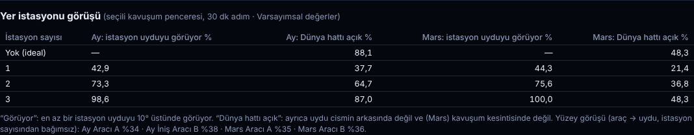
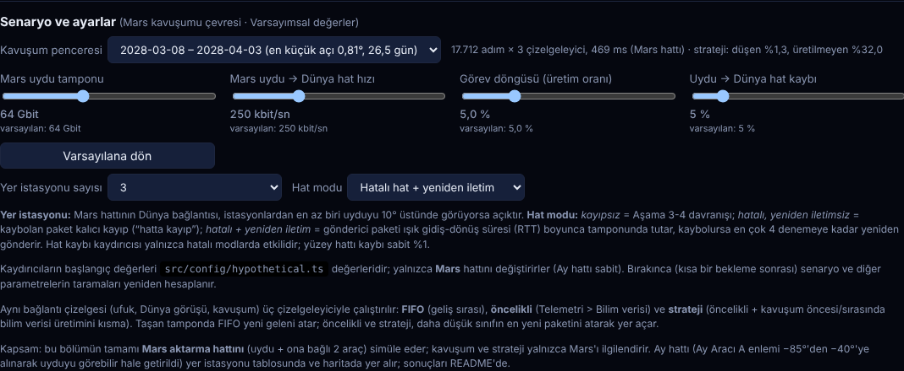
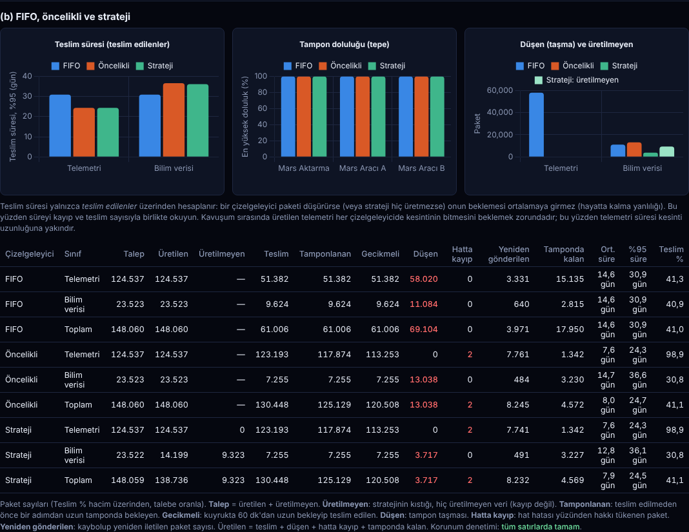
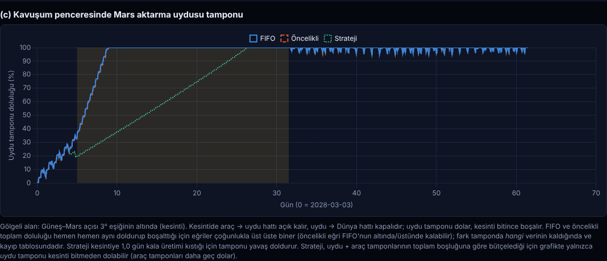
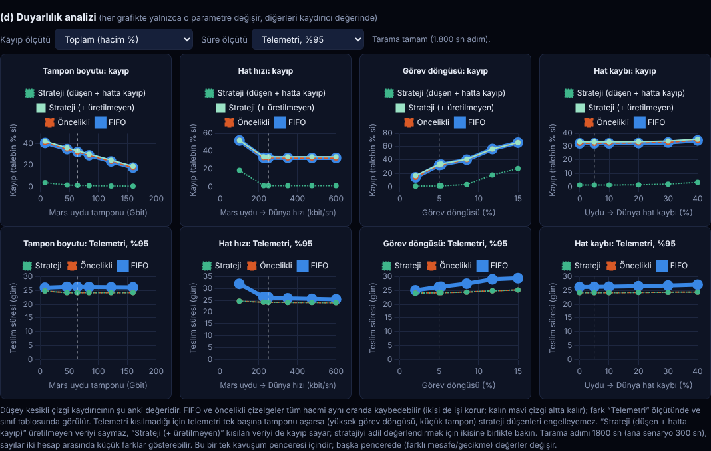

### Gerçek veriyle sonuçlar (2028-03-08 penceresi, Mars hattı, 300 sn adım, **varsayımsal**)

| Yapılandırma | FIFO teslim % | Öncelikli teslim % | Strateji teslim % | Strateji düşen % |
|---|---|---|---|---|
| 3 istasyon, kayıpsız hat (= Aşama 4) | 67,6 | 67,6 | 66,5 | 1,3 |
| 3 istasyon, hatalı hat, yeniden iletimsiz | 63,7 | 63,7 | 62,8 | 1,2 |
| 3 istasyon, hatalı hat + yeniden iletim (varsayılan) | 67,6 | 67,6 | 66,5 | 1,3 |
| 1 istasyon, hatalı hat + yeniden iletim | 41,0 | 41,1 | 41,1 | 13,4 |

Hatta kayıp (yeniden iletimsiz mod, öncelikli): Mars'ta talebin %4,0'ı, Ay'da %6,0'ı (yüzey %1 + Dünya %5 kayıp denemesi; Mars'ta bir kısmı zaten taşmaya giden veridir). Yeniden iletimle ≈ %0 (tüm kayıplar kurtarıldı; örn. öncelikli: 8,7 bin yeniden gönderilen paket, 0 kalıcı kayıp).

**Ay hattı** (aynı pencere, 300 sn, öncelikli çizelge; Ay'da kavuşum yok, strateji = öncelikli; betikle alındı, arayüzde Ay senaryosu yok):

| İstasyon | Hat modu | Teslim % | Düşen % | Hatta kayıp % | Telemetri ort. süre |
|---|---|---|---|---|---|
| 3 | kayıpsız | 99,8 | 0,0 | 0,0 | 1,9 sa |
| 3 | hatalı, yeniden iletimsiz | 93,8 | 0,0 | 6,0 | 1,9 sa |
| 3 | hatalı + yeniden iletim | 99,8 | 0,0 | 0,0 | 1,9 sa |
| 1 | kayıpsız | 78,1 | 19,4 | 0,0 | 6,4 sa |
| 1 | hatalı + yeniden iletim | 73,8 | 23,6 | 0,0 | 6,4 sa |

**Okuma (varsayımsal modelde):**
- **Yer istasyonu sayısı bu modelde en etkili parametredir:** 1 istasyonla hem Ay hem Mars'ta hat açık süresi indirme ihtiyacının altına düşer; tampon kavuşum sonrası da boşalmaz (Mars teslim %67,6 → %41; Ay %99,8 → %78).
- **Yeniden iletim kaybı neredeyse tamamen kurtarır** (%4–6 hatta kayıp → ≈ %0), süre maliyeti küçüktür çünkü Mars'ta bile RTT (~40 dk) kavuşum kesintisinin (~26 gün) yanında önemsizdir; bu senaryoda süre kesintiye bağlıdır, yeniden iletime değil.
- **Maliyet tampondadır:** gönderici kopyayı RTT boyunca tuttuğu için tampon darken (1 istasyonlu Ay) yeniden iletim **düşeni artırır** (%19,4 → %23,6): kayıp kurtarma, taşma kaybına dönüşür.
- 3 istasyonla Mars'ta ARQ'nun etkisi kayıpsız moda göre ihmal edilebilir (teslim farkı < %0,1).

### Beklenmedik ve dikkat edilecekler
1. **Strateji yer istasyonu kapsamasını bilmez:** bütçeyi yalnızca boş tampondan hesaplar, kavuşum sonrası boşaltma kapasitesini (hat açık oranı) hesaba katmaz. 1 istasyonda (hat %21 açık) kavuşum sonrası yine taşar (strateji düşeni %1,3 → %13,4). Düzeltilmedi; sonraki aşama adayı. **→ Aşama 7'de ele alındı** (kapsama bilen strateji; düşen %13,4 → %2,8, ama toplam kayıp/teslim iyileşmedi).
2. **Belirleyici kayıp periyodiktir:** her 20. deneme kaybolur (%5). Gerçek hatalar rastgele ve kümelidir (kümelenmiş, art arda kayıplar); bu yüzden burada `maxAttempts` aşımı gerçekçi olandan çok daha az görülür ve yeniden iletimin kayıp kurtarma başarısı iyimserdir. **→ Aşama 7'de kümelenmiş model eklendi; tahmin doğrulandı** (aynı ortalama kayıpla hatta kayıp 0–2 → 122–267 paket).
3. **Yüzey hattında RTT yok sayıldı** (5–9 bin km ≈ 20–30 ms ≪ adım 300 sn); uydu → Dünya hattında ise tam RTT var. ACK/NAK kendi hattında kayıpsız ve anlıktır (varsayım).
4. **Kapsama tablosu 30 dk adımlıdır;** kısa (<30 dk) görüş boşlukları kaçabilir.
5. **Dünya küresel,** GMST UT1≈TDB varsayımıyla (~1 dk ≈ 0,3° fark); istasyon görüşü için yeterli, yükseklik eşiğinde 0,3° belirsizlik var. Atmosfer, kırılma, anten kısıtları, hava, bakım ve zamanlama çakışmaları yok; üç istasyon sürekli kullanılabilir varsayılır.
6. **Sweep süresi arttı** (4 parametre; tarama 5 nokta + varsayılan): ilk açılışta ~10 sn (parçalı, sayfa donmaz).
7. Aşama 4'ün sayıları (kayıpsız hat, ideal Dünya) **hâlâ geçerlidir**: arayüzde "Yok (ideal)" + "Kayıpsız hat" seçilerek ya da 3 istasyonla (neredeyse tam kapsama) yeniden üretilir.

## Aşama 6: 3B görünüm ve harita arayüzü

> Ağ değerleri **varsayımsaldır** (`src/config/hypothetical.ts`; ekranda "Varsayımsal değerler"), sonuçlar gerçek bir görev sonucu değildir. Gezegen kartındaki fiziksel bilgiler **genel bilgidir, Horizons verisi değildir, kaynağı doğrulanmamıştır** (hafızadan yazıldı). Dünya'ya uzaklık ve ışık gecikmesi satırları gerçek Horizons verisidir (ekranda "Horizons" etiketi). Ekran görüntüleri depodaki **gerçek veriyle** (`vite preview`, `?sentetik=1` yok) alındı. Çizelgeleyici sekmesine ve simülasyon mantığına dokunulmadı; PR [#5](https://github.com/mastartm/solar-system-data-network/pull/5)'teki kaydırma/zoom davranışı ve 3B'de Güneş'e göre referans değişmedi.

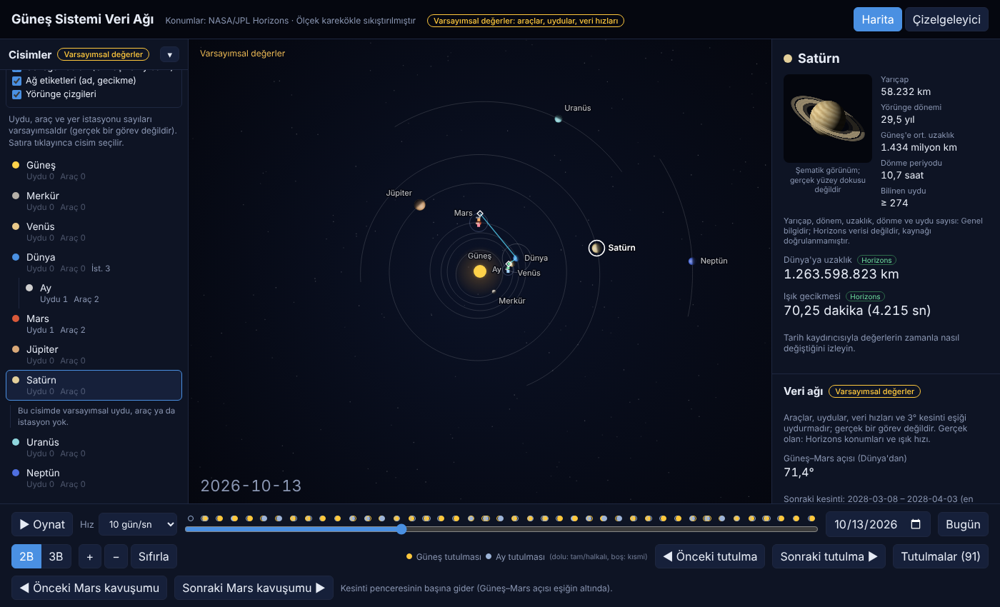

### 1. Sol panel "Cisimler"
- Güneş, gezegenler ve Ay (Dünya'nın altında girintili). Satırda renk noktası, ad ve **Uydu / Araç / İst.** sayıları (aktarma uydusu, yüzey aracı, Dünya için yer istasyonu); sayılar `hypothetical.ts`'ten türetilir (`countsFor`), panelde "Varsayımsal değerler" yazar.
- Satıra tıklayınca cisim seçilir (haritadaki tıklamayla aynı seçim: harita ve bilgi paneli birlikte güncellenir) ve satır açılır: uydular (ad, yükseklik, Dünya hattı durumu, görünen yer istasyonu ve yüksekliği), araçlar (ad, enlem/boylam, veri hızı, canlı bağlantı durumu), Dünya'da istasyonlar. Seçili satıra tekrar tıklamak açar/kapatır.
- Durum metinleri DOM yeniden kurulmadan güncellenir (yalnızca `textContent`, 250 ms'de bir), bu yüzden tıklamalar bozulmaz. Panel katlanabilir (başlıktaki ▾/▸); dar ekranda (≤ 700 px) başlangıçta katlıdır.

### 2. 3 boyutlu gezegen kartı
- Bilgi panelinde seçili cisim için dönen, ışıklandırılmış küre (küçük canvas, kendi kodumuz, Three.js yok). Altında "Şematik görünüm; gerçek yüzey dokusu değildir".
- **Dokular prosedürel ve belirleyici** (`src/map/planetTextures.ts`): sabit karma işlevli değer gürültüsü + fraktal/Worley gürültü, `Math.random` yok. Dünya (okyanus, kıta, kutup buzu, bulut), Mars, Ay, Merkür (kraterli), Venüs, Jüpiter (bantlar + Büyük Kırmızı Leke), Satürn (halka, Cassini aralığı, küre gölgesi), Uranüs (yan yatık eksen), Neptün, Güneş. Birim testlerle belirlilik doğrulanır.
- **Verimlilik:** kamera, ışık ve eksen sabit olduğundan piksel başına geometri cisim seçilince bir kez hazırlanır (`src/map/sphereRender.ts`); her karede yalnızca boylam kayması ve doku okuması yapılır. Kart en çok ~30 kare/sn, kendi `requestAnimationFrame`'inde; harita sekmesi dışında ve sayfa gizliyken durur; `prefers-reduced-motion` ise durağan kare çizer.
- **Bilgi paneli iskeleti** seçim değişince bir kez kurulur, 250 ms'lik güncelleme yalnızca sayıları değiştirir (kart canvas'ı DOM'da aynı kalır, titremez; tarayıcıda doğrulandı).
- **Kartın yanındaki bilgiler:** yarıçap, yörünge dönemi, Güneş'e ortalama uzaklık, dönme periyodu, bilinen uydu sayısı (dev gezegenlerde "≥"). Ekranda "Genel bilgidir; Horizons verisi değildir, kaynağı doğrulanmamıştır" yazar. Değerler `src/data/bodyFacts.ts` içindedir.
- **Haritadaki küreler:** Güneş'e bakan yüz aydınlık, karşı yüz belirgin gölgede (kesin terminatör; önceki yumuşak degrade yerine).

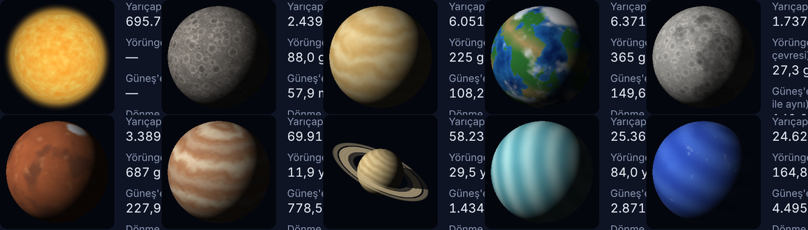

### 3. Etiket yerleştirici
`src/map/labels.ts` (saf, DOM/Canvas yok). `MapView` ve `NetworkLayer` etiketleri doğrudan çizmez, `LabelSink`'e **istek** olarak verir; `MapView.render` sonunda `placeLabels` çalışır ve çizer (tek istisna: sol üstteki sabit "Varsayımsal değerler" yazısı, nesneye bağlı değil).
- **Öncelik:** seçili (0) > Güneş/gezegenler (1) > Ay (2) > aktarma uydusu (3) > araç (4) > gecikme (5); eşitlikte istek sırası (belirleyici).
- **Aday arama:** önce en yakın mesafede 8 yön, sonra sonraki mesafe (4 mesafe: 3, 12, 28, 52 px, nesne kenarından). **Tercih edilen yön** cisim merkezinden nesneye doğru (dışa); gezegenlerde merkez Güneş, Ay'da Dünya, uydu/araçlarda ilgili cisim.
- Çakışmayan, sınır içinde, nesne işaretlerine (cisim diskleri, araç/uydu işaretleri) binmeyen ilk aday seçilir. 3. ve 4. mesafede (uzağa giden) **çıkıntı çizgisi** çizilir. Yer yoksa etiket **atlanır**; yalnızca zorunlu (seçili cisim) çakışarak da olsa yerleştirilir.
- Testler (`labels.test.ts`, sentetik): çakışmama, öncelik, sınır, belirlilik, tercih edilen yön, engel, çıkıntı çizgisi, zorunlu etiket.
- Gerçek veride: yakınlaşıp Dünya–Ay ve Mars çevresinde etiketler (Ay, Ay Aktarma Uydusu, Ay Aracı A/B, gecikme, Venüs vb.) **çakışmıyor** (tarayıcıda her karede çakışma sayısı 0 ölçüldü).

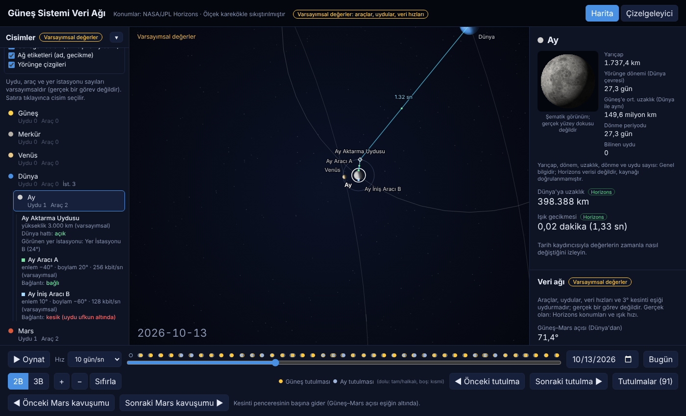
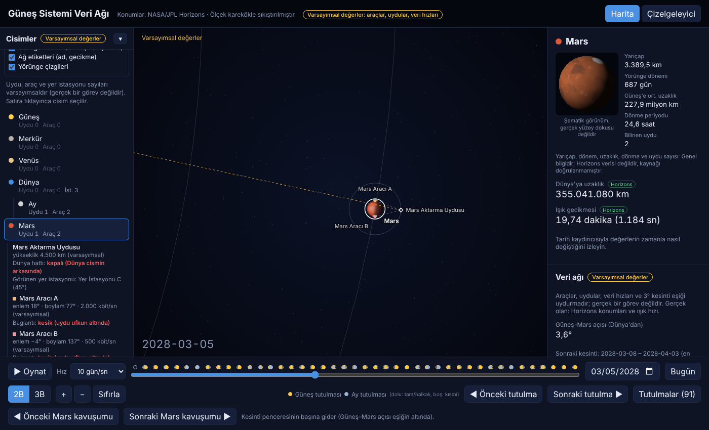

### 4. Katmanlar
Sol panelde 5 anahtar: **Ağ katmanı** (uydular, araçlar, bağlantılar, kavuşum uyarısı), **Veri akışı** (paketler), **Gezegen adları** (Güneş ve Ay dahil; seçili cismin adı her zaman görünür), **Ağ etiketleri** (ad, gecikme), **Yörünge çizgileri** (gezegen izleri, Ay yörüngesi, 3B başvuru halkaları). Kapalıyken ilgili şey çizilmez. Tercihler `localStorage`'da (`ssdn.layers.v1`) saklanır; yoksa/engelliyse/bozuksa varsayılan (hepsi açık) ile çalışır (try/catch, testli). Veri akışı ve ağ etiketleri ağ katmanına bağlı olduğundan, ağ kapalıyken soluk ve devre dışı görünür (tercihleri korunur).

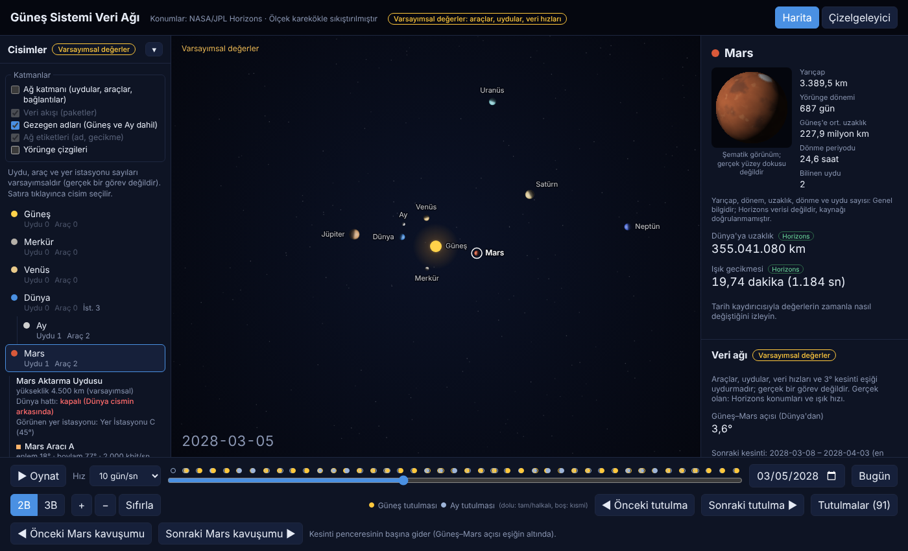
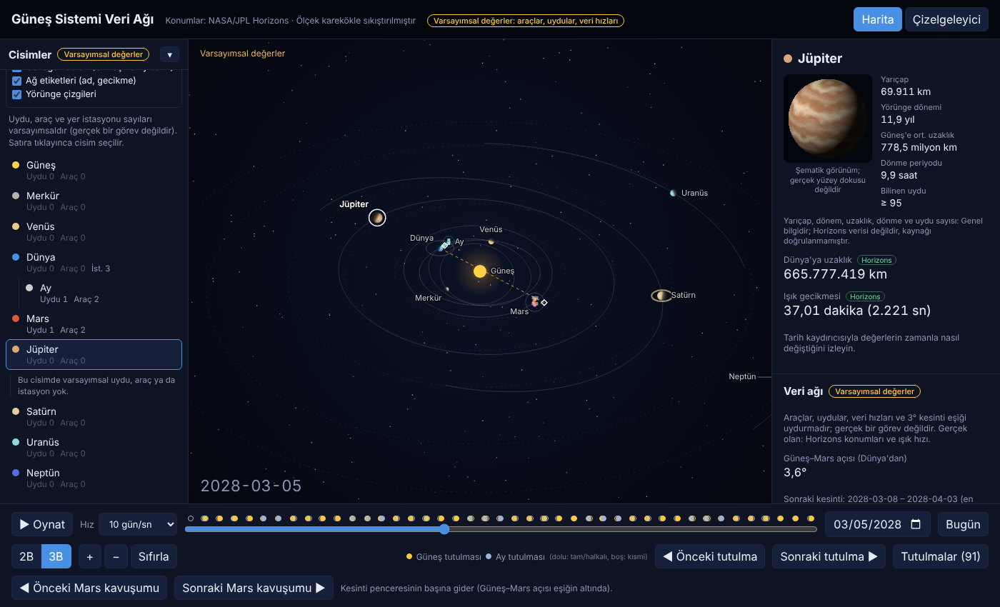

### Gerçek veriyle doğrulama (Playwright/Chromium, `vite preview`, `?sentetik=1` yok)
Sol panel, kart (10 cisim), etiketler (Dünya–Ay ve Mars bölgesinde yakınlaşarak), her katmanın aç/kapa'sı (ve `localStorage` içeriği), 2B/3B (sürükleme dahil), tarih değişimi (Mars kavuşumu düğmesi), Çizelgeleyici sekmesine gidip dönme, dar ekran denendi. **Konsolda hata/uyarı yok.**
- Ana döngü: 60 kare/sn (kart canlı, 2B/3B, 100 gün/sn oynatmada da); `MapView.render` ortalama ~1,1 ms, p95 ~1,6 ms. Kart karesi (`putImageData`) ~0,05 ms; ilk seçimde doku üretimi 30–100 ms.
- 3B: kamera/projeksiyon koduna dokunulmadı (Güneş'e göre referans aynı).

### Beklenmedik ve dikkat edilecekler
1. **Etiket yüksekliği hatası (bulundu, düzeltildi):** `600 12px` gibi yazı tipi dizisinden boyut ayrıştırırken ağırlık (600) boyut sanılıyordu; seçili cismin etiketi 750 px yüksek ölçülüp "zorunlu" yerleştirilip ekranın dışına itiliyordu. Düzenli ifadeyle düzeltildi.
2. **Doku, gerçek yüzey değildir:** Dünya'daki kıtalar gerçek haritayı değil gürültüyü izler; Jüpiter'in Büyük Kırmızı Leke'si ve Neptün'ün koyu lekesinin konumu sabit, gerçek boylamla ilgisiz. Dönme hızı üsluptur (gerçek dönme periyodunun karekökü ile ölçeklenir; 20–80 sn/tur). Ters dönenler (Venüs 177°, Uranüs 98°) eşdeğer eğikliğe indirgenip dönüş yönü çevrilerek çizilir; kuzey/güney çizimde ters görünebilir.
3. **Uydu sayıları (≥ 95 / 274 / 28 / 16) hafızadan** yazıldı ve zamanla artar; kaynağı doğrulanmadı. Diğer değerler de öyle (ekranda belirtilir). Ay için "Güneş'e uzaklık" Dünya'nınkiyle aynıdır (ekranda belirtilir).
4. **Haritadaki gölge** ekran düzleminde Güneş yönünü kullanır (3B'de derinlik bileşeni yok sayılır); şematiktir.
5. **Dar ekran** düzeni önceki aşamalardaki gibi sıkışık: sol panel katlanır ama alt kontroller yüksek olduğundan harita küçük kalır. İyileştirilmedi. **→ Aşama 7'de düzeltildi** (asıl neden canvas `min-height:auto`; ayrıntı Aşama 7, bölüm 4).
6. **Yörünge çizgileri anahtarı** 3B başvuru halkalarını da kapatır (ayrı anahtar yapılmadı; karar).
7. **Etiket yerleştirici çıkıntı çizgileri** pratikte nadiren görünür (yakın adaylar çoğu zaman yeter); testte zorlanarak doğrulandı.
8. Sol panelde seçim değişince satır görünür alana kaydırılır; bu yüzden "Katmanlar" kutusu yukarı kayabilir.

### Kararlar
- Yeni bağımlılık, Web Worker veya GitHub Actions iş akışı eklenmedi; Three.js yok.
- Yeni varsayımsal değer eklenmedi (sayılar mevcut `hypothetical.ts`'ten türetilir); fiziksel bilgiler `bodyFacts.ts`'te, varsayımsal değildir ama doğrulanmamıştır.
- Unit testler sentetiktir (testte yazılı). `npm test`: 75 test.

## Aşama 7: kapsama bilen strateji, kümelenmiş hata, Ay hattı, dar ekran

> Her şey **varsayımsaldır** (`src/config/hypothetical.ts`; ekranda "Varsayımsal değerler" yazar); sonuçlar **gerçek bir görev sonucu değildir.** Gerçek olan: Horizons konumları, ışık gecikmeleri, geometri. Birim testler **sentetiktir** (testte yazılı). Aşağıdaki sayılar depodaki **gerçek Horizons dosyalarıyla** (`public/data/`, dokunulmadı; Horizons'a erişilmedi; `?sentetik=1` kullanılmadı) tarayıcıda ve `scripts/asama7-sonuclar.ts` betiğiyle (`npx vite-node scripts/asama7-sonuclar.ts [kapsama|tum-pencereler|ufuk|havuz|hata|hat-ayrimi|ay]`) alındı; ikisi aynı sayıları verir. Kaydırma/zoom (PR [#5](https://github.com/mastartm/solar-system-data-network/pull/5)), 3B'de Güneş'e göre referans, Aşama 6 sol paneli, küre kartı, etiket yerleştirici ve katmanlar ile Aşama 3–5'in çizelgeleyicileri (FIFO, öncelikli, strateji) ve sayıları **değişmedi** (Aşama 5 tablosundaki 1 istasyon/strateji sayıları — düşen %13,4, teslim %41,1 — birebir yeniden üretildi).

### Nasıl kullanılır (Çizelgeleyici sekmesi)
- **Hat:** *Mars aktarma hattı (kavuşum penceresi)* ya da yeni **Ay aktarma hattı (tarih aralığı, kavuşum yok)**. Ay'da başlangıç tarihi (veri aralığı içinde) ve süre (7/14/30/60 gün) seçilir; varsayılan 2028-03-03, 60 gün. Kaydırıcılar seçili hattın uydu tamponunu ve Dünya hat hızını değiştirir (Ay için ayrı aralıklar, `HYPOTHETICAL.sensitivity.moon*`).
- **Hat modu:** dördüncü seçenek **Kümelenmiş hata + yeniden iletim** (aynı ortalama kayıp, iki durumlu dağılım).
- Karşılaştırma tabloları ve grafikler artık **dört** çizelgeleyiciyi gösterir (Ay'da ikisini: kavuşum yok, stratejiler kısma yapmaz): FIFO, öncelikli, strateji (Aşama 4, değişmedi) ve **kapsama bilen strateji** (mor).
- Yeni bölümler: **(d) Yer istasyonu sayısına göre karşılaştırma** (1, 2, 3 istasyon; düşen ve düşen+üretilmeyen sütunları + tablo) ve **(e) Hata modeli: periyodik ve kümelenmiş**. Duyarlılık taraması **(f)** oldu (eski (d)).

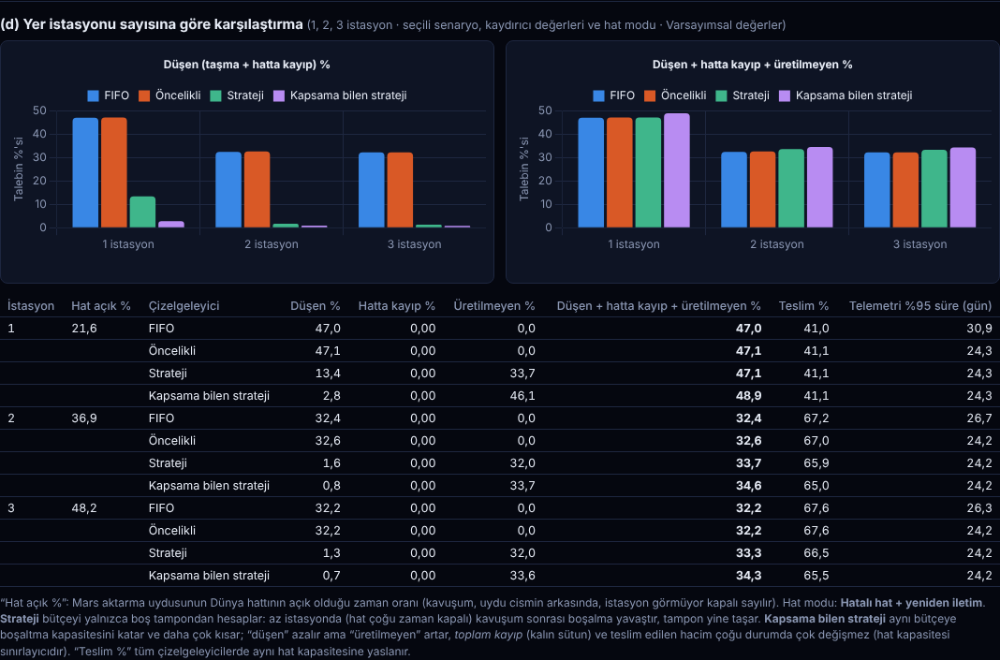
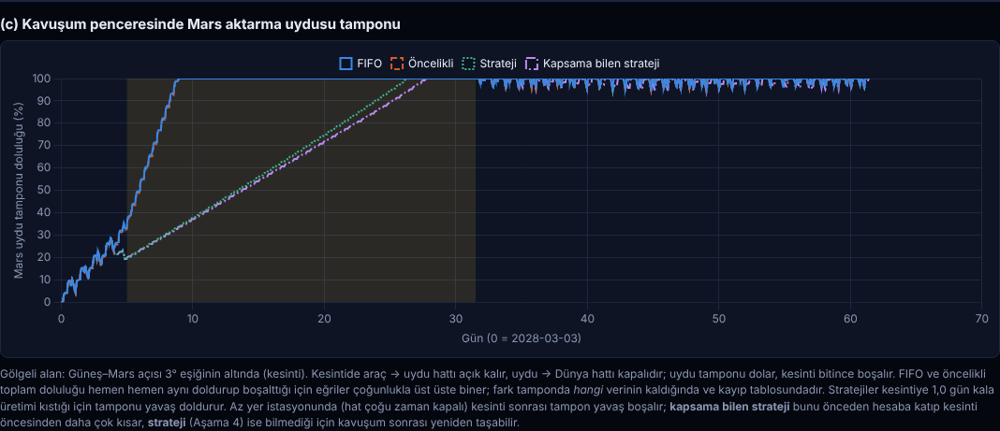
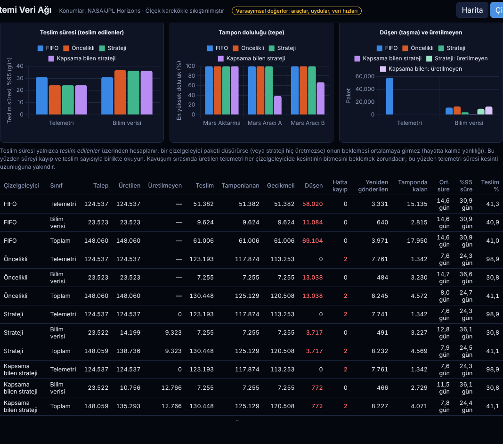

### 1. Kapsama bilen strateji (`'coverage'` politikası)

**Varsayım (öncelikle):** bağlantı takvimi **önceden bilinir**: yörünge, Dünya dönüşü, yer istasyonu görüşü, kavuşum öngörülebilir; ayrıca hattın ortalama kaybı bilinir. Gerçek bir görevin bunu ne kadar doğru bildiğini bilmiyorum; tahmin hatası modellenmedi. Eski strateji de kesinti takvimini biliyordu; yeni olan **kapsamanın** (uyduyu gören istasyonlar, hat açık süresi) önceden bilinmesidir.

**Nasıl çalışır** (`scheduler.ts`): kesintiye `lookaheadDays` (1) kala, kesinti boyunca ve bittikten sonra `recoveryDays` (30) boyunca, her araç için tampon "havuzu" (araç tamponu + uydu tamponunun hız oranındaki payı) **ileriye doğru izlenir**: Dünya hattı açıkken hat hızı × payı × (1 − ortalama kayıp) hızıyla boşalır, kapalıyken (kavuşum, istasyon görmüyor, cisim arkası) boşalmaz; tepe doluluk havuzun `margin` (0,9) oranını aşmayacak en büyük bilim verisi üretim çarpanı ikili aramayla bulunur. Telemetri kısılmaz; kısılan veri "üretilmeyen"dir (kayıp değil). Eski strateji (`'strategy'`) olduğu gibi durur; yalnızca boşaltma terimi ve toparlanma ufku yenidir. Çarpan 1800 sn'de bir yenilenir (yalnızca hesap maliyeti için; sonuçlar her adımda yenilemeyle aynı çıktı).

Parametreler `HYPOTHETICAL.coverageStrategy`: `lookaheadDays`, `recoveryDays`, `margin`, `minFactor`, `assetBufferShare` (araç tamponunun havuza katılan oranı; 1 = Aşama 4 ile aynı havuz, böylece karşılaştırma yalnızca boşaltma kapasitesi terimini ölçer).

**Sonuçlar** (2028-03-08 penceresi, Mars hattı, hatalı hat + yeniden iletim [periyodik], 300 sn adım; hücre: düşen % / düşen + üretilmeyen % / teslim %; **varsayımsal**):

| İstasyon | Hat açık % | FIFO | Öncelikli | Strateji (Aşama 4) | Kapsama bilen strateji |
|---|---|---|---|---|---|
| 1 | 21,6 | 47,0 / 47,0 / 41,0 | 47,1 / 47,1 / 41,1 | 13,4 / 47,1 / 41,1 | **2,8** / 48,9 / 41,1 |
| 2 | 36,9 | 32,4 / 32,4 / 67,2 | 32,6 / 32,6 / 67,0 | 1,6 / 33,7 / 65,9 | **0,8** / 34,6 / 65,0 |
| 3 | 48,2 | 32,2 / 32,2 / 67,6 | 32,2 / 32,2 / 67,6 | 1,3 / 33,3 / 66,5 | **0,7** / 34,3 / 65,5 |

Üretilmeyen %: strateji 33,7 / 32,0 / 32,0, kapsama bilen 46,1 / 33,7 / 33,6 (1 / 2 / 3 istasyon).

Aynı karşılaştırma 9 kavuşum penceresinde, **1 istasyon**, düşen % (öncelikli → strateji → kapsama bilen) ve kapsama bilen stratejinin düşen + üretilmeyen %'si (öncelikli/strateji: aynı değer):

| Pencere | Öncelikli düşen | Strateji düşen | Kapsama bilen düşen | Kapsama bilen düşen+üretilmeyen (diğerleri) | Teslim % |
|---|---|---|---|---|---|
| 2021-09-29 | 44,7 | 22,3 | 2,5 | 46,8 (44,7) | 41,8 |
| 2023-11-08 | 52,8 | 26,8 | 2,9 | 54,8 (52,8) | 34,2 |
| 2025-12-29 | 54,3 | 24,5 | 3,2 | 56,1 (54,3) | 33,7 |
| 2028-03-08 | 47,1 | 13,4 | 2,8 | 48,9 (47,1) | 41,1 |
| 2030-05-13 | 38,3 | 9,6 | 2,2 | 39,6 (38,3) | 50,3 |
| 2032-07-01 | 33,4 | 10,4 | 2,0 | 35,2 (33,4) | 53,3 |
| 2034-08-10 | 35,7 | 15,0 | 2,3 | 37,7 (35,7) | 50,3 |
| 2036-09-15 | 40,9 | 19,9 | 2,3 | 42,9 (40,9) | 45,3 |
| 2038-10-23 | 49,9 | 25,8 | 2,8 | 52,0 (49,9) | 36,7 |

**Duyarlılık** (2028, düşen % / düşen + üretilmeyen % / teslim %):

| Parametre | 1 istasyon | 3 istasyon |
|---|---|---|
| Toparlanma ufku 0 / 3 / 7 / 14 / 21 / **30** gün | 11,9 / 47,1 · 10,6 / 47,4 · 9,1 / 47,6 · 6,5 / 47,6 · 4,6 / 47,9 · **2,8 / 48,9** (teslim hepsinde 41,1) | 0,7 / 34,2–34,3 hepsinde (teslim 65,5) |
| Araç tamponu payı 0 / 0,5 / **1** | 0,0 / 50,3 · 0,3 / 49,6 · **2,8 / 48,9** (teslim 41,1) | 0,0 / 36,5 / 63,3 · 0,2 / 35,5 / 64,3 · **0,7 / 34,3 / 65,5** |

**Okuma (varsayımsal modelde):**
- Kapsamayı bilmek **düşeni 3–5 kat azaltır** (1 istasyonda 13,4 → 2,8; 2–3 istasyonda ≈ yarıya) ve düşenin neredeyse tamamını "üretilmeyen"e çevirir. **Ama toplam kaybı ve teslim edilen hacmi iyileştirmez:** 1 istasyonda teslim aynıdır (41,1; hat kapasitesi sınırlayıcı), 2–3 istasyonda toplam kayıp ≈ 1 puan *artar* (34,3 vs 33,3) ve teslim ≈ 1 puan *azalır* (65,5 vs 66,5), çünkü taşmayı daha sıkı önleyip daha çok kısar. Aşama 4'ün sonucu burada da geçerlidir: strateji hangi verinin ve hangi aşamada kaybolduğunu değiştirir, hacmi artırmaz.
- Neden **1 istasyonda** eski strateji yetmedi: kavuşumdan sonra hat zamanın %21,6'sında açık; ortalama boşaltma (~52 kbit/sn) üretimin (125 kbit/sn) altındadır, yani kavuşumdan sonra da tampon dolu kalır. Kapsama bilen strateji bunu gördüğü için kavuşumdan *sonra* da kısmaya devam eder (toparlanma ufku büyüdükçe düşen azalır: 11,9 → 2,8); ufuk 30 günden (senaryonun sonu) uzun tutulmadı.
- **Kalan düşen** (%0,7–2,8) uydu tamponu doyunca telemetri paketinin daha düşük sınıfı **atarak** girmesinden gelir (öncelikli kural; Aşama 4'te de böyleydi). `assetBufferShare = 0` (yalnızca uydu tamponu bütçelenir) düşeni 0'a indirir ama ≈ 2 puan daha çok kısar; varsayılan 1 seçildi çünkü Aşama 4 ile aynı havuzla adil karşılaştırma verir. Hangisinin tercih edileceği bir maliyet kararıdır (bilmiyorum).

### 2. Kümelenmiş hata modeli (Gilbert–Elliott benzeri, belirleyici)
- **Model:** her hat (her araç→uydu yüzey hattı, her uydu→Dünya hattı) için adım adım iki durumlu (iyi/kötü) bir zincir üretilir (`genLinkStates`). **Rastgelelik yok:** durum geçişleri ve kayıp çekilişleri kendi yazdığım, sabit tohumlu `mulberry32` üretecinden gelir (`HYPOTHETICAL.arq.burst.seed`); aynı girdi aynı sonucu verir (testli). Kötü durumun uzun dönem oranı, hattın **ortalama kaybı** (yüzey %1, Dünya kaydırıcısı %5) iyi/kötü durum kayıplarının karışımı olacak şekilde seçilir; yani **ortalama kayıp periyodik modelle aynıdır, yalnızca dağılımı farklıdır**. Zincir **zamana** bağlıdır (denemeye değil): kaybolan bir paketin yeniden denemesi RTT kısaysa büyük olasılıkla aynı kötü durumda kalır — periyodik modelde bu hiç olmuyordu.
- **Parametreler** (`HYPOTHETICAL.arq.burst`, uydurma): iyi durum kaybı %0,5, kötü durum kaybı %80, kötü durumun ortalama süresi 30 dk, tohum 20281031. Başlangıç durumu iyi.
- **Hat modu** olarak seçilir ("Kümelenmiş hata + yeniden iletim"); `maxAttempts` 4 aynı. (e) bölümü seçili senaryo ve istasyon sayısı için *yeniden iletimsiz*, *periyodik* ve *kümelenmiş* modları yan yana verir (öncelikli çizelge).

**Sonuçlar** (3 ve 1 istasyon, öncelikli, 300 sn adım; **varsayımsal**). "Hatta kayıp paket" = `maxAttempts` (4) denemede iletilemeyen:

| Senaryo | İst. | Mod | İletim denemesi | Kaybolan deneme % (iki hat) | En uzun art arda kayıp | Yeniden gönderilen | **Hatta kayıp paket** | Teslim % |
|---|---|---|---|---|---|---|---|---|
| Mars 2028 | 3 | periyodik | 288.296 | 3,03 | 1 | 8.732 | **0** | 67,6 |
| Mars 2028 | 3 | kümelenmiş | 289.372 | 3,56 | 30 | 10.042 | **267** (%0,06) | 67,5 |
| Mars 2028 | 1 | periyodik | 275.591 | 2,99 | 1 | 8.245 | **2** | 41,1 |
| Mars 2028 | 1 | kümelenmiş | 274.130 | 2,67 | 30 | 7.060 | **266** (%0,06) | 41,0 |
| Ay 2028-03-03, 60 g | 3 | periyodik | 45.749 | 3,04 | 1 | 1.390 | **0** | 99,9 |
| Ay 2028-03-03, 60 g | 3 | kümelenmiş | 46.380 | 4,73 | 28 | 2.046 | **146** (%0,28) | 99,6 |
| Ay 2028-03-03, 60 g | 1 | periyodik | 43.859 | 3,02 | 1 | 1.324 | **0** | 73,2 |
| Ay 2028-03-03, 60 g | 1 | kümelenmiş | 44.133 | 3,88 | 28 | 1.592 | **122** (%0,35) | 73,3 |

**Okuma:**
- **Aynı ortalama kayıpla `maxAttempts` aşımı 0–2 pakette → 122–267 pakete çıktı:** periyodik modelde her 20. deneme kaybolduğu için aynı paket art arda 4 kez hiç kaybolmaz (en uzun art arda kayıp 1); kümelenmiş modelde 28–30 deneme art arda kaybolur. Yani Aşama 5'teki "yeniden iletim kaybı neredeyse tamamen kurtarır" sonucu **iyimserdi** (Aşama 5, "Beklenmedik" 2'deki tahmin doğrulandı), ama büyüklüğü küçük kalır (%0,06–0,35).
- **Kaybın hangi hattan geldiği RTT'ye bağlı** (betik `hat-ayrimi`, 3 istasyon): Mars'ta 267 paketin **250'si yüzey hattından** (RTT ≈ 0, yeniden deneme aynı adımda, aynı kötü durumda) ve yalnızca **17'si Dünya hattından** (RTT ~40 dk ≳ kötü durumun ortalama süresi 30 dk, yeniden deneme çoğu zaman kötü durumdan sonra); 1 istasyonda 260 / 6. Ay'da 146 paketin **121'i Dünya hattından** (RTT ~3 sn ≪ 30 dk: yeniden deneme aynı kötü durumda), 25'i yüzeyden; 1 istasyonda 31 / 91. Arayüzde (e) tablosundaki "…yüzey / Dünya hattı" sütunu bunu gösterir.
- Kaybolan deneme oranı nominalden sapar (2,7–4,7 %, periyodik %3,0; oranlar iki hattın tüm denemelerinin payıdır, Dünya hattı %5 nominal): kötü durumda kaybolan paketler yeniden denendiği için denemeler kötü durumda aşırı temsil edilir, ve 60 günde yalnızca ~100–170 kötü durum dönemi örneklenir (deterministik sapma).
- Teslim edilen hacim neredeyse değişmez (Mars 67,6 → 67,5; Ay 99,9 → 99,6): hata modeli bu varsayımlarda hacmi değil, *hangi paketlerin kalıcı kaybolduğunu* etkiler.

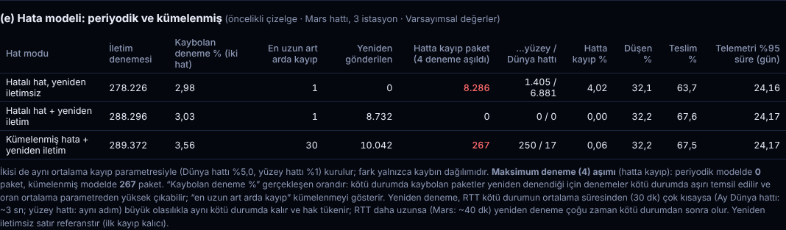
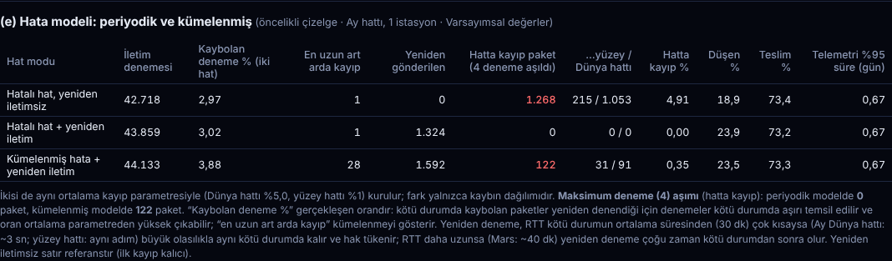

### 3. Ay hattı senaryosu (arayüz)
- Çizelgeleyici sekmesinde **Hat → Ay aktarma hattı**. Ay'da kavuşum yok; senaryo, seçilen **tarih aralığı** (başlangıç + 7/14/30/60 gün) boyunca Ay aktarma uydusu + 2 araçtır. Yer istasyonu kapsama tablosu, istasyon karşılaştırması, hata modeli ve duyarlılık taraması Ay için de çalışır; tampon grafiğinde gölgeli alanlar Dünya hattının kapalı olduğu zamanlardır (istasyon görmüyor ya da Ay'ın arkasında). Stratejiler Ay'da kısma yapmaz (öncelikliyle birebir aynı, testli) ve gösterilmez.
- **Gerçek veriyle** (2028-03-03, 60 gün, hatalı hat + yeniden iletim, 300 sn; **varsayımsal**). Aşama 5'in README tablosuyla uyumludur (pencere 61 → 60 gün olduğundan küçük fark):

| İstasyon | Uyduyu görüyor % | Dünya hattı açık % | FIFO düşen / teslim % | Öncelikli düşen / teslim % | Telemetri %95 süre (FIFO / öncelikli) |
|---|---|---|---|---|---|
| 1 | 42,6 | 37,4 | 24,2 / 72,8 | 23,9 / 73,2 | 4,9 gün / 0,7 gün |
| 2 | 73,2 | 64,6 | 0,0 / 99,9 | 0,0 / 99,9 | 0,5 / 0,4 gün |
| 3 | 98,5 | 87,0 | 0,0 / 99,9 | 0,0 / 99,9 | 0,2 / 0,2 gün |

- **Okuma:** Ay hattında belirleyici olan **yer istasyonu kapsamasıdır**: 1 istasyonda hat %37 açık, tampon (2 Gbit) her boşlukta dolup taşar (düşen ≈ %24), 2 istasyonda kayıp ortadan kalkar. Öncelikli çizelge burada FIFO'ya göre yalnızca telemetri süresini düşürür (4,9 → 0,7 gün) ve düşenden telemetriyi korur. ARQ etkisi küçüktür ama (e) bölümünde görülür: kümelenmiş hatada hatta kayıp %0,28–0,35.
- **Tarih aralığına duyarlıdır:** aynı hat 2030-06-01, 30 gün, 1 istasyon: teslim %74,6, düşen %20,3 (2028'de 73,2 / 23,9). Tek bir aralıktan genelleme yapmayın.

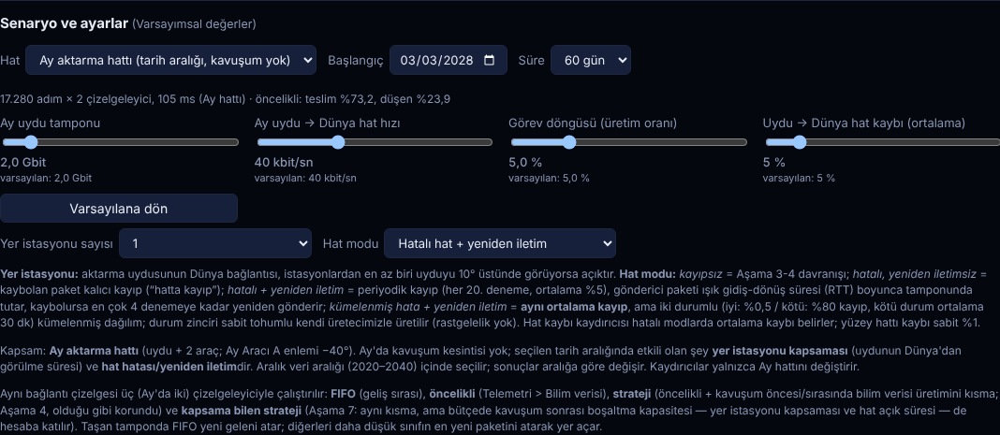
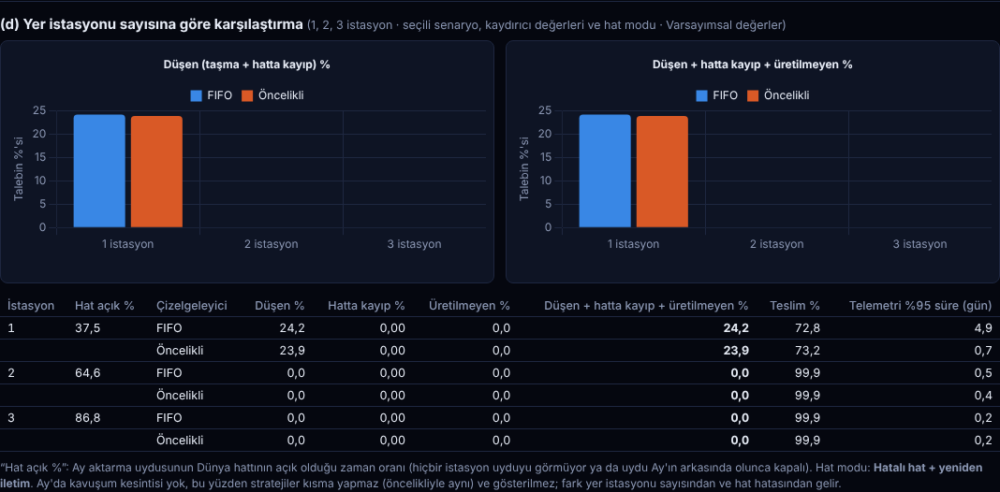
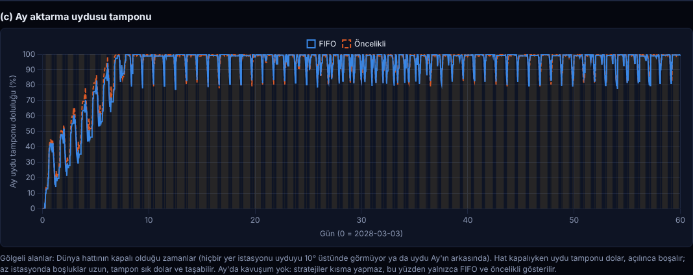
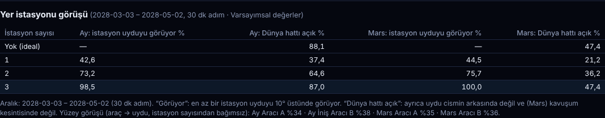

### 4. Dar ekran düzeni
- **Asıl neden Aşama 6'da yazdığımdan farklıydı** ("alt kontroller yüksek"): ≤ 700 px'te `#map` canvas'ının `height` niteliği (kendi ölçüsüne eşitlenir) flex `min-height:auto` yüzünden **haritanın küçülmesini engelliyordu**. 420×860'da `main` 324 px iken canvas 667 px kalıyor, alt çubuğun arkasına taşıyor (Güneş ve iç gezegenler görünmüyordu) ve bilgi/ağ paneli (`#side`) ekranın dışına itiliyordu: **bilgi paneli ve küre kartı dar ekranda hiç erişilemiyordu.** `#map { min-height:0 }` ile çözüldü.
- **Düzen (≤ 700 px):** alt kontroller **tek satır** (▶ Oynat · tarih çubuğu · tarih · **⋯**); **⋯** hız, Bugün, 2B/3B, zoom, tutulma ve Mars kavuşumu düğmelerini açar/kapar (başlangıçta kapalı). Başlık küçüldü (Konumlar notu dar ekranda gizli; "Varsayımsal değerler" rozeti duruyor). Bilgi/ağ paneli **"Bilgi ve ağ durumu ▸"** çubuğuyla katlanır (başlangıçta kapalı). Sol "Cisimler" paneli eskisi gibi başlangıçta katlı ve ▸/▾ ile açılır. Tarih etiketi bilgi paneli açıkken gizlenir (örter). 701 px ve üstünde masaüstü düzeni **değişmedi**.
- **Ölçü (420×860, gerçek veri):** harita yüksekliği görünür ≈ 280 px → **681 px**; alt çubuk 415 → **43 px**; başlık 121 → 60 px. ⋯ açıkken harita 509 px, bilgi açıkken 350 px. 360×740'ta harita 539 px; 700/701 sınırı denendi.
- Dar ekranda Çizelgeleyici sekmesinin başlığı sığıyor; sayfa yatay taşmıyor (`scrollWidth` = 420), geniş tablolar kendi içinde kayıyor.


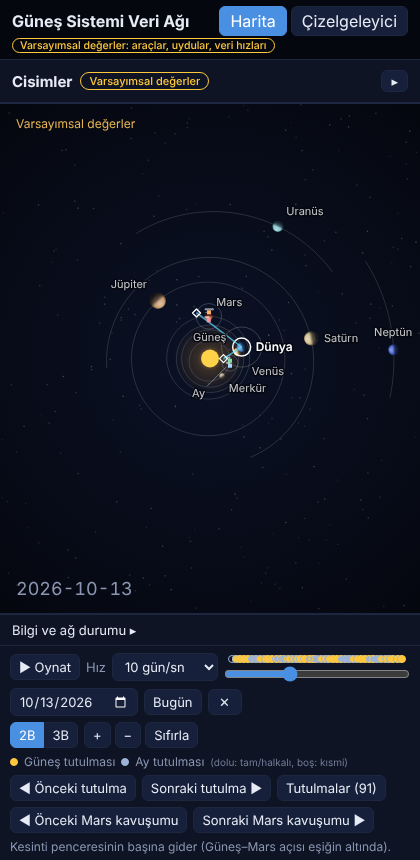

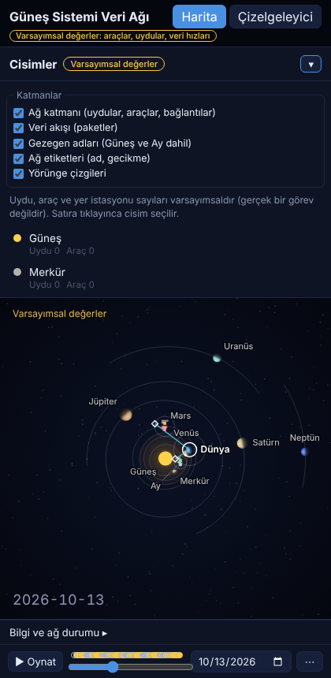
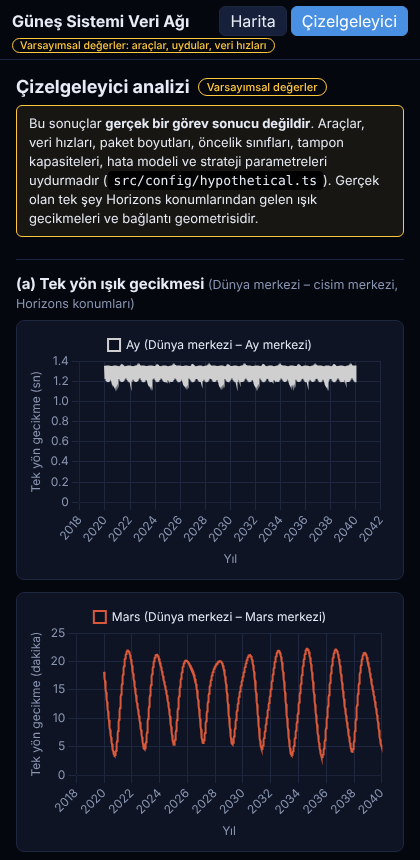

### Gerçek veriyle doğrulama (Playwright/Chromium, `vite preview`, `?sentetik=1` yok)
Denendi: kapsama bilen strateji (1/2/3 istasyon, 2028 penceresi), kümelenmiş hata modu (Mars ve Ay), Ay hattı senaryosu (başlangıç tarihi/süre değişimi dahil), dar ekran (420, 360, 700/701), harita sekmesinde Aşama 6 özellikleri (10 cisim satırı, kart, 5 katman anahtarı ve `localStorage`, zoom, 2B/3B sürükleme, Mars kavuşumu düğmeleri ardışık pencerelere gidiyor, Çizelgeleyici sekmesine gidip dönme, 60 kare/sn). **Konsolda hata/uyarı yok** (tüm akışlarda).
- **Hesap süresi** (tarayıcıda, parçalı: her çizelgeleyici/istasyon/mod/tarama noktası ayrı `setTimeout` parçası, sayfa o sırada girdiye yanıt verir; `PerformanceObserver` `longtask` ile ölçüldü):
  - **Mars, ilk açılış** (3 istasyon, hatalı hat + yeniden iletim): toplam ≈ **14–15 sn** (senaryo 0,5–0,8 sn [4 çizelgeleyici], kapsama tablosu 0,06 sn, **istasyon karşılaştırması 1,7–2,2 sn**, **hata modeli 0,4–0,5 sn**, duyarlılık taraması 10,8–11,8 sn). Aşama 5'te ilk açılış ≈ 10 sn idi; artışın nedeni dördüncü çizelgeleyici (taramada 5 → 6 sonuç/nokta) ve iki yeni bölüm. Önbellek: istasyon sayısı seçimi değişince istasyon karşılaştırması yeniden hesaplanmaz (9 ms; zaten 1/2/3'ü kapsar), hat modu değişince hata modeli tablosu yeniden hesaplanmaz (1 ms; üç modu zaten içerir); kaydırıcı değişince ikisi de yeniden hesaplanır.
  - **En uzun tek görev: 229–396 ms** (çoğunlukla 300 sn adımlı tek bir çizelgeleyici çalıştırması ya da ilk çizim; ilk açılışta 396 ms, Chart.js'in ilk yüklenmesi dahil); Aşama 4–5'te ≈ 150–280 ms'ydi. Sayfa donmuyor ama kısa takılmalar (~0,3–0,4 sn) olabilir. Kapsama bilen stratejinin ileri projeksiyonu 1800 sn'de bir yenilenir; yenilenmeseydi tek çalıştırma ≈ 0,7 sn olurdu.
  - **Ay hattı:** toplam 1,3–2,6 sn, en uzun görev 51–114 ms.
- Harita ekran görüntüleri (masaüstü, 3B): 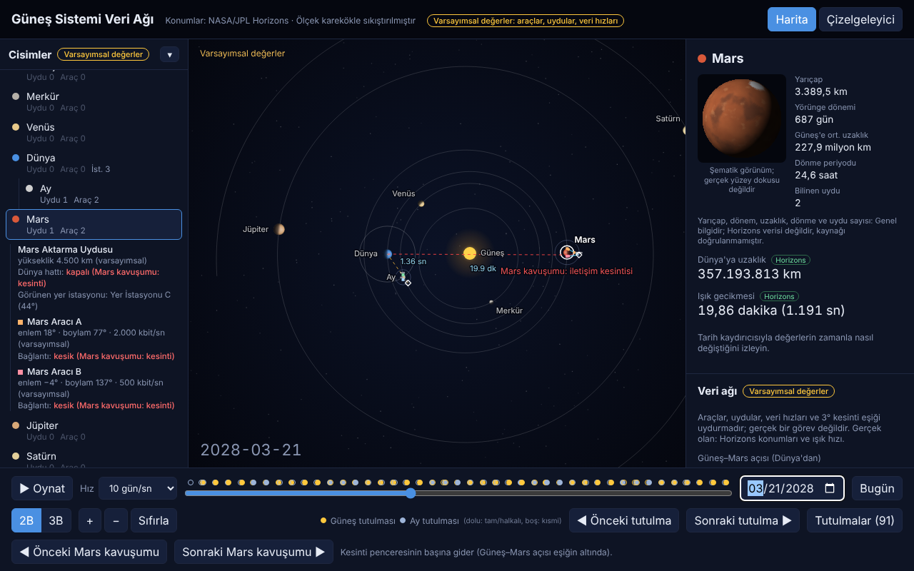 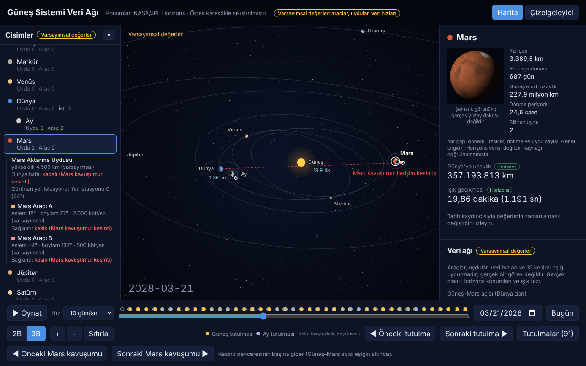

### Testler
`npm test`: **89 test** (önce 75). Yeni (hepsi **sentetik**: uydurma tek araçlı topoloji, uydurma hızlar ve kayıplar, testte yazılı): kapsama bilen strateji (kesinti işareti yokken öncelikliyle birebir aynı; zayıf kapsamada eski strateji taşarken yenisi çok daha az düşürür ve daha çok kısar; tam kapsamada aşırı kısmaz; telemetri kısılmaz/düşmez; **korunum ve talep denklemleri**; toparlanma ufku tekdüzeliği; belirleyicilik, girdiyi değiştirmeme; ARQ varken korunum; `runPolicies` kısayolunun gerçek hesapla aynılığı), üreteç ve durum zinciri (belirleyicilik, kötü oran ve ortalama süre hedefe yakın), kümelenme (periyodik modelde en uzun art arda kayıp ≤ 1, kümelenmişte çok daha uzun; `maxAttempts` aşımı; uzun RTT'nin yeniden denemeyi kurtarması; kaybın yüzey/Dünya ayrımı; tohum değişince dizi değişir), ARQ + küçük tampon + kapsama stratejisi + kümelenmiş hata birlikte korunum. Mevcut testlere dokunulmadı; yalnızca `SweepParams` alan adları değişti (aşağıda).

### Beklenmedik ve dikkat edilecekler
1. **Dar ekran sorunu başka bir yerdeydi** (yukarıda): Aşama 6'daki teşhisim ("alt kontroller yüksek") eksikti; canvas'ın `min-height:auto` davranışı haritayı alt çubuğun arkasına itiyor ve bilgi panelini erişilemez yapıyordu.
2. **Kapsama bilen strateji toplam kaybı iyileştirmedi:** düşeni azaltır, üretilmeyeni artırır; 2–3 istasyonda toplam kayıp ≈ +1 puan, teslim ≈ −1 puan (yukarıda). "Düşen" tek başına bakılırsa strateji çok başarılı görünür; **"düşen + üretilmeyen"** ve teslim sütunlarıyla birlikte okuyun.
3. **Kalan düşenin kaynağı** uydu tamponu doygunluğunda telemetrinin düşük sınıfı atmasıdır (öncelikli kural); `assetBufferShare = 0` bunu 0'a indirir ama daha çok kısar.
4. **Kümelenmiş modelde gerçekleşen kayıp oranı nominalden sapar** (yukarıda): "ortalama kayıp aynı" parametre düzeyinde doğrudur, gerçekleşen oran değil. Ayrıca zincir adım zamanıyla (300 sn; taramada 1800 sn) ayrıklaştırılır; meanBadSec ≥ adım olduğu sürece ortalama doğrudur, sayılar iki adım arasında küçük sapabilir.
5. **`maxAttempts` aşımı yüzey hattında baskındır** (Mars): yüzey hattında yeniden deneme aynı adımda yapıldığından (RTT ≈ 0 varsayımı, Aşama 5) kötü durumda kalır. Gerçek bir yüzey hattında yeniden deneme aralığı ve kısa süreli bozulmalar farklı olabilir; bilmiyorum.
6. **Hesap süresi arttı:** ilk açılış ≈ 10 → 14–15 sn, en uzun tek görev ≈ 280 → 396 ms (dört çizelgeleyici + istasyon karşılaştırması + hata modeli); parçalı olduğu için sayfa donmuyor. Ay hattı çok daha hafif (≈ 2 sn). Web Worker eklenmedi (kural gereği sorulmadan eklenmez); gerekirse bir sonraki adımda önerilir.
7. **Ay senaryosunda strateji yok:** `strategy` ve `coverage` yalnızca kavuşum kesintisini (`earthBlackout`) kullanır; Ay'da istasyon boşlukları (öngörülebilir kapalı hat) için akış kontrolü yapmaz. Bu bir sınırlama; sonraki aşama adayı.
8. **`SweepParams` alanları yeniden adlandırıldı** (`marsRelayBufferMb` → `relayBufferMb`, `marsRelayDownlinkKbps` → `relayDownlinkKbps`; `defaultParams`/`withParams`/`runPolicy`/`sweepPoint` hangi uydu için kullanılacağını isteğe bağlı `relayId` ile alır, varsayılan Mars): davranış aynı, Mars sayıları aynı; yalnızca testlerde anahtar adları güncellendi.
9. **Bölüm harfleri değişti:** duyarlılık taraması (d) → (f); eski bölümlerdeki "(d)" anılar Aşama 4–5 metinlerinde tarihsel olarak kaldı.
10. **Kapsama bilen strateji ortalama kaybı bilir** (periyodik ya da kümelenmiş; aynı ortalama) ve ARQ kopyalarının RTT boyunca tamponda yer tutmasını yok sayar (iyimser).
11. **Sentetik veriyle ekran görüntüsü konmadı;** birim testler sentetiktir ve testte yazılıdır.

### Kararlar
- Yeni dış bağımlılık, Web Worker veya GitHub Actions iş akışı eklenmedi; Chart.js dışında bağımlılık yok. `scripts/asama7-sonuclar.ts` yalnızca `public/data/` dosyalarını okur (Horizons'a erişmez), `vite-node` (vitest ile birlikte gelir) ile çalışır.
- Yeni varsayımsal değerlerin hepsi `hypothetical.ts` içindedir: `coverageStrategy`, `arq.burst`, `moonScenario`, `sensitivity.moon*`. Strateji (Aşama 4) olduğu gibi korundu; yeni politika ayrı bir ad (`'coverage'`).
- Kapsama bilen strateji için araç tamponu havuza dahil (Aşama 4 ile karşılaştırılabilirlik); toparlanma ufku 30 gün (senaryo sonu); pay 0,9 (Aşama 4 ile aynı).
- Kümelenmiş hata zamana bağlı, ortalama kayıp periyodik modelle eşit, tohum sabit.
- Dar ekranda bilgi paneli başlangıçta kapalı; harita seçimiyle otomatik açılmaz (haritanın aniden küçülmemesi için).

## Aşama 8: kayan ufuklu akış kontrolü, tahmin hatası, hata modeli duyarlılığı

> Her şey **varsayımsaldır** (`src/config/hypothetical.ts`; ekranda "Varsayımsal değerler" yazar); sonuçlar **gerçek bir görev sonucu değildir.** Gerçek olan: Horizons konumları, ışık gecikmeleri, geometri. Birim testler **sentetiktir** (testte yazılı). Sayılar depodaki **gerçek Horizons dosyalarıyla** (`public/data/`, dokunulmadı; Horizons'a erişilmedi; `?sentetik=1` yok) `npx vite-node scripts/asama8-sonuclar.ts [ay|mars|ufuk|tum-pencereler|tahmin|capraz|hata]` betiğiyle ve tarayıcıda (Playwright/Chromium, `vite preview`) alındı. **Aşama 3–7'nin çizelgeleyicileri ve sayıları değişmedi** (Aşama 7 tablosundaki Mars 1/2/3 istasyon sayıları betikle birebir yeniden üretildi: 13,4 / 47,1 / 41,1 · 2,8 / 48,9 / 41,1 vb.); PR #5 kaydırma/zoom, 3B referansı, Aşama 6 sol paneli/kart/etiket/katmanlar, Aşama 7 dar ekran düzeni korundu (tarayıcıda denendi, aşağıda).

### Ne eklendi
- **`'rolling'` politikası** (Kayan ufuklu strateji): `'coverage'` ile aynı havuz projeksiyonu, ama **kavuşum işaretine bağlı değil**. Her 1800 sn'de, her araç için önümüzdeki `rollingDays` boyunca bağlantı takviminden öngörülen **her** kapalı hat dönemi (yer istasyonu boşluğu, cisim arkası, kavuşum) boyunca havuz (araç + uydu tamponu payı) ileri izlenir; tepe doluluğu `margin × kapasite`yi aşmayacak en büyük bilim verisi çarpanı ikili aramayla seçilir. Telemetri kısılmaz. Böylece **Ay'da çalışır**. `strategy` ve `coverage` kodu aynı (ortak projeksiyon fonksiyonu, aritmetik aynı; sayılar birebir tuttu). Parametreler `HYPOTHETICAL.rollingStrategy` (`rollingDays` 3, seçenekler 0,5–45 gün, `margin` 0,9, `assetBufferShare` 1, `refreshSec` 1800).
- **Tahmin hatası** (`SchedConfig.forecast`): stratejilerin bildiği takvim/kayıp sapar, **gerçek simülasyon değişmez**. (1) her açık pencerenin başı/sonu ±N dk (+ iyimser: uzun sanılır; − kötümser), (2) pencerelerin tümü ±N dk ötelenir, (3) ortalama kayıp tahmini ±% sapar. Belirleyici, rastgelelik yok; adıma yuvarlanır (tarama adımı 600 sn); veri aralığının kenarına değen pencere uçları kenar kaymasından etkilenmez. Hata verilmezse sonuç birebir aynı (testli). `strategy`, `coverage`, `rolling` hata alır; öncelikli/FIFO almaz.
- **Yüzey hattı yeniden deneme aralığı:** `HYPOTHETICAL.arq.surfaceRetrySec` (varsayılan **0 = aynı adımda**, Aşama 5–7 davranışı; sayılar korunur). > 0 ise kaybolan paket kuyruktan çıkar, tamponda yer tutarak bekler, süre dolunca başa döner (bu sırada hat başka paketlere devam eder).
- **Arayüz** (Çizelgeleyici): "Kayan ufuk" seçici; kayan ufuklu strateji Mars'ta 5, Ay'da 3 çizelgeleyicili karşılaştırmada; **(g) Tahmin hatası** ve **(h) Hata modeli duyarlılığı** bölümleri (**düğmeyle** hesaplanır; senaryo/seçim değişince silinir). Mars taramaları (f) eski dört çizelgeleyiciyle kaldı (hesap süresi), Ay taramalarına kayan ufuklu eklendi.

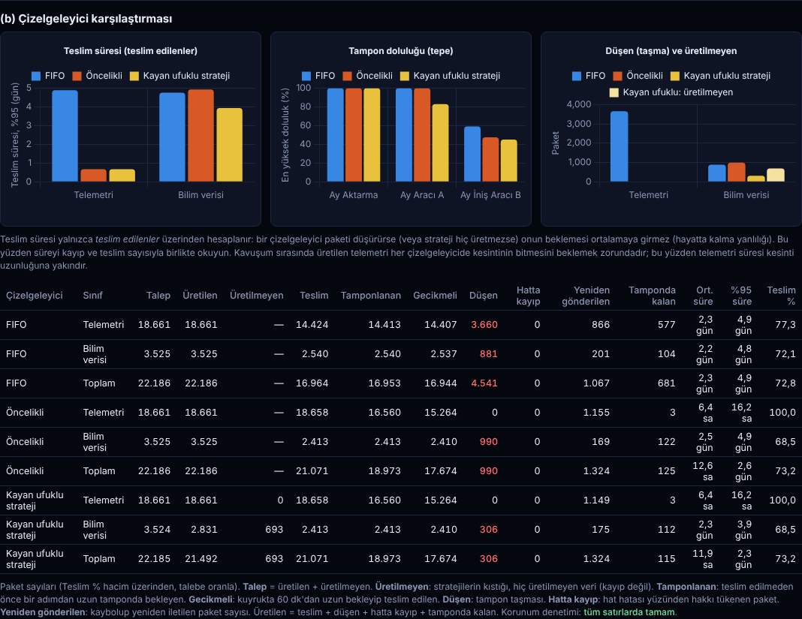
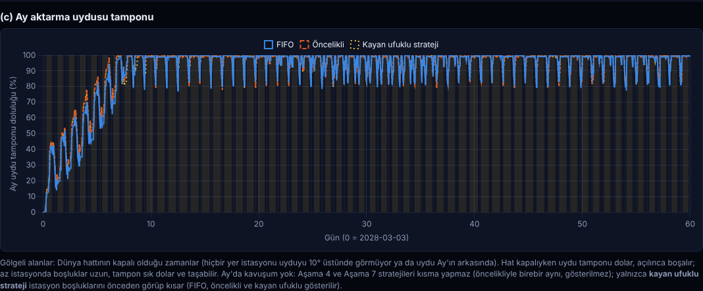
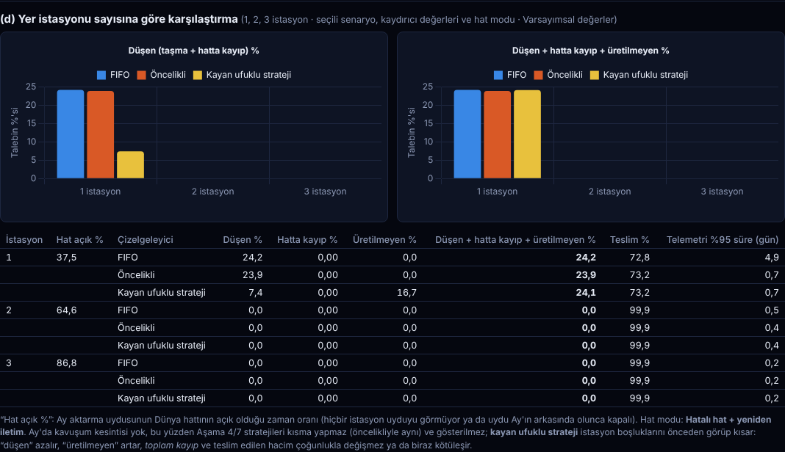
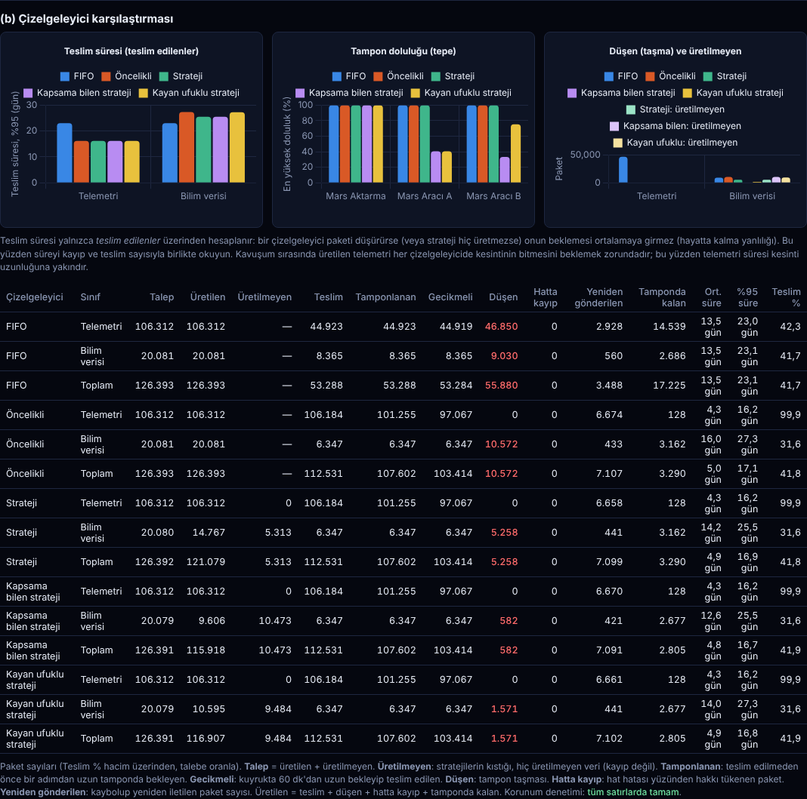
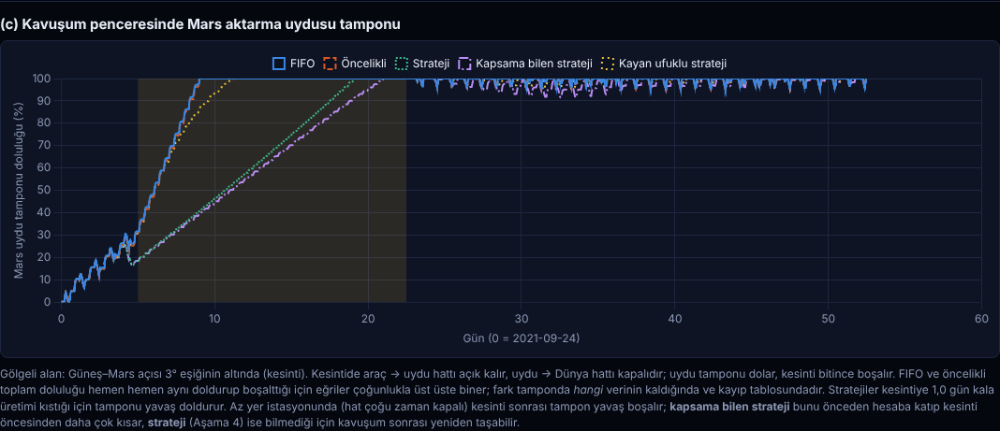
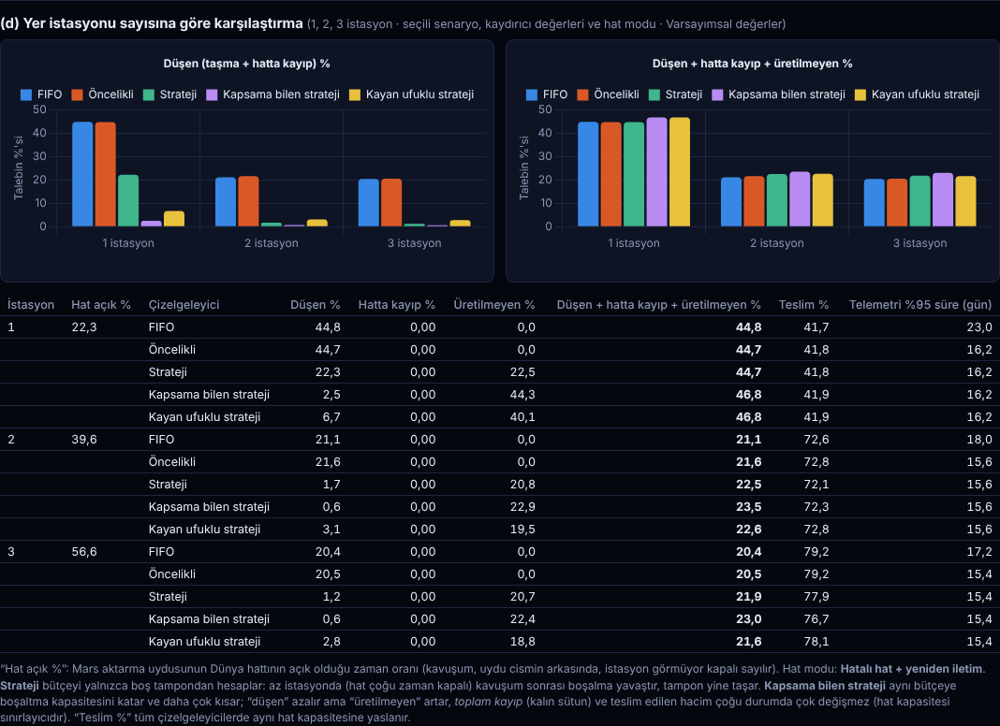

### 1. Kayan ufuklu strateji sonuçları (300 sn, hatalı hat + yeniden iletim [periyodik], ufuk 3 gün; hücre: düşen+hatta kayıp % / toplam kayıp (düşen+hatta kayıp+üretilmeyen) % / teslim % [üretilmeyen %]; **varsayımsal**)

| Hat | İst. | Hat açık % | Öncelikli | Aşama 4 strateji | Kapsama bilen | Kayan ufuklu |
|---|---|---|---|---|---|---|
| Ay 2028-03-03, 60 g | 1 | 37,5 | 23,9 / 23,9 / 73,2 | = öncelikli | = öncelikli | **7,4** / 24,1 / 73,2 [16,7] |
| Ay | 2 | 64,6 | 0,0 / 0,0 / 99,9 | = | = | 0,0 / 0,0 / 99,9 [0,0] |
| Ay | 3 | 86,8 | 0,0 / 0,0 / 99,9 | = | = | 0,0 / 0,0 / 99,9 [0,0] |
| Mars 2028 | 1 | 21,6 | 47,1 / 47,1 / 41,1 | 13,4 / 47,1 / 41,1 [33,7] | 2,8 / 48,9 / 41,1 [46,1] | 7,1 / 48,9 / 41,1 [41,8] |
| Mars | 2 | 36,9 | 32,6 / 32,6 / 67,0 | 1,6 / 33,7 / 65,9 | 0,8 / 34,6 / 65,0 | 4,7 / 33,6 / 66,1 [28,8] |
| Mars | 3 | 48,2 | 32,2 / 32,2 / 67,6 | 1,3 / 33,3 / 66,5 | 0,7 / 34,3 / 65,5 | 4,6 / 33,2 / 66,5 [28,6] |

**Açık sonuç: toplam kayıp ve teslim açısından fayda yok.** Kayan ufuklu strateji "düşen"i çok azaltır (Ay 1 istasyon 23,9 → 7,4; Mars 1 istasyon 47,1 → 7,1) ama bunu "üretilmeyen"e çevirir: Ay 1 istasyonda toplam kayıp 23,9 → 24,1 (+0,2 puan), teslim 73,2 → 73,2 (aynı; hat kapasitesi sınırlayıcı); Mars'ta toplam kayıp +1–1,8 puan, teslim 3 istasyonda −1,1 puan. Ay 2–3 istasyonda zaten kayıp yok, strateji bir şey kazandırmaz. Aşama 7 sonucu burada da geçerli: strateji *neyin* ve *ne zaman* kaybolduğunu değiştirir, hacmi artırmaz. (Mars 3 istasyonda "düşen" bakımından Aşama 4 stratejisinden de **daha kötü**: 4,6 vs 1,3; ufuk 3 gün kavuşumun tamamını görmediği için kısmayı geç başlatıyor.)

**Kayan ufuk duyarlılığı** (düşen+hatta / toplam / teslim [üretilmeyen]):

| Ufuk (gün) | Ay 1 ist. | Mars 1 ist. | Mars 3 ist. |
|---|---|---|---|
| 0,5 | 7,5 / 24,1 / 73,2 [16,6] | 8,5 / 48,9 / 41,1 [40,5] | 5,1 / 33,2 / 66,5 [28,1] |
| 1 | 7,5 / 24,1 / 73,2 | 7,7 / 48,9 / 41,1 | 5,0 / 33,2 / 66,5 |
| **3 (varsayılan)** | 7,4 / 24,1 / 73,2 [16,7] | 7,1 / 48,9 / 41,1 [41,8] | 4,6 / 33,2 / 66,5 [28,6] |
| 10 | 4,8 / 24,1 / 73,2 [19,3] | 4,3 / 48,9 / 41,1 [44,7] | 2,0 / 34,2 / 65,6 [32,2] |
| 30 | 3,6 / 27,5 / 69,8 [23,9] | 2,5 / 51,7 / 38,3 [49,1] | 0,7 / 38,9 / 60,8 [38,2] |
| 45 | 3,6 / 27,5 / 69,9 | 2,5 / 51,7 / 38,3 | 0,7 / 39,0 / 60,8 |

Uzun ufuk "düşen"i daha çok azaltır ama toplam kaybı ve teslimi **kötüleştirir** (ufuk boyunca üretimin hep kısılmış hızda süreceğini varsayan tutucu projeksiyon fazla kısar). 3 gün varsayılan çünkü toplam kayıpta ufuk ≤ 10 günde neredeyse ücretsizdir; bu bir seçimdir.

9 Mars penceresi, 1 istasyon, 1800 sn adım, ufuk 30 gün (düşen / toplam / teslim [üretilmeyen]): kayan ufuklu düşen %1,9–2,9 (kapsama bilen %2,0–3,3), ama toplam kayıp kapsama bilenden her pencerede 2,2–4,4 puan yüksek, teslim 1,9–4,4 puan düşük (ör. 2028-03-08: öncelikli 47,6 / 47,6 / 40,6; kapsama bilen 2,8 / 49,4 / 40,6; kayan 2,5 / 52,1 / 37,9). (`tum-pencereler`)

### 2. Tahmin hatası (tarama adımı 600 sn; kayan ufuk 3 gün; (g) bölümü ve `tahmin`/`capraz` betiği)

Ölçüt: "kayan ufuklu strateji karşılaştırılan çizelgenin altına düştü" = 0,1 puandan fazla kötü (düşen+hatta kayıp daha yüksek, toplam kayıp daha yüksek, teslim daha düşük).

| Senaryo | Düşen+hatta kayıp: öncelikli / Aşama 4'e göre (hata yokken fark) | Toplam kayıp: öncelikli | Teslim: öncelikli |
|---|---|---|---|
| Ay 1 ist. | −17,2 puan (daha iyi); **−480…+480 dk'da hiç kötüleşmez** | hata yokken zaten **+0,24** kötü | −120 dk'da kötüleşir (72,3 vs 73,2); + yönde taranan aralıkta yok |
| Ay 2 ist. | 0 (zaten kayıp yok) | hata yokken 0; **−60 dk**'da kötüleşir (0,7), −120'de 4,5 | −60 dk'da (99,2 vs 99,9), −120'de 95,4 |
| Mars 1 ist. | −40,0 / −6,3 puan; hiç kötüleşmez | hata yokken zaten **+1,9** | kötüleşmez |
| Mars 3 ist. | −27,7 puan; Aşama 4'e göre hata yokken **+3,3 (zaten kötü)** | hata yokken **+1,0** | hata yokken **−1,0** |

**Okuma:**
- **Düşen** bakımından kayan ufuklu strateji, öncelikli çizelgenin altına **hiçbir taranan hata düzeyinde düşmedi** (±480 dk). Aşama 4 stratejisinin altına yalnızca Mars 3 istasyonda (hata yokken bile) düşer (kavuşumu görmeyen kısa ufuk).
- **Toplam kayıp ve teslim** bakımından zaten hata yokken öncelikliden iyi değildir (bölüm 1); yani "altına düşme eşiği" hata yokken sıfırdır. Hatanın bunu *ek olarak* kötüleştirdiği yön **kötümser** hatadır (pencereler kısa sanılır → fazla kısma): Ay 2 istasyonda hiçbir şey kaybedilmezken −60 dk'da %0,7, −120 dk'da %4,5 üretilmeyen (teslim 99,9 → 95,4); Ay 1 istasyonda toplam kayıp 24,2 → 26,5 (−120 dk). Mars'ta kapsama bilen strateji bu hataya daha duyarlı: 1 istasyonda −120 dk'da toplam kayıp 49,1 → 58,5, teslim 40,9 → 38,0; 3 istasyonda 34,3 → 45,7, teslim 65,5 → 54,1.
- **İyimser** hata (pencere uzun sanılır) bu modelde ucuzdur: Ay 1 istasyonda +120 dk'da düşen 6,7 → 6,8; Mars kapsama bilen 2,8 → 4,4 (kayan ufuklu 7,2 → 8,5). Tamponun ve hat boşluklarının zaten geniş olması bunu açıklıyor olabilir; bilmiyorum.
- **Ötelemenin** etkisi ihmal edilebilir (±120 dk'da ≤ 0,2 puan). **Ortalama kayıp sapması** küçük etkili: kayıp %5 olduğu için ±%100 sapma kapasite tahminini ≈ %5 oynatır (Mars 1 ist. kapsama bilen düşen 3,0 → 1,5, kayan ufuklu 7,3 → 6,5; toplam kayıp ≤ 0,2 puan).
- Bu sonuçlar tahmin hatasının **bu varsayımlarla** küçük olduğunu söyler; gerçek istasyon takvimi/bakım belirsizlikleri bu modelin dışındadır.

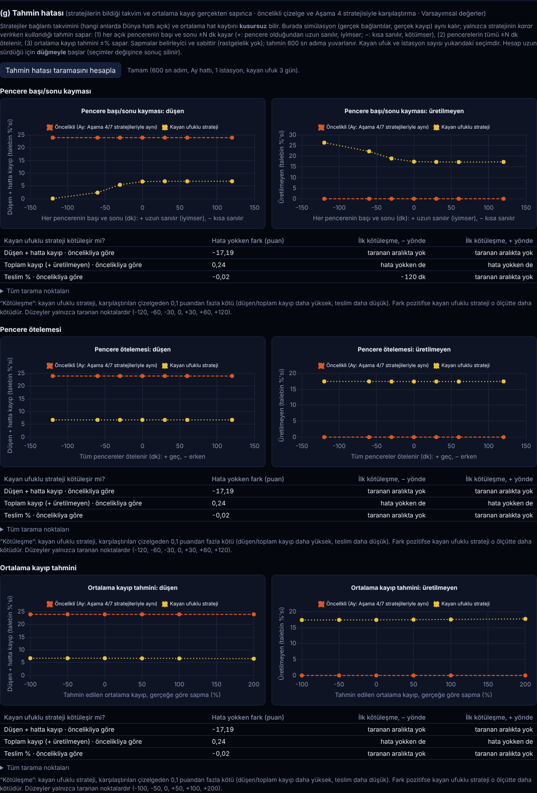
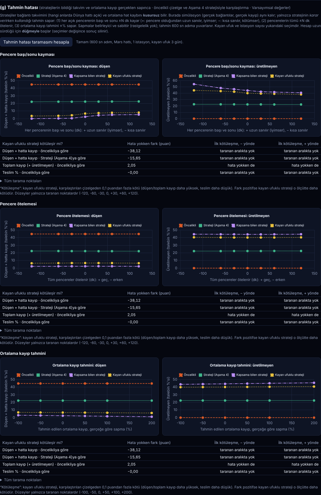

### 3. Hata modeli duyarlılığı (kümelenmiş model, 3 istasyon, öncelikli, 600 sn; (h) bölümü ve `hata` betiği)
Hatta kayıp paket (yüzey / Dünya hattı); periyodik referans (aynı ortalama kayıp): Mars 2 (0 / 2), Ay 0. Varsayılan: kötü durum kaybı %80, süre 30 dk, yeniden deneme aralığı 0.

| Parametre | Mars 2028 | Ay 2028-03-03, 60 g |
|---|---|---|
| Kötü durum kaybı %20 / 40 / 60 / **80** / 100 | 4 (3/1) · 42 (41/1) · 147 (147/0) · **323 (322/1)** · 568 (568/0) | 4 (1/3) · 10 (3/7) · 41 (21/20) · **85 (53/32)** · 163 (91/72) |
| Kötü durum süresi 10 / 20 / **30** / 60 / 120 dk | 181 (181/0) · 257 (257/0) · **323 (322/1)** · 494 (491/3) · 1.283 (760/523) | 74 (74/0) · 59 (54/5) · **85 (53/32)** · 245 (44/201) · 579 (83/496) |
| Yüzey yeniden deneme aralığı **0** / 10 / 30 / 60 / 120 dk | **323 (322/1)** · 20 (19/1) · **2 (0/2)** · 1 (0/1) · 1 (0/1) | **85 (53/32)** · 52 (22/30) · 35 (0/35) · 30 (0/30) · 29 (0/29) |

**Okuma:** (i) Kayıp, kötü durum kaybı ve süresiyle hızla artar; teslim ve düşen % neredeyse değişmez (Mars teslim %67,6 → 67,4; Ay %99,8 → 99,3) — etki *hangi paketlerin kalıcı kaybolduğunda*. (ii) **Mars'ta kaybın baskın kısmı yüzey hattındandır** (RTT ≈ 0, yeniden deneme aynı kötü durumda); yüzey yeniden deneme aralığı 10 dk'ya çıkınca 323 → 20, **30 dk'da 2** (periyodik modelin seviyesi) olur, yani yüzeyden gelen kayıp kötü durumun ortalama süresine eşit bir aralıkla yok olur. Dünya hattı kaybı Mars'ta RTT'den (~40 dk) dolayı düşüktür, kötü durum süresi 120 dk'ya çıkarsa (RTT'yi aşarsa) 523'e sıçrar. (iii) Ay'da yüzey kaybı yeniden denemeyle 0'a iner (30 dk) ama **Dünya hattı kaybı (RTT ~3 sn) 29–35'te kalır**: yeniden deneme aralığı yüzey hattını düzeltir, Dünya hattını düzeltmez. (iv) Bekleyen kopya tamponda yer tutar; bu senaryoda (3 istasyon) düşen etkisi görülmedi, tampon dar olsaydı görünürdü (testle korunumu doğrulandı).

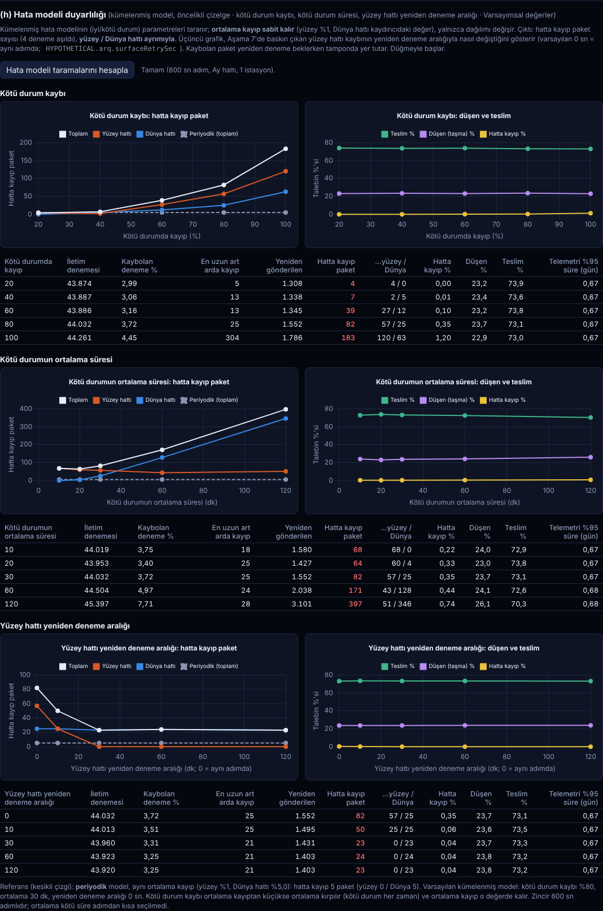
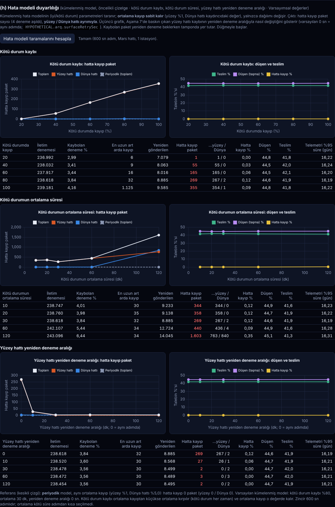

### 4. Hesabın Web Worker'a taşınması (onayla eklendi)

Aşama 8'in dördüncü maddesi, onay beklediği için ilk PR'da yoktu; onay gelince ayrı PR ile yapıldı. Yeni bağımlılık ve GitHub Actions iş akışı yok (Vite'ın yerleşik Worker desteği; `npm run build` Worker'ı `dist/assets/compute.worker-*.js` olarak üretir, Pages yayını değişmedi).

- **Mimari:** `src/network/compute.ts` (saf işleyici, DOM yok: bağlantı çizelgesi üretimi, çizelgeleyici çalıştırma, tarama noktası, yer istasyonu kapsaması), `compute.worker.ts` (ince Worker girişi), `computeClient.ts` (**Worker havuzu**: en çok 4, `hardwareConcurrency − 1` işçi; her biri izlerin kendi kopyasını ve bağlantı çizelgesi önbelleğini tutur; Worker kurulamazsa aynı işleyici ana iş parçacığında çalışır). Panel (`schedulerPanel.ts`) yalnızca iş verir ve sonucu çizer; kapsama tablosu, senaryo, istasyon karşılaştırması, hata modeli, tarama ve (g)/(h) taramaları **işçi havuzunda birlikte** hesaplanır, her bölüm bitince çizilir. Hesap sonuçları ana iş parçacığındaki hesapla **aynıdır** (testle doğrulanır; tarayıcıda da aynı sayılar: örn. Mars 1 istasyon kayan ufuklu düşen %6,7 / üretilmeyen %40,1).
- **İptal belirteci:** kaydırıcı, senaryo, istasyon, hat modu ya da kayan ufuk değişince `bump()` hem belirteci hem havuzu iptal eder: bekleyen işler **hiç başlamaz**, sürmekte olanın sonucu atılır (işçi o işi bitirince serbest kalır; tek iş ≤ ~0,3 sn). Atılan işlerin sözleri sonuçlanmaz (reddedilmez de): "yakalanmamış söz reddi" gürültüsü olmasın diye; kimse tutunmadığı için çöp toplanır. Tarama sürerken senaryo değiştirmek de denendi (konsolda hata yok).
- **Ölçüm** (gerçek veri, `vite preview`, 4 çekirdekli kapta, 3 işçi; `longtask` ile; Aşama 8'in ilk PR'ındaki ana iş parçacığı sürümüyle karşılaştırma):

| | Aşama 7 / ilk Aşama 8 PR'ı (ana iş parçacığı, parçalı `setTimeout`) | Web Worker havuzu |
|---|---|---|
| Mars ilk açılış, tüm bölümler | ≈ 14,5–16,5 sn | **≈ 6,1–6,5 sn** (en yavaş bölüm: duyarlılık taraması) |
| Senaryo (5 çizelgeleyici) ilk çizim | ≈ 0,8–1,0 sn | ≈ 0,75–0,85 sn (ilk açılış), 0,4 sn (sonraki) |
| `longtask` sayısı / toplamı (açılış) | ≈ 115–120 / ≈ 14–15 sn | **3 / ≈ 0,25 sn** |
| **En uzun görev (ana iş parçacığı)** | 279–324 ms | **124–138 ms** (Aşama 7: 229–396 ms; hedefin altında) |
| Mars istasyon/mod değişince (önbellekli bağlantı) | ≈ 10–12 sn | ≈ 4–4,7 sn |
| Mars (g) tahmin hatası taraması / (h) | ≈ 7 sn / ≈ 2 sn | ≈ 2,8 sn / ≈ 0,9 sn |
| Ay ilk açılış | ≈ 2,9 sn | ≈ 1,4 sn |

Kalan üç ana iş parçacığı görevi (≈ 80–140 ms) Chart.js'in ilk yüklenmesi ve ilk grafik çizimleridir (hesap değil); bunların altına inmek için çizimin bölünmesi gerekir, yapılmadı. Sayfa hesap sırasında hiç takılmadı (hesap ana iş parçacığında değil). İlk açılışta toplam süre çekirdek sayısına bağlıdır: tek çekirdekte işçiler paylaşır, kazanç yalnızca "sayfa takılmaz" olur (ölçülmedi, bilmiyorum).

- **Beklenmedik (madde 4):** (1) **İptal edilen işin sözünü reddetmek** ilk denemede hem yakalanmamış söz hatalarına hem de önbellekteki bekleyen sözün sonsuza dek asılı kalmasına yol açtı (bağlantı çizelgesi özeti önbelleğe *söz* olarak alınmıştı; iptalden sonra yeniden kullanılınca hesap hiç bitmedi); düzeltme: yalnızca tamamlanmış özetler önbelleğe alınıyor. (2) (g) taramasında bir `async` döngüsünün henüz atanmamış diziye eriştiği hata (yalnızca tarayıcıda, Mars (g)) bulundu ve düzeltildi. (3) Her işçi kendi bağlantı çizelgesi önbelleğini kurar (aynı çizelge işçi sayısı kadar kez üretilebilir; ≈ 0,1–0,5 sn).
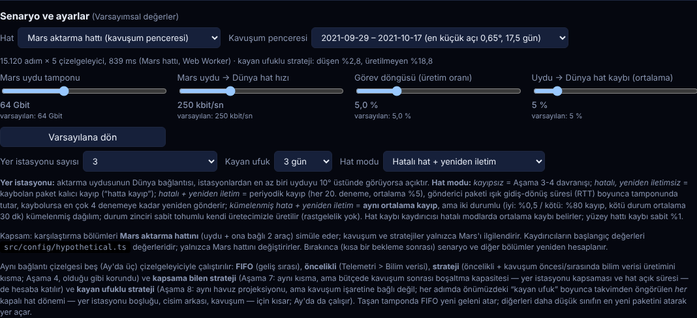

- **Testler:** `npm test` **114 test** (önce 108). `src/network/compute.test.ts` (**sentetik**: uydurma dairesel yörüngeli konum izleri): işleyici sonucu doğrudan çağrıyla birebir aynı (`sim`, `tlInfo`, `policy`, `coverage`), başlatılmadan hata, bozuk aralıkta hata; havuz (1 ve 3 işçi) sonucu aynı; iptalde bekleyen işlerin hiç başlamadığı ve sonuçların atıldığı; hatadan sonra havuzun çalışmaya devam etmesi.

### Gerçek veriyle doğrulama (Playwright/Chromium, `vite preview`, `?sentetik=1` yok)
Denendi: Ay 1/2/3 ve Mars 1/2/3 istasyon (kayan ufuklu strateji, kayan ufuk 30 gün seçimi), (g) ve (h) taramaları (Ay ve Mars), dar ekran (420 px; sayfa yatay taşmıyor, `scrollWidth` 420), harita sekmesi: 10 cisim satırı, kart canvas'ı, katman anahtarları + `localStorage`, zoom/sürükleme, 2B/3B, tutulma ve Mars kavuşumu düğmeleri; dar ekranda ⋯, bilgi paneli, harita 681 px / alt çubuk 43 px (Aşama 7 ile aynı). **Konsolda hata/uyarı yok** (tüm akışlarda).


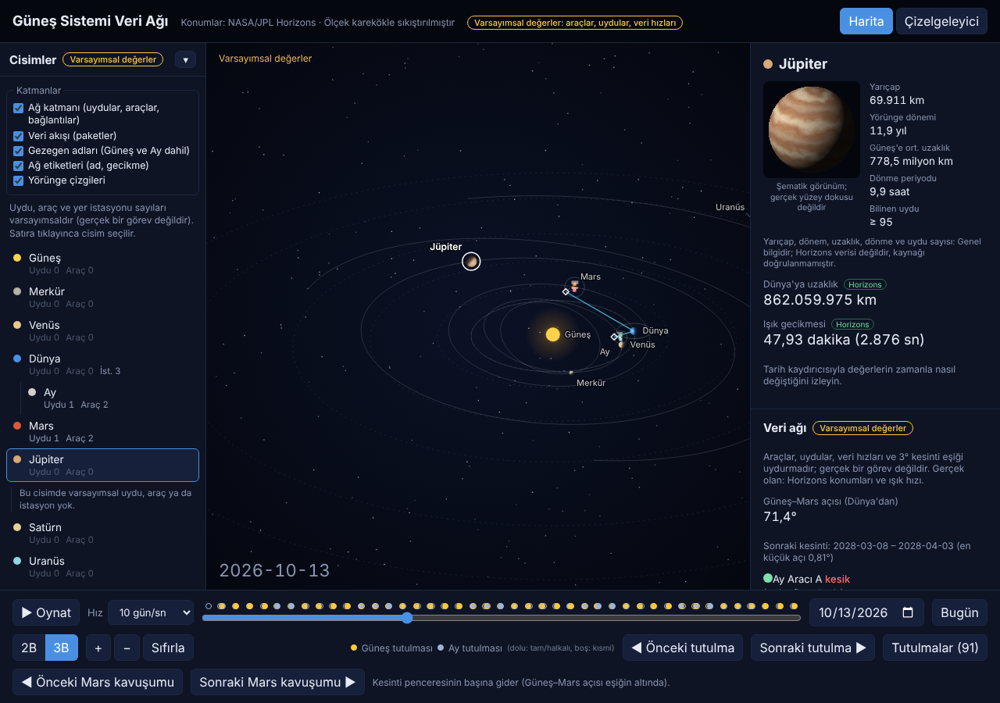
   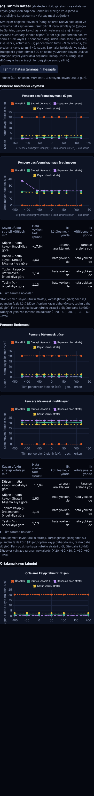

**Hesap süresi** (aynı kapta, aynı betikle, `main` ve bu dal art arda ölçüldü; `longtask` ile): Mars ilk açılış toplam **14,5–16,5 sn** (main: 15,1–16,1; bu dal: 14,5–16,2; tek seferlik 15,8 sn / 537 ms aykırı değer), en uzun tek görev **279–324 ms** (main 287–324, bu dal 279–315). **Aşama 7'nin altına inemedi:** hesap hâlâ ana iş parçacığında, `setTimeout` ile parçalı; tek bir 300 sn'lik çizelgeleyici çalıştırması ≈ 0,25–0,3 sn ve Chart.js'in ilk çizimi bu tabanı belirliyor. Beşinci çizelgeleyici senaryo ve (d) bölümüne ≈ 0,2–0,4 sn ekledi, toplam gürültü içinde kaldı (Mars taramaları (f) beşinci politikayı kapsamıyor). Yeni (g)/(h) taramaları isteğe bağlıdır: Mars (g) ≈ 7 sn, (h) ≈ 2 sn; Ay (g) ≈ 0,9 sn, (h) ≈ 0,6 sn; en uzun görev 61–231 ms. Ay ilk açılış ≈ 2,9 sn (en uzun görev 131 ms). **Hesabı Web Worker'a taşıma (madde 4) onay beklediği için bu ölçümde yoktu; sonradan onayla yapıldı, bölüm 4.**

### Testler
`npm test`: **108 test** (önce 89; yeni 19, `src/network/rolling.test.ts`, hepsi **sentetik**: uydurma tek araçlı topoloji ve uydurma periyodik hat boşlukları): kayan ufuklu strateji (kapalı dönem yokken öncelikliyle birebir aynı; kavuşum işareti olmadan boşluklarda kısar, Aşama 4/7 stratejileri aynı desende hiçbir şey yapmaz; telemetri kısılmaz/düşmez; **korunum ve talep denklemleri**, düşen/üretilmeyen ayrımı; kısma teslim edilen hacmi artırmaz; kavuşumda da çalışır; deterministik, girdiyi değiştirmez; ayar yoksa kısmaz), tahmin hatası (`forecastFlags`; hata yok = kusursuzla birebir; öncelikli etkilenmez; iyimser/kötümser yönler; kayıp sapması; öteleme), yüzey yeniden deneme aralığı (0 = eski davranış birebir; korunum, bekleyen paket "kalan"; uzun aralık yüzey kaybını azaltır; deterministik; küçük tamponla korunum). Mevcut testlere dokunulmadı.

### Beklenmedik ve dikkat edilecekler
1. **Toplam kayıp/teslim iyileşmedi** (yukarıda): Aşama 7'nin bulgusu üçüncü kez doğrulandı; "düşen" tek başına yanıltıcıdır.
2. **Uzun ufuk kötüleştirir**: ufuk 30–45 gün toplam kaybı 3–6 puan artırır (tutucu projeksiyon). Mars kavuşumunu görmek için uzun ufuk gerekir ama bedeli var; varsayılan 3 gün Mars 3 istasyonda Aşama 4'ten daha çok düşürür.
3. **Kapsama bilen strateji kötümser takvim hatasına en duyarlı politikadır** (Mars 3 ist. toplam kayıp 34,3 → 45,7 @ −120 dk); iyimser hata ucuz çıktı, nedeni tam anlaşılmadı.
4. **Havuz yaklaşımı yüzey hattını modellemez:** boşalma yalnızca Dünya hattı açıklığına bağlı; araç yüzey hattı kapalıyken araç tamponundaki veri boşalmaz. Ay'da yüzey görüşü %34–38 olduğundan projeksiyon iyimser olabilir (varsayım). **→ Aşama 9'da seçenek olarak eklendi; etki yok** (bölüm 1).
5. **ARQ kopyalarının RTT boyunca tampon tutması ve yüzeydeki bekleyen kopyalar** projeksiyonda yok sayılır (iyimser). **→ Aşama 9'da seçenek olarak eklendi; etki yok** (bölüm 1).
6. **Tarama 600 sn adımlı**; ±N dk kayması adıma yuvarlanır, 10 dk altı sapma ayırt edilemez. Kümelenmiş zincir 600 sn adımlıdır (meanBadSec ≥ adım seçildi); 10 dk'lık kötü süre adım sınırındadır.
7. **Kötü durum kaybı ortalama kayıptan küçükse** (örn. Dünya kaybı kaydırıcıyla %40 iken kötü durum %20) ortalama kırpılır; taramada ortalama sabit kalmaz.
8. **Sonuçlar tek senaryo aralığıdır** (Ay 2028-03-03/60 g, Mars 2028 penceresi); Ay 1 istasyonda başka aralık denenmedi (Aşama 7'de aralığa duyarlılık görülmüştü). **→ Aşama 9'da kapatıldı** (Ay 5 aralık, Mars 9 pencere; bölüm 4).
9. **(g)/(h) isteğe bağlı** (düğmeyle): ilk açılış süresi artmasın diye. Web Worker ile (bölüm 4) artık ucuz (Mars ≈ 3 sn / 1 sn); otomatik çalıştırmak bir tasarım kararıdır, yapılmadı. **→ Aşama 9'da ölçülüp değerlendirildi:** varsayılan kapalı, isteğe bağlı kutu (bölüm 4b).
10. **Hesap süresi hedefi ilk PR'da tutmadı** (ilk açılış ≈ 15 sn, en uzun görev ≈ 0,3 sn); Web Worker onayıyla bölüm 4'te giderildi (≈ 6 sn, en uzun görev ≈ 0,13 sn).

### Kararlar
- Yeni dış bağımlılık ve GitHub Actions iş akışı eklenmedi (Web Worker: onay beklediği için ilk PR'da yoktu, sonradan onayla eklendi, bölüm 4); yeni politika ayrı ad (`'rolling'`), `strategy`/`coverage` aynen.
- Yeni varsayımsal değerler yalnızca `hypothetical.ts`: `rollingStrategy`, `forecastScan`, `errorScan`, `arq.surfaceRetrySec` (varsayılan 0).
- `scripts/asama8-sonuclar.ts` yalnızca `public/data/` okur (Horizons'a erişmez), `vite-node` ile çalışır.
- Tahmin hatası yalnızca stratejilerin bildiği takvime uygulanır; gerçek bağlantılar ve kayıplar değişmez.

## Aşama 9: model iyimserlikleri, değer ağırlıklı fayda, kapsamayı artıran fiziksel model, genelleme

> Her şey **varsayımsaldır** (`src/config/hypothetical.ts`; ekranda "Varsayımsal değerler" yazar); sonuçlar **gerçek bir görev sonucu değildir.** Gerçek olan: Horizons konumları, ışık gecikmeleri, geometri. **Varsayım olanlar:** yörünge elemanları (eliptik Ay yörüngesi, ikinci uydu), ikinci uydunun kapasitesi, kutup aracı, Mars gölge modeli, değer ağırlıkları ve yarı ömürler. Birim testler **sentetiktir** (testte yazılı). Sayılar depodaki **gerçek Horizons dosyalarıyla** (`public/data/`, dokunulmadı; Horizons'a erişilmedi; `?sentetik=1` kullanılmadı) `npx vite-node scripts/asama9-sonuclar.ts [projeksiyon|projeksiyon-zor|deger|deger-esik|adaptif|yorunge|golge|genelleme|tahmin-genelleme]` betiğiyle (ortak yardımcılar `scripts/asama9-lib.ts`) ve tarayıcıda (Playwright/Chromium, `vite preview`) alındı; ikisi aynı sayıları verir.
>
> **Aşama 3–8 sayıları değişmedi:** `scripts/asama8-sonuclar.ts` (`ay`, `mars`, `ufuk`, `tum-pencereler`, `tahmin`, `hata`) ve `scripts/asama7-sonuclar.ts` (`kapsama`, `tum-pencereler`, `ufuk`, `havuz`, `hata`, `hat-ayrimi`, `ay`) çıktıları, bu dalda ve `main`'de (aynı makinede) **bayt bayt aynı** (karşılaştırıldı). Yeni her şey **seçenektir** (varsayılan kapalı / varsayılan yörünge); mevcut çizelgeleyiciler (FIFO, öncelikli, strateji, kapsama bilen, kayan ufuklu) ve PR #5 kaydırma/zoom, 3B'de Güneş'e göre referans, Aşama 6 sol paneli, küre kartı, etiket yerleştirici, katmanlar, Aşama 7 dar ekran düzeni, Aşama 8 Worker havuzu ve iptal belirteci (iptal edilen işlerin sözleri sonuçlanmaz, önbelleğe bekleyen söz konmaz) korundu.

### Ne eklendi (özet)
1. **İyimser projeksiyon varsayımlarını kaldıran iki seçenek** (`SchedConfig.projection`, `HYPOTHETICAL.projection`, varsayılan ikisi kapalı): yüzey hattı kapalılığı, ARQ kopyalarının RTT boyunca tampon payı. **Etkisi ayrı raporlandı: etki yok** (bölüm 1).
2. **Değer ağırlıklı fayda ölçütü** (teslim edilen değer / talep edilen değer; telemetri ve bilim verisi için varsayımsal birim değer, bilim verisi için isteğe bağlı zamanla azalan değer) ve yeni **`'adaptive'` (uyarlamalı ufuk) politikası** (bölüm 2).
3. **Ay aktarma uydusu için yörünge seçimi** (ekvatoral dairesel [mevcut] / eğimli-eliptik kutupsal), **ikinci Ay aktarma uydusu** (araçlar en iyi görüneni kullanır ya da hat sırasıyla), isteğe bağlı **kutup aracı**; **Mars aktarma uydusu gölgesi** (basit kesinti, güç modeli yok) (bölüm 3).
4. **Genelleme** (Ay 5 tarih aralığı, Mars 9 pencere, tahmin hatası dahil), (g)/(h) taramalarını **isteğe bağlı otomatik** çalıştırma, ana iş parçacığı görevlerini bölme (bölüm 4).

**Arayüz (Çizelgeleyici sekmesi):** *Hat* seçicisine "Mars aktarma hattı (tarih aralığı; kavuşumsuz önerilir)" eklendi (varsayılan 2029-06-01, 60 gün: hiçbir kavuşumla kesişmez; kavuşumla kesişen bir aralıkta Aşama 4/7 stratejileri de gösterilir). Ayarlarda *Havuz projeksiyonu* (iki işaret kutusu), Ay'da *Ay yörüngesi / İkinci Ay uydusu / kutup aracı ekle*, Mars'ta *Mars uydusu gölgesi* seçicileri; seçilince ana senaryo, istasyon karşılaştırması, taramalar buna göre yeniden hesaplanır. Yeni bölümler: **(i) Değer ağırlıklı fayda**, **(j) İyimser varsayımların etkisi**, **(k) Ay yörüngesi ve ikinci uydu / Mars uydusu gölgesi**, **(l) Genelleme** ((j), (k), (l) düğmeyle çalışır; hepsi Worker havuzunda). Karşılaştırma tablosuna "Değer %" sütunu, duyarlılık taramalarına "Değer" ölçütü, (g) bölümüne uyarlamalı strateji eklendi.

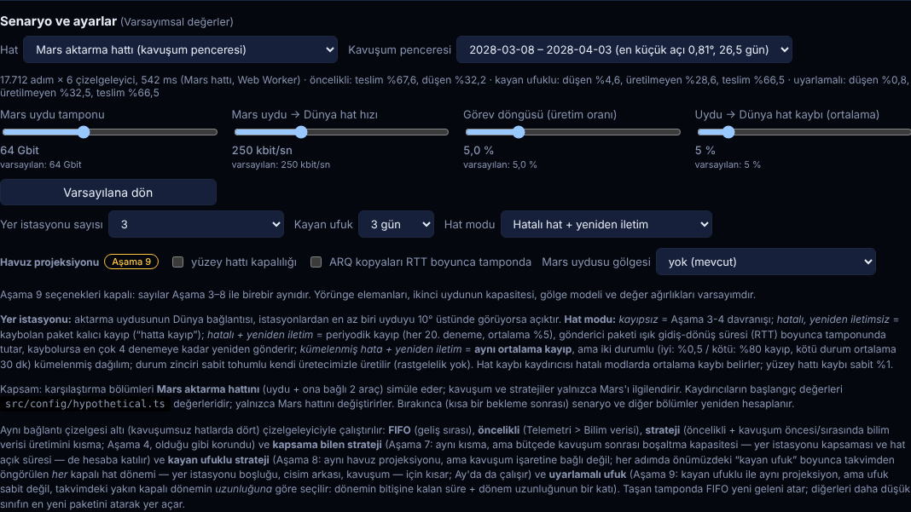
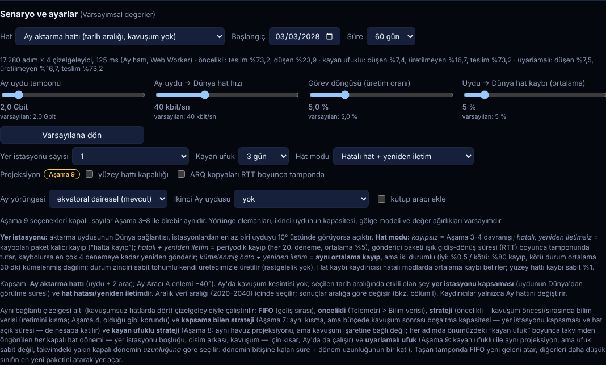

### 1. İyimser varsayımların kaldırılması (etkisi ayrı rapor)

Aşama 8'in "Beklenmedik" 4–5. maddeleri: kapsama bilen / kayan ufuklu stratejinin havuz projeksiyonu (a) araç tamponundaki verinin yüzey hattı (araç → uydu) kapalıyken de boşaldığını, (b) ARQ kopyalarının uydu tamponunda yer tutmadığını varsayıyordu. İkisi de artık **seçenek** (`'coverage'`, `'rolling'` ve yeni `'adaptive'` kullanır; Aşama 4'ün `'strategy'`si boş tampon bütçesiyle çalışır, etkilenmez):

- **Yüzey hattı kapalılığı** (`surfaceClosure`): havuz iki aşamalı izlenir: araç tamponu *a* → uydu payı *r* → Dünya. *a*, yüzey hattı (stratejinin bildiği takvim; tahmin hatası aynı kuralla uygulanır) açıkken `yüzey hızı × (1 − yüzey kaybı)` ile *r*'ye akar (hat boşsa üretim kadar), *r* yalnızca Dünya hattı açıkken boşalır; *a* ya da *r* boşalınca akış rejimi değişir (alt aralıklara bölünür, analitik). Üst sınır *a + r* toplamı üzerindedir (araç ve uydu tamponları ayrı ayrı sınırlanmaz: **varsayım**).
- **ARQ kopyası RTT tampon payı** (`arqHold`): simülasyonda kopya, gönderimden `1 + ⌈RTT/adım⌉` adım sonra (adım başında) bırakılır; sürekli zamanlı projeksiyonda bu, "hat açık" bayrağının `⌈RTT/adım⌉` adım ötelenmesine denk (başlangıçtan önce gönderim olmadığı için ilk adımlarda boşalma yok). Mars'ta ≈ 9 adım (45 dk), Ay'da RTT 3 sn < adım olduğu için 1 adım (adım ayrıklaştırmasının sonucu).
- Arayüzde iki işaret kutusu ve (j) bölümü; betik: `projeksiyon`, `projeksiyon-zor`.

**Sonuç (300 sn, hatalı + yeniden iletim [periyodik]; hücre: düşen + hatta kayıp % / toplam kayıp % / teslim % [üretilmeyen %]; "yüzey" = yüzey hattı kapalılığı, "ARQ" = RTT tampon payı; öncelikli yalnızca referans):**

| Hat / politika | İst. | Varsayılan (Aşama 8) | Yüzey | ARQ | İkisi birden | Öncelikli |
|---|---|---|---|---|---|---|
| Ay 2028-03-03, 60 g / kayan ufuklu | 1 | 7,4 / 24,1 / 73,2 [16,7] | 7,4 / 24,1 / 73,2 [16,7] | 7,4 / 24,1 / 73,2 [16,7] | 7,4 / 24,1 / 73,2 [16,7] | 23,9 / 23,9 / 73,2 |
| | 2 | 0,0 / 0,0 / 99,9 | aynı | aynı | aynı | 0,0 / 0,0 / 99,9 |
| | 3 | 0,0 / 0,0 / 99,9 | aynı | aynı | aynı | 0,0 / 0,0 / 99,9 |
| Ay / uyarlamalı | 1 | 7,5 / 24,1 / 73,2 [16,7] | 7,5 / 24,1 / 73,2 [16,7] | 7,5 / 24,1 / 73,2 [16,7] | 7,5 / 24,1 / 73,2 [16,7] | 23,9 / 23,9 / 73,2 |
| Mars 2028-03-08 / kapsama bilen | 1 | 2,8 / 48,9 / 41,1 [46,1] | aynı | aynı | aynı | 47,1 / 47,1 / 41,1 |
| | 2 | 0,8 / 34,6 / 65,0 [33,7] | aynı | aynı | aynı | 32,6 / 32,6 / 67,0 |
| | 3 | 0,7 / 34,3 / 65,5 [33,6] | aynı | aynı | aynı | 32,2 / 32,2 / 67,6 |
| Mars / kayan ufuklu | 1 | 7,1 / 48,9 / 41,1 [41,8] | 7,1 / 48,9 / 41,1 [41,8] | 7,2 / 48,9 / 41,1 [41,8] | 7,2 / 48,9 / 41,1 [41,8] | 47,1 / 47,1 / 41,1 |
| | 2 | 4,7 / 33,6 / 66,1 [28,8] | aynı | 4,7 / 33,5 / 66,1 [28,8] | 4,7 / 33,5 / 66,1 [28,8] | 32,6 / 32,6 / 67,0 |
| | 3 | 4,6 / 33,2 / 66,5 [28,6] | aynı | 4,6 / 33,3 / 66,5 [28,6] | 4,6 / 33,3 / 66,5 [28,6] | 32,2 / 32,2 / 67,6 |
| Mars / uyarlamalı | 1 | 3,5 / 48,9 / 41,1 [45,5] | aynı | 3,4 / 48,9 / 41,1 [45,5] | 3,4 / 48,9 / 41,1 [45,5] | 47,1 / 47,1 / 41,1 |
| | 2 | 0,9 / 33,6 / 66,0 [32,7] | aynı | aynı | aynı | 32,6 / 32,6 / 67,0 |
| | 3 | 0,8 / 33,3 / 66,5 [32,5] | aynı | 0,7 / 33,3 / 66,5 [32,5] | 0,7 / 33,3 / 66,5 [32,5] | 32,2 / 32,2 / 67,6 |

Varsayılana göre en büyük mutlak fark (tüm hücreler; düşen / toplam kayıp / teslim / üretilmeyen, puan): yüzey **0,004 / 0,007 / 0,021 / 0,010**; ARQ **0,043 / 0,007 / 0,011 / 0,048**. **Etki yok** (0,1 puanın altında; Aşama 7–8 sonuçları bu iki iyimser varsayımdan etkilenmiyor).

**Zorlanmış ayarlarda da** (`projeksiyon-zor`) etki ≤ 0,1 puan: Ay yüzey hattı 100/50/30 kbit/sn (üretimin ~2–8 katı; Ay 1 istasyon, kayan ufuklu: üretilmeyen yalnız 30 kbit/sn'de 19,1 → 19,2); Mars uydu tamponu 8/16 Gbit ve hat hızı 250–600 kbit/sn (3 istasyon, kapsama bilen ve kayan ufuklu: toplam kayıp en çok 41,0 → 41,1).

**Neden etkisiz:** (1) projeksiyonun belirleyici ölçütü *tepe doluluk*tur ve bu, kapalı dönemin **sonunda** (veri birikmişken) oluşur; yüzey hattı kapalılığının ve ARQ kopyalarının yarattığı fark o ana kadar kapanır. (2) Yüzey hattı (Ay 1000, Mars 600 kbit/sn) araç üretiminden (Ay'da 6–13, Mars'ta 25–100 kbit/sn) çok hızlıdır ve yörünge döneminde (≈ 6–8 sa) sık açılır: araç tamponu her açılışta birkaç saniyede boşalır (Ay 1 istasyon kayan ufuklu çalıştırmasında 5760 projeksiyonun yalnızca 20'sinde tepe doluluk iki modelde farklı çıktı; sonuçlar aynı kaldı). (3) Mars'ta ARQ kopyası ≈ hat hızı × RTT ≈ 0,15–0,6 Gbit, 64 Gbit'lik tamponun < %1'i ve kapalı dönem (günler) RTT'den (40 dk) çok uzun. Seçeneklerin **çalıştığı** sentetik testle doğrulanır (yüzey her 100 adımda 10 adım açıkken kapalılığı hesaba katan projeksiyon üretilmeyeni 707 → 1307 paketa çıkarır, düşeni 1490 → 929'a indirir; `projection.test.ts`): gerçek (varsayımsal) ağda bu koşullar oluşmuyor.

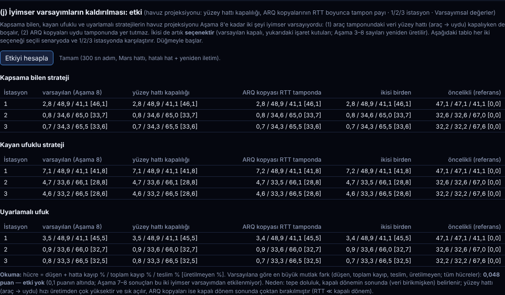

### 2. Değer ağırlıklı fayda ve uyarlamalı strateji

**Ölçüt.** `hypothetical.ts`: telemetri `valuePerMb: 4`, bilim verisi `1` (uydurma). **Değer % = teslim edilen değer / talep edilen değer**; talep edilen değer = (üretilen + üretilmeyen Mb) × birim değer (yaşı 0). İsteğe bağlı **zamanla azalan değer** (yalnızca bilim verisi): teslim edilen paketin değeri `2^(−yaş / yarı ömür)` ile çarpılır (yaş = teslim anı − üretim anı; yarı ömürler 3 / 7 / 14 / 30 / 90 gün, arayüzde seçilir). Mevcut ölçütler (düşen %, düşen + üretilmeyen %, teslim %) **aynen** kalır. Her çalıştırma ham toplamları (`Metrics.valueParts`: sınıf başına talep Mb, teslim Mb, her yarı ömür için azalan hacim) taşır; böylece ağırlık ve yarı ömür duyarlılığı **ek çizelgeleyici hesabı olmadan** taranır (bölüm (i) ızgarası; `valuePct`). Taramalar (f) azalan toplamı hesaplamaz (yalnızca sabit değer; hız).

**(a) Kısma değerce kazandırıyor mu, hangi koşulda?** Kazanç = politikanın değer % − öncelikli çizelgenin değer %, puan (telemetri 4×; betik `deger-esik`, yarı ömür 1–365 gün tarandı):

| Senaryo | Sabit değer | Zamanla azalan değer: yarı ömür 3 / 7 / 14 / 30 / 90 gün | Kırılma yarı ömrü (kazanç ≥ 0 olduğu en uzun yarı ömür) |
|---|---|---|---|
| Ay 2028, 1 ist. — kayan ufuklu | 0,00 | +1,00 / +0,66 / +0,39 / +0,20 / +0,07 | yok (hep ≥ 0, uzun yarı ömürde → 0) |
| Ay 1 ist. — uyarlamalı | +0,01 | +0,80 / +0,53 / +0,31 / +0,16 / +0,06 | yok |
| Mars 2028, 1 ist. — kapsama bilen | −0,00 | +0,49 / +1,13 / +1,20 / +0,88 / +0,39 | yok (en büyük +1,22 @ 10 g) |
| Mars 1 ist. — kayan ufuklu | −0,00 | +0,45 / +0,97 / +0,98 / +0,69 / +0,30 | yok (+1,02 @ 10 g) |
| Mars 1 ist. — uyarlamalı | −0,00 | +0,46 / +1,05 / +1,09 / +0,78 / +0,34 | yok (+1,13 @ 10 g) |
| Mars 2 ist. — kapsama bilen | −1,36 | +0,99 / +0,74 / +0,33 / −0,27 / −0,91 | **21 gün** (en büyük +1,10 @ 1 g) |
| Mars 2 ist. — kayan ufuklu | −0,65 | +1,53 / +1,05 / +0,56 / +0,07 / −0,37 | **34 gün** (+1,67 @ 1 g) |
| Mars 2 ist. — uyarlamalı | −0,66 | +1,67 / +1,41 / +1,00 / +0,41 / −0,22 | **57 gün** (+1,75 @ 2 g) |
| Mars 3 ist. — kapsama bilen | −1,43 | +0,17 / +0,20 / −0,03 / −0,50 / −1,04 | 13 gün (+0,21 @ 1 g) |
| Mars 3 ist. — kayan ufuklu | −0,71 | +0,69 / +0,48 / +0,19 / −0,16 / −0,49 | 21 gün (+0,80 @ 1 g) |
| Mars 3 ist. — uyarlamalı | −0,72 | +0,85 / +0,88 / +0,65 / +0,19 / −0,34 | **42 gün** (+0,89 @ 5 g) |

**Cevap:** *Evet, ama dar bir koşulda ve küçük:*
- **Sabit değerde (zamanla azalma yok) kısma hiçbir telemetri ağırlığında (1–32×) kazandırmaz:** 1 istasyonda hat doygun (hat kapasitesi sınırlayıcı), kısma hacmi artırmaz → kazanç 0,00; 2–3 istasyonda taşmayı daha sıkı önlemek için fazla kıstığından −0,1 … −2,1 puan *kaybettirir* (telemetri ağırlığı 32× … 1×) (Aşama 4/7/8 bulgusunun değer ölçütüyle de tekrarı).
- **Bilim verisinin değeri zamanla azalıyorsa** kazandırır: kısma, kapalı dönemde biriken eski veriyi (hat boşalırken öncelikli çizelge önce eski paketleri gönderir) hiç üretmeyip yeni veriyi öne aldığı için teslim edilen verinin ortalama yaşı düşer. **Hat doygunsa** (Ay ve Mars 1 istasyon) kazanç her yarı ömürde pozitiftir (uzun yarı ömürde → 0), **hat doygun değilse** (Mars 2–3 istasyon) yalnızca yarı ömür **kırılma değerinden kısaysa** (politikaya göre 13–57 gün) kazandırır; uzun yarı ömürde (değer neredeyse hiç azalmıyorken) hacim kaybı baskın çıkar.
- **Kazanç küçüktür:** telemetri 4×'te en çok +1,1 (Ay), +1,2 (Mars 1 ist.), +1,8 (Mars 2 ist., yarı ömür 1–2 gün) puan (telemetri 1×'te +1,5 / +1,8 / +2,5); telemetri değeri arttıkça (bilim verisinin payı küçülür) azalır: Mars 1 ist. uyarlamalı, 14 gün yarı ömür: +1,58 (telemetri 1×) → +1,09 (4×) → +0,49 (16×) → +0,28 (32×).
- **Sonuç: sabit değer yapısında strateji toplam değer açısından fayda sağlamaz.** Fayda yalnızca "değer zamanla azalır ve hat doygundur / yarı ömür kısadır" varsayımında vardır; bu bir **varsayımdır** (ağırlıklar ve yarı ömürler uydurma), gerçek bir görev bunu bilmez.

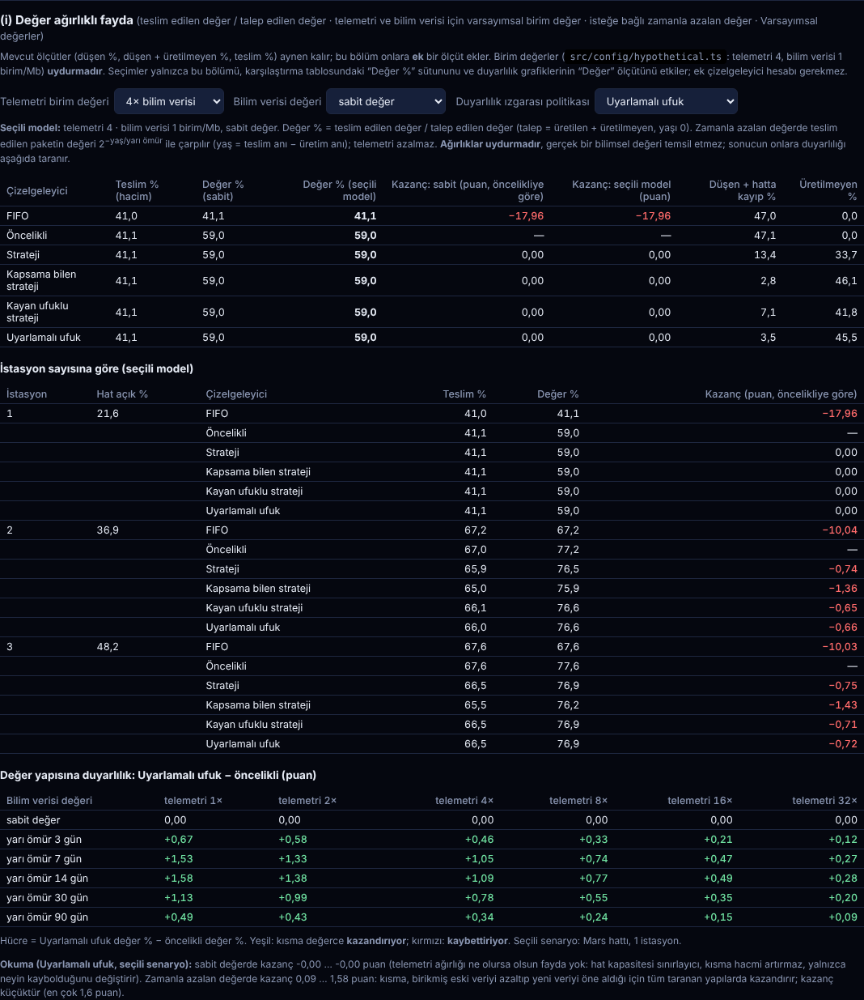
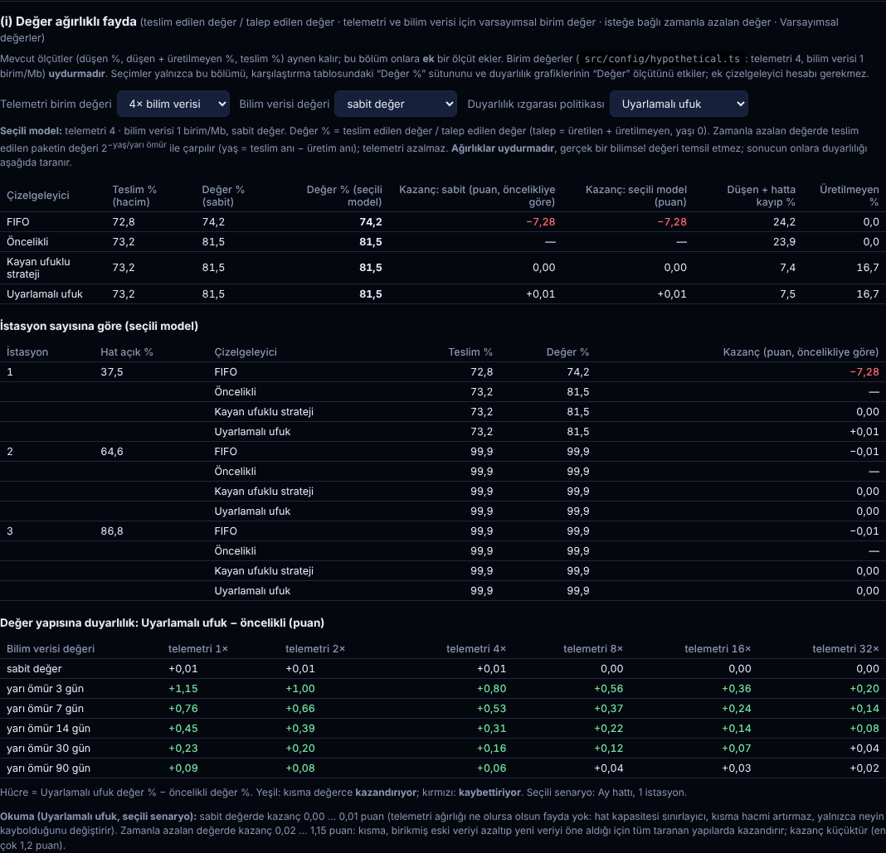

**(b) `'adaptive'` (uyarlamalı ufuk).** `'rolling'` ile aynı havuz projeksiyonu (aynı fonksiyon), ama ufuk **sabit değil**: her `refreshSec`'te (1800 sn), takvimden (stratejinin bildiği Dünya hattı takvimi; tahmin hatası aynı kuralla) şimdi sürmekte olan ya da `leadDays` (1) içinde başlayan **ilk kapalı hat döneminin** uzunluğu *L* bulunur (dönemin başı geriye doğru, sonu ileri doğru; çok uydulu araçta herhangi bir rotanın açık olması "açık" sayılır); ufuk = *dönemin bitişine kalan süre + `tailFactor` × L*, `[minDays, maxDays]` = [1, 45] gün aralığına kırpılır; yakın kapalı dönem yoksa `minDays`. Telemetri kısılmaz; kısılan veri "üretilmeyen"dir. Böylece **kısa istasyon boşluklarında kısa** (≈ 1–1,5 gün), **kavuşumda uzun** (kavuşum + toparlanma) ufuk kullanılır. Parametreler `HYPOTHETICAL.adaptiveStrategy` (`minDays` 1, `maxDays` 45, `leadDays` 1, `tailFactor` 1, `margin` 0,9, `assetBufferShare` 1, `refreshSec` 1800). Ufuk sabitlenirse (`minSec = maxSec`) kayan ufuklu stratejiyle birebir aynı sonucu verir (testli). `strategy`, `coverage`, `rolling` aynen kaldı.

**Sonuçlar** (2028, 300 sn, hatalı + yeniden iletim [periyodik]; düşen + hatta kayıp % / toplam kayıp % / teslim % [üretilmeyen %]; betik `adaptif`):

| Hat | İst. | Öncelikli | Strateji (A4) | Kapsama bilen | Kayan ufuklu (3 gün) | **Uyarlamalı** |
|---|---|---|---|---|---|---|
| Ay | 1 | 23,9 / 23,9 / 73,2 | = öncelikli | = öncelikli | 7,4 / 24,1 / 73,2 [16,7] | **7,5 / 24,1 / 73,2 [16,7]** |
| Ay | 2, 3 | 0,0 / 0,0 / 99,9 | = | = | 0,0 / 0,0 / 99,9 | 0,0 / 0,0 / 99,9 |
| Mars | 1 | 47,1 / 47,1 / 41,1 | 13,4 / 47,1 / 41,1 [33,7] | 2,8 / 48,9 / 41,1 [46,1] | 7,1 / 48,9 / 41,1 [41,8] | **3,5 / 48,9 / 41,1 [45,5]** |
| Mars | 2 | 32,6 / 32,6 / 67,0 | 1,6 / 33,7 / 65,9 [32,0] | 0,8 / 34,6 / 65,0 [33,7] | 4,7 / 33,6 / 66,1 [28,8] | **0,9 / 33,6 / 66,0 [32,7]** |
| Mars | 3 | 32,2 / 32,2 / 67,6 | 1,3 / 33,3 / 66,5 [32,0] | 0,7 / 34,3 / 65,5 [33,6] | 4,6 / 33,2 / 66,5 [28,6] | **0,8 / 33,3 / 66,5 [32,5]** |

Uyarlamalı strateji "düşen"de kapsama bilen stratejiye (0,7–0,8) ve toplam kayıpta kayan ufuklu/Aşama 4 stratejisine (33,2–33,3) yakındır: **2–3 istasyonda kapsama bilenin toplam kaybından ≈ 1 puan iyi, kayan ufuklunun (3 gün) düşeninden 2–6 kat iyi**. Ama öncelikliye göre **hâlâ toplam kayıp +1,0…1,6 puan, teslim −1,0…−1,6 puan** (2–3 istasyon) — hacim açısından fayda yoktur. Duyarlılık (Mars 1 ve 3 ist., Ay 1 ve 3 ist.): `tailFactor` 0 … 2 ve `leadDays` 0,25 … 3 neredeyse etkisiz (düşen ≤ 0,1 puan oynar); `minDays` 0,5 → 3: Mars 1 ist. düşen 4,0 → 3,3.

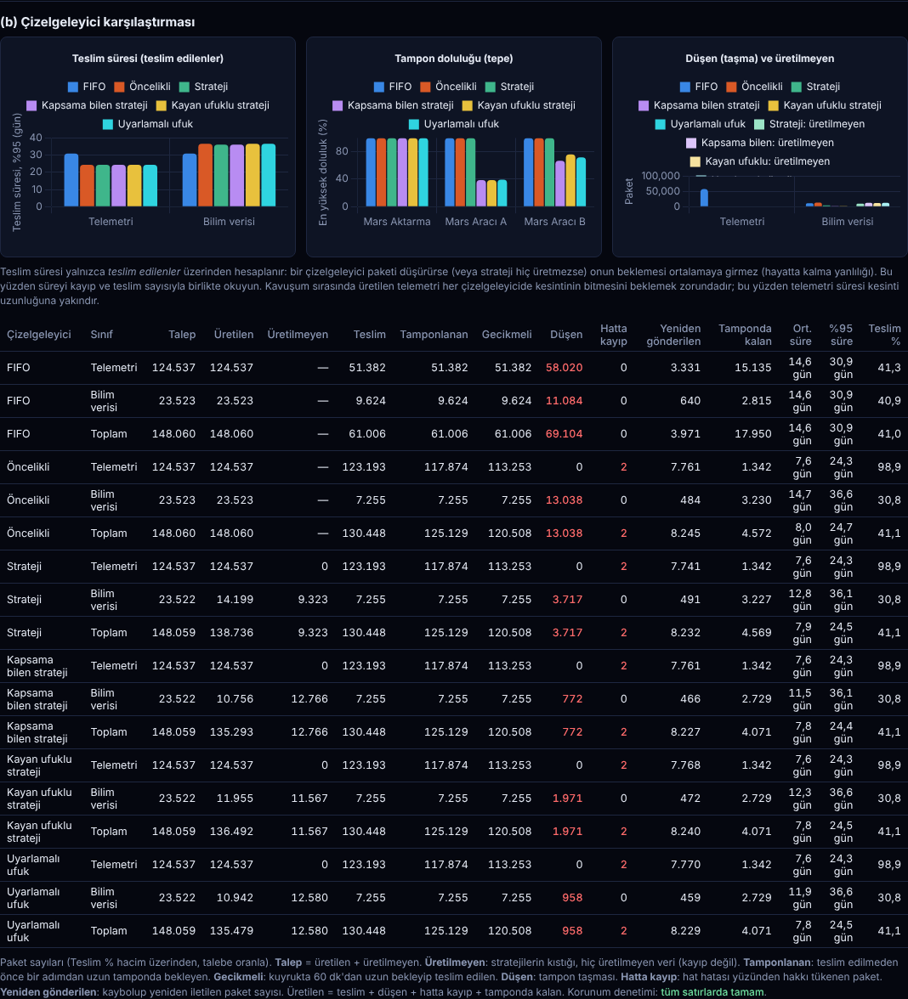


### 3. Kapsamayı artıran fiziksel model (Ay) ve Mars gölgesi

**Model** (`network.ts`, `coverage.ts`, `timeline.ts`; hepsi `NetOptions` ile seçilir, varsayılan = Aşama 2–8 ağı, testle birebir):
- **Ay yörüngesi:** `'equatorial'` (mevcut: 3000 km dairesel ekvatoral; Aşama 2–8 formülü aynen) ya da `'elliptical'`: Kepler yörüngesi (cisim merkezli, ekliptiğe paralel çerçeve; Newton ile Kepler denklemi), **uydurma elemanlar** `HYPOTHETICAL.moonOrbits.elliptical`: a = 6500 km, e = 0,6, i = 90° (kutupsal), ω = 90° (apolün güney kutbu üzerinde), periapsis yüksekliği ≈ 863 km, apoapsis ≈ 8663 km, dönem ≈ 13 sa. **Düzlem eylemsiz sabit** (J2/üçüncü cisim presesyonu yok; varsayım).
- **İkinci Ay aktarma uydusu** (`HYPOTHETICAL.moonRelay2`): apolünü kuzeyde olan eşi eliptik/kutupsal yörünge (yarım dönem faz farkı); **kendi hat hızı (40 kbit/sn) ve tamponu (2 Gbit) vardır** — yani kapasiteyi de iki katına çıkarır (varsayım). Araçlar: **'best'** = uyduyu gören(ler) arasında önce Dünya hattı açık olanı, sonra en yüksek yükseklikte olanı kullanır; **'order'** = hat sırası (önce birinci, görmüyorsa ikinci). Çizelgeleyici `LinkSample.assetRelay` (her adımda araç başına kullanılan uydu) ile çok uydulu çalışır; strateji projeksiyonu araç için rotaları birleştirir (havuz = araç tamponu + her rotadaki uydu payları, boşalma = açık rotaların toplam hızı; **varsayım:** uydu tamponları birbirinin yerine kullanılabilir).
- **Kutup aracı** (`moonPolarAsset`, −85° enlem, isteğe bağlı): varsayılan kapalı (eski sayılar değişmez). Ekvatoral yörünge onu hiç göremez (testli); eliptik yörünge görür.
- **Mars gölgesi** (`marsEclipse`): silindirik gölge (Güneş yönü Mars'ın Güneş'e göre konumundan); **güç modeli yok**; gölgede yalnızca hat kapalı: `'earth'` = yalnız uydu → Dünya hattı, `'both'` = yüzey hattı da. Mars ekseni ekliptiğe paralel varsayıldığı için ekvatoral yörünge her turda gölgeden geçer (≈ %14; gerçekte eksen eğikliği ≈ 25°) — **varsayım**. Yeni `LinkState` `'eclipse'`.
- **Kapsama özeti** (`CoverageRow`): uyduyu gören yer istasyonu %, Dünya hattı açık % (uydu başına ve en az bir uydu), yüzey görüşü %, araç → Dünya yolu açık %.

**Ay sonuçları** (2028-03-03, 60 g, hatalı + yeniden iletim [periyodik], 300 sn; 2 araç; "yüzey görüşü" = Ay Aracı A / İniş Aracı B; hücre: düşen + hatta kayıp % / toplam kayıp % / teslim % [üretilmeyen]; betik `yorunge`):

| İst. | Yapılandırma | Uyduyu gören ist. % (uydu 1 / 2) | Dünya hattı açık % (uydu 1 / 2 / herhangi) | Yüzey görüşü % (A / B) | Öncelikli | Kayan ufuklu | Uyarlamalı |
|---|---|---|---|---|---|---|---|
| 1 | ekvatoral dairesel (mevcut) | 42,6 | 37,4 | 34,1 / 37,8 | 23,9 / 23,9 / 73,2 | 7,4 / 24,1 / 73,2 [16,7] | 7,5 / 24,1 / 73,2 [16,7] |
| 1 | eğimli/eliptik | 41,9 | 41,4 | **71,2 / 19,2** | 17,0 / 17,0 / **80,9** | 6,1 / 17,2 / 81,0 [11,2] | 6,9 / 17,2 / 81,0 [10,3] |
| 1 | ekv. + 2. uydu (en iyi) | 42,6 / 43,1 | 37,4 / 42,4 / 54,5 | 39,4 / 64,7 | 0,8 / 0,8 / 98,7 | aynı | aynı |
| 1 | ekv. + 2. uydu (hat sırası) | 42,6 / 43,1 | 37,4 / 42,4 / 54,5 | 39,4 / 64,7 | 1,0 / 1,0 / 98,5 | aynı | aynı |
| 1 | eliptik + 2. uydu (en iyi) | 41,9 / 43,1 | 41,4 / 42,4 / 54,6 | 71,2 / 43,3 | 0,1 / 0,1 / 99,5 | aynı | aynı |
| 1 | eliptik + 2. uydu (hat sırası) | 41,9 / 43,1 | 41,4 / 42,4 / 54,6 | 71,2 / 43,3 | 0,7 / 0,7 / 98,9 | aynı | aynı |
| 1 | *(kontrol) tek ekvatoral uydu, hat hızı ve tampon 2×* | — | — | — | **0,0 / 0,0 / 99,8** | aynı | aynı |
| 2 | ekvatoral (mevcut) | 73,2 | 64,6 | 34,1 / 37,8 | 0,0 / 0,0 / 99,9 | 0,0 / 0,0 / 99,9 | 0,0 / 0,0 / 99,9 |
| 2 | eğimli/eliptik | 72,4 | 71,2 | 71,2 / 19,2 | **5,6 / 5,6 / 94,3** | 5,6 / 5,6 / 94,3 | 5,6 / 5,6 / 94,3 |
| 2 | ikinci uydulu (4 seçenek) | 72,4–73,2 / 73,8 | 64,6–71,2 / 72,6 / 83,1–83,2 | 39,4–71,2 / 43,3–64,7 | 0,0 / 0,0 / 99,9 | aynı | aynı |
| 3 | ekvatoral (mevcut) | 98,5 | 87,0 | 34,1 / 37,8 | 0,0 / 0,0 / 99,9 | aynı | aynı |
| 3 | eğimli/eliptik | 98,3 | 96,7 | 71,2 / 19,2 | **5,6 / 5,6 / 94,3** | aynı | aynı |
| 3 | ikinci uydulu (4 seçenek) | 98,3–98,5 / 98,7 | 87,0–96,7 / 97,2 / 99,4–99,5 | 39,4–71,2 / 43,3–64,7 | 0,0 / 0,0 / 99,9 | aynı | aynı |

**Kutup aracı eklenirse** (3 araç; öncelikli çizelge: düşen + hatta kayıp / toplam kayıp / teslim; 1 ve 3 istasyon):

| Yapılandırma | Kutup aracı yüzey görüşü % | 1 ist. | 3 ist. |
|---|---|---|---|
| ekvatoral dairesel | 0,0 | 42,2 / 42,2 / 54,9 | 24,2 / 24,2 / 74,9 |
| eğimli/eliptik | 78,8 | 35,4 / 35,4 / 61,5 | 4,2 / 4,2 / 95,7 |
| ekvatoral + 2. uydu (en iyi) | 7,2 | 0,6 / 0,6 / 98,8 | 0,0 / 0,0 / 99,8 |
| eliptik + 2. uydu (en iyi) | 78,8 | 7,9 / 7,9 / 90,7 | 0,0 / 0,0 / 99,9 |
| eliptik + 2. uydu (hat sırası) | 78,8 | 14,4 / 14,4 / 83,8 | 0,0 / 0,0 / 99,9 |
| *(kontrol) tek ekvatoral, hat hızı ve tampon 2×* | — | 24,2 / 24,2 / 74,9 | 24,2 / 24,2 / 75,0 |

**Okuma (varsayımsal modelde):**
- **Eliptik/kutupsal yörünge kapsamayı yeniden dağıtır, genel olarak artırmaz:** Ay Aracı A'nın yüzey görüşü %34 → %71, kutup aracı %0 → %79 olur ve (1 istasyonda) Dünya hattı açık süresi, uydunun Ay arkasında kalma süresinin azalmasıyla %37,4 → %41,4 (teslim 73,2 → 80,9) çıkar; ama ekvator yakınındaki **Ay İniş Aracı B'nin görüşü %38 → %19'a düşer** ve görüş boşlukları günlerce sürdüğü için (sabit düzlem + Ay'ın dönmesi) B'nin 1 Gbit'lik tamponu taşar: 2–3 istasyonda, Dünya hattı %71–97 açıkken bile **%5,6 düşen** (ekvatoral yörüngede 0,0). Yani kutupsal yörüngenin değeri araç yerleşimine bağlıdır (kutup aracı varsa 3 istasyonda %24,2 → %4,2).
- **İkinci uydu çok yardım eder, ama neden kapasitedir:** 1 istasyonda düşen 23,9 → 0,8; **ancak tek uydunun hat hızı ve tamponu iki katına çıkarılınca sonuç aynı (hatta daha iyi: 0,0 / 99,8)**. İkinci uydunun kapsama katkısı küçüktür: yer istasyonu uyduyu hiçbir zaman Ay'dan görünür olduğundan fazla göremez (1 istasyon: uyduyu gören %42–43; "herhangi uydu hattı açık" %37,4 → %54,5, çünkü ikinci uydu Ay'ın arkasında kalmaz); sınırlayıcı olan istasyonun Ay'ı görme süresidir. Kutup aracı varken ise (eliptik + 2. uydu, 3 araç) kapasite kontrolü tek uyduyla 24,2 kayıp bırakır: kutup aracını yalnızca kutupsal yörünge görebildiği için orada **kapsama** (kapasite değil) belirleyicidir.
- **'en iyi görünen' vs 'hat sırası':** küçük fark (1 istasyon: 0,8 vs 1,0; eliptik + 2. uydu 0,1 vs 0,7; kutup aracıyla 7,9 vs 14,4): hat sırası ikinci uyduyu yalnızca birinci görünmezken kullandığı için yükü birinciye yığar.
- Kayan ufuklu / uyarlamalı strateji ikinci uydulu hatlarda öncelikliyle aynıdır (kayıp zaten ≤ %1).


**Mars gölgesi** (2028-03-08 kavuşum penceresi, 300 sn; hücre: düşen + hatta / toplam / teslim [üretilmeyen]; betik `golge`):

| İst. | Yapılandırma | Dünya hattı açık % | Yüzey görüşü % (A / B) | Öncelikli | Kayan ufuklu | Uyarlamalı |
|---|---|---|---|---|---|---|
| 1 | gölge yok (mevcut) | 21,4 | 35,1 / 35,7 | 47,1 / 47,1 / 41,1 | 7,1 / 48,9 / 41,1 [41,8] | 3,5 / 48,9 / 41,1 [45,5] |
| 1 | gölgede yalnız Dünya hattı kapalı | 21,1 | 35,1 / 35,7 | 47,7 / 47,7 / 40,4 | 7,2 / 49,6 / 40,4 [42,4] | 3,6 / 49,6 / 40,4 [46,0] |
| 1 | gölgede yüzey + Dünya hattı kapalı | 21,1 | **30,2 / 30,7** | 48,4 / 48,4 / 40,4 | 7,1 / 49,5 / 40,4 [42,5] | 3,4 / 49,5 / 40,4 [46,2] |
| 3 | gölge yok → 'earth' → 'both' | 48,3 → 47,7 → 47,7 | 35,1 → 35,1 → 30,2 | 32,2 → 32,3 → 32,2 (teslim 67,6 → 67,5 → 67,5) | 4,6 / 33,2 → 33,3 → 33,3 | 0,8 / 33,3 / 66,5 (değişmez) |

Kavuşum penceresinde gölgenin etkisi **küçüktür** (1 istasyonda teslim 41,1 → 40,4; 2–3 istasyonda ≤ 0,1): uydu zamanın %14,2'sinde gölgededir ama bunun **%99,2'si zaten Dünya hattının kapalı olduğu zamana düşer**, çünkü kavuşuma yakın Dünya ile Güneş Mars'tan neredeyse aynı yönde görünür ve Mars'ın gölgesindeki uydu aynı zamanda Dünya'dan bakınca Mars'ın arkasındadır (cisim arkası kapanması). **Kavuşumdan uzak bir aralıkta** (2029-06-01, 60 gün; arayüzde "tarih aralığı, kavuşumsuz") etki **büyüktür**:

| İst. | Yapılandırma | Dünya hattı açık % | Yüzey görüşü % | Öncelikli | Kayan ufuklu | Uyarlamalı |
|---|---|---|---|---|---|---|
| 1 | gölge yok | 35,6 | 35,0 / 35,8 | 21,0 / 21,0 / 67,1 | 3,3 / 22,8 / 67,1 [19,5] | 3,7 / 22,8 / 67,1 [19,1] |
| 1 | gölgede yalnız Dünya hattı kapalı | 30,8 | 35,0 / 35,8 | **29,9 / 29,9 / 58,2** | 4,8 / 31,6 / 58,2 [26,8] | 5,2 / 31,6 / 58,2 [26,3] |
| 1 | gölgede yüzey + Dünya hattı kapalı | 30,8 | 30,2 / 30,7 | 29,9 / 29,9 / 58,2 | 4,7 / 31,6 / 58,2 [26,9] | 5,2 / 31,5 / 58,2 [26,4] |
| 3 | gölge yok → 'earth' | 85,9 → 74,6 | 35,0 / 35,8 | 0,0 / 0,0 / 99,7 (değişmez) | aynı | aynı |

(Hat açık süresi 1 istasyonda −4,8, 3 istasyonda −11,3 puan; 1 istasyonda teslim 67,1 → 58,2; 3 istasyonda hat hâlâ yeterli.) Yüzey hattı da kapanırsa ('both') yüzey görüşü 35 → 30 olur; sonuçları ayrıca değiştirmez (hat zaten sınırlayıcı).


### 4. Genelleme ve temizlik

**(a) Genelleme.** Aşama 8'in "tek senaryodan genelleme yapılmadı" sınırı bu bölümle **kapatıldı** (bölüm (l) ve betik `genelleme`, `tahmin-genelleme`). **Ay, 1 istasyon, beş 60 günlük aralık** (Ay'ın düğüm döngüsüne göre seçildi: 2025 civarı büyük, 2034 civarı küçük durağanlık; hatalı + yeniden iletim [periyodik], 300 sn; düşen + hatta / toplam / teslim [üretilmeyen]):

| Başlangıç | Hat açık % | FIFO | Öncelikli | Kayan ufuklu (3 g) | Uyarlamalı |
|---|---|---|---|---|---|
| 2021-03-01 | 36,8 | 24,2 / 24,2 / 72,6 | 24,5 / 24,5 / 72,3 | 7,7 / 24,7 / 72,3 [17,0] | 8,1 / 24,7 / 72,3 [16,6] |
| 2025-09-01 | 35,3 | 27,0 / 27,0 / 69,1 | 27,4 / 27,4 / 69,1 | 8,2 / 27,8 / 69,1 [19,7] | 8,3 / 27,6 / 69,1 [19,3] |
| 2028-03-03 | 37,5 | 24,2 / 24,2 / 72,8 | 23,9 / 23,9 / 73,2 | 7,4 / 24,1 / 73,2 [16,7] | 7,5 / 24,1 / 73,2 [16,7] |
| 2034-05-01 | 36,2 | 26,1 / 26,1 / 70,6 | 26,0 / 26,0 / 70,7 | 8,2 / 26,2 / 70,7 [18,0] | 8,3 / 26,2 / 70,7 [17,8] |
| 2038-01-15 | 37,7 | 22,5 / 22,5 / 74,4 | 23,0 / 23,0 / 74,0 | 7,3 / 23,3 / 74,1 [16,1] | 7,3 / 23,3 / 74,0 [16,0] |

Öncelikliye göre fark (min / medyan / maks, puan): düşen + hatta **−19,2 / −16,8 / −15,8** (kayan ufuklu), −19,1 / −16,4 / −15,7 (uyarlamalı); toplam kayıp **+0,20 / +0,24 / +0,44** ve +0,20 / +0,21 / +0,26; teslim 0,00 / +0,02 / +0,02 ve +0,01 / +0,01 / +0,02; değer (sabit) ≈ 0; değer (bilim verisi 14 gün yarı ömür) **+0,31 / +0,33 / +0,35** (uyarlamalı). **2 istasyonda** beş aralığın hepsinde kayıp 0,0 ve fark 0,00 (kısma bir şey yapmaz). Yani Aşama 8'in Ay 2028 sonucu **her beş aralıkta aynı niteliktedir** (düşen çok azalır, toplam kayıp ve teslim değişmez, sapma ≤ 0,4 puan); aralığa göre değişen şey kayıp düzeyidir (düşen %22,5–27,4, teslim %69,1–74,4).

**Mars, tüm 9 kavuşum penceresi** (1800 sn tarama adımı, kayan ufuk 30 gün [Aşama 8 ile aynı], 1 ve 3 istasyon; öncelikliye göre fark, min / medyan / maks, puan):

| | Düşen + hatta | Toplam kayıp | Teslim | Değer (14 g yarı ömür) |
|---|---|---|---|---|
| **1 ist.** kapsama bilen | −50,9 / −42,4 / −31,2 | +1,25 / +1,90 / +2,14 | −0,00 / 0,00 / 0,00 | |
| kayan ufuklu (30 g) | −51,4 / −42,6 / −31,2 | **+4,07 / +4,62 / +5,85** | **−4,36 / −2,74 / −2,25** | |
| uyarlamalı | −49,3 / −40,7 / −30,3 | +1,23 / +1,83 / +2,14 | −0,00 / 0,00 / 0,00 | **+0,68 / +1,06 / +1,45** |
| **3 ist.** kapsama bilen | −31,6 / −21,7 / −18,7 | +2,00 / +2,36 / +2,57 | −2,57 / −2,36 / −2,00 | |
| kayan ufuklu (30 g) | −31,6 / −21,7 / −18,7 | +6,65 / +7,05 / +7,29 | −7,29 / −7,05 / −6,64 | |
| uyarlamalı | −31,6 / −21,7 / −18,7 | +1,00 / +1,34 / +1,58 | −1,59 / −1,35 / −1,00 | **+0,54 / +0,62 / +0,69** |

9 pencerenin her birinde aynı yön: strateji "düşen"i çok azaltır, toplam kaybı artırır (uyarlamalı en az: +1,0…2,1 puan), hacmi artırmaz. **Uyarlamalı strateji, sabit uzun ufuklu (30 gün) kayan ufukludan her pencerede 2,3–5,8 puan daha az toplam kayıp verir** (1 istasyon 2,3–4,4; 3 istasyon 5,6–5,8) (uzun sabit ufkun tutuculuğunu kapalı dönem uzunluğuna göre seçerek giderir); azalan değerde (14 gün) öncelikliye göre +0,5…+1,5 puan kazanç tutarlıdır.


**Tahmin hatası, genelleme** (pencere başı/sonu kayması −240 / −120 / +120 / +240 dk, 600 sn; + iyimser, − kötümser; Ay: 5 aralık, 1 istasyon, kayan ufuk 3 g ve uyarlamalı; Mars: 9 pencere, 1 istasyon, kapsama bilen / kayan ufuk 30 g / uyarlamalı; **toplam kayıp farkı, öncelikliye göre**, senaryolar üzerinde min / medyan / maks, puan; betik `tahmin-genelleme`):

| Politika | |hata| ≤ 120 dk içindeki en kötü fark | −240 dk | Düşen + hatta kayıp öncelikliden (> 0,1 puan) kötüleşen senaryo |
|---|---|---|---|
| Ay kayan ufuklu | +1,44 / +2,25 / +2,57 | +9,79 / +11,28 / +12,45 | 0 / 5 |
| Ay uyarlamalı | +0,60 / +1,45 / +2,36 | **+51,93 / +53,87 / +55,25** | 0 / 5 |
| Mars kapsama bilen | +5,74 / +11,28 / +17,81 | +6,71 / +14,59 / +24,03 | 0 / 9 |
| Mars kayan ufuklu (30 g) | +8,63 / +14,43 / +22,21 | +10,65 / +18,13 / +28,65 | 0 / 9 |
| Mars uyarlamalı | **+2,37 / +2,65 / +3,06** | +11,63 / +19,17 / +29,79 | 0 / 9 |

**Okuma:** (1) **Düşen + hatta kayıp, hiçbir senaryoda ve taranan hiçbir hata düzeyinde (−240 … +240 dk) öncelikli çizelgenin altına düşmedi** (Ay 0/5, Mars 0/9): Aşama 8'in tek senaryolu bulgusu genelleşti. (2) **İyimser hata** (+120/+240 dk) ucuz: toplam kayıp hata yokkine eşit ya da biraz daha iyi, "düşen" birkaç puan artar (ör. Mars 2028 kapsama bilen düşen 2,8 → 4,4–4,5; Ay 2028 kayan ufuklu 6,7 → 6,8, 600 sn). (3) **Kötümser hata** (pencereler kısa sanılır → fazla kısılır) toplam kaybı artırır; **uyarlamalı strateji |hata| ≤ 120 dk'da Mars'ta çok daha dayanıklıdır** (+2,4…+3,1 puan; kapsama bilen +5,7…+17,8, sabit 30 gün ufuklu kayan ufuklu +8,6…+22,2), çünkü ufku kapalı dönem sonu + kısa bir kuyruğa kısıtlar. (4) **Büyük kötümser hatada (−240 dk) hepsi çöker; uyarlamalı en çok Ay 1 istasyonda** (toplam kayıp ≈ %78, teslim ≈ %19; kayan ufuklu 3 gün aynı hatada ≈ %36): −240 dk her istasyon penceresini (≲ 8 sa) tamamen siler, takvim "hiç açık değil" görünür, kapalı dönem 60 gün sanılır ve ufuk 45 güne çıkar. **Ufku kapalı dönem uzunluğuna göre seçmek, takvim hatası kapalı dönemleri birleştirip uzattığında kırılgandır** (bilinen bir zayıflık).

**(b) (g)/(h) taramalarını açılışta otomatik çalıştırma: yapılmadı (varsayılan kapalı; isteğe bağlı kutu eklendi).** Ölçüm (Mars, ana bölümler bittikten hemen sonra iki düğme birlikte tıklanarak, 3 deneme): (g) + (h) birlikte **3,5–4,6 sn** ek hesap, bu sürede **hiç uzun görev yok** (çizimler görevlere bölündü). Ana bölümlerin süresi etkilenmez (taramalar sonra başlar), ama **"her şey hazır" süresi ≈ 5,5 sn → ≈ 9–10 sn** olur ve her kaydırıcı/seçim değişiminde yeniden çalışır (3 işçi 4 sn daha meşgul). İlk açılışı ve etkileşimi bunun için kötüleştirmeye değmez; **işaret kutusu** ("(g) ve (h) taramalarını ana bölümler bittikten sonra otomatik hesapla", varsayılan kapalı) ile isteyen açar. Bu arada (g) ve (h) grafikleri aynı listeyi paylaşıyor ve biri hesaplanırken diğerinin grafiklerini yok ediyordu (Aşama 8 hatası); ayrı listelere bölündü. (g) bölümüne uyarlamalı strateji de eklendi.

**(c) Ana iş parçacığı görevleri.** *Başarılı:* (1) Çizelgeleyici paneli (büyük şablon ve Aşama 3–9 bölümleri) artık **ilk açılışta, ayrı parça** (`import()`) olarak yüklenir/kurulur; ana paket 167 → 58 KB (gzip 60 → 23 KB), harita açılışı bunlarla uzamaz. (2) Chart.js yalnızca kullanılan bileşenlerle yüklenir (`chart.js/auto` yerine) ve **her grafik ayrı bir makro görevde** çizilir (`setTimeout(0)` ile, yeni hesap başlarsa kalan çizim bırakılır); simülasyon işleri Worker havuzuna önce verilir, (a) gecikme grafikleri bu sırada çizilir. Sonuç: Chart.js yüklemesi ve ilk çizimler artık **uzun görev (>50 ms) değil**; Mars ilk açılışta `longtask` 3 → 1–2 (kalan: aşağıda). *Başarısız / yapılamayan:* kalan en uzun görev (≈ 120–175 ms, sayfa açılışında ≈ 190. ms) **sayfa başlatmadır** (planets.json 1,6 MB'ın ayrıştırılması ve izlerin kurulması, harita/sol panel/küre kartı ilk kurulumu); bu görev çizelgeleyici sekmesinden bağımsızdır, `JSON.parse` bölünemez, harita ana iş parçacığında kurulmak zorunda olduğundan taşınamaz; bölünmedi. Chart.js'in modül değerlendirmesi (≈ 205 KB) bölünemez ama çizimlerle aynı görevde olmadığı için artık 50 ms'nin altında.

### Hesap süresi ve `longtask` (gerçek veri, `vite preview`, 4 çekirdekli kap, 3 işçi; `main` ve bu dal art arda, 5 deneme)

| | Aşama 8 (`main`) | Bu dal |
|---|---|---|
| Mars ilk açılış, tüm ana bölümler | 5,8–6,9 sn | **5,2–6,4 sn** |
| Senaryo (Mars: 5 → 6 çizelgeleyici) ilk çizim | 0,72–0,82 sn | 0,82–0,91 sn |
| Ay hattına geçiş, toplam | 1,41–1,47 sn | 1,73–1,96 sn |
| `longtask` sayısı (Mars açılış) | 3 | 1–2 |
| En uzun ana iş parçacığı görevi | 133–145 ms | **121–175 ms** (sayfa başlatma; çizelgeleyiciye ait değil) |
| (j) etki / (k) gölge / (l) genelleme [Mars 3 ist.] | — | 3,5 / 2,6 / 8,9 sn (hiçbiri uzun görev üretmez) |
| (j) / (k) yörünge / (l) genelleme [Ay 3 ist.] | — | 0,5 / 3,6 / 1,8 sn |
| (g) tahmin / (h) hata modeli [Mars] | ≈ 2,8 / 0,9 sn | 3,3 / 0,7 sn |

Mars ilk açılış, 6. çizelgeleyici (uyarlamalı) ve değer toplamlarına rağmen **kötüleşmedi, ≈ 0,5 sn iyileşti**: simülasyon çekirdeği hızlandı (gecikme dizisi `Float64Array.sort()` ile sıralanıyor: bir çalıştırma ≈ %20–40 hızlandı, sonuçlar **bayt bayt aynı**; azalan değer toplamı `reduce + Math.pow` yerine döngü + `exp` ile hesaplanıyor, ilk denemede çalıştırma başına +50–90 ms tutuyordu). Ay hattı ≈ 0,3–0,5 sn yavaşladı (uyarlamalı strateji ve karşılaştırmadaki dördüncü politika). `longtask` ölçümü `PerformanceObserver` (`type: 'longtask'`) ile.

### Gerçek veriyle doğrulama (Playwright/Chromium, `vite preview`, `?sentetik=1` yok)
Denendi: **Mars ve Ay, 1/2/3 istasyon**; değer ağırlıklı ölçüt (telemetri ağırlığı ve yarı ömür seçicileri, ızgara politikası, tablo ve duyarlılık "Değer" ölçütü); **eliptik yörünge, ikinci uydu (en iyi / hat sırası), kutup aracı** (ayrı ayrı ve birlikte); Mars gölgesi (earth / both) ve kavuşumsuz aralık; **iki projeksiyon seçeneği**; (j), (k), (l) bölümleri (Mars ve Ay); (g)/(h) taramaları ve otomatik kutusu; **dar ekran** (420 px: sayfa yatay taşmıyor, `#sched` `scrollWidth` 420; Aşama 9 seçenekleri sığıyor, uzun seçici metinleri taşmıyor; harita 681 px, alt çubuk 43 px — Aşama 7 ile aynı); **harita sekmesinde Aşama 6 ve 7 özellikleri:** 10 cisim satırı, küre kartı, 5 katman anahtarı (+ `localStorage`), zoom ve sürükleme, 2B/3B, Mars kavuşumu düğmeleri ardışık pencerelere gidiyor (2028-03-05, 2030-05-10, 2032-06-28), dar ekranda ⋯ ve katlanır bilgi paneli, çizelgeleyici sekmesine gidip dönme. **Konsolda hata/uyarı yok** (tüm akışlarda).


    

### Testler
`npm test`: **157 test** (önce 114). Yeni (hepsi **sentetik**: uydurma tek araçlı topolojiler, uydurma hızlar/boşluklar, sentetik dairesel konum izleri, uydurma yörünge elemanları; testte yazılı): `projection.test.ts` (varsayılan = Aşama 8 birebir; yüzey kapalılığı sık/hızlı yüzeyde tek havuza iner ve uzun kapalılıkta daha çok kısar/daha az düşürür; ARQ RTT payı; ARQ yokken etkisiz; iki seçenek birlikte korunum, deterministiklik, girdiyi değiştirmeme; kapsama stratejisiyle korunum), `adaptive.test.ts` (kapalı dönem yokken öncelikliyle aynı; ufuk sabitlenince kayan ufukluyla birebir aynı; telemetri kısılmaz/düşmez; **korunum ve talep denklemleri**; ufuk kapalı dönem uzunluğuna göre seçilir; tahmin hatası; çok rotalı `assetRelay` yönlendirmesi ve çok rotalı projeksiyon korunumu; değer ölçütü: `decayMb`, uç yarı ömürler, `valuePct` ağırlık/yarı ömür, mevcut ölçütler değişmez, azalan değerde kısmanın göreli iyileşmesi), `orbit.test.ts` (Kepler: dairesel/eliptik/kutupsal, vis-viva; varsayılan seçenekler = seçeneksiz; ikinci uydu aday ve seçim kuralları; kutup aracı; `restrictToRelays`; silindirik gölge geometrisi, gölge oranı ≈ asin(R/a)/π, 'earth'/'both' davranışı; kapsama özeti; **yeni yollarda korunum: ikinci Ay uydusu + kutup aracı + eliptik yörünge + gölge, 6 politika, kayıpsız/periyodik/kümelenmiş hat, iki projeksiyon seçeneği açıkken**), `compute.test.ts` (ağ seçenekli çizelge: işleyici doğrudan çağrıyla aynı; `tlInfo` uydu başına açık oranı; `coverage` ağ seçenekleri; `policy` ikinci uydunun parametrelerini de uygular). Mevcut testlere dokunulmadı.

### Beklenmedik ve dikkat edilecekler
1. **İki iyimser projeksiyon varsayımı etkisiz çıktı** (≤ 0,05 puan, zorlanmış ayarlarda da ≤ 0,1): Aşama 7–8 sonuçları bunlardan kaynaklanmıyordu; strateji-kayıp ayrımı modelin iyimserliğinden değil, hat kapasitesinin sınırlayıcı olmasından geliyor.
2. **Kısmanın değerce faydası yalnızca "değer zamanla azalır" varsayımında** ve ≤ ~2,5 puan; sabit değerde yok (bölüm 2). Bu bir ölçüt/varsayım bulgusudur, strateji bulgusu değildir.
3. **İkinci uydunun faydası kapasiteden geliyor** (kontrol satırı); kapsamadan değil. Yer istasyonunun Ay'ı görme süresi sınırlayıcı kalır.
4. **Eliptik kutupsal yörünge B aracını bozar** (görüş %38 → %19, günlerce boşluk, tampon taşar): kutupsal yörünge yerleşime duyarlı. Düzlemin eylemsiz sabit olması (presesyon yok) bunu büyütüyor olabilir; bilmiyorum.
5. **Mars gölgesi kavuşumda büyük ölçüde maskeleniyor** (%99,2 örtüşme): ilk denememde "gölgede geçen süre %0,3" göründü, çünkü gölgedeki durumlar önce 'Mars'ın arkasında' diye etiketleniyordu; `RelayState.eclipsed` eklenerek ayrıldı. Gölgenin etkisini görmek için kavuşumsuz aralık senaryosu eklendi.
6. **Uyarlamalı strateji büyük kötümser takvim hatasında çöker** (Ay 1 ist., −240 dk: toplam kayıp ≈ %78); kayan ufuklu 3 gün bunu %36'da tutar. Ufku kapalı dönem uzunluğuna bağlamak takvim hatasına kırılgandır.
7. **`CoverageRow` anlamı değişti:** `see`/`up` artık uydu başına bir kez sayılır (eskiden araç sayısı kadar toplanıp bölünüyordu; yüzdeler aynı). `TlInfo` `openFracByRelay` ve `openFracAny` aldı; tek uyduda `openFrac` ile aynı.
8. **(g)/(h) grafik listesi paylaşımı** Aşama 8'den kalma bir hataydı (ikisini art arda çalıştırınca ilkinin grafikleri yok oluyordu); düzeltildi.
9. **Dar ekranda kavuşum penceresi seçicisi 477 px taşıyordu** (Aşama 7'den kalma; sayfa değil `#sched` yatay kayıyordu); düzeltildi (etiketli seçiciler dar ekranda alt alta).
10. **Hız:** değer toplamı ilk uygulamada çalıştırma başına +50–90 ms tutuyordu (`reduce + Math.pow`), Mars ilk açılışı ≈ 7,5–8,6 sn'ye çıkarmıştı; döngü + `exp`, taramalarda toplamın hiç hesaplanmaması ve gecikme dizisinin tipli dizide sıralanması ile geri alındı (ölçüm tablosu).
11. **Çok uydulu projeksiyon varsayımı:** uydu tamponları birbirinin yerine kullanılabilir sayılır (bir araç verisi bir uyduya girmişse diğerinin hattı da onu boşaltabilirmiş gibi); gerçekte veri girdiği uyduda kalır. İkinci uydulu hatlarda kayıp ≤ %1 olduğundan sonuçları etkilemedi, ama sınır kapasite darsa iyimserdir.
12. **İki projeksiyon seçeneğinin tek uyduda tek rotayla Aşama 8 aritmetiği birebir korunur** (`Metrics`/sayaçlar aynı); ek alanlar (`decayMb`, `valueParts`) yalnızca eklendi.
13. **Ay ARQ tutma gecikmesi** adım ayrıklaştırmasının sonucudur (RTT 3 sn → 1 adım = 300 sn); Ay'da gerçek etkisi ihmal edilebilir.
14. **Azalan değer yalnızca ölçüt hesabındadır:** çizelgeleme kararlarını (hangi paketin gideceğini) değiştirmez; yani "yaşlanan veriyi önce gönder / eski veriyi at" gibi değere duyarlı bir kuyruk politikası **denenmedi** (azalan değerde öncelikli çizelgenin eski paketi önce göndermesi ayrı bir politika konusu).

### Kararlar
- Yeni dış bağımlılık ve GitHub Actions iş akışı yok (Chart.js dışında bağımlılık eklenmedi; Playwright yalnızca doğrulama için, depoya eklenmedi). Yeni politika ayrı ad (`'adaptive'`); `strategy`/`coverage`/`rolling` aynen.
- Yeni varsayımsal değerlerin hepsi `hypothetical.ts` içindedir: `projection`, `value`, `scheduler.classes[].valuePerMb`, `adaptiveStrategy`, `moonOrbits`, `moonRelay2`, `moonPolarAsset`, `marsEclipse`, `marsFreeScenario`, `generalization`; ikinci uydunun hat hızı/tamponu `scheduler.relay*` içinde.
- Varsayılanlar eski sayıları verir: `projection` ikisi de kapalı, yörünge ekvatoral, ikinci uydu/kutup aracı/gölge yok; `schedConfig()` yalnızca ek alanlar ekler.
- Uyarlamalı ufuk parametreleri (`tailFactor` 1, `leadDays` 1, `minDays` 1, `maxDays` 45) duyarlılık taramasında neredeyse etkisiz olduğundan makul orta değerler seçildi (ayar yapılmadı).
- (g)/(h) otomatik çalıştırma varsayılan kapalı (ölçüm gerekçesi yukarıda); çizelgeleyici paneli ve Chart.js ilk kullanımda yüklenir.
- Tarama ve hata modeli hesapları azalan değer toplamı üretmez (yalnızca sabit değer ölçütü); değer ızgarası senaryo/karşılaştırma hesaplarından beslenir.


## Aşama 10: değere duyarlı kuyruk, takvim hatasına dayanıklı ufuk, çok uydulu yönlendirme, yörünge/güç, telemetri, sayfa başlatma

> Her şey **varsayımsaldır** (`src/config/hypothetical.ts`; ekranda "Varsayımsal değerler" yazar); sonuçlar **gerçek bir görev sonucu değildir.** Gerçek olan: Horizons konumları, ışık gecikmeleri, geometri. **Varsayım olanlar:** kuyruk eşikleri ve kuralları, değer ağırlıkları ve yarı ömürler, dayanıklı ufuk parametreleri, uydular arası bağlantı (menzil, hız), Ay presesyon hızları, **Mars ekseninin yönü**, batarya/güç parametreleri, telemetri denemesi değerleri (ve Aşama 9'dan gelen yörünge elemanları, ikinci uydunun kapasitesi, gölge modeli). Birim testler **sentetiktir** (testte yazılı). Sayılar depodaki **gerçek Horizons dosyalarıyla** (`public/data/`, dokunulmadı; Horizons'a erişilmedi; `?sentetik=1` kullanılmadı) `npx vite-node scripts/asama10-sonuclar.ts [deger|deger-esik|deger-model|dayanikli|yonlendirme|presesyon|golge|guc|telemetri]` betiğiyle üretildi (bölüm adı verilmezse hepsi; çıktı belirleyicidir: iki ayrı çalıştırma **bayt bayt aynı** çıktı verdi) ve tarayıcıda (Playwright/Chromium, `vite preview`, Worker havuzu) aynı sayılar görüldü.
>
> **Aşama 3–9 sayıları değişmedi:** `scripts/asama7-sonuclar.ts`, `asama8-sonuclar.ts` ve `asama9-sonuclar.ts` çıktıları (tüm bölümler + `projeksiyon-zor`, `deger-esik`, `tum-pencereler`, `havuz`), değişiklikten **önce** (`main`, 722aee1) kaydedildi ve değişiklikten **sonra** karşılaştırıldı: `asama9` ve ek bölümler **bayt bayt aynı**; `asama7` ve `asama8` betikleri her satırın sonuna duvar saati süresi (`(ms: …)`) yazdığı için yalnızca bu süre notları çıkarılarak karşılaştırıldı (kalan her bayt aynı). Yeni her şey **seçenektir**: yeni politikalar ayrı adlıdır (`'valueAware'`, `'valueAdaptive'`, `'adaptiveRobust'`), yapılandırma yoksa ilgili eski politikayla (`'priority'` / `'adaptive'`) **birebir** aynıdır (testli); `FIFO`, `öncelikli`, `strateji`, `kapsama bilen`, `kayan ufuklu`, `uyarlamalı` ve PR [#5](https://github.com/mastartm/solar-system-data-network/pull/5) kaydırma/zoom, 3B'de Güneş'e göre referans, Aşama 6 sol paneli, küre kartı, etiket yerleştirici, katmanlar, Aşama 7 dar ekran düzeni, Aşama 8 Worker havuzu ve iptal belirteci (iptal edilen işlerin sözleri sonuçlanmaz, önbelleğe bekleyen söz konmaz) ve sayfa genelindeki `import()` ile parçalı yükleme korundu.

### Ne eklendi (özet)
1. **Değere duyarlı kuyruk politikası** (`'valueAware'`; kısmayla birlikte `'valueAdaptive'`): yalnızca **azalan değer modeli seçiliyken** devreye girer (aksi halde `'priority'` ile birebir aynı); bilim verisini **en yeni önce** gönderir, değeri eşiğin altına inen paketi atar ("atılan", düşen değildir), tampon dolunca **en eski** bilim paketini atıp yeni veriye yer açar. Üretimi **kısmaz** (bölüm 1).
2. **Takvim hatasına dayanıklı uyarlamalı ufuk** (`'adaptiveRobust'`; `'adaptive'` aynen kalır): kapalı dönem uzunluğuna **güven aralığı**, **geri çekilme** ("hiç açık değil" görünen takvimde kısma yok), **ufuk kırpma** (bölüm 2).
3. **Gerçek çok uydulu yönlendirme** (`SchedConfig.routing`, `ProjectionOptions.separateRelays`, `NetOptions.moonIsl`): veri girdiği uyduda kalır (uydu tamponları ayrı); aracın uydu seçimi tampon/hat durumuna göre (`'leastFilled'`, `'openFirst'`); isteğe bağlı **uydular arası bağlantı**; projeksiyonda **ayrı uydu tamponları** (bölüm 3).
4. **Yörünge ve güç (basit):** Ay **presesyonu** (`NetOptions.moonPrecession`), Mars **eksen eğikliği** (`marsAxis: 'tilted'`), çok basit **güç modeli** (`marsEclipse: 'power'`) (bölüm 4).
5. **Telemetri tarafı:** daha küçük/sık telemetri paketi, telemetri için ayrılmış hat payı (`telemetryShare`), telemetrinin de kısılması (`telemetryMinFactor`) (bölüm 5).
6. **Sayfa başlatma görevi bölündü:** önceki en uzun ana iş parçacığı görevi (≈ 110–195 ms) artık uzun görev değil (bölüm 6).

**Arayüz (Çizelgeleyici sekmesi):** Ayarlarda yeni **"Aşama 10 seçenekleri"** satırı: *Aşama 10 politikalarını da çalıştır* (karşılaştırma tablosu ve grafiklerine ek satırlar; varsayılan kapalı, Mars ilk açılışını uzatmasın diye), *projeksiyon: ayrı uydu tamponları*, *telemetri kısma alt sınırı*; Ay'da *araç uydu seçimi*, *uydular arası bağlantı*, *Ay yörünge presesyonu*; Mars'ta *Mars ekseni* ve gölge seçicisine *güç modeli*. Yeni **(m) Aşama 10 deneyleri** bölümü (m1–m5, düğmeyle, Worker havuzunda) bu bölümlerdeki tabloların küçültülmüş hâlini seçili hat/istasyon sayısı/hat moduyla hesaplar. Karşılaştırma paket tablosuna **"Atılan"** sütunu eklendi (korunum: üretilen = teslim + düşen + hatta kayıp + **atılan** + kalan).


### 1. Değere duyarlı kuyruk politikası

**Neden:** Aşama 9'da azalan değer yalnızca *ölçüttü* (teslim edilen paketin değeri `2^(−yaş/yarı ömür)`); çizelgeleme kararlarını etkilemiyordu ve kısma yalnızca bilim verisinin değeri zamanla azalırsa küçük (≤ ~2,5 puan) kazandırıyordu. Soru: bu kazanç **üretimi kısmadan**, kuyruk kuralıyla elde edilebilir mi?

**Politika** (`scheduler.ts`; parametreler `HYPOTHETICAL.valueAware`, kuralların hepsi **uydurmadır**):
- **En yeni önce** (`newestFirst`): bilim verisi sınıfında sıradaki paket kuyruğun *sonundakidir* (gönderimdeki paket bitirilir). Üstel azalmada, kapasite kısıtlıyken toplam değeri en çok artıran sıra budur (`v₁>v₂` iken önce `v₁` göndermek `(v₁−v₂)(2^(−d₁/H)−2^(−d₂/H)) > 0` kazandırır). Telemetri (en önemli sınıf) etkilenmez.
- **Eşik altı atma** (`expireBelow`, varsayılan 0,25 = iki yarı ömür): değeri başlangıcın bu oranının altına inen bilim paketi tamponda (araç ve uydu) atılır; **"atılan"** (`expired`) olarak sayılır, düşen ya da hatta kayıp değildir; toplam kayba **dahildir**.
- **En eskiyi at** (`evictOldest`): tampon doluyken, araçta yeni üretilen paket için aynı sınıfın en eski paketi atılır (bu "düşen" sayılır: taşma). Uydu/aktarma hopunda yalnızca daha düşük sınıflar atılır (yoksa araç tamponu boşalıp uydu tamponunda yer değiştirir ve toplam kapasite küçülürdü; ilk denemede böyleydi, düzeltildi).
- **Kapalıyken** (`SchedConfig.valueAware` yok ⇒ azalan değer modeli seçili değil) `'valueAware'` `'priority'` ile, `'valueAdaptive'` `'adaptive'` ile **birebir** aynıdır. Arayüzde yapılandırma yalnızca *Bilim verisi değeri* seçicisi "sabit değer" dışındayken verilir.
- **Korunum:** üretilen = teslim + düşen + hatta kayıp + **atılan** + kalan; talep = üretilen + üretilmeyen; her yeni yolda testle sürülür (hat modları × kural kombinasyonları × `valueAware`/`valueAdaptive`).

**Sonuç** (Ay 2028-03-03 60 g ve Mars 2028-03-08 penceresi; 300 sn, hatalı hat + yeniden iletim [periyodik]; telemetri ağırlığı 4×; hücre: **değer % kazancı, puan** = politika − öncelikli, her sütunda gerçek değerin yarı ömrü kural yarı ömrüyle aynı; betik `deger`):

| Senaryo | Yarı ömür | Kısma (Aşama 9 uyarlamalı) | **Kuyruk kuralı (hepsi)** | yalnız en yeni önce | kısma + kuyruk |
|---|---|---|---|---|---|
| Ay 1 ist. (öncelikli: düşen 23,9, teslim 73,2) | 3 g | +0,80 | **+13,01** | +10,28 | +12,84 |
| | 7 g | +0,53 | **+6,65** | +4,63 | +6,38 |
| | 14 g | +0,31 | **+3,66** | +1,95 | +3,38 |
| | 30 g | +0,16 | **+1,79** | +0,52 | +1,63 |
| | 90 g | +0,06 | **+0,61** | −0,23 | +0,56 |
| Ay 2 ist. / 3 ist. | 3 g | 0,00 / 0,00 | +0,12 / +0,01 | +0,12 / +0,01 | +0,12 / +0,01 |
| | ≥ 7 g | 0,00 | ≤ +0,03 | ≤ +0,03 | ≤ +0,03 |
| Mars 1 ist. (öncelikli: düşen 47,1, teslim 41,1) | 3 g | +0,46 | **+13,97** | +12,15 | +13,97 |
| | 7 g | +1,05 | **+11,00** | +10,09 | +11,22 |
| | 14 g | +1,09 | **+7,68** | +7,18 | +7,84 |
| | 30 g | +0,78 | **+4,58** | +4,21 | +4,63 |
| | 90 g | +0,34 | **+1,79** | +1,56 | +1,81 |
| Mars 2 ist. | 3 g | +1,67 | **+8,64** | +7,83 | +8,64 |
| | 7 g | +1,41 | **+4,41** | +3,77 | +4,51 |
| | 14 g | +1,00 | **+2,26** | +1,66 | +2,25 |
| | 30 g | +0,41 | **+1,06** | +0,53 | +0,90 |
| | 90 g | −0,22 | **+0,33** | +0,08 | −0,10 |
| Mars 3 ist. | 3 g | +0,85 | **+2,89** | +2,52 | +2,89 |
| | 7 g | +0,88 | **+1,88** | +1,18 | +1,85 |
| | 14 g | +0,65 | **+0,88** | +0,51 | +1,08 |
| | 30 g | +0,19 | **+0,73** | +0,16 | +0,43 |
| | 90 g | −0,34 | **+0,28** | +0,02 | −0,26 |

**Telemetri ağırlığı** (yarı ömür 14 g; hücre: kuyruk kuralı / kısma, puan; betik `deger-esik`): Ay 1 ist. 1× +5,30 / +0,45 → 4× +3,66 / +0,31 → 32× +0,94 / +0,08; Mars 1 ist. 1× +11,13 / +1,58 → 4× +7,68 / +1,09 → 32× +1,97 / +0,28; Mars 2 ist. 1× +3,28 / +1,45 → 32× +0,58 / +0,26; Mars 3 ist. 1× +1,27 / +0,95 → 32× +0,23 / +0,17. Ay 2–3 istasyonda iki ölçüt de ≈ 0 (hat doygun değil: kuyruğun sırası önemsiz).

**Cevap: evet.** *Aşama 9'un küçük kazancı üretimi kısmadan elde edilebiliyor, hatta çok aşılıyor, ama yalnızca "bilim verisinin değeri zamanla azalır" varsayımında:*
- **Hat doygunsa** (Ay 1 ist., Mars 1–2 ist.) kuyruk kuralı kısmadan katlarca fazla kazandırır (telemetri 4×, yarı ömür 3–14 g: Ay 1 ist. +13,0 / +6,7 / +3,7 puan = kısmanın 12–16 katı; Mars 1 ist. +14,0 / +11,0 / +7,7 = 7–30 katı; Mars 2 ist. 2–5 katı); kısma + kuyruk, kuyruğun tek başına verdiğinden **fazla bir şey vermez** (±0,3; Mars 2–3 ist.'da 90 g yarı ömürde kısma kuyruğun kazancından ≈ 0,4–0,5 puan götürür). Kuyruk kuralı **uzun yarı ömürde de pozitif kalır** (90 g: +0,3…+1,8), kısma ise Mars 2–3 ist.'da 90 g'de −0,2…−0,3 kaybettirir.
- **Kazancın kaynağı "en yeni önce" + "en eskiyi at"tır**, eşik altı atma değil: eşik taraması (yarı ömür 14 g, 4×; betik `deger-esik`) Ay 1 ist. eşik 0 / 0,5 / 0,25 / 0,1 / 0,03 için +3,66 / +3,61 / +3,66 / +3,66 / +3,66; Mars 1 ist. +7,73 / +7,81 / +7,68 / +7,65 / +7,73; Mars 3 ist. +1,28 / +0,88 / +0,88 / +1,28 / +1,28 — atma eşiği kazancı oynatmıyor (|Δ| ≤ 0,4), yalnızca "düşen"i "atılan"a çeviriyor (Mars 1 ist. eşik 0,5'te düşen 47,1 → 32,7, atılan %20,4). Yalnız "en yeni önce" kazancın Mars 1 ist.'de %87–93'ünü, Ay 1 ist.'de kısa yarı ömürde %79'unu (3 g), uzun yarı ömürde daha azını (30 g: %29) verir; geri kalanı "en eskiyi at"tan gelir (tampon taşarken yeni veriye yer açmak). "Yalnız en eskiyi at" ≤ +1,3'tür ve Ay'da uzun yarı ömürde negatiftir.
- **Sabit değerde kural yoktur** (kapalıyken öncelikliyle aynı); ama **kural yarı ömrü gerçekten farklıysa** (betik `deger-model`; Mars 2 ist.): kural 3 g, gerçek değer sabit ⇒ −5,23 puan (teslim −7,6) çünkü gerçekte değerli verilerin atılması; kural 14 g ⇒ −2,00; kural 90 g ⇒ 0,00 (ve 3 g gerçeğe karşı hâlâ +8,0, 14 g'ye +2,3). Ay 1 ist. ve Mars 1 ist.'de yanlış belirtilmiş kural bile sabit değerde −0,03…0,00 (kuyruk sırası hacmi değiştirmiyor). Yani **sırayı değiştirmek neredeyse bedelsiz, atmak yarı ömür doğru bilinmiyorsa pahalı.**
- **Bedel (gizli):** bilim verisi gecikme dağılımı değişir: Mars 1 ist. bilim verisi %95 gecikme (teslim edilenler) 36,6 gün → 0,8–1,5 gün, çünkü eski veri geç gidiyor ya da atılıyor; **teslim edilen verinin yaşı iyileşir, eski verinin akıbeti kötüleşir** (kuyrukta kalır / atılır). Telemetri etkilenmez. "Toplam kayıp" (atılan dahil) en çok Mars 1 ist.'de +9,1 puan artar (3 g yarı ömür, eşik 0,25): kuyruk kuralı hacim değil değer kazandırır.
- **Kısma da kuyruk da teslim hacmini anlamlı artırmaz** (teslim farkı en çok +0,3; çoğu hücrede 0 … −7,6 puan; Mars 2 ist.'da kuyruk-hepsi 3 g'de −7,6); fayda yalnızca "yeni veri değerli" varsayımındadır.


### 2. Takvim hatasına dayanıklı uyarlamalı ufuk

**Sorun (Aşama 9):** `'adaptive'` ufku takvimdeki yakın kapalı dönemin uzunluğuna göre seçer; pencere başı/sonu −240 dk kaydırılınca (pesimist) her yer istasyonu penceresi (≲ 8 sa) silinir, takvim "hiç açık değil" görünür, kapalı dönem 60 gün sanılır, ufuk 45 güne çıkar ve her şey kısılır (Ay 1 ist.: toplam kayıp ≈ %78).

**Dayanıklı sürüm** (`'adaptiveRobust'`; `AdaptiveRobustConfig`; yalnızca ayarlar açıksa devreye girer, hepsi kapalıyken `'adaptive'` ile **birebir** aynı, testli):
1. **Güven aralığı** (`histFactor`): tahmin edilen kapalı dönem uzunluğu, stratejinin **gözlediği gerçek** (geçmişte hata yok) son 7 gündeki en uzun kapalı dönemin ×2'sini aşamaz; geçmişte hiç kapalı dönem yoksa takvimin uzunluğuna güvenilmez.
2. **Geri çekilme** (`trustMin` + `checkSec`): son 2 günde takvim, **gerçekte açık olan adımların** %30'undan azını açık gösteriyorsa (pesimist/silinmiş takvim) takvime güvenilmez ve **kısma yapılmaz** (öncelikli kuralı); son 2 günde hiç açık adım gözlenmediyse (kavuşum) son hüküm korunur.
3. **Ufuk kırpma** (`capSec`): kavuşum içermeyen kapalı dönemlerde ufuk bu süreyi aşamaz. Kavuşum kesintisi içeren (astronomik, öngörülebilir) kapalı dönemlerde 1. ve 3. koruma uygulanmaz.
- Varsayılan (`hypothetical.ts`): geri çekilme (eşik 0,3) + güven aralığı (×2); kırpma kapalı (tek başına çöküşü gidermediği için, aşağıya bakın).

**Ölçüt:** Aşama 9 `tahmin-genelleme` tablosunun yeniden üretimi (Ay 5 aralık, Mars 9 pencere, 1 ist., 600 sn, −240…+240 dk; betik `dayanikli`; Aşama 9 satırları README'deki sayılarla **birebir** aynı çıktı: Ay uyarlamalı −240 dk +51,93 / +53,87 / +55,25; Mars uyarlamalı |hata| ≤ 120 dk +2,37 / +2,65 / +3,06). Toplam kayıp farkı (puan, öncelikliye göre; min / medyan / maks senaryo):

| Hat / politika | \|hata\| ≤ 120 dk'daki en kötü | −240 dk | −120 dk | hata yok | düşen+hatta % (medyan): öncelikli / hata yok / −120 / −240 |
|---|---|---|---|---|---|
| Ay kayan ufuklu (3 g) | +1,44 / +2,25 / +2,57 | +9,79 / +11,28 / +12,45 | +1,44 / +2,25 / +2,57 | +0,21 / +0,23 / +0,49 | 24,8 / 7,2 / 0,1 / 0,0 |
| Ay uyarlamalı (Aşama 9) | +0,60 / +1,45 / +2,36 | **+51,93 / +53,87 / +55,25** | +0,60 / +1,45 / +2,36 | +0,19 / +0,21 / +0,27 | 24,8 / 7,5 / 3,0 / 0,0 |
| Ay dayanıklı: yalnız geri çekilme (0,3) | +0,22 / +0,40 / +0,55 | −0,01 / +0,23 / +0,53 | −0,00 / +0,26 / +0,55 | +0,19 / +0,21 / +0,27 | 24,8 / 7,5 / 13,2 / 24,7 |
| Ay dayanıklı: yalnız güven aralığı | +0,59 / +0,67 / +0,81 | +0,56 / +0,69 / +1,20 | +0,59 / +0,67 / +0,81 | +0,19 / +0,21 / +0,27 | 24,8 / 7,5 / 3,8 / 2,4 |
| Ay dayanıklı: yalnız kırpma 6 g | +0,50 / +1,29 / +1,90 | +35,61 / +37,49 / +38,89 | +0,50 / +1,29 / +1,90 | +0,19 / +0,21 / +0,27 | 24,8 / 7,5 / 3,0 / 0,0 |
| Ay dayanıklı: yalnız kırpma 1 g (en küçük ufuk) | +0,42 / +0,49 / +0,72 | +0,45 / +0,54 / +1,01 | +0,42 / +0,49 / +0,72 | +0,19 / +0,21 / +0,27 | 24,8 / 7,5 / 6,1 / 4,7 |
| Ay dayanıklı: **varsayılan** (geri çekilme + güven aralığı) | **+0,22 / +0,40 / +0,55** | **+0,00 / +0,00 / +0,00** | −0,00 / +0,26 / +0,55 | +0,19 / +0,21 / +0,27 | 24,8 / 7,5 / 13,2 / 24,8 |
| Mars kayan ufuklu (30 g) | +8,63 / +14,43 / +22,21 | +10,65 / +18,13 / +28,65 | +8,63 / +14,43 / +22,21 | +4,07 / +4,71 / +5,98 | 44,8 / 2,3 / 0,0 / 0,0 |
| Mars uyarlamalı (Aşama 9) | **+2,37 / +2,65 / +3,06** | **+11,63 / +19,17 / +29,79** | +2,37 / +2,65 / +3,06 | +1,45 / +1,92 / +2,15 | 44,8 / 3,6 / 0,0 / 0,0 |
| Mars dayanıklı: yalnız geri çekilme (0,3) | +1,77 / +2,15 / +2,50 | −0,01 / +0,15 / +0,59 | −0,00 / +0,00 / +0,00 | +1,45 / +1,92 / +2,15 | 44,8 / 3,6 / 44,8 / 44,8 |
| Mars dayanıklı: yalnız güven aralığı | +2,37 / +2,54 / +3,06 | +11,63 / +19,17 / +29,79 | +2,37 / +2,54 / +3,06 | +1,45 / +1,92 / +2,15 | 44,8 / 3,6 / 0,0 / 0,0 |
| Mars dayanıklı: yalnız kırpma 6 g / 1 g | +2,37 / +2,65 / +3,06 ; +2,20 / +2,40 / +2,73 | +11,63 / +19,17 / +29,79 (ikisi de) | aynı | +1,45 / +1,92 / +2,15 | 44,8 / 3,6 / 0,0 / 0,0 |
| Mars dayanıklı: geri çekilme → sabit 3 g ufuk | +2,70 / +3,50 / +4,55 | +3,02 / +4,25 / +5,28 | +2,70 / +3,50 / +4,55 | +1,45 / +1,92 / +2,15 | 44,8 / 3,6 / 3,8 / 3,7 |
| Mars dayanıklı: **varsayılan** | **+1,77 / +2,15 / +2,50** | **−0,01 / +0,15 / +0,59** | −0,00 / +0,00 / +0,00 | +1,45 / +1,92 / +2,15 | 44,8 / 3,6 / 44,8 / 44,8 |

**Sonuç: −240 dk çöküşü giderildi, ±120 dk dayanıklılığı bozulmadı — ama bedeli var.**
- **−240 dk:** Ay'da uyarlamalının +51,9…+55,3 puanlık kaybı **0,00**'a, Mars'ta +11,6 / +19,2 / +29,8 **−0,01 / +0,15 / +0,59**'a iner (öncelikliden fark yok). Mars'ın |hata| ≤ 120 dk'daki en kötü farkı +2,37…+3,06 → **+1,77…+2,50** (daha iyi), Ay'ın +0,60…+2,36 → **+0,22…+0,55** (daha iyi); hatasız ve iyimser (+120/+240) sonuçlar uyarlamalıyla **aynı** (geri çekilme tetiklenmez).
- **Bedel: geri çekilme kısmanın kazancını da bırakır.** Güvenilmeyen takvimde strateji öncelikliye döner; "düşen" azaltma özelliği o hata düzeylerinde kaybolur (Ay −240 dk: düşen+hatta medyan 24,8; Mars −120 ve −240 dk: 44,8 = öncelikli). Yani dayanıklı sürüm **"takvim kötü bilindiğinde en kötü öncelikli kadar"** garantisidir, "takvim kötü bilindiğinde de kısmanın faydası"nı sürdürmez. Eşik 0,3 yerine 0,5 Ay −120 dk'da kısmayı tamamen bırakır (düşen medyan 24,7), 0,2 daha geç bırakır (10,3; 0,3'te 13,2); Mars'ta −120 dk'da 0,2 / 0,3 / 0,5 eşiklerinin üçünde de geri çekilme gerçekleşir (düşen medyan 44,6 / 44,8 / 44,8). "Düşen+hatta öncelikliden kötü" olan senaryo sayısı dayanıklı varsayılanda Ay 0 / 5, Mars 1 / 9 (geçiş anlarında birkaç puanlık geçici kötüleşme).
- **Hangi koruma neyi çözüyor?** *Geri çekilme* her iki hatta −240 dk'yı çözen tek koruma; *güven aralığı* yalnızca Ay'ı çözer (+0,56…+1,20) çünkü Mars'ın kapalı dönemleri kavuşum içerir ve (tasarım gereği) güven aralığından muaftır; *kırpma* yalnızca **ufuk, tamponun üretimi karşılayabildiği süreye indirilirse** (1 g: Ay'ın ≈ 3 Gbit'lik araç + uydu tamponu, 1 günlük üretimden büyük) Ay'ı çözer (+0,45…+1,01, düşen medyan −240 dk'da 4,7 — geri çekilmeden daha iyi), 6 g'de **çözmez** (+35,6): silinmiş bir takvimde "boşalma yok" varsayımı her ufukta, tamponu aşan her ufukta kısmaya yol açar; yani kırpma **tamponun büyüklüğüne ve üretime bağlı bir ayardır**, genel bir çözüm değil. *Geri çekilme → sabit ufuk* Mars'ta −240 dk'yı +3,0…+5,3'e indirir (düşen medyan 3,7) ama Ay'da çözmez (+9,9…+12,4); ve ±120 dk'da daha kötüdür (+2,7…+4,6).
- **Giderilemeyen/denenmeyen:** takvim hatasını gözlemden **düzeltmek** (geçmişteki gerçek pencerelerden kayma tahmin edip gelecek takvimi geri ötelemek; −120 dk'da pencereler kısalıyor ama silinmiyor, düzeltilebilir; −240 dk'da pencereler siliniyor, düzeltilemez) denenmedi; olabilir ki böyle bir sürüm −120 dk'da da kısmanın faydasını koruyabilir (bilmiyorum; Sonraki aşamalar). Hata türü yalnızca pencere başı/sonu kayması (ötelemesi ve kayıp sapması bu aşamada taranmadı).


### 3. Gerçek çok uydulu yönlendirme

**Aşama 9'daki iyimserlik:** simülasyonda veri zaten girdiği uydunun tamponunda kalıyordu (uydu tamponları ayrı); iyimser olan yalnızca strateji **projeksiyonuydu** (uydu tamponları birbirinin yerine kullanılabilir sayılıyordu). Bu aşamada:
- **Ayrı tamponlu projeksiyon** (`projection.separateRelays`, seçenek): havuz kaplara bölünür (araç tamponu → planlanan uydunun payı; her uydunun payı **kendi** hattıyla boşalır); sınır her kapta ayrı (araç tamponu payı ve her uydunun payı). Tek rotalı araçta etkisiz (testli: Aşama 9 ile aynı).
- **Dinamik uydu seçimi** (`routing.select`): `'timeline'` = Aşama 9 çizelge seçimi (varsayılan, birebir); `'leastFilled'` = aracın görebildiği (yüzey hattı açık) uydular arasında **tamponu en az dolu** olan; `'openFirst'` = önce Dünya hattı açık olanlar, aralarında en az dolu. Çizelge her adımda aday uydu başına yüzey hattı durumunu verir (`LinkSample.cand`).
- **Uydular arası bağlantı** (`routing.isl`, `NetOptions.moonIsl`): iki Ay uydusu arasında Ay'ın engellemediği görüş hattı ve ≤ 30 000 km (uydurma); **Dünya hattı kapalı** uydudaki veri, hattı açık eşe 100 kbit/sn (uydurma) hızla aktarılır (öncelik sırasıyla, paketin tamamı). Eliptik + eliptik çiftte bağlantı **%100** açık (mesafe 7 800–14 300 km, Ay görüş hattını kesmiyor), ekvatoral + eliptik çiftte ≈ %94: pratikte hep açık.

**Sonuç** (Ay 2028-03-03, 60 g, 300 sn, hatalı + yeniden iletim; hücre: düşen+hatta / toplam kayıp / teslim [üretilmeyen]; "havuz" = Aşama 9 projeksiyonu, "ayrı" = ayrı tamponlar; betik `yonlendirme`):

| Yapılandırma | Uydu seçimi | öncelikli | kayan ufuklu (havuz) | kayan ufuklu (ayrı) | uyarlamalı (ayrı) |
|---|---|---|---|---|---|
| eliptik + 2. uydu + kutup aracı, **1 ist.** | çizelge (Aşama 9) | 7,9 / 7,9 / 90,7 | 7,9 / 7,9 / 90,6 | 0,0 / 20,3 / 79,1 [20,3] | 0,0 / 14,9 / 84,1 [14,9] |
| | en az dolu tamponlu | **1,8 / 1,8 / 97,3** | 1,8 / 1,8 / 97,3 | 0,0 / 18,7 / 80,8 [18,7] | 0,0 / 9,4 / 90,1 [9,4] |
| | önce hattı açık, sonra en az dolu | 1,8 / 1,8 / 97,3 | 1,8 / 1,8 / 97,3 | 0,0 / 18,8 / 80,7 | 0,0 / 9,4 / 90,1 |
| | çizelge + uydular arası bağlantı | 6,5 / 6,5 / 92,3 | 6,4 / 6,5 / 92,3 | 0,0 / 19,2 / 80,2 | 0,0 / 11,3 / 88,0 |
| | en az dolu + uydular arası bağlantı | **1,4 / 1,4 / 98,2** | 1,4 / 1,4 / 98,2 | 0,0 / 18,5 / 81,1 | 0,0 / 7,5 / 92,0 |
| ekvatoral + 2. uydu, **1 ist.** | çizelge (Aşama 9) | 0,8 / 0,8 / 98,7 | 0,8 / 0,8 / 98,7 | 0,0 / 4,9 / 94,6 | 0,0 / 4,5 / 94,9 |
| | en az dolu | 0,3 / 0,3 / 99,3 | 0,3 / 0,3 / 99,3 | 0,0 / 2,9 / 96,7 | 0,0 / 2,2 / 97,3 |
| | önce hattı açık | 0,2 / 0,2 / 99,4 | 0,2 / 0,2 / 99,4 | 0,0 / 2,9 / 96,7 | 0,0 / 2,3 / 97,4 |
| | çizelge + uydular arası bağlantı | 0,0 / 0,0 / 99,7 | 0,0 / 0,0 / 99,7 | 0,0 / 1,1 / 98,5 | 0,0 / 0,1 / 99,6 |
| eliptik + 2. uydu (kutup aracı yok), **1 ist.** | çizelge (Aşama 9) | 0,1 / 0,1 / 99,5 | 0,1 / 0,1 / 99,5 | 0,0 / 3,5 / 96,1 | 0,0 / 1,3 / 98,4 |
| | en az dolu / hattı açık / ISL | 0,0 / 0,0 / 99,7 … 99,8 | aynı | 0,0 / 2,9…3,1 / 96,6…96,9 | 0,0 / 0,0…0,3 / 99,4…99,8 |
| 2 ve 3 ist. (tüm yapılandırmalar) | tüm seçenekler | 0,0 / 0,0 / 99,9 | aynı | 0,0 / 0,0…0,1 / 99,9 | aynı |
| *(kontrol) tek ekvatoral uydu, hat hızı ve tampon 2×* | — | 1–3 ist.: 0,0 / 0,0 / 99,8–99,9 | aynı | — | — |
| *(kontrol) tek ekvatoral uydu + kutup aracı, 2×* | — | 1–3 ist.: **24,2 / 24,2 / 74,9–75,0** | aynı | — | — |

**Okuma:**
- **Dinamik uydu seçimi gerçek fark yaratıyor, ama yalnızca darboğazda:** kutup aracı varken 1 ist.'de kayıp 7,9 → **1,8** (en az dolu tamponlu) → **1,4** (+ uydular arası bağlantı); ekvatoral + 2. uyduda 0,8 → 0,3 → **0,0**. 2–3 istasyonda zaten ≤ %0,1 olduğundan fark yok. "Önce hattı açık" ile "en az dolu" farkı ≤ 0,1.
- **Uydular arası bağlantı** darboğazdaki kalan kaybı da bitirir (0,3 → 0,0; 1,8 → 1,4); çünkü kapalı hat nedeniyle bir uyduda sıkışan veri hattı açık eşe geçebilir. Bağlantı neredeyse hep açık ve hızı (100 kbit/sn) uydu hat hızından (40 kbit/sn) yüksek olduğundan sınırlayıcı olan büyük olasılıkla bağlantı değil, hattı açık olan eşin boş kapasitesidir (bu yorum ölçülmedi).
- **Kapasite kontrolü:** 2× kapasiteli tek ekvatoral uydu kutup aracı olmadan 0,0 / 99,8 yapar (ikinci uydunun faydası kapasiteden: Aşama 9 bulgusu tekrar doğrulandı); **kutup aracı varken** tek uydu 24,2'de kalır (kutup aracını yalnızca eliptik/kutupsal yörünge görebilir): orada fayda **kapsamadan** gelir ve dinamik seçim/ISL bunu 1,4'e indirir — ikinci uydu + akıllı yönlendirme, kapasite kontrolünden **daha iyidir**, çünkü kontrol bu veriyi hiç göremez.
- **Aşama 9 projeksiyonu gerçekten iyimserdi ve "ayrı tamponlar" bunu açığa çıkarır ama stratejiyi iyileştirmez:** havuz projeksiyonu darboğazda (kutup aracı, 1 ist.) hiç kısmaz ve öncelikliyle aynı kaybı bırakır (kayan ufuklu havuz 7,9 = öncelikli 7,9); ayrı tamponlar projeksiyonu "düşen"i 0'a indirecek kadar kısmaya iter ama **toplam kayıp 7,9 → 14,9…20,3'e çıkar** (üretilmeyen): Aşama 4–9'un "kısma düşeni üretilmeyene çevirir, toplam kayıp ve teslim iyileşmez" bulgusu **çok uydulu hatta da aynen geçerli** (hat/tampon kapasitesi sınırlayıcı). Aşama 9'un ikinci uydulu sonuçları (kayıp ≤ %1) bu iyimserlikten etkilenmedi.


### 4. Yörünge ve güç gerçekçiliği (basit)

**(a) Ay presesyonu** (`NetOptions.moonPrecession`; yalnızca eliptik/eğimli yörüngede anlamlı: dairesel ekvatoral yörüngenin düzlemi ekvator düzlemidir): eliptik yörüngenin düğümü (RAAN) `epoch` (2028-03-03) sonrası sabit hızla (°/gün) kayar (`HYPOTHETICAL.moonPrecession.raanRateDegPerDay`, varsayılan −1; hızlar **uydurmadır**; gerçek ELFO/NRHO presesyonu bu basit modelle bulunmaz). Ay İniş Aracı B'nin yüzey görüşü ve kaybı (eliptik tek uydu, 60 g; betik `presesyon`):

| RAAN hızı (°/gün) | Dünya hattı açık % | Yüzey görüşü % (A / **B**) | 1 ist.: düşen+hatta / teslim | **3 ist.: düşen+hatta** / teslim |
|---|---|---|---|---|
| yok (sabit düzlem; Aşama 9) | 41,4 | 71,2 / **19,2** | 17,0 / 80,9 | **5,6** / 94,3 |
| −13,2 (Ay dönüşünün tersi) | 41,4 | 70,8 / 18,2 | 18,2 / 79,6 | 2,1 / 96,8 |
| −5 / −2 / −1 / −0,5 | 41,3–41,4 | 70,9–71,1 / 18,1–19,2 | 16,8–18,9 / 79,4–81,1 | 4,5–5,7 / 93,9–95,4 |
| +0,5 / +1 / +2 / +5 | 41,4–41,5 | 70,8–71,4 / 17,9–18,7 | 17,8–18,3 / 80,3–80,8 | 5,9–6,8 / 92,2–94,0 |
| +13,2 (Ay dönüşüyle eş hız) | 42,1 | 70,6 / **26,8** | 15,3 / 82,2 | **0,0** / 99,9 |

(Kutup aracı eklenince 3 ist. kaybı %0,0–5,1 aralığında kalır; ikinci uydu varken 3 ist. 0,0, 1 ist. ≤ %0,3 [kutup aracı yok] ya da %6,1–11,1 [kutup aracı var]; Ay'ın başka bir başlangıcında [2034-05-01, epoch'tan ≈ 6 yıl sonra, −1 °/gün] B görüşü %17,7 → %17,4, 3 ist. düşen %5,4 → %6,2.) **Sonuç:** B aracı kaybının presesyona duyarlılığı **sistematik değil**: ±5 °/gün aralığında B görüşü %18–19'da kalır, 3 ist. kaybı yalnızca ±1 puan oynar (gürültü düzeyi); bir etki yalnızca düzlemin Ay yüzeyine göre neredeyse sabit kaldığı uç hızda (+13,2 °/gün: B %26,8, kayıp 0) görülür — bu **uydurma bir uyum**dur. Dolayısıyla Aşama 9'daki "B aracı kaybı (görüş %38 → %19) presesyon yokluğundan kaynaklanıyor olabilir" şüphesi **doğrulanmadı**: presesyon eklendiğinde de B aracının görüşü ≈ %18–19'da kalıyor; sorun yörünge düzleminin dönmesinden değil, apolün güney kutbunda toplanmış kutupsal geometriden.

**(b) Mars eksen eğikliği** (`marsAxis: 'tilted'`; eksen yönü **varsayımdır**: ICRS RA 317,68°, Dec 52,89° ≈ ekliptik kutbundan **26,7°** eğik): Mars aktarma uydusunun yörünge düzlemi ve yüzey araçlarının kutup ekseni bu eksene göre dönen **tutarlı bir çerçevede** hesaplanır (yüzey–uydu mesafeleri/görüş sayıları değişmez; ama Dünya ve Güneş yönüne göre konum değişir). 20 günlük pencerelerde, 1 ist. (betik `golge`):

| Pencere başı | Eksen paralel: gölge % / cisim arkası % / hat açık % | Eksen **eğik**: gölge % / cisim arkası % / hat açık % |
|---|---|---|
| 2029-06-01 | 14,0 / 14,2 / 32,3 | 10,4 / **0,0** / 38,8 |
| 2029-09-23 | 14,2 / 14,2 / 25,1 | 13,9 / 13,3 / 25,5 |
| 2030-01-15 | 14,2 / 14,3 / 30,2 | **2,4** / 4,6 / 34,8 |
| 2030-05-09 | 14,2 / 3,2 / 9,4 | 12,9 / 2,8 / 9,2 |
| 2030-12-23 | 14,6 / 14,1 / 30,4 | **2,9** / 8,0 / 35,9 |
| 2031-02-18 | 14,5 / 14,1 / 27,6 | 4,9 / 11,9 / 30,2 |

(13 pencerenin tamamı betik çıktısında.) **Gölge seçilen mevsimlerde belirgin biçimde azalır** (yıl boyunca %2,4–14,0 aralığında dolaşır; eksen paralelken sabit ≈ %14), **ama ikinci, beklenmedik bir etki daha büyüktür: cisim arkası kapanması da mevsimsel değişir** (%0–14; yörünge düzlemi artık Dünya'ya hep aynı hizada değildir) ve Dünya hattı açık süresi gölge olmasa bile %35,6 → %40,9 (2029-06-01 penceresi, 1 ist.) çıkar. Kavuşumsuz aralıkta (2029-06-01, 60 g, 1 ist., öncelikli; düşen+hatta / toplam / teslim):

| Yapılandırma | Dünya hattı açık % | Öncelikli | Uyarlamalı |
|---|---|---|---|
| gölge yok, eksen paralel (Aşama 9) | 35,6 | 21,0 / 21,0 / 67,1 | 3,7 / 22,8 / 67,1 [19,1] |
| gölge yok, eksen **eğik** | 40,9 | **12,2 / 12,2 / 76,9** | 2,2 / 13,1 / 76,9 [10,9] |
| gölgede Dünya hattı kapalı, eksen paralel | 30,8 | 29,9 / 29,9 / 58,2 | 5,2 / 31,6 / 58,2 [26,3] |
| gölgede Dünya hattı kapalı, eksen **eğik** | 36,3 | 20,4 / 20,4 / 67,7 | 3,5 / 22,2 / 67,7 [18,7] |
| gölgede yüzey + Dünya hattı kapalı, eksen eğik | 36,3 | 21,0 / 21,0 / 67,7 | 3,4 / 22,3 / 67,7 |

3 istasyonda hat yeterli kaldığından hiçbir yapılandırma kaybı değiştirmez (0,0 / 99,7). **Okuma:** gölgenin kendi etkisi eğik eksende de büyük (12,2 → 20,4 = +8,2 puan; paralel: +8,9), ama eksen eğikliği **cisim arkası kapanmasını** azalttığı için **toplam etki gölge-yok-paralel taban çizgisinin (21,0) etrafında kalır (20,4)**: Aşama 9'daki "eksen ekliptiğe paralel varsayımı gölgeyi abartıyor" çekincesi doğru, ama eksen eğikliğinin asıl sonucu gölge değil, hat kapsamasının mevsimsel olarak iyileşmesidir. Kavuşum penceresinde (2028-03-08, 1 ist.) eksen eğikliği öncelikli kaybı 47,1 → 43,8 (teslim 41,1 → 45,2) yapar; gölge +0,6 puan ekler (yine kavuşumla örtüşür).

**(c) Güç modeli** (`marsEclipse: 'power'`; "gölgede hat kapalı" yerine; varsayılan kapalı): durumlu basit batarya (`MarsPower`): gölgede güneş girdisi 0, güneşte `solarW`, yük = taban yük + (hat jeometrik olarak açıksa) hat yükü; doluluk **%20'nin altına** inince hat (yüzey + Dünya) kapanır, **%50'nin üstüne** çıkınca açılır (histerezis); parametreler `HYPOTHETICAL.marsPower` (700 Wh, 700 W güneş, 300 W taban, 350 W hat yükü: **uydurma**, gerçek bir uydunun güç bütçesi değil). Zaman çizelgesinde sırayla uygulanır (çizelge başında batarya dolu; adım 300 sn, taramalarda 600–1800 sn: gölgenin adım örneklemesi kabadır). Batarya kapasitesi taraması (kavuşumsuz aralık 2029-06-01, 1 ist.; betik `guc`):

| Batarya (Wh) | Eksen | Dünya hattı açık % | Güç nedeniyle hat kapalı % | Öncelikli (1 ist.) |
|---|---|---|---|---|
| 450 | paralel | 31,0 | 4,6 | 29,4 / 29,4 / 58,6 |
| 550 | paralel | 32,2 | 3,4 | 28,2 / 28,2 / 59,9 |
| **700** | paralel | 33,4 | 2,2 | 21,0 / 21,0 / 67,1 |
| 900 | paralel | 35,1 | 0,5 | 21,0 / 21,0 / 67,1 |
| 1500 | paralel | 35,6 | 0,0 | 21,0 / 21,0 / 67,1 |
| *gölgede hat kapalı (Aşama 9)* | paralel | 30,8 | 11,3 | 29,9 / 29,9 / 58,2 |
| 450 | eğik | 37,6 | 3,3 | 19,8 / 19,8 / 68,9 |
| 700 | eğik | 38,6 | 2,3 | 15,0 / 15,0 / 74,2 |
| 900 | eğik | 39,6 | 1,3 | 12,2 / 12,2 / 76,9 |
| *gölgede hat kapalı (Aşama 9)* | eğik | 36,3 | 11,8 | 20,4 / 20,4 / 67,7 |

**Sonuç:** "gölgede hat kapalı" kuralı (hat %11–12 kapalı) güç modelinde yalnızca **bataryanın bitmesi** hâlinde kapanır (%0–4,6); yeterince büyük batarya (≥ 900 Wh bu uydurma yükte) gölgeyi tamamen göğüsler ve sonuçlar gölgesiz taban çizgisine döner. Gölgenin Aşama 9'daki etkisi (+8 puan kayıp) **bu aşamada seçilen güç bütçesinin sonucudur**, modelin değil: batarya 450 Wh'ta +8,4 puan, 700 Wh'ta ≈ 0, ≥ 900 Wh'ta 0. 3 istasyon ve kavuşum penceresinde fark yok.


### 5. Telemetri tarafı

Aşama 4–9 telemetriyi hiç kısmadı. Üç deneme (300 sn, hatalı + yeniden iletim; betik `telemetri`; hücre: düşen+hatta / toplam / teslim [üretilmeyen]):
1. **Daha küçük/sık telemetri paketi** (0,8 → 0,4 / 0,2 / 0,1 Mb): Ay 1 ist. öncelikli 23,9 → 23,4 / 23,8 / 23,8 (teslim 73,2 → 73,7 / 73,3 / 73,2); Mars 1 ist. 47,1 → 47,1; Mars 3 ist. 32,2 → 32,2. **Etki yok** (|Δ| ≤ 0,5 puan, yönsüz; paket boyutu nicemlemesinin gürültüsü). Telemetri düşen+hatta %0,00–0,03.
2. **Telemetri için ayrılmış hat payı** (`telemetryShare`: 0 / 0,1 / 0,25 / 0,5; kullanılmayan pay bilim verisine geçer): **öncelikli kuyrukta etkisiz** (telemetri zaten önce gider: telemetri p95 gecikme Ay'da 58 201 sn hep, Mars'ta 2 099 997 sn hep; toplam sonuç aynı). **FIFO'da** telemetri gecikmesini azaltır (Ay 1 ist. p95 422 101 → 207 601 sn [pay 0,5]; Mars 1 ist. 2 672 699 → 2 238 897 sn) ama telemetri **düşen** neredeyse değişmez (Ay %19,6 → 20,3–21,5; Mars %46,6 → 46,3–46,5) ve FIFO'nun toplam sonucu öncelikliden hâlâ çok kötüdür (Mars 1 ist. değer %41,1 → 44,1 vs öncelikli 59,0). Kavuşumda gecikme kesinti uzunluğuna eşit kalır (hat kapalı).
3. **Telemetri de kısılır** (`telemetryMinFactor`: bilim kısma çarpanı `t` iken telemetri çarpanı `m + (1−m)·t`; uyarlamalı kısma): düşen+hatta azalır ama **aynı miktarda "üretilmeyen"e dönüşür**; toplam kayıp ve teslim değişmez, **değer ölçütü düşer** (telemetri 4×): Ay 1 ist. alt sınır 1 / 0,75 / 0,5 / 0,25 / 0 için düşen+hatta 7,5 / 6,9 / 6,3 / 6,0 / 5,4; toplam kayıp 24,1 / 23,6 / 24,1 / 23,8 / 23,9; teslim 73,2 / 73,8 / 73,2 / 73,6 / 73,4; değer % (sabit) 81,5 / 80,4 / 78,5 / 77,5 / 75,9. Mars 1 ist.: düşen+hatta 3,5 → 2,0; toplam 48,9 → 48,9; değer 59,0 → 44,5. Mars 3 ist.: 0,8 → 0,2; toplam 33,3 → 33,3; değer 76,9 → 66,6. **Toplam kaybı azaltmıyor; değeri düşürüyor: etki yok / olumsuz.**

Sonuç: **telemetri tarafında bu üç denemenin hiçbiri toplam kaybı ya da değeri iyileştirmez**; telemetri en önemli sınıf olarak zaten ilk gittiği için darboğaz hat kapasitesidir (Aşama 9 bulgusu), telemetri hakkında yapılacak şey (paket, pay, kısma) onu değiştirmez.


### 6. Sayfa başlatma görevi

**Ölçüm** (`vite preview`, **gerçek veri**, `?sentetik=1` yok; Playwright/Chromium, `PerformanceObserver` `longtask`; `main` ve bu dal art arda): önceki en uzun ana iş parçacığı görevi sayfa başlatmaydı; tek bir **≈ 110–195 ms**'lik uzun görev (sayfa açılışında ≈ 160–200. ms'de). CPU profili (`Profiler`, profil yükü dahil) görevin neyden oluştuğunu gösterdi — **beklenen `planets.json` ayrıştırması baskın değil**:

| Bileşen (profil, yük dahil) | Süre |
|---|---|
| Dünya küre kartı dokusu (`generateTexture('earth')`, fbm gürültüsü, 256×128) — `select('earth')` içinde | ≈ 60–65 ms |
| Tutulma çubuğu ve listesi (`fmtDate` → her çağrıda yeni `Intl.DateTimeFormat`, 91 tutulma × 2) — `createControls` içinde | ≈ 25 ms |
| `findBlackoutWindows` (20 yıl, 0,25 g adım) | ≈ 12 ms |
| `planets.json` + `moon.json` ayrıştırma (`res.json`) ≈ 8–11 ms, `Float64Array.from` dönüşümü ≈ 12 ms (Node ölçümü; 1,62 MB) | ≈ 20 ms, **iki ayrı görevde** |
| İlk karenin çizimi (yıldızlar, gövdeler, etiketler) | profil yüküyle ≈ 110 ms (ayrı görev; yüksüz ≈ 50 ms civarı) |

**Başarılı olan (uygulandı):** (1) Küre kartı dokusu **16 satırlık parçalarla** üretilir (her parça ≈ 8 ms, parçalar arası `setTimeout(0)`), bu sırada düz renkli bir yer tutucu çizilir ve doku bitince yerine geçer (`generateTextureRows`; tek seferde üretimle **bayt bayt aynı**, testli); (2) tek `Intl.DateTimeFormat` örneği kullanılır (çıktı `toLocaleString` ile **aynı**: 500 tarihte 0 fark); (3) başlatma aşamaları arasına (`MapView + kontroller` → `sol panel + bilgi paneli` → `ağ katmanı + kavuşum pencereleri` → ilk kare) birer `setTimeout(0)` görev sınırı konuldu. **Sonuç:** sayfa açılışında ≥ 50 ms görev bulunan açılış sayısı **20 / 20 → 3 / 20** (kalanlarda 52–56 ms; `main`'de 115–221 ms, medyan 135 ms); açılış süresi ("hazır": tarih etiketi görünene dek) **değişmedi** (medyan 338 → 333 ms): iş azalmadı, yalnızca parçalara bölündü.

**Başarısız / yapılmayan (nedenleriyle):**
- **`planets.json` ayrıştırmasını Worker'a taşımak: uygulanmadı** — ölçüm gerekçesiyle: ayrıştırma + dayanıklı dizilere dönüşüm toplamı ≈ 20 ms ve zaten iki ayrı görevde; uzun görevin parçası bile değil. Worker kurulumu (modül yükleme ve `postMessage` ile tamponların aktarımı) bunun neredeyse tamamını götürürdü; kazanç ≤ 20 ms ana iş parçacığı süresi, açılış gecikmesi artar. Önceki README'nin ("ayrıştırma bölünemez") tahmini **yanlıştı**: asıl maliyet doku üretimi ve biçimleyiciydi.
- **Haritayı yalnızca görünür sekmede kurmak: uygulanmadı** — harita varsayılan görünür sekmedir; `#cizelgeleyici` ile doğrudan çizelgeleyici açılsa bile harita küçük bir kuruluma ihtiyaç duyar (≈ 30 ms parçalı), kazanç ihmal edilebilir. Çizelgeleyici paneli zaten ilk kullanımda `import()` ile yüklenir (Aşama 9).
- **İlk karenin çizimi** (profil yüküyle ≈ 110 ms, gerçekte `longtask` eşiğinin çevresinde) tek çizim görevidir; parçalanmadı (bir kare bölünemez). 20 açılışın 3'ünde bu görev 52–56 ms olarak görüldü.

### Hesap süresi ve `longtask` (gerçek veri, `vite preview`, 4 çekirdekli kap, 3 işçi; `main` ve bu dal **art arda, dönüşümlü**, 12 deneme)

| | Aşama 9 (`main`) | Bu dal (Aşama 10) |
|---|---|---|
| Sayfa açılışı, "hazır" (tarih etiketi) | 295–488 ms (medyan 339) | 277–432 ms (medyan 333) |
| Açılışta ≥ 50 ms görev olan açılış | **20 / 20** (en uzun 115–221 ms, medyan 135) | **3 / 20** (52–56 ms) |
| Mars ilk açılış, tüm ana bölümler (çizelgeleyici sekmesi) | 5,13–6,99 sn (medyan 5,78) | 5,66–6,63 sn (medyan 6,17) |
| Senaryo (6 çizelgeleyici) ilk çizim | 0,85–1,05 sn (medyan 0,90) | 0,85–1,05 sn (medyan 0,94) |
| Ay hattına geçiş, toplam | 1,91–2,24 sn (medyan 1,93) | 1,80–2,27 sn (medyan 2,08) |
| Çizelgeleyici sekmesi akışında (Mars açılış + Ay'a geçiş) ≥ 50 ms görev, deneme başına | 1,5 (en uzun medyan 130 ms, en büyük 217) | 0,75 (en uzun medyan 54 ms, en büyük 74) |
| Aşama 10 politikaları açıkken Mars açılış | — | 5,6–6,4 sn (ek 3 çizelgeleyici Worker havuzunda; fark ölçüm gürültüsü içinde) |
| (m1) / (m2) / (m4) / (m5) [Mars, 3 ist.] | — | 1,0 / 1,1 / 1,2 / 2,3 sn |
| (m3) / (m4) / (m5) / (m1) / (m2) [Ay, 1 ist.] | — | 1,8 / 0,7 / 0,6 / 0,3 / 0,9 sn |

**Değerlendirme:** **Ana iş parçacığı için kazanç:** sayfa açılışındaki ≈ 135 ms'lik uzun görev ortadan kalktı (bölüm 6) ve çizelgeleyici sekmesi akışındaki en uzun görev 130 → 54 ms'ye indi. **Hesap süresi için bedel:** Mars ilk açılış medyanı **≈ +0,4 sn (≈ %7)**, Ay'a geçiş ≈ +0,15 sn (≈ %8) yavaş; bu, ölçümün kendi dalgalanmasının (aynı sürümde ±0,5 sn) içinde ama her iki dönüşümlü turda da aynı yönde. **Nedeni kanıtlanamadı:** saf simülasyon çekirdeği (`simulate`) Node'da ve Chromium'da (V8) `priority` / `rolling` / `adaptive` için aynı süreyi veriyor (örn. Chromium'da Mars 2028, 3 ist.: `main` 86–94 / 92–102 / 149–177 ms; dal 85–102 / 96–113 / 157–173 ms; bağlantı çizelgesi üretimi 103–158 vs 109–156 ms); bölüm bazında fark da tutarsız (istasyon karşılaştırması −4 %, senaryo +8 %, tarama +5 %). Olası etkenler: daha büyük `simulate` ve panel parçası (paket 112 → 141 KB) ve ek alanlar; bunlar **ölçülmedi**. Aşama 10 politikaları (varsayılan kapalı) açıkken ek maliyet gözlenmedi. `main` yeni bir PR'da çalıştırılabilecek aynı betiklerle (`/tmp` yerine depoda yok) yeniden ölçülmelidir; bu aşamada kaliteli bir A/B için ölçüm sayısı sınırlıydı.

Kuyruk kuralı (`valueAware`) aynı sıcak döngüde: kural kapalıyken sıra seçimi eski çağrılarla (`peek`/`shift`) yapılır, yeni işlev yalnızca kural açıkken devreye girer; ilk uygulamada ayrı uydu tamponlu projeksiyonun (`peakSep`) her `projectThrottle` çağrısında bir `closure` ve `ftOf` çağrısı eklemesi Chromium'da `adaptive`'i ≈ %10 yavaşlatmıştı (3 tekrar); ayrı işleve (`projectSeparate`) alınınca fark gürültü düzeyine indi.

### Gerçek veriyle doğrulama (Playwright/Chromium, `vite preview`, `?sentetik=1` yok)
Denendi: **Mars ve Ay, 1/2/3 istasyon** (Mars 2 ve 3 ist. ayrı koşuldu); Aşama 10 politikaları (azalan değer 14 g seçili): tablo, **korunum satırı ("tüm satırlarda tamam"), "Atılan" sütunu**, değer tablosu ve duyarlılık ızgarası; (m1)…(m5) Mars'ta ve Ay'da (eliptik + 2. uydu + kutup aracı + uydular arası bağlantı + en az dolu tamponlu uydu seçimi); Ay presesyonu, ayrı uydu tamponları ve telemetri alt sınırı seçenekleri; Mars kavuşumsuz aralık + eğik eksen + güç modeli; **Aşama 8–9 bölümlerinin yeniden denenmesi** ((g) tahmin hatası, (h) hata modeli, (j) iyimser varsayımlar, (k) yörünge/gölge, (l) genelleme [Mars 9 pencere, Ay 5 aralık]; Mars ve Ay, 1 ve 3 istasyon: hepsi çalıştı, tek bir 74 ms'lik görev dışında uzun görev yok); genelleme taramaları (Ay 5 aralık / Mars 9 pencere, tahmin hatasıyla) Aşama 10 betiğinde (`dayanikli`) da; **dar ekran** (420 px: sayfa yatay taşmıyor, `#sched` `scrollWidth` 420, Aşama 10 seçenek satırı 388 px; harita 372 px bilgi paneli kapalı iken, alt çubuk 43 px); **harita sekmesinde Aşama 6 ve 7 özellikleri:** 10 cisim satırı, küre kartı (yer tutucu → doku), 5 katman anahtarı (+ `localStorage`), zoom ve sürükleme, 2B/3B, Mars kavuşumu düğmeleri ardışık pencerelere gidiyor (2028-03-05, 2030-05-10, 2032-06-28), dar ekranda ⋯ ve katlanır bilgi paneli, çizelgeleyici sekmesine gidip dönme. **Konsolda hata/uyarı yok** (tüm akışlarda; bir "willReadFrequently" uyarısı yalnızca doğrulama betiğinin kendi `getImageData` çağrılarından geldi, uygulamadan değil).

Aşama 10 politikaları açık ve çok seçenekli akışlarda **tek tek ≥ 50 ms görevler görüldü** (en büyüğü ≈ 90–110 ms; senaryo yeniden hesaplanıp 9 çizelgeleyicili grafikler çizilirken ve doğrulama betiğinin sayfa boyutu değişimlerinde), varsayılan akışta (Aşama 10 seçenekleri kapalı) görülmedi; bunlar Aşama 9'un 120–175 ms'lik görevinden küçüktür ama **ortadan kaldırılmadı** (grafik çizimi görevlere zaten bölünüyor, 9 seri 6 seriden ağır).


    

### Testler
`npm test`: **192 test** (önce 157). Yeni (hepsi **sentetik**: uydurma tek/çift uydulu topolojiler, uydurma hızlar, periyodik boşluklar, sentetik konum izleri; testte yazılı): `stage10.test.ts` (**değere duyarlı kuyruk:** yapılandırma yokken `valueAware` = öncelikli ve `valueAdaptive` = uyarlamalı **birebir** (4 hat modu × iki bağlantı çizelgesi); kurallar kapalı yapılandırma de aynı; **korunum denklemleri** (üretilen = teslim + düşen + hatta kayıp + atılan + kalan, 4 hat modu × 5 kural kombinasyonu × 2 politika); doygun hatta en yeni önce değeri artırır, üretimi kısmaz; uzun kapalı dönemden sonra atma ("atılan" ≠ düşen; teslim edilen paketin yaşı eşik yaşını aşmaz); en eskiyi at; deterministiklik; **dayanıklı ufuk:** yapılandırma yokken öncelikli, korumasız yapılandırma uyarlamalı ile birebir; silinen pencerelerde uyarlamalı çöker, geri çekilme öncelikliye döner; hafif ve iyimser hatada geri çekilme tetiklenmez; kavuşum içeren dönemde kırpma/güven aralığı yok ama güvenilmeyen takvimde geri çekilme (hüküm kesinti sırasında korunur); ufuk kırpma; güven aralığı; **telemetri:** `telemetryMinFactor` 1/yok ⇒ aynı, < 1 ⇒ telemetri üretilmeyen; `telemetryShare` öncelikli kuyrukta etkisiz, FIFO'da gecikmeyi azaltır; **çok uydulu:** `'timeline'` seçimi ve routing yok ⇒ Aşama 9 ile aynı, tek rotada dinamik seçim etkisiz; en az dolu / önce hattı açık seçimi teslimi artırır, hiçbir uydu tamponu kapasiteyi aşmaz (veri girdiği uyduda kalır); uydular arası bağlantı (kapalıyken etkisiz, korunum); `separateRelays` kapalı ⇒ Aşama 9 ile aynı, tek rotada etkisiz, çok rotada daha çok kısar; `restrictToRelays` yeniden indeksleme; **ağ seçenekleri:** presesyon (kapalı/epoch'ta aynı, sonra düzlem kayar, dairesel yörüngede etkisiz), Mars ekseni (dönme matrisi: uzunluklar korunur, 24–29° eğiklik, paralel = varsayılan), mevsimsel gölge oranı eğik eksende daha çok değişir, `MarsPower` (boşalma, eşik, histerezis, yeterli bataryada kapanmaz, belirleyici), `applyPower` çizelge etkisi, uydular arası bağlantı geometrisi); `compute.test.ts` (yeni politikalar ve ağ seçenekleri **Worker işleyicisinde** doğrudan çağrıyla birebir aynı, korunum; güç/eksen kapsama özeti; havuz iptali Aşama 10 işlerini başlatmaz, sözler sonuçlanmaz); `planetTextures.test.ts` (satır parçalarıyla doku üretimi tek seferle bayt bayt aynı). Mevcut testlere dokunulmadı.

### Beklenmedik ve dikkat edilecekler
1. **Kuyruk kuralı, kısmadan çok daha fazla değer kazandırıyor** (Ay 1 ist. 3 g: +13,0 vs +0,8), ama kazanç neredeyse tamamen **sıralama** ("en yeni önce" + "en eskiyi at") ve **"değer zamanla azalır"** varsayımından; atma eşiği (asıl istenen kural) kazanca katkı yapmadı (|Δ| ≤ 0,4). Sabit değerde yok; yanlış yarı ömürle atma pahalı (−5,2 puan, teslim −7,6). Bunlar bir **model bulgusudur**: gerçek bilimsel değerin üstel azaldığı, yeni verinin eskisinden değerli olduğu bilinmiyor.
2. **İlk uygulamada "en eskiyi at" iki aşamalı tamponu bozuyordu:** uydu hopunda da aynı sınıfın eski paketlerini atıp yer açmak, araç tamponunu boşaltıp uydu tamponundaki eski veriyi sildiği için toplam kapasiteyi küçültüyordu (sentetik testte teslim %70,5 → %55,9; test bu yüzden yazıldı). Yalnızca araçta yeni üretilen pakete uygulanacak şekilde düzeltildi.
3. **Dayanıklı ufuk −240 dk'yı gideriyor ama kısmanın faydasını da bırakıyor** (bölüm 2); ufuk kırpma ancak tampon üretimi karşıladığı sürece (1 g) işe yarıyor ve sentetik testte bu açıkça görüldü. İlk denemede geri çekilmenin kavuşum içeren dönemlerde çalışmaması Mars'ta −240 dk'yı çözmüyordu (kavuşum sırasında son 2 günde hiç açık adım gözlenmediği için hüküm "güvenilir"e dönüyordu); son hükmü koruyan bellek eklendi.
4. **Eksen eğikliğinin asıl etkisi gölge değil, cisim arkası kapanması** (%14 → %0–14 mevsimsel; Dünya hattı açık %35,6 → %40,9): Aşama 9'da yalnızca gölge için istenen eğiklik, tutarlı çerçeve gerektirdiği için tüm geometriyi değiştirdi. Sonuç gölge-yok-paralel taban çizgisinin etrafında kaldı (21,0 → 20,4).
5. **Presesyonun B aracı kaybına etkisi sistematik değil** (±1 puan gürültü; yalnızca +13,2 °/gün'de belirgin).
6. **Güç modelinde gölgenin etkisi güç bütçesine bağlı:** küçük bataryada Aşama 9'un "gölgede hat kapalı"sından yalnızca biraz hafif, büyükte sıfır.
7. **Telemetri tarafında üç denemenin üçü de etkisiz/olumsuz:** darboğaz hat kapasitesi.
8. **Aşama 9 projeksiyonu çok uydulu hatta gerçekten iyimserdi** (havuz projeksiyonu darboğazda hiç kısmıyor), ayrı tamponlar bunu düzeltince strateji toplam kaybı artırıyor (7,9 → 14,9…20,3): Aşama 4–9'un genel bulgusu çok uydulu hatta da geçerli.
9. **Uydular arası bağlantı pratikte hep açık** (eliptik + eliptik %100; ekvatoral + eliptik ≈ %94).
10. **Sayfa başlatmada beklenen suçlu (JSON ayrıştırma) değildi:** doku üretimi (≈ 60 ms) ve her çağrıda yeni `Intl.DateTimeFormat` (≈ 25 ms) görevi uzatıyordu; ayrıştırma ≈ 20 ms ve iki görevde.
11. **Çizelgeleyici sekmesinde ≈ +0,4 sn (%7) hesap süresi artışı** (bölüm "Hesap süresi"; nedeni kanıtlanamadı).
12. **`asama7/8-sonuclar.ts` süre notları:** bu betikler her satıra `(ms: …)` yazdığı için bayt bayt karşılaştırma bu notlar çıkarılarak yapılır (önceki aşamalardaki karşılaştırma da böyleydi, burada açıkça yazılıyor).
13. **Betik süreleri:** `asama10-sonuclar.ts` tümü ≈ 8–10 dk (4 işlemde 2 ve 3 bölümlük gruplar halinde ≈ 4–5 dk).

### Kararlar
- Yeni dış bağımlılık ve GitHub Actions iş akışı yok (Playwright yalnızca doğrulama için kullanıldı, depoya eklenmedi). Yeni politikalar ayrı adlı (`'valueAware'`, `'valueAdaptive'`, `'adaptiveRobust'`); mevcut altı çizelgeleyici ve sayıları aynen kaldı (kanıt: yukarıdaki bayt karşılaştırması).
- Yeni varsayımsal değerlerin hepsi `hypothetical.ts` içindedir: `valueAware`, `adaptiveRobust`, `routing`, `moonPrecession`, `marsAxis`, `marsPower`, `telemetry`.
- Varsayılanlar eski sayıları verir: yeni `SchedConfig` alanları yoksa ya da varsayılandaysa aritmetik birebir aynıdır (testli); `stage10Cfg` arayüzde yalnızca seçili seçenekleri ekler.
- Kuyruk kuralı yalnızca azalan değer modeli seçiliyken devreye girer (istek); kural yarı ömrü gerçek yarı ömre eşittir (yanlış belirtme duyarlılığı `deger-model`'de).
- "Atılan" `lossPct`'e **dahildir** (değerli veri atılmış olması kayıptır), ama `dropPct`/`abandonedPct`'e değil; ayrı `expiredPct`.
- Dayanıklı ufukta varsayılan: geri çekilme (0,3) + güven aralığı (×2); kırpma kapalı. Geri çekilme "kısma yok" (öncelikli) olarak seçildi, çünkü silinmiş takvimle yapılan her projeksiyon kısmaya yol açar.
- Ayrı tamponlu projeksiyon ve dinamik uydu seçimi yalnızca çok uydulu araçlarda etkilidir; tek rotalıda etkisizdir.
- Güç modeli, presesyon ve eksen eğikliği varsayılan **kapalı**; güç modeli çizelge başında batarya dolu varsayar.
- Aşama 10 politikaları arayüzde varsayılan **kapalı** (açılış süresini uzatmamak için); (m) deneyleri düğmeyle çalışır.
- Sayfa başlatmada Worker'a ayrıştırma taşınmadı (ölçüm gerekçesi bölüm 6); küre kartı dokusu satır parçalarıyla üretilir.


## Aşama 11 (başladı): çizelgeleyici hız kaybı

> Kapsam: yalnızca README "Sonraki aşamalar"daki **ilk madde** (Aşama 10'da ölçülen ≈ %7'lik çizelgeleyici sekmesi yavaşlamasının nedeni). Diğer Aşama 11 adayları **yapılmadı**. Sayılar gerçek Horizons verisiyle, Chromium'da, `main` (722aee1, Aşama 9) ile dönüşümlü ölçüldü; hesaplar varsayımsaldır.

**Bulgu 1 — ana iş parçacığı değil, Worker:** CPU profilinde ana iş parçacığı işi iki sürümde aynıydı (inclusive süreler ±%3); fark yalnızca boşta bekleme süresindeydi. İş sayısı da aynı (133 Worker işi, aynı türde). Worker'larda toplam meşgul süre ölçülünce (her işin süresi `performance.now()` ile toplandı) fark orada çıktı.

**Bulgu 2 — neden:** Aşama 10 kodu, varsayılan (kapalı) yolda da `simulate`'in sıcak döngüsünü büyütüyordu (kuyruk kuralı, uydular arası bağlantı, ayrı tamponlu projeksiyon). Düğüm bazında ayıklama (Chromium'da 60 tekrarlı `simulate` ölçümü; Node'da fark görünmüyordu, V8 sürümü farkı): ISL ve atma bloklarını döngüden çıkarınca `priority` farkı kayboldu. Yapılan: (1) atma taraması ve uydular arası aktarım `expireStep` / `islStep` işlevlerine alındı; (2) ayrı tamponlu projeksiyonun seçimi `projectThrottle` içinden çağıran yere (`projectFor`) taşındı, `projectThrottle` Aşama 9 biçimine döndü; (3) kuyruk kuralı kapalıyken sıra seçimi doğrudan eski çağrılarla (`peek`/`shift`); (4) `computeNetwork` varsayılanda her çağrıda boş dizi ayırmıyor.

**Sonuç (sayfa içi, Mars açılış, 10 dönüşümlü deneme × 2 tur; Worker'ların toplam meşgul süresi / duvar süresi):** düzeltmeden önce dal `main`'e göre **+%5…+%14 / +%3…+%6**, sonra **+%4…+%7 / +%3…+%6**; yani hız kaybı **tamamen giderilmedi**, kalan ≈ %4–5 (Chromium'da `simulate` mikro ölçümü `priority` için eşit, `rolling` ≈ +%5, `adaptive` ≈ +%4; ölçüm gürültüsü bu düzeyde). Kalan farkın kaynağı **bilinmiyor** (olası: `simulate` kapanışının büyümesi, `projectThrottle` içindeki telemetri çarpanı dalı). Ek olarak ≥ 50 ms görevler (Aşama 10 politikaları açıkken grafik yeniden çizimi) **bölünmedi**.

**Doğrulama:** `npm test` 192 test geçti; `asama7/8/9` çıktıları ve `asama10-sonuclar.ts` çıktıları (deger, golge, telemetri, yonlendirme) değişiklikten sonra önceki çıktılarla **bayt bayt aynı** (asama7/8: süre notları hariç).

## Aşama 11 (devam): takvim hatasını gözlemden düzeltme

> Kapsam: README "Sonraki aşamalar"daki **tek madde** (takvim hatasını gözlemden düzeltmek). Diğer adaylar (değer modeli, kapasite maliyet-fayda, gerçekçi yörünge/güç, kalan ≈ %4–5 hız farkı) **yapılmadı**. Tüm değerler **varsayımsaldır**; sonuçlar gerçek bir görev sonucu değildir (konumlar ve ışık gecikmeleri gerçek Horizons verisidir, geri kalanı uydurmadır). Yeni şey **seçenektir**; varsayılan kapalıdır.

**Sorun (Aşama 10):** `'adaptiveRobust'` takvim hatası belli bir düzeyi aşınca (geri çekilme) kısmayı bırakıp öncelikli çizelgeye döner (Mars −120 dk: düşen+hatta 44,8 = öncelikli; Ay −120 dk: 13,2). Strateji geçmişte takvimin **ne kadar yanlış çıktığını gözlemleyebilir**; hata bir kayma ise telafi edilebilir.

**Yöntem** (`AdaptiveRobustConfig.correct`; `learnSec`, `minWindows`, `maxShiftSec`; varsayılanlar `HYPOTHETICAL.adaptiveRobust.correct`: 7 gün, 3, 6 sa; `correctConfig()`):
1. Her adımda yalnızca **o ana kadar gerçekleşmiş** Dünya hattı pencere **başları** ve **bitişleri** (gözlem: hata yok) bilinen (hatalı) tahmin kenarlarıyla **ayrı ayrı** eşlenir: karşılıklı en yakın komşu, en çok `maxShiftSec` uzaklıkta. Birleşmiş ya da silinmiş pencerelerin kenarları eşleşmez (bu önemliydi: pencere çiftini eşlemek iyimser hatada komşu pencereler birleşince 6 yerine 30 adım gibi yanlış kayma buluyordu; ilk sürüm buydu, düzeltildi).
2. Başlar için fark *ds*, bitişler için *de* (medyan, tüm uydular, adıma yuvarlı); genişleme *e* = (*de* − *ds*)/2, öteleme *o* = (*de* + *ds*)/2. Başlar ve bitişler için en az `minWindows` eşleşme yoksa ya da |*e*|, |*o*| `maxShiftSec`i aşıyorsa **düzeltme yapılmaz**.
3. Gelecek takvim (Dünya hattı ve yüzey hattı; projeksiyon ve kapalı dönem hesabı, ARQ gecikmesi dahil) `forecastFlags(tahmin, −e, −o)` ile geri ötelenir; değişen kenarlar için takvim yapıları yeniden kurulur (yalnızca tahmin değişince). **Kavuşum (cisim arkası) takvimine dokunulmaz.** Geri çekilme ve güven aralığı düzeltilmiş takvimle çalışır.
4. `correct` yoksa kod yolu **aynıdır** (Aşama 10 ile birebir; testli). Gerçek simülasyon (bağlantılar, kayıplar) hiç değişmez; yalnızca stratejinin bildiği takvim.

Arayüz: Çizelgeleyici → (m2) "Takvim hatasını gözlemden düzelt (Aşama 11)" onay kutusu tabloya **yeni bir sütun** ekler; "Varsayımsal değerler" tablosunda satırı vardır.

**Sonuçlar** (`npx vite-node scripts/asama11-sonuclar.ts`; gerçek Horizons verisi; 600 sn adım, 1 istasyon, hatalı hat + yeniden iletim [periyodik]; Ay 5 başlangıç tarihi, Mars 9 kavuşum penceresi; hücre: toplam kayıp farkı medyanı [puan, öncelikliye göre] / düşen+hatta % medyanı; öncelikli düşen+hatta: Ay 24,8, Mars 44,8; hata yokken dayanıklı: Ay +0,21 / 7,5, Mars +1,92 / 3,6):

| hata (dk) | Ay: dayanıklı (Aşama 10) | Ay: + düzeltme | Mars: dayanıklı (Aşama 10) | Mars: + düzeltme |
|---|---|---|---|---|
| kenar −240 | +0,00 / 24,8 | +0,00 / 24,8 (**etki yok**) | +0,15 / 44,8 | +0,15 / 44,8 (**etki yok**) |
| kenar −120 | +0,26 / 13,2 | +0,28 / 8,2 | +0,00 / 44,8 | +2,09 / 24,6 |
| kenar −60 | +0,40 / 7,1 | +0,21 / 7,5 | +2,15 / 25,9 | +1,97 / 3,8 |
| kenar +60 / +120 | +0,20 / 7,5 | +0,21 / 7,5 | +1,88 / 4,6 ; +1,42 / 5,2 | +1,90 / 3,9 ; +1,90 / 4,0 |
| öteleme −120 | +0,26 / 7,5 | +0,21 / 7,2 | +2,00 / 26,3 | +1,92 / 3,9 |
| öteleme −60 | +0,22 / 7,5 | +0,21 / 7,5 | +1,96 / 26,3 | +1,92 / 3,6 |
| öteleme +60 / +120 | +0,21 / 7,5 ; +0,23 / 7,5 | +0,21 / 7,5 ; +0,26 / 7,6 | +1,89 / 3,6 ; +1,90 / 3,5 | +1,92 / 3,5 ; +1,89 / 3,6 |

**Okuma:**
- **−60 ve −120 dk (pencereler kısalır) ve Mars'ta öteleme:** düzeltme, hatalı takvimin kaybettirdiği kısmayı geri getirir; sonuç "hata yok" satırına yaklaşır (Mars kenar −60: düşen+hatta 25,9 → 3,8; Mars öteleme −60: 26,3 → 3,6 [hata yok 3,6]; Ay kenar −120: 13,2 → 8,2 [hata yok 7,5]). **Mars kenar −120 dk'da kısmen**: 44,8 (öncelikli) → 24,6; "hata yok" 3,6'ya **varmaz**, çünkü −120 dk'da en kısa pencereler tümüyle silinir (4 saatten kısa pencere kalmaz) ve silinmiş pencere düzeltilemez; geri çekilme (0,3) hâlâ kısmen tetiklenir. (Geri çekilme ve güven aralığı olmadan yalnız düzeltme: düşen+hatta 1,0, toplam kayıp +2,20; yani **fazla** kısıyor, hata yokta +1,92 / 3,6'dan sapıyor.)
- **−240 dk: etki yok.** Pencereler tamamen silindiği için eşlenecek tahmin kenarı yoktur, hiç düzeltme öğrenilmez; sonuç Aşama 10 ile aynıdır (Ay 24,8, Mars 44,8 = öncelikli). Bu, Aşama 10'un belirttiği sınır; aşılmadı.
- **İyimser kenar (+60/+120) ve Ay'da öteleme: pratikte etki yok** (Ay ≤ 0,05 puan). Mars'ta iyimser kenarda düzeltme hatasız sonuca yaklaştırır: toplam kayıp biraz **artar** (+1,42 → +1,90), düşen+hatta düşer (5,2 → 4,0); yani iyimser hatanın "ucuz" ek kazancı da düzeltmeyle kaybolur (hata yoksa +1,92).
- **Öncelikliden kötü** (düşen+hatta) senaryo sayısı Aşama 10 varsayılanıyla aynı (Mars −240: 1/9, Ay 0/5); düzeltme bunu artırmadı.
- Gerçek veriyle Chromium'da (Mars, 3 istasyon, adım 600 sn, (m2) onay kutusu açık): konsol hatası yok; yeni sütun çalışır (−120 dk: düşen+hatta 20,4 [geri çekilme = öncelikli] → 18,1; ±240 dk: aynı). Ekran görüntüleri gerçek verilidir: `docs/asama11-takvim-duzeltme-genis.png`, `docs/asama11-takvim-duzeltme-dar.png` (600 px).

**Testler** (`npm test`; hepsi **sentetik**: uydurma tek uydulu topoloji ve periyodik hat boşlukları, testte yazılı; `src/network/stage11.test.ts`): `correct` yok ya da hata yok ⇒ Aşama 10 ile **birebir**; −100 sn kenar kısalması toplam kaybı > 5 puan artırır, düzeltme hatasız takvimin < 1 puan yakınına indirir; kenar, öteleme ve ikisi birden düzeltilir; silinen pencerelerde (−250 sn) düzeltme yok ⇒ `correct` yokkenle aynı; `maxShiftSec` ve `minWindows` sınırları; komşu pencerelerin birleştiği iyimser hatada (boşluk < 2 × kayma) yanlış kayma öğrenilmez; **korunum denklemleri** (üretilen = teslim + düşen + hatta kayıp + atılan + kalan; talep = üretilen + üretilmeyen) düzeltmeli yollarda (kayıpsız, ARQ, yüzey kapalılığı + ARQ tutma + ayrı tamponlar × dört takvim hatası); belirleyicilik. Hesap Worker havuzunda çalışır (ayrı bir kod yolu eklenmedi; `correct` yapılandırmayla işleyiciye gider).

**Doğrulama:** `asama7/8/9/10-sonuclar.ts` çıktıları değişiklikten önce ve sonra **bayt bayt aynı** (asama7/8: süre notları hariç; önce referanslar kaydedildi). `npm test`: **200 test** (önce 192; yeni 8, hepsi `stage11.test.ts`); `npm run build` geçti.

**Sınırlar (bilinmeyenler):**
- Düzeltici, simülasyonun hata modelinin (sabit kenar kayması ve/veya sabit öteleme) **aynı ailesini** varsayar; bu ölçümde hata da bu ailedendir, yani sonuçlar **iyimser** olabilir. Zamanla değişen, pencereye göre farklı ya da kısmen silinmiş hatalar, gerçek istasyon bakım belirsizlikleri denenmedi.
- **Ortalama kayıp sapması** hatası ve cisim arkası (kavuşum) takvim hatası düzeltilmedi; taranmadı.
- Parametreler (7 gün, 3 eşleşme, 6 sa, karşılıklı en yakın komşu kuralı) uydurmadır; ayarlanmadı. Hata türü yalnızca pencere kayması.
- Düzeltmenin ne zaman "yeterince" öğrendiği (kaç pencerede) taranmadı; öğrenme süresi içinde strateji hatalı takvimle çalışır.

## Veri kaynağı ve kararlar

- **Kaynak:** NASA/JPL Horizons API (`ssd.jpl.nasa.gov/api/horizons.api`), anahtar gerektirmez. Güneş merkezli, ekliptik düzlemde konum ve hız vektörleri (gezegenler 2 günde bir, Ay Dünya merkezli günde bir).
- **Karar: veri bir betikle çekilip `public/data/` altına JSON olarak yazılır, site bu dosyalardan okur** (`scripts/fetch-horizons.mjs`). Neden: hız sınırı ve CORS riski yok, site hızlı açılır, sunucu gerekmez. Ayrıca bu aşamayı yazarken Horizons'a erişemeyen bir ortamdaydım, bu yüzden tarayıcıdan doğrudan çağrının (CORS) çalışıp çalışmadığını **test edemedim**.
- `npm run dev` ve `npm run build` veri yoksa betiği otomatik çalıştırır. GitHub Actions da yayından önce çeker. İsterseniz çektiğiniz JSON'ları commit edebilirsiniz; böylece betik tekrar çalışmaz.
- **Ara günler** Hermite interpolasyonu ile hesaplanır (konum + hız kullanılır), bu yüzden dosyalar küçüktür.
- **Harita ölçeği:** çizim yarıçapı gerçek mesafenin karekökü ile orantılıdır (Neptün ile Merkür aynı ekrana sığsın diye). Açılar gerçektir. **Ay'ın çizim mesafesi abartılıdır** (yönü gerçek). Panelde gösterilen km ve ışık dakikası ise gerçek değerlerdir.
- **Yörünge izleri** 2020 başından itibaren bir dönem (veya veri sonuna kadar) çizilir; Satürn ve ötesinde tam daire değil 2020–2040 yayıdır.
- Zaman: Horizons JD (TDB) kullanılır, ekranda UTC gösterilir. Aradaki ~69 saniye fark bu harita için önemsizdir.

- **Tutulmalar** (2020–2040, 91 adet) [astronomy-engine](https://github.com/cosinekitty/astronomy) kütüphanesiyle hesaplanıp `public/data/eclipses.json` dosyasına yazılmıştır (`npm run build-eclipses`, internet gerekmez). Bu NASA kataloğunun kendisi değil, hesaplanmış bir listedir; saat farkı olabilir. Bilinen tarihlerle (örn. 2024-04-08 tam güneş, 2025-03-14 tam Ay) kontrol edilmiştir.

## Klasörler

```
src/data/    veri okuma, tipler, genel fiziksel bilgiler (bodyFacts)
src/map/     interpolasyon (ephemeris), Canvas çizimi, etiket yerleştirici (labels), gezegen dokuları ve küre kartı hesabı
src/ui/      kontroller, bilgi paneli + küre kartı, sol panel (Cisimler, katmanlar), ağ paneli; Çizelgeleyici sekmesi: schedulerPanel.ts (ana panel), schedulerExtras.ts (Aşama 9 bölümleri: değer, etki, yörünge/gölge, genelleme), schedShared.ts (ortak yardımcılar, değer modeli seçimi), stage10Panel.ts (Aşama 10 deneyleri m1–m5)
src/network/ ağ modeli (gecikme, bağlantı durumu, kavuşum; Aşama 9: Kepler yörüngesi, ikinci Ay uydusu, Mars gölgesi; Aşama 10: presesyon, Mars ekseni eğikliği, güç modeli `MarsPower`, uydular arası bağlantı), çizelgeleyici + stratejiler (Aşama 9: uyarlamalı ufuk, projeksiyon seçenekleri, değer ölçütü; Aşama 10: değere duyarlı kuyruk, dayanıklı ufuk, yönlendirme, ayrı tamponlu projeksiyon, telemetri seçenekleri) + hata modeli, tarama, zaman çizelgesi, kapsama özeti (coverage.ts); compute.ts / compute.worker.ts / computeClient.ts (uzun hesabı Web Worker havuzunda çalıştıran işleyici ve istemci)
src/config/  varsayımsal değerler (tek dosya)
scripts/     Horizons veri çekme betiği; asama7-sonuclar.ts, asama8-sonuclar.ts, asama9-sonuclar.ts (+ asama9-lib.ts ortak yardımcılar), asama10-sonuclar.ts (README sayılarını gerçek veriyle üreten betikler, Horizons'a erişmez)
public/data/ Horizons JSON dosyaları (gerçek veri, depoda)
docs/        gerçek veriyle alınmış ekran görüntüleri
.github/workflows/  GitHub Pages yayını
```

## Açık sorular (varsayımla devam edildi)

0. **3B:** Three.js yerine Canvas'ta kendi perspektif projeksiyonumuz kullanıldı (ağır framework yasağı nedeniyle).
1. **Ölçek:** karekök sıkıştırma varsayıldı. Gerçek ölçekli (doğrusal) görünüm istenirse eklenebilir.
2. **Tarih aralığı:** 2020–2040 varsayıldı. Aralık `scripts/fetch-horizons.mjs` içindeki `START`/`STOP` ile değişir.
3. **CORS:** doğrudan tarayıcı çağrısı test edilemedi (yukarıya bakın). Betikle çekmek bu yüzden seçildi.
4. **Ekran görüntüsü:** gerçek Horizons verisiyle alındı, `docs/` altında (Aşama 4'te kapandı). Sentetik görüntü konmadı.
5. **Chart.js:** Aşama 3'te eklendi (tek yeni bağımlılık, sekme açılınca dinamik yüklenir).
6. **Çizelgeleyici varsayımları:** (yer istasyonu ve yeniden iletim Aşama 5'te eklendi) kodlama yok; tek bağlantı hızı; uydu tamponu doluyken araç tutar (geri basınç); uydudaki araçlar sırayla (ilk araç önce) kaynağa erişir. Gerçekçi tampon boyutları ve sınıf payları için gerçek bir görev profili gerekir, bilmiyorum.
7. **Kavuşum sırasında telemetri:** öncelik, kesinti sırasında üretilen telemetriyi öne alamaz (hat kapalı). Aşama 4'teki strateji bilim verisini kısar ama telemetriyi hızlandıramaz; telemetri gecikmesi kesinti uzunluğuna eşit kalır. Telemetriyi de kısan ya da daha sık/küçük paketlere bölen bir strateji denenmedi.
8. **Gerçek veriyle doğrulama:** Aşama 4'te yapıldı (yukarıya bakın).
9. **Strateji varsayımları:** kesintinin başı/sonu önceden bilinir (hatasız); bütçe tamponun %90'ı (`margin`), 1 gün önceden başlar. Gerçekçi bir görev bu parametreleri bilmez; sonuçlar kavramsaldır.
10. **Üretilmeyen veri "kayıp" sayılmaz** (ayrı sütun); bunu tanım olarak seçtim ve karşılaştırmada hem "düşen" hem "düşen + üretilmeyen" gösteriyorum. Sizin için "üretilmeyen" farklı bir maliyete denk geliyorsa (ör. bilimsel değeri olan kısma) bu tanımı birlikte gözden geçirelim.
11. **Ay Aracı A görüş sorunu:** Aşama 5'te enlem −40°'ye alınarak giderildi (kutup bölgesi modellenmedi, yukarıya bakın). Aşama 7'de arayüze Ay hattı senaryosu eklendi (seçilebilir tarih aralığı).
12. **Mars aktarma uydusunun Mars gölgesi (tutulma) ve güç modeli:** Aşama 9'da basit bir gölge kesintisi eklendi (silindirik, güç modeli yok, seçenek; bölüm 3); güç/batarya modeli hâlâ yok.
13. **3B görünüm:** Aşama 6'da arayüz işleri yapıldı (sol panel, kart, etiketler, katmanlar); projeksiyon değişmedi.
14. **Yer istasyonu ve ARQ varsayımları:** konumlar derin uzay istasyonlarına benzer seçilmiş varsayımsal değerlerdir; kayıp modeli belirleyici (periyodik ya da, Aşama 7'den beri, sabit tohumlu kümelenmiş); Aşama 4'ün stratejisi kapsamayı bilmez, Aşama 7'deki yeni strateji bilir (kapsama takvimi önceden bilinir varsayımıyla).
15. **Kapsama takvimi önceden bilinir mi?** (Aşama 7) Yörünge ve Dünya dönüşü öngörülebilirdir, ama gerçek bir görevin istasyon çizelgesini, bakım ve çakışmaları ne kadar önceden bildiğini bilmiyorum; tahmin hatası modellenmedi. Ortalama hat kaybının önceden bilindiği varsayımı da aynı sınırlamayı taşır.
16. **Kümelenmiş hata parametreleri** (kötü durumda %80 kayıp, ortalama 30 dk, iyi durumda %0,5) uydurmadır; gerçek hat ölçümüne dayanmaz. Sonuçlar (özellikle `maxAttempts` aşımı) bu parametrelere ve RTT'ye çok duyarlıdır.
17. **Havuz tanımı (kapsama bilen strateji):** araç tamponu havuza dahil (`assetBufferShare` = 1) varsayıldı; 0 yapılırsa düşen sıfıra iner ama daha çok kısar. Hangisinin doğru maliyet olduğu bir tasarım kararıdır, sizinle gözden geçirilmeli.

18. **Yörünge elemanları (Aşama 9) uydurmadır:** eliptik Ay yörüngesi (a 6500 km, e 0,6, i 90°, ω 90°), ikinci uydu (ω 270°, yarım dönem faz farkı), kutup aracı (−85°, 30°). Düzlem varsayılan olarak eylemsiz sabit: gerçek kutupsal/NRHO benzeri yörüngeler Ay ve Dünya'nın çekimiyle farklı davranır. **Aşama 10'da basit bir presesyon seçeneği eklendi** ve B aracı kaybının ona sistematik duyarlı **olmadığı** görüldü (bölüm 4a); ama presesyon hızları da uydurmadır ve gerçek ELFO/NRHO presesyonu bu basit modelle bulunmaz.
19. **İkinci uydunun kapasitesi** (40 kbit/sn hat, 2 Gbit tampon; birinciyle aynı) bir varsayımdır ve faydanın kaynağıdır (kapasite, kapsama değil; bölüm 3). Çok uydulu projeksiyonda uydu tamponlarının birbirinin yerine kullanılabildiği varsayıldı.
20. **Değer ağırlıkları ve yarı ömürler** (telemetri 4, bilim verisi 1 birim/Mb; 3–90 gün yarı ömür) uydurmadır; gerçek bilimsel değer bu biçimde (Mb başına sabit, üstel azalan) olmayabilir. Sonuç "sabit değerde fayda yok, azalan değerde ≤ ~2,5 puan" biçimindedir; ağırlıkların kendisini sizinle gözden geçirmeliyiz.
21. **Mars gölgesi:** silindirik, yarıgölge ve Güneş çapı yok, Mars ekseni varsayılan olarak ekliptiğe paralel (**Aşama 10'da eğik eksen seçeneği eklendi:** gölge mevsimsel olarak %2,4–14'e iner, ama asıl etki cisim arkası kapanmasının değişmesidir; eksen yönü bir varsayımdır); gölgede hat kapalı sayıldı (**Aşama 10: basit güç modeli seçeneği**). Etki kavuşum penceresinde maskelendiği için gölgenin önemini ancak kavuşumsuz aralıkta görüyoruz.
22. **Uyarlamalı ufuk takvim hatasına kırılgandır** (Ay 1 istasyonda −240 dk'da çöker; bölüm 4a): kapalı dönem uzunluğunu doğru bilmek gerekir. **Aşama 10'da denendi** (bölüm 2): geri çekilme + güven aralığı çöküşü giderir, ama kısmanın faydasını da bırakır; ufuk kırpma ancak tampon üretimi karşıladığı sürece işe yarar.
23. **Azalan değer yalnızca ölçüttedir:** çizelgeleme kararlarını (hangi paket önce gider, hangisi atılır) değiştirmez. **Aşama 10'da değere duyarlı kuyruk politikası denendi** (bölüm 1): kısmanın küçük kazancı üretimi kısmadan, ondan çok daha fazlasıyla elde edilir — ama yalnızca "değer zamanla azalır ve yeni veri eskisinden değerlidir" varsayımında.
24. **Sayfa başlatma görevi** Aşama 10'da bölündü (bölüm 6): asıl maliyet `planets.json` ayrıştırması değil, küre kartı dokusu ve tarih biçimleyicisiydi.
25. **Kuyruk kuralı ve atma eşiği** (en yeni önce, eşik %25, en eskiyi at) uydurmadır; kuralın kazancı "bilim verisinin değeri zamanla üstel azalır" varsayımına bağlıdır. Gerçek bir görevin hangi verinin yaşlanınca değer kaybettiğini (ya da eski verinin de aynı kadar değerli olup olmadığını) bilmiyorum; eski verinin akıbeti (geç gitmesi ya da atılması) bir maliyet olarak değer ölçütünde görünmez, yalnızca "atılan" ve gecikme sütunlarında.
26. **Dayanıklı ufuk parametreleri** (güven eşiği 0,3, ×2 aralığı, 7 gün geçmiş, 2 gün kontrol) uydurmadır; hata türü yalnızca pencere başı/sonu kaymasıdır (öteleme ve kayıp sapması bu aşamada taranmadı). Geri çekilme öncelikliye döner; gözlemden takvim hatasını **düzeltmek** denenmedi.
27. **Uydular arası bağlantı** (menzil 30 000 km, 100 kbit/sn) uydurmadır; gerçekte bağlantı bütçesi, yönlendirme ve gecikme çok daha karmaşık olabilir. Veri aktarımı yalnızca "hattı kapalı → açık" kuralıyla yapılır.
28. **Mars ekseninin yönü** (RA 317,68°, Dec 52,89°) bir varsayımdır (gerçek değere yakın seçildi, doğrulanmadı); yörünge düzlemi ve yüzey araçları aynı eksene göre döndürüldü, yani eksen eğikliği yalnızca gölgeyi değil, cisim arkası kapanmasını ve görüşü de değiştirir.
29. **Güç modeli** (batarya 700 Wh, güneş 700 W, taban yük 300 W, hat yükü 350 W, eşikler %20/%50) uydurmadır ve gerçek bir uydunun güç bütçesini temsil etmez; çizelge başında batarya dolu varsayılır; adım örneklemesi (300–1800 sn) gölge süresine kıyasla kabadır; güneş paneli yönelimi, bataryanın yaşlanması ve ısı yok.
30. **Presesyon** yalnızca düğümü (RAAN) sabit hızla kaydırır; periapsis argümanı ve eğim sabit; hızlar uydurmadır. Üçüncü cisim etkisiyle gerçekçi bir yörünge yayılımı denenmedi.
31. **Telemetri denemesi:** paket boyutu, ayrılmış pay ve kısma değerleri uydurmadır; telemetri en önemli sınıf olduğundan etkisiz çıktı. Telemetrinin kendi hat/öncelik yapısı (ör. ayrı düşük hızlı bir telemetri hattı, ARQ'suz telemetri) denenmedi.
32. **Performans:** Aşama 10 çizelgeleyici sekmesi akışı `main`'e göre ≈ %7 daha yavaş ölçülmüştü; Aşama 11'de nedeni (Worker'daki simülasyon çekirdeği) bulundu ve kısmen giderildi, kalan ≈ %4–5 açıklanamadı (bölüm "Aşama 11").
33. **Takvim düzeltmesi hata ailesini bilir:** düzeltici, sabit kenar kayması + sabit ötelemeyi varsayar; ölçümdeki hata da bu ailedendir (sonuçlar iyimser olabilir). Gerçek takvim belirsizlikleri (bakım, değişken kayma) farklı davranabilir.
34. **Silinen pencereler düzeltilemez** (kenar −240 dk, Mars −120 dk'da en kısa pencereler): eşlenecek tahmin kenarı olmadığından düzeltme öğrenilmez ya da eksik kalır; geri çekilme hâlâ gereklidir. Düzeltme parametreleri (7 g, 3 eşleşme, 6 sa) uydurmadır, ayarlanmadı.

## Kullanılan dış kaynaklar

- [NASA/JPL Horizons System](https://ssd.jpl.nasa.gov/horizons/) — gezegen ve Ay konumları (kamuya açık veri).
- [astronomy-engine](https://github.com/cosinekitty/astronomy) (MIT) — tutulma hesabı (yalnızca geliştirme aşamasında).
- [Chart.js](https://www.chartjs.org) (MIT) — karşılaştırma grafikleri.
- Araçlar: [Vite](https://vite.dev), [TypeScript](https://www.typescriptlang.org), [Vitest](https://vitest.dev).

## Sonraki aşamalar

Aşama 11 adayları (değerler **varsayımsal** kalır; sonuçlar gerçek bir görev sonucu değildir):
- **Takvim hatasını gözlemden düzeltmek:** **Aşama 11'de yapıldı** (bölüm "Aşama 11 (devam)"): kenar kayması ve öteleme düzeltilir (Mars kenar −120 dk'da kısmen; −240 dk'da etki yok). Kalan: **ortalama kayıp sapması** ve kavuşum takvimi hataları, zamanla değişen/pencereye göre farklı hatalar, parametre ayarı.
- **Değer modelini sorgulamak:** kuyruk kuralının kazancı "üstel azalan, yeni veri değerli" varsayımına bağlı; başka modeller (basamak azalma, gecikmeye duyarlı sınıflar, bazı verinin eskiyince bile değerli kalması) ve eski verinin akıbetinin değer ölçütüne yansıtılması.
- **Kapasiteyi artıran ilkeler:** toplam kayıp tüm çabalara rağmen hat/tampon kapasitesine bağlı kalıyor (kısma, kuyruk kuralı, telemetri, yönlendirme toplam kaybı artırmıyor ya da azaltmıyor); ikinci uydu ve istasyon sayısı kontrolleri kaldıraç. Kapasiteyi pahalılaştıran seçimlerin (ör. iki uydu + uydular arası bağlantı) maliyet-fayda analizi.
- **Daha gerçekçi yörünge ve güç:** üçüncü cisim etkili Ay yörüngeleri (NRHO/ELFO), Mars eksen yönünün doğrulanması ve yarıgölge, güneş paneli yönelimi ve bataryanın ısıl/yaşlanma modeli; güç modelinde yük paylaşımı (hat yerine veri biriktirme).
- **Çizelgeleyici sekmesi hızı:** Aşama 10'daki ≈ %7'lik süre artışının nedenini bulmak (V8 profili, Worker modül maliyeti), Aşama 10 politikaları açıkken grafik çizimini daha küçük görevlere bölmek.
